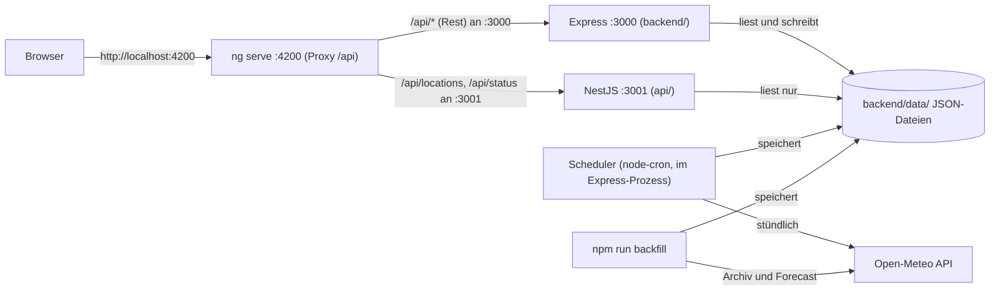

# Projektdokumentation – Wetter-Dashboard Heubach

> Stand: 20.11.2026 · Roadmap-Schritt 2 (Basis `7b3c416`) · Pflege: siehe Abschnitt „11. Pflege dieser Datei“

Diese Datei ist eine Landkarte des **aktuellen** Systems: was es gibt, wo es liegt, wie es zusammenhängt. Sie enthält keinen Code und keine Planung (die steht in `docs/umbau/`).

---

## 1. Überblick

Lokales Wetter-Dashboard für Heubach (Ostalbkreis, 48,7936 °N, 9,9369 °O). Ein Express-Backend ruft stündlich Daten von Open-Meteo ab und legt sie als JSON-Dateien ab. Ein Angular-Frontend zeigt Tag, Monat, Jahr und Rekorde.

Parallelbetrieb (Strangler-Muster): Neben Express entsteht in `api/` ein NestJS-Backend. Es liest die JSON-Dateien von Express **nur lesend** und liefert die ersten Ressourcen der neuen API. Express bleibt der einzige Schreiber. Der Dev-Proxy verteilt die Anfragen je Ressource (siehe 4.6).



---

## 2. Ordnerstruktur

| Ordner / Datei | Zweck |
|---|---|
| `README.md` | Kurzbeschreibung und Startanleitung für Menschen |
| `.gitignore` | schließt `node_modules/`, `backend/dist/`, `frontend/dist/`, `frontend/.angular/`, `backend/data/` und Logs aus |
| `backend/` | Express-Server, Scheduler, Datenablage (eigene `package.json`) |
| `backend/src/` | TypeScript-Quellen des Backends (Dateien siehe 3.1) |
| `backend/data/` | Laufzeitdaten, **nicht im Git**: Ordner `YYYY-MM/` mit Tagesdateien plus `forecast.json` (Stand: 23 Monatsordner und `forecast.json`) |
| `frontend/` | Angular-21-App (eigene `package.json`, Angular-CLI-Konfiguration, stylelint, Vitest) |
| `frontend/proxy.conf.json` | Dev-Proxy: `/api/locations` und `/api/status` an `http://localhost:3001` (Nest), Rest `/api` an `http://localhost:3000` (Express), siehe 4.6 |
| `frontend/vitest.config.mjs` | Vitest-Ergänzung (`maxWorkers: 2`) |
| `frontend/.stylelintrc.json` | stylelint-Regeln (u. a. `color-no-hex`), `tokens.css` ausgenommen |
| `frontend/src/main.ts`, `index.html` | Einstieg, `lang="de"`, Standardtitel „Wetter Heubach“ |
| `frontend/src/app/` | App-Shell (`app.ts`, `app.html`, `app.css`, `app.config.ts`, `app.routes.ts`) |
| `frontend/src/app/components/` | gemeinsame UI-Komponenten (siehe 4.3), je Ordner `.ts/.html/.css/.spec.ts` |
| `frontend/src/app/pages/` | vier Seiten, je ein Ordner (siehe 4.2) |
| `frontend/src/app/services/` | `weather.service.ts` (HTTP zum Backend) |
| `frontend/src/app/models/` | Typen: `weather.ts` (Express), `api.ts` (neue API), `load-state.ts` |
| `frontend/src/app/pipes/` | `unit.pipe.ts` |
| `frontend/src/app/utils/` | Datum, Titel, Parameterprüfung, Wettersymbole |
| `frontend/src/app/config/` | `data-range.ts` (Datenbeginn) |
| `frontend/src/styles/` | `tokens.css` (Design-Tokens, Schriften, `.surface-dark`) |
| `frontend/src/styles.css` | globale Klassen: Buttons, Seitenlayout, Raster, `.kicker`, `.visually-hidden` |
| `frontend/public/assets/fonts/` | lokale Schriften (woff2) und Lizenz `OFL.txt` |
| `api/` | NestJS-11-Backend (eigene `package.json`, `nest-cli.json`, `tsconfig.json` strict, `tsconfig.build.json`, `.gitignore` für `node_modules/`, `dist/`, `coverage/`), siehe Abschnitt 3a |
| `api/src/` | Quellen der Nest-API (Dateien siehe 3a.1) |
| `api/test/` | e2e-Tests (`app.e2e-spec.ts`, `jest-e2e.json`) |
| `api/test/characterization/` | Golden Files der Express-API (`golden/*.json`, `capture.sh`, `README.md`) |
| `docs/` | Dokumentation; diese Datei |
| `docs/umbau/` | Planung des Umbaus: `01`–`05` (siehe Abschnitt 9) |
| `docs/umbau/screenshots/` | Screenshots der Seiten (Ist-Stand, `nachher/` mit dem neuen Design) |

---

## 3. Backend (Express)

Node.js + TypeScript, Express 4, helmet, node-cron, axios. Port 3000, `PORT` über Umgebungsvariable änderbar.

### 3.1 Dateien und Aufgaben

| Datei (`backend/src/`) | Aufgabe |
|---|---|
| `server.ts` | Express-App, `helmet()`, `express.json()`, alle Endpunkte, startet den Scheduler, lauscht nur auf `127.0.0.1` |
| `scheduler.ts` | Stündlicher Abruf per node-cron; hält `lastFetch`, `lastStatus`, `lastError` im Speicher (`getSchedulerStatus`, `startScheduler`) |
| `weather-api.ts` | Open-Meteo-Aufrufe (`fetchDayData`, `fetchTodayData`, `fetchForecast`) und die Typen `HourlyEntry`, `DayData`, `DayForecast` |
| `data-store.ts` | Lesen und Schreiben der JSON-Dateien, Zusammenfassungen (`getMonthSummary`, `getYearSummary`), Rekorde (`getStats`), `countStoredDays` |
| `berlin-date.ts` | `berlinDate()`: heutiges Datum als `YYYY-MM-DD` in Europe/Berlin |
| `backfill.ts` | Skript: lädt historische Daten nach (siehe 3.5) |
| `seed-data.ts` | Skript: schreibt Testdaten für 01.–06.05.2026 (Warnung siehe 3.5) |

### 3.2 Endpunkte

Alle Endpunkte sind `GET`. Fehlerantworten haben die Form `{ "error": "<Text>" }`.

| Pfad | Antwort bei Erfolg | Fehlercodes |
|---|---|---|
| `/api/status` | `{ lastFetch, lastStatus ("ok"/"error"), lastError, storedDays }` | – |
| `/api/data/today` | `DayData` für den heutigen Berliner Tag (`{ date, location, hourly[] }`) | 404 keine Datei für heute |
| `/api/data/day/:date` | `DayData` für `YYYY-MM-DD` | 400 Format ungültig, 404 keine Datei |
| `/api/data/month/:year/:month` | `{ year, month, data: [{ day, avgTemp, totalPrecip }] }` (leeres `data`, wenn nichts da ist) | 400 wenn nicht `\d{4}` und `\d{2}` |
| `/api/data/year/:year` | `{ year, data: [{ month, avgTemp, totalPrecip }] }` (leeres `data` möglich) | 400 wenn nicht `\d{4}` |
| `/api/forecast` | Liste `[{ date, maxTemp, minTemp, precipitation, weathercode }]` (7 Tage ab heute) | 404 noch keine `forecast.json` |
| `/api/stats` | `{ hottestDay, coldestDay, rainiestDay, driestStreak, totalDays }`, Felder `null`, wenn keine Daten | – |

Hinweise: Der Monats-Parameter wird nur auf zwei Ziffern geprüft (kein Bereich 01–12). Alle Zusammenfassungen werden bei jeder Anfrage aus den Dateien berechnet (kein Cache). `/api/status` von Express ist über den Dev-Proxy nicht mehr erreichbar, weil der Proxy diesen Pfad an Nest gibt (4.6); direkt auf `127.0.0.1:3000` antwortet Express weiter.

### 3.3 Scheduler und Datenabruf

| Punkt | Wert |
|---|---|
| Zeitplan | sofort beim Start, dann `0 * * * *` (jede volle Stunde), Zeitzone `Europe/Berlin` |
| Ablauf je Lauf | `fetchTodayData()` und `fetchForecast()` parallel, dann `saveDayData` und `saveForecast`; Fehler werden nur geloggt und in `lastError` gemerkt |
| Tagesdaten | `https://api.open-meteo.com/v1/forecast` mit `hourly=temperature_2m, apparent_temperature, precipitation, weathercode, windspeed_10m, winddirection_10m`, `start_date = end_date = heute` |
| Vorhersage | derselbe Endpunkt mit `daily=temperature_2m_max, temperature_2m_min, precipitation_sum, weathercode`, `forecast_days=7` |
| Backfill | `https://archive-api.open-meteo.com/v1/archive` (ältere Tage) und Forecast-API mit `past_days` (letzte 10 Tage) |
| Zeit | alle Aufrufe mit `timezone=Europe/Berlin`; „heute“ bestimmt `berlinDate()` |

### 3.4 Datenablage

- Tagesdatei: `backend/data/YYYY-MM/YYYY-MM-DD.json`
- Vorhersage: `backend/data/forecast.json` (wird bei jedem Lauf überschrieben)
- Zeitstempel `time` sind Ortszeit **ohne Offset** (`2026-11-18T00:00`)
- Die Tagesdatei wird bei jedem Lauf komplett überschrieben

```json
{
  "date": "2026-11-18",
  "location": "Heubach",
  "hourly": [
    { "time": "2026-11-18T00:00", "temperature": 12.6, "apparentTemperature": 9.3,
      "precipitation": 0, "weathercode": 3, "windspeed": 15.6, "winddirection": 220 }
  ]
}
```

### 3.5 Skripte

| Befehl (in `backend/`) | Wirkung |
|---|---|
| `npm run dev` | `ts-node src/server.ts` (Server + Scheduler) |
| `npm run build` | `tsc` nach `backend/dist/` |
| `npm start` | `node dist/server.js` (nach `build`) |
| `npm run backfill` | lädt Daten ab 2025-01-01 bis heute nach; Startdatum optional: `npm run backfill -- 2024-06-01`; schreibt auch `forecast.json` und überschreibt vorhandene Tagesdateien dieser Tage |
| `src/seed-data.ts` | **Warnung:** nur von Hand mit `ts-node`, kein npm-Skript; schreibt 6 künstliche Tage (Mai 2026) und **überschreibt** dort vorhandene echte Dateien. Nicht auf echten Daten ausführen |

---

## 3a. Backend (NestJS, `api/`)

NestJS 11 auf Express 5 (`@nestjs/platform-express`), TypeScript strict, Jest. Stand Roadmap-Schritt 2: ein Modul (`AppModule`), Controller ohne Services, Daten aus den JSON-Dateien von Express (nur lesend, In-Memory). Lauscht nur auf `127.0.0.1`, globales Präfix `/api`.

### 3a.1 Dateien und Aufgaben

| Datei (`api/src/`) | Aufgabe |
|---|---|
| `main.ts` | Start: `setGlobalPrefix('api')`, `listen(PORT, '127.0.0.1')`, loggt Adresse und Datenordner |
| `app.module.ts` | einziges Modul: vier Controller, Provider `Clock` (= `SystemClock`), `LEGACY_DATA_DIR`, `LegacyFileSource` |
| `common/clock.ts` | `Clock` (abstrakt, zugleich DI-Token), `SystemClock`, `FixedClock` (Tests: `set`, `advance`) |
| `common/berlin-time.ts` | `BERLIN_TIMEZONE`, `localDate`, `localHour`, `hoursInDay` (23/24/25), `isIsoDate` |
| `legacy/legacy-data-dir.ts` | Token `LEGACY_DATA_DIR`, `resolveLegacyDataDir` (Umgebungsvariable oder Standard, relativ zum Arbeitsverzeichnis) |
| `legacy/legacy-types.ts` | Altformat der Dateien (`LegacyDayFileRaw`, `LegacyForecastRaw`) und normalisierte Typen (`LegacyHour`, `LegacyForecast`) |
| `legacy/legacy-file-source.ts` | `LegacyFileSource`: lädt beim Start alle Tagesdateien asynchron in eine `Map<date, hours[]>`; die Datei für heute (Berliner Datum über `Clock`) und `forecast.json` liest es bei jeder Anfrage neu. Werte `number \| null`, nicht gerundet |
| `locations/location.ts`, `locations.controller.ts` | Standort Heubach als Konstante (`id = 1`, `slug = "heubach"`) und Controller |
| `days/day.ts`, `days.controller.ts` | Typ `Day`/`DayHour` und Controller für `today` und `:date` |
| `forecasts/forecast.ts`, `forecasts.controller.ts` | Typ `Forecast`/`ForecastList` und Controller |
| `status/status.ts`, `status.controller.ts` | Typ `Status` und Controller |

Tests: je `*.spec.ts` neben der Quelle (`berlin-time`, `clock`, `legacy-data-dir`), dazu `api/test/app.e2e-spec.ts` (alle Endpunkte mit Fixture-Dateien im Temp-Ordner und `FixedClock`).

### 3a.2 Endpunkte

Alle `GET`, Antwort JSON. Fehler im Standardformat von Nest (`{ statusCode, message, error }`), das einheitliche Fehlerformat folgt in Roadmap-Schritt 5.

| Pfad | Antwort bei Erfolg | Fehlercodes |
|---|---|---|
| `/api/locations` | `{ items: [Location] }` mit genau Heubach | – |
| `/api/locations/:id` | `Location` (`id, slug, name, postalCode, region, latitude, longitude, timezone, isDefault`) | 400 `id` keine Zahl, 404 unbekannt |
| `/api/days/today` | `Day` für den Berliner Tag, Header `Content-Location: /api/days/<datum>` | 404 noch keine Datei für heute |
| `/api/days/:date` | `Day`: `id, date, locationId, timezone, isToday, hoursExpected, hours[]`; Stunde: `timeLocal` (Ortszeit **ohne** Offset aus dem Altbestand), `temperature, apparentTemperature, precipitation, weatherCode, windSpeed, windDirection` | 404 keine Daten (vorerst auch bei ungültigem Datum) |
| `/api/forecasts` | `{ items: [Forecast], fetchedAt }`; Eintrag: `locationId, date, maxTemp, minTemp, precipitationSum, weatherCode, fetchedAt`. `fetchedAt` = Änderungszeit von `forecast.json` | – (ohne Datei: `items = []`, `fetchedAt = null`) |
| `/api/status` | `{ locationId, today, timezone, dataFrom, dataTo, lastSuccessfulUpdateAt: null, updateState: "never" }`, ohne Fehlertext | – |

### 3a.3 Umgebungsvariablen (Übergang)

| Variable | Standard | Zweck |
|---|---|---|
| `PORT` | `3001` | Port; Host ist immer `127.0.0.1` |
| `LEGACY_DATA_DIR` | `../backend/data` | Ordner mit den Express-Dateien; relativ zum Arbeitsverzeichnis (bei npm-Skripten `api/`) |

### 3a.4 Skripte

| Befehl (in `api/`) | Wirkung |
|---|---|
| `npm start` | `nest start` (baut und startet) |
| `npm run start:dev` | `nest start --watch` |
| `npm run start:prod` | `node dist/main` (nach `build`) |
| `npm run build` | `nest build` nach `api/dist/` |
| `npm test` | Unit-Tests (Jest, `src/**/*.spec.ts`) |
| `npm run test:e2e` | e2e-Tests (`test/jest-e2e.json`, supertest) |

---

## 4. Frontend (Angular 21)

Standalone-Komponenten, Signals, `OnPush` bei den gemeinsamen Komponenten, Lazy Loading je Seite, Chart.js für das Diagramm, Locale `de-DE`. Alle Seiten laufen über `WeatherService` und den Pfad `/api`.

### 4.1 Routen

Quelle: `frontend/src/app/app.routes.ts`. Parameter gehen per `withComponentInputBinding()` als `input()` in die Seite. Der Titel kommt aus `page-title.ts` und erhält per `AppTitleStrategy` den Zusatz „ – Wetter Heubach“.

| Pfad | Seite | Parameter | Titel |
|---|---|---|---|
| `` (leer) | `TodayPageComponent` | – (heute, Berlin) | „<19. November 2026> – Heute“ |
| `tag/:date` | `TodayPageComponent` | `date` (`YYYY-MM-DD`) | wie oben für das Datum, bei ungültigem Datum „Ungültiges Datum“ |
| `monat` | `MonthlyPageComponent` | – (aktueller Monat) | „<November 2026> – Monat“ |
| `monat/:year/:month` | `MonthlyPageComponent` | `year`, `month` | wie oben, bei Fehler „Ungültiger Monat“ |
| `jahr` | `YearlyPageComponent` | – (aktuelles Jahr) | „<2026> – Jahr“ |
| `jahr/:year` | `YearlyPageComponent` | `year` | wie oben, bei Fehler „Ungültiges Jahr“ |
| `statistiken` | `StatsPageComponent` | – | „Rekorde“ |
| `**` | Weiterleitung auf `` | – | – |

### 4.2 Seiten

| Seite (`pages/…`) | Beschreibung |
|---|---|
| `today-page` (Heute und Tagesansicht) | Tagesverlauf mit Kennzahlen, Klimadiagramm und 7-Tage-Vorschau. Tag nur aus der URL (`date`-Input, `selectedDate`), Datumsfeld und Pfeile ‹ › navigieren per Router. Zustand `state: LoadState`, Signale `dayData`, `forecast`, `fieldError`, `dateStatus` (`valid`/`invalid`/`future`/`before-start`). Zukunft und ungültige Daten lösen keinen Request aus; die Vorhersage kommt aus `getForecast()`. Tipp-Eingaben im Datumsfeld werden verzögert übernommen (`KEYBOARD_COMMIT_DELAY_MS`) |
| `monthly-page` | Monatsdiagramm (Tagesmittel und Niederschlag) mit Kennzahlen. Auswahl Jahr und Monat aus der URL (`year`, `month`), zwei Selects navigieren per Router. `state: LoadState`, `monthData`, `dataPeriod` (Zeitraum der angezeigten Daten, damit die Achse beim Nachladen stabil bleibt). Volle Monatsachse, Tage ohne Daten als Lücke (`null`) |
| `yearly-page` | Jahresdiagramm (Monatsmittel und Niederschlag) mit Kennzahlen wärmster und kältester Monat. Auswahl Jahr aus der URL (`year`), ein Select. `state: LoadState`, `yearData`; volle Achse Jan–Dez mit Lücken |
| `stats-page` | Rekorde: fünf Kennzahl-Karten (heißester, kältester, regenreichster Tag, längste Trockenperiode, gespeicherte Messtage). Kein Router-Parameter. Eigene Signale `stats`, `loading`, `error` (kein `LoadState`), lädt in `ngOnInit`, kein Erneut-versuchen |

Alle Seiten setzen den Seitentitel per `setPageTitle` aus einem `effect`.

### 4.3 Gemeinsame Komponenten

Ordner `frontend/src/app/components/`. Alle Selektoren beginnen mit `app-`.

| Selektor | Inputs | Outputs / Inhalt | Zweck |
|---|---|---|---|
| `app-card` | `edge`, `busy`, `reveal`, `revealIndex` | Content Projection | Grundkarte mit Akzentkante, Ladebalken bei `busy`, gestaffeltes Einblenden |
| `app-kpi-card` | `kicker` (Pflicht), `value`, `unit`, `digits`, `meta`, `loading`, `busy`, `reveal`, `revealIndex` | Zusatzzeile per Projection | Kennzahl-Karte; Zahl wird hier deutsch formatiert, ohne Wert „–“ und „keine Daten“ |
| `app-chip` | `variant` (`status`/`forecast`) | Text per Projection | nicht klickbare Markierung, z. B. „Vorhersage“ |
| `app-notice` | `variant` (`info`/`error`/`forecast`), `kicker`, `announce` | Text per Projection | Hinweisbox mit Linie links; `announce` setzt `role="alert"` bzw. `status` |
| `app-form-field` | `label` und `fieldId` (Pflicht), `hint`, `error` | Feld per Projection | Label, Hilfetext, Fehlermeldung, setzt `aria-describedby` und `aria-invalid` am Feld |
| `app-data-table` | `caption`, `columns`, `rows` (Pflicht), `captionHidden`, `columnsNarrow`, `emptyText` | – (Zellen: Text, Zahl, Chip, Icon) | barrierefreie Tabelle; unter 48em optional anderer Spaltensatz |
| `app-climate-chart` | `data` (`ClimateChartDataset`), `title`, `caption`, `labelHeading`, `predictionFromIndex` | – | Chart.js-Diagramm (Temperatur Linie, Niederschlag Balken) mit Kernaussage, HTML-Legende und Wertetabelle in `<details>`; Vorhersageteil gestrichelt/schraffiert |
| `app-skeleton` | `width`, `height` | – | Platzhalter in Endgröße, `aria-hidden` |
| `app-loading` | `label` | Skelette per Projection | Ladezustand mit `aria-live="polite"`-Text |
| `app-empty` | `message` (Pflicht), `kicker`, `announce` | Link per Projection | Leerzustand als Hinweisbox |
| `app-error` | `message` (Pflicht), `details`, `retryable`, `retryLabel`, `announce` | Output `retry`; Projection | Fehlerbox mit Button „Erneut versuchen“ |

`loading`, `empty` und `error` liegen gemeinsam in `components/state/` (Datei `state.css` geteilt).

### 4.4 Services, Modelle, Pipes, Utils, Config

| Datei (`frontend/src/app/…`) | Exporte | Zweck |
|---|---|---|
| `services/weather.service.ts` | `WeatherService`: `getStatus`, `getLocation(id)` (neue API, 3a.2); `getToday`, `getDay`, `getMonth`, `getYear`, `getForecast`, `getStats` (Express, 3.2) | ein HTTP-Aufruf je Endpunkt, Basis `/api` |
| `models/weather.ts` | `HourlyEntry`, `DayData`, `MonthSummary`, `MonthResponse`, `YearSummary`, `YearResponse`, `DayForecast`, `StatsRecord`, `Stats` | Typen der Express-Antworten |
| `models/api.ts` | `Location`, `LocationList`, `UpdateState`, `Status`, `DayHour`, `Day`, `Forecast`, `ForecastList` | Typen der neuen API (3a.2), Messwerte `number \| null` |
| `models/load-state.ts` | `LoadState`, `LoadResult<T>` | Ladezustand `idle/loading/success/empty/error` |
| `pipes/unit.pipe.ts` | `UnitPipe` (`unit`), `UNIT_SEPARATOR` | Zahl in deutscher Schreibweise plus Einheit, fehlend = „–“ |
| `utils/berlin-date.ts` | `berlinToday`, `berlinHour`, `addDays`, `isValidIsoDate`, `formatDateLongDe`, `formatDateDe` | Datumsrechnung in Europe/Berlin |
| `utils/page-title.ts` | `SITE_TITLE`, `MONTH_LONG`, `viewTitle`, `fullTitle`, `longDateLabel`, `monthLabel`, `dayViewTitle`, `monthViewTitle`, `yearViewTitle`, `setPageTitle`, `AppTitleStrategy` | Seitentitel und Beschriftungen |
| `utils/route-params.ts` | `dayParamStatus`, `isValidYearParam`, `isValidMonthParam` | Prüfung der Route-Parameter |
| `utils/weather-icon.ts` | `getWeatherIcon`, `describeWeather`, `getWeatherDescription`, `getWindDirection` | WMO-Wettercode zu Symbol und Text, Windrichtung |
| `config/data-range.ts` | `DATA_START` (`2025-01-01`) | erster Tag mit Daten (Übergangslösung) |
| `app.config.ts` | `appConfig` | Router mit Input-Binding, HttpClient, Locale `de-DE`, `AppTitleStrategy` |
| `app.ts` | `App`, `footerData`, `FooterDataState` | Kopfzeile mit Navigation (Heute, Monat, Jahr, Rekorde), Skip-Link, Footer mit Datenquelle und Block Standort/Datenstand: „Wetterdaten für <Ort>“ (Name aus `getLocation(status.locationId)`) und „Daten vom TT.MM.JJJJ bis TT.MM.JJJJ“ (`dataFrom`–`dataTo` aus `getStatus`). Ein Request-Paar je App-Start. Beim Laden ein `app-skeleton` in der Zeitraum-Zeile; bei Fehler oder ohne Zeitraum nur der statische Text „Wetterdaten für Heubach“, die Zeile behält ihre Höhe |

### 4.5 Zustände und Datenfluss

1. Die Route liefert Parameter. `withComponentInputBinding()` setzt sie als `input()` der Seite.
2. Die Seite leitet daraus per `computed` die Auswahl ab (ohne Parameter: heute, aktueller Monat, aktuelles Jahr) und baut ein Anfrage-Objekt.
3. `toObservable(request)` mit `distinctUntilChanged` und `switchMap` löst genau einen Request je Wechsel aus; ein überholter Request wird abgebrochen.
4. Der Service-Aufruf wird in ein `LoadResult` übersetzt: `loading` (Start), `success`, `empty` (404 oder leere Liste), `error` (anderer Fehler); ungültige Parameter ergeben `idle` ohne Request.
5. Die Seite setzt `state`, `error` und die Daten. Bei `loading` bleiben alte Daten sichtbar (Karte `busy`), bei `empty` und `error` werden sie entfernt.
6. Die Vorlage zeigt je Zustand `app-loading`, `app-empty`, `app-error` oder den Inhalt. „Erneut versuchen“ erhöht einen Zähler und löst denselben Weg neu aus.

Die Auswahl steht ausschließlich in der URL; Select und Datumsfeld rufen `router.navigate` auf.

### 4.6 Dev-Proxy: Verteilung je Ressource

Quelle: `frontend/proxy.conf.json`. Der Dev-Server nimmt den **ersten** passenden Eintrag; der Fallback `/api` steht deshalb zuletzt. Gelistet werden nur Ressourcen, die das Frontend schon von Nest liest.

| Pfad-Präfix | Ziel | Backend |
|---|---|---|
| `/api/locations` | `http://localhost:3001` | Nest |
| `/api/status` | `http://localhost:3001` | Nest |
| `/api` (alles andere, z. B. `/api/data/*`, `/api/forecast`, `/api/stats`) | `http://localhost:3000` | Express |

`/api/days` und `/api/forecasts` von Nest sind direkt auf `127.0.0.1:3001` erreichbar, über den Proxy aber noch nicht (die Seiten werden erst später umgestellt).

---

## 5. Design-System

| Thema | Stand |
|---|---|
| Ort der Tokens | `frontend/src/styles/tokens.css` (einzige Datei mit festen Farb- und Schriftwerten), im Build vor `styles.css` eingebunden |
| Farben | `--color-bg`, `--color-surface`, `--color-text(-muted/-subtle)`, `--color-border`, `--color-accent(-bright/-strong)`, `--color-on-accent`, `--color-danger(-bg)`, `--color-success(-bg)`, `--color-notice(-line/-bg)`, `--color-skeleton`, `--color-border-control` |
| Dunkelwerte | `--dark-bg`, `--dark-surface-hover`, `--dark-text(-muted/-subtle)`, `--dark-accent(-hover/-active)`, `--dark-border` |
| Typografie | `--font-heading` (Space Grotesk), `--font-body` (Inter), Größen `--fs-xs` bis `--fs-xl`, Zeilenhöhen `--lh-*`, Gewichte `--fw-*`, `--tracking-*` |
| Abstände und Layout | `--space-1` bis `--space-7`, `--content-max`, `--page-margin`, `--gutter`, `--target-min` (Zielgröße) |
| Radien und Linien | `--radius`, `--radius-pill`, `--line`, `--line-strong`, `--edge-card`, `--edge-notice` |
| Fokus | `--color-focus`, `--focus-width`, `--focus-offset` |
| Bewegung | `--motion-duration`, `--motion-distance`, `--motion-stagger(-max)`, `--motion-ease`, `--motion-fast`; Klasse `.reveal`; bei `prefers-reduced-motion` ohne Animation |
| Diagramm | `--chart-temp`, `--chart-precip`, `--chart-compare`, `--chart-forecast-band`, `--chart-forecast-dash`, `--chart-grid`, `--chart-axis`, `--chart-now`, `--chart-tooltip-bg/-text`; das Diagramm liest sie zur Laufzeit |
| Dunkelbereich | Klasse `.surface-dark` setzt die Farb-Tokens auf die Dunkelwerte um; genutzt in Kopfzeile, Fußzeile und der Hero-Karte der Tagesansicht |
| Buttons | in `styles.css`: `.btn` mit `.btn-primary`, `.btn-secondary`, `.btn-text`, `.btn-icon`; Zustände `:disabled`, `[aria-disabled]`, `[aria-busy]` |
| Globale Klassen | `.kicker`, `.num`, `.visually-hidden`, `.page`, `.page-header`, `.page-title`, `.page-controls`, `.page-stack`, `.card-stack`, `.kpi-grid`, `.card-head` |
| Schriften | lokal in `frontend/public/assets/fonts/`: `inter-latin-wght-normal.woff2`, `space-grotesk-latin-wght-normal.woff2`, Lizenz SIL OFL in `OFL.txt`; eingebunden per `@font-face` in `tokens.css` (keine externen Schrift-Server) |
| Breakpoint | `48em` (768 px) für Tablet und größer |

Regeln:
- Farben, Schriften, Abstände und Radien in Komponenten **nur über Tokens**; keine festen Hex- oder rgb-Werte.
- stylelint (`npm run lint:css`) verbietet Hex-Farben (`color-no-hex`); `tokens.css` ist ausgenommen.
- Keine Schatten (`box-shadow`); Tiefe entsteht über Rand, Fläche und Kante.

---

## 6. Tests und Qualität

| Thema | Stand |
|---|---|
| Frontend-Tests | Vitest über den Angular-Builder `@angular/build:unit-test` (`ng test`), Umgebung jsdom |
| Befehl | `cd frontend && npm test -- --watch=false` |
| Worker | `vitest.config.mjs` setzt `maxWorkers: 2`. Auf der USB-Platte (FAT32) laufen sonst zu viele jsdom-Worker gleichzeitig an und brechen mit „Timeout waiting for worker to respond“ ab |
| Umfang | 19 Spec-Dateien (im Dateisystem gezählt), 210 Tests laut letztem bekannten Lauf; je Komponente, Seite, Service, Pipe und Util eine `*.spec.ts` neben der Quelle, dazu `app.spec.ts` |
| Erster Lauf | kann wegen der langsamen Platte (jsdom laden, ca. 130 s) mit dem Worker-Timeout abbrechen; erneut starten, danach ist der Cache warm |
| stylelint | `cd frontend && npm run lint:css` (Basis `stylelint-config-standard`, siehe `.stylelintrc.json`) |
| Backend Express | keine automatisierten Tests |
| Backend Nest (`api/`) | Jest + ts-jest: `cd api && npm test` (Unit: BerlinTime mit vier Tagen Zeitumstellung und Mitternacht MEZ/MESZ, Clock, Datenordner), `npm run test:e2e` (alle Endpunkte mit supertest, Fixture-Dateien im Temp-Ordner, `FixedClock`) |
| Golden Files | `api/test/characterization/golden/` (Antworten der Express-API vom 19.11.2026: `day-*`, `month-*`, `year-*`, `stats.json`). Zweck: Vergleichsstand für eine spätere neue API. Aufnehmen mit `bash api/test/characterization/capture.sh` bei laufendem Backend (`BASE` ändert die Adresse); das Skript **überschreibt** `golden/`. Bekannte Abweichungen und Hinweise stehen in `api/test/characterization/README.md` |
| axe-core | als devDependency im Frontend vorhanden, Prüfwerkzeug für Barrierefreiheit (z. B. im Browser oder in einem Skript); in den Specs ist es derzeit nicht eingebunden |

---

## 7. Starten, Bauen, Testen

| Aufgabe | Ordner | Befehl |
|---|---|---|
| Backend entwickeln (Server + Scheduler) | `backend/` | `npm run dev` |
| Backend bauen | `backend/` | `npm run build` |
| Backend aus dem Build starten | `backend/` | `npm start` |
| Historische Daten laden | `backend/` | `npm run backfill` oder `npm run backfill -- YYYY-MM-DD` |
| Nest-API starten (:3001, nur `127.0.0.1`) | `api/` | `npm start` oder `npm run start:dev` (Watch); Port/Datenordner über `PORT`, `LEGACY_DATA_DIR` |
| Nest-API bauen / aus dem Build starten | `api/` | `npm run build` / `npm run start:prod` |
| Nest-API testen | `api/` | `npm test` (Unit), `npm run test:e2e` |
| Frontend entwickeln (:4200, Proxy auf :3000 und :3001) | `frontend/` | `npm start` (= `ng serve`) |
| Frontend bauen | `frontend/` | `npm run build` (Ausgabe in `frontend/dist/`) |
| Frontend-Tests | `frontend/` | `npm test -- --watch=false` |
| CSS prüfen | `frontend/` | `npm run lint:css` |
| Golden Files neu aufnehmen | Repo-Wurzel | `bash api/test/characterization/capture.sh` (Backend muss laufen) |

Reihenfolge für die Entwicklung: zuerst Express (`:3000`) und Nest (`:3001`), dann Frontend (`:4200`). Der Browser spricht nur mit `:4200`; `/api` verteilt der Dev-Proxy je Ressource (4.6). Läuft Nest nicht, zeigt der Footer nur den statischen Standorttext; alle Seiten funktionieren weiter über Express. Nest braucht Express nicht, liest aber dessen Dateien: ohne laufenden Scheduler fehlt die Datei für heute (`/api/days/today` → 404).

---

## 8. Stolperfallen

| Thema | Hinweis |
|---|---|
| USB-Platte (FAT32) | Laufwerk D: ist langsam: Installationen, Builds und der erste Testlauf dauern lange; keine rekursiven Suchen über `node_modules`. Git meldet unter Umständen „dubious ownership“; dann das Repo einmalig als `safe.directory` eintragen |
| Windows: Kindprozesse | Nach dem Stoppen von `npm`/`ng`/`ts-node` bleiben oft Node-Kindprozesse zurück und belegen die Ports 3000/3001/4200. Von Hand beenden, z. B. mit `Get-CimInstance Win32_Process` (nach Name und Befehlszeile filtern) und `Stop-Process -Id <PID>` |
| Vitest-Worker-Timeout | siehe Abschnitt 6: Lauf wiederholen, `maxWorkers` nicht erhöhen |
| Express und Nest nur auf `127.0.0.1` | Beide Backends sind von außen nicht erreichbar. Zugriff im Betrieb nur über den Proxy von `ng serve` |
| Nest-Daten beim Start geladen | Nest liest alle Tagesdateien nur beim Start; neu gelesen werden nur die Datei für heute und `forecast.json`. Ändert ein Backfill ältere Tage, Nest neu starten |
| Zeitstempel ohne Offset | `time` ist Berliner Ortszeit ohne Offset. An Tagen mit Zeitumstellung (26.10.2025, 29.03.2026) hat die Datei 24 Einträge; das Thema ist in `docs/umbau/03-zielbild.md` (Befund Z1) beschrieben |
| Heutige Tagesdatei | Sie enthält 24 Stunden, auch die Stunden nach der aktuellen Uhrzeit: das sind **Vorhersagewerte**. Das Frontend trennt sie nur übergangsweise über die aktuelle Berliner Stunde (`chartPredictionFrom`). Monats-, Jahres- und Rekordwerte rechnen den laufenden Tag mit Vorhersagestunden mit |
| `seed-data.ts` | überschreibt echte Dateien im Mai 2026, siehe 3.5 |
| `backend/data/` | nicht im Git; nie löschen oder überschreiben, nur lesen |
| Nest-Cache der Altdaten | `LegacyFileSource` liest alle Tagesdateien nur beim Start; neu gelesen werden je Anfrage nur die Datei für heute und `forecast.json`. Ändert ein Backfill ältere Tage, liefert Nest den alten Stand bis zum Neustart (gilt bis Schritt 9) |

---

## 9. Weiterführende Dokumente

| Datei (`docs/umbau/`) | Inhalt |
|---|---|
| `01-analyse.md` | Ist-Analyse: Befunde, Fehlerliste F01–F34, Entscheidungen des Auftraggebers |
| `02-verbesserungen-und-design.md` | Verbesserungen V01–V35, neue Funktionen N01–N10, Design-System mit Kontrastwerten |
| `03-zielbild.md` | Zielarchitektur (NestJS, Datenbank, Sicherheit, Betrieb), Anforderungen und Akzeptanzkriterien |
| `04-roadmap.md` | Umsetzungsplan in Schritten 0.1 bis 14 mit „Fertig, wenn …“-Kriterien und Statusspalte |
| `05-pruefung.md` | Prüfung der Pläne 01–04 (Befunde P01–P37) |

Roadmap-Status (aus der Übersicht in `04-roadmap.md`):

| Schritt | Status |
|---|---|
| 0.1 Sicherheitsnetz | erledigt (`a4ec0b6`) |
| 0.2 Kritische und hohe Frontend-Fehler | erledigt (`76986a3`) |
| 0.3 Quick Wins | erledigt (`9e783e8`) |
| 0.4 URL-Zustand und Datumsfeld | erledigt (`f912292`) |
| 1 Design-Grundlage und Umstellung aller Seiten | erledigt (`79cc815` bis `2fcccd5`) |
| 2 bis 14 (NestJS `api/`, Datenbank, Login, Rollen, Zusatzfunktionen, Abnahme) | offen |

---

## 10. Änderungsprotokoll

Neueste oben.

| Datum | Schritt | Commit | Änderung |
|---|---|---|---|
| 2026-11-20 | 2 | `8cca517` | NestJS-Projekt `api/` mit Clock/BerlinTime, LegacyFileSource (nur lesend) und GET `/api/locations`, `/api/days/today`, `/api/days/:date`, `/api/forecasts`, `/api/status`; Proxy verteilt `/api/locations` und `/api/status` an :3001; Footer zeigt Ort und Datenzeitraum aus Nest |
| 2026-11-20 | Doku | `7b3c416` | `docs/PROJEKTDOKU.md` angelegt; Rollen-Dateien und Ablauf auf laufende Pflege der Doku umgestellt |
| 2026-11-20 | Doku | `33acb33` | Kopfzeilen der Status-Spalten in der Roadmap ergänzt |
| 2026-11-20 | Doku | `cd51458` | Status der erledigten Roadmap-Schritte und behobenen Fehler in 01 und 04 eingetragen |
| 2026-11-19 | 1 (Feinschliff) | `2fcccd5` | Feinschliff nach der Endprüfung: Diagramm, Datentabelle, Formularfeld, Heute-Seite |
| 2026-11-19 | 1d | `f8e9a7b` | Aliase aus `styles.css` entfernt, Vorschau-Tabelle schmal (`columnsNarrow`), Icon-Zellen in der Tabelle |
| 2026-11-19 | 1c | `4020359` | Seiten Heute, Monat, Jahr und Rekorde im neuen Design; Seiten-CSS auf gemeinsame Klassen umgestellt |
| 2026-11-19 | 1b | `ee8bb2f` | App-Shell (Kopf, Navigation, Skip-Link, Fuß), gemeinsame Komponenten, barrierefreies Klimadiagramm |
| 2026-11-19 | 1a | `79cc815` | Design-Tokens, lokale Schriften, stylelint, Farbwerte über Tokens |
| 2026-11-19 | 0.4 | `f912292` | Auswahl in der URL (`tag/:date`, `monat/:year/:month`, `jahr/:year`) und robustes Datumsfeld |
| 2026-11-19 | 0.3 | `9e783e8` | Quick Wins aus der Analyse (E1) |
| 2026-11-19 | 0.2 | `76986a3` | Kritische und hohe Frontend-Fehler behoben |
| 2026-11-19 | 0.1 | `a4ec0b6` | Sicherheitsnetz: Frontend-Tests (Vitest) und Golden Files der Alt-API |
| 2026-11-19 | Planung | `c01e54c` | Umbauplanung Phase 2 und 3 (Verbesserungen, Zielbild, Roadmap, Prüfung) |
| 2026-11-19 | Vorarbeit | `3b8603d` | Backfill historischer Wetterdaten, Fix des Vorhersage-Abrufs, Ist-Analyse |

Basis dieser Liste: `git log` seit `9e5583a` (Pfeil-Navigation und Zukunftsdaten-Sperrung in der Tagesansicht, 2026-05-07).

---

## 11. Pflege dieser Datei

1. Wer in einem Roadmap-Schritt Struktur, Routen, Komponenten, Endpunkte, Skripte oder Befehle ändert, aktualisiert die betroffenen Abschnitte **im selben Schritt**.
2. Der Prüfer kontrolliert die Übereinstimmung der Datei mit dem Code.
3. Der Architekt trägt beim Commit eine Zeile ins Änderungsprotokoll (Abschnitt 10) ein und aktualisiert „Stand“ im Kopf.
4. Keine Code-Kopien, keine Planungsinhalte; Planung gehört nach `docs/umbau/`.
