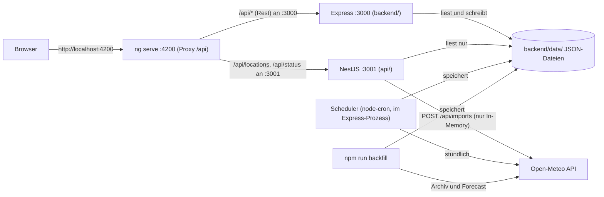

# Projektdokumentation – Wetter-Dashboard Heubach

> Stand: 20.11.2026 · Roadmap-Schritt 4 (`f2108f9`) · Pflege: siehe Abschnitt „11. Pflege dieser Datei“

Diese Datei ist eine Landkarte des **aktuellen** Systems: was es gibt, wo es liegt, wie es zusammenhängt. Sie enthält keinen Code und keine Planung (die steht in `docs/umbau/`).

---

## 1. Überblick

Lokales Wetter-Dashboard für Heubach (Ostalbkreis, 48,7936 °N, 9,9369 °O). Ein Express-Backend ruft stündlich Daten von Open-Meteo ab und legt sie als JSON-Dateien ab. Ein Angular-Frontend zeigt Tag, Monat, Jahr und Rekorde.

Parallelbetrieb (Strangler-Muster): Neben Express entsteht in `api/` ein NestJS-Backend. Es liest die JSON-Dateien von Express **nur lesend** und liefert die ersten Ressourcen der neuen API. Importe über `POST /api/imports` holt Nest selbst von Open-Meteo, hält sie aber **nur im Arbeitsspeicher**. Express bleibt der einzige Schreiber der Dateien. Der Dev-Proxy verteilt die Anfragen je Ressource (siehe 4.6).



---

## 2. Ordnerstruktur

| Ordner / Datei | Zweck |
|---|---|
| `README.md` | Kurzbeschreibung und Startanleitung für Menschen |
| `.gitignore` | schließt `node_modules/`, `backend/dist/`, `frontend/dist/`, `frontend/.angular/`, `backend/data/` und Logs aus |
| `backend/` | Express-Server, Scheduler, Datenablage (eigene `package.json`) |
| `backend/src/` | TypeScript-Quellen des Backends (Dateien siehe 3.1) |
| `backend/data/` | Laufzeitdaten, **nicht im Git**: Ordner `YYYY-MM/` mit Tagesdateien plus `forecast.json` (Stand: 23 Monatsordner und `forecast.json`) |
| `frontend/` | Angular-21-App (eigene `package.json`, Angular-CLI-Konfiguration, stylelint, Vitest) |
| `frontend/proxy.conf.json` | Dev-Proxy: `/api/locations` und `/api/status` an `http://localhost:3001` (Nest), Rest `/api` an `http://localhost:3000` (Express), siehe 4.6 |
| `frontend/vitest.config.mjs` | Vitest-Ergänzung (`maxWorkers: 2`) |
| `frontend/.stylelintrc.json` | stylelint-Regeln (u. a. `color-no-hex`), `tokens.css` ausgenommen |
| `frontend/src/main.ts`, `index.html` | Einstieg, `lang="de"`, Standardtitel „Wetter Heubach“ |
| `frontend/src/app/` | App-Shell (`app.ts`, `app.html`, `app.css`, `app.config.ts`, `app.routes.ts`) |
| `frontend/src/app/components/` | gemeinsame UI-Komponenten (siehe 4.3), je Ordner `.ts/.html/.css/.spec.ts` |
| `frontend/src/app/pages/` | vier Seiten, je ein Ordner (siehe 4.2) |
| `frontend/src/app/services/` | `weather.service.ts` (HTTP zum Backend) |
| `frontend/src/app/interceptors/` | `api-error.interceptor.ts` (Fehlerantworten → `ApiError`, siehe 4.4) |
| `frontend/src/app/models/` | Typen: `weather.ts` (Express), `api.ts` (neue API), `load-state.ts` |
| `frontend/src/app/pipes/` | `unit.pipe.ts` |
| `frontend/src/app/utils/` | Datum, Titel, Parameterprüfung, Wettersymbole, Server-Fehler an Formulare (`apply-server-errors.ts`) |
| `frontend/src/app/config/` | `data-range.ts` (Datenbeginn) |
| `frontend/src/styles/` | `tokens.css` (Design-Tokens, Schriften, `.surface-dark`) |
| `frontend/src/styles.css` | globale Klassen: Buttons, Seitenlayout, Raster, `.kicker`, `.visually-hidden` |
| `frontend/public/assets/fonts/` | lokale Schriften (woff2) und Lizenz `OFL.txt` |
| `api/` | NestJS-11-Backend (eigene `package.json`, `nest-cli.json`, `tsconfig.json` strict, `tsconfig.build.json`, `.gitignore` für `node_modules/`, `dist/`, `coverage/`), siehe Abschnitt 3a |
| `api/src/` | Quellen der Nest-API (Dateien siehe 3a.1); Eingabe-Schemas je Ressource in `dto/` (3a.7) |
| `api/test/` | e2e-Tests (`app.e2e-spec.ts`, `imports.e2e-spec.ts`, `errors.e2e-spec.ts`, `jest-e2e.json`) |
| `api/test/support/` | `fakes.ts`: Testhilfen für Unit- und e2e-Tests (Open-Meteo-Antworten, `fetch`-Ersatz, `FakeLegacySource`); `app.ts`: `createTestApp` (App wie `main.ts`); nicht im Build |
| `api/test/characterization/` | Golden Files der Express-API (`golden/*.json`, `capture.sh`, `README.md`) |
| `docs/` | Dokumentation; diese Datei |
| `docs/umbau/` | Planung des Umbaus: `01`–`05` (siehe Abschnitt 9) |
| `docs/umbau/screenshots/` | Screenshots der Seiten (Ist-Stand, `nachher/` mit dem neuen Design) |

---

## 3. Backend (Express)

Node.js + TypeScript, Express 4, helmet, node-cron, axios. Port 3000, `PORT` über Umgebungsvariable änderbar.

### 3.1 Dateien und Aufgaben

| Datei (`backend/src/`) | Aufgabe |
|---|---|
| `server.ts` | Express-App, `helmet()`, `express.json()`, alle Endpunkte, startet den Scheduler, lauscht nur auf `127.0.0.1` |
| `scheduler.ts` | Stündlicher Abruf per node-cron; hält `lastFetch`, `lastStatus`, `lastError` im Speicher (`getSchedulerStatus`, `startScheduler`) |
| `weather-api.ts` | Open-Meteo-Aufrufe (`fetchDayData`, `fetchTodayData`, `fetchForecast`) und die Typen `HourlyEntry`, `DayData`, `DayForecast` |
| `data-store.ts` | Lesen und Schreiben der JSON-Dateien, Zusammenfassungen (`getMonthSummary`, `getYearSummary`), Rekorde (`getStats`), `countStoredDays` |
| `berlin-date.ts` | `berlinDate()`: heutiges Datum als `YYYY-MM-DD` in Europe/Berlin |
| `backfill.ts` | Skript: lädt historische Daten nach (siehe 3.5) |
| `seed-data.ts` | Skript: schreibt Testdaten für 01.–06.05.2026 (Warnung siehe 3.5) |

### 3.2 Endpunkte

Alle Endpunkte sind `GET`. Fehlerantworten haben die Form `{ "error": "<Text>" }`.

| Pfad | Antwort bei Erfolg | Fehlercodes |
|---|---|---|
| `/api/status` | `{ lastFetch, lastStatus ("ok"/"error"), lastError, storedDays }` | – |
| `/api/data/today` | `DayData` für den heutigen Berliner Tag (`{ date, location, hourly[] }`) | 404 keine Datei für heute |
| `/api/data/day/:date` | `DayData` für `YYYY-MM-DD` | 400 Format ungültig, 404 keine Datei |
| `/api/data/month/:year/:month` | `{ year, month, data: [{ day, avgTemp, totalPrecip }] }` (leeres `data`, wenn nichts da ist) | 400 wenn nicht `\d{4}` und `\d{2}` |
| `/api/data/year/:year` | `{ year, data: [{ month, avgTemp, totalPrecip }] }` (leeres `data` möglich) | 400 wenn nicht `\d{4}` |
| `/api/forecast` | Liste `[{ date, maxTemp, minTemp, precipitation, weathercode }]` (7 Tage ab heute) | 404 noch keine `forecast.json` |
| `/api/stats` | `{ hottestDay, coldestDay, rainiestDay, driestStreak, totalDays }`, Felder `null`, wenn keine Daten | – |

Hinweise: Der Monats-Parameter wird nur auf zwei Ziffern geprüft (kein Bereich 01–12). Alle Zusammenfassungen werden bei jeder Anfrage aus den Dateien berechnet (kein Cache). `/api/status` von Express ist über den Dev-Proxy nicht mehr erreichbar, weil der Proxy diesen Pfad an Nest gibt (4.6); direkt auf `127.0.0.1:3000` antwortet Express weiter.

### 3.3 Scheduler und Datenabruf

| Punkt | Wert |
|---|---|
| Zeitplan | sofort beim Start, dann `0 * * * *` (jede volle Stunde), Zeitzone `Europe/Berlin` |
| Ablauf je Lauf | `fetchTodayData()` und `fetchForecast()` parallel, dann `saveDayData` und `saveForecast`; Fehler werden nur geloggt und in `lastError` gemerkt |
| Tagesdaten | `https://api.open-meteo.com/v1/forecast` mit `hourly=temperature_2m, apparent_temperature, precipitation, weathercode, windspeed_10m, winddirection_10m`, `start_date = end_date = heute` |
| Vorhersage | derselbe Endpunkt mit `daily=temperature_2m_max, temperature_2m_min, precipitation_sum, weathercode`, `forecast_days=7` |
| Backfill | `https://archive-api.open-meteo.com/v1/archive` (ältere Tage) und Forecast-API mit `past_days` (letzte 10 Tage) |
| Zeit | alle Aufrufe mit `timezone=Europe/Berlin`; „heute“ bestimmt `berlinDate()` |

### 3.4 Datenablage

- Tagesdatei: `backend/data/YYYY-MM/YYYY-MM-DD.json`
- Vorhersage: `backend/data/forecast.json` (wird bei jedem Lauf überschrieben)
- Zeitstempel `time` sind Ortszeit **ohne Offset** (`2026-11-18T00:00`)
- Die Tagesdatei wird bei jedem Lauf komplett überschrieben

```json
{
  "date": "2026-11-18",
  "location": "Heubach",
  "hourly": [
    { "time": "2026-11-18T00:00", "temperature": 12.6, "apparentTemperature": 9.3,
      "precipitation": 0, "weathercode": 3, "windspeed": 15.6, "winddirection": 220 }
  ]
}
```

### 3.5 Skripte

| Befehl (in `backend/`) | Wirkung |
|---|---|
| `npm run dev` | `ts-node src/server.ts` (Server + Scheduler) |
| `npm run build` | `tsc` nach `backend/dist/` |
| `npm start` | `node dist/server.js` (nach `build`) |
| `npm run backfill` | lädt Daten ab 2025-01-01 bis heute nach; Startdatum optional: `npm run backfill -- 2024-06-01`; schreibt auch `forecast.json` und überschreibt vorhandene Tagesdateien dieser Tage |
| `src/seed-data.ts` | **Warnung:** nur von Hand mit `ts-node`, kein npm-Skript; schreibt 6 künstliche Tage (Mai 2026) und **überschreibt** dort vorhandene echte Dateien. Nicht auf echten Daten ausführen |

---

## 3a. Backend (NestJS, `api/`)

NestJS 11 auf Express 5 (`@nestjs/platform-express`), TypeScript strict, Jest, Zod 4 (`zod` ^4.6.7) für Open-Meteo-Antworten und für jede Eingabe (Pfad, Query, Body; 3a.7). Stand Roadmap-Schritt 4: ein Modul (`AppModule`); Controller rufen nur Services auf, Services greifen über DI-Tokens auf Stores zu (3a.3). Die Stores liegen im Arbeitsspeicher und lesen den Altbestand aus den JSON-Dateien von Express (nur lesend). Lauscht nur auf `127.0.0.1`, globales Präfix `/api`.

### 3a.1 Dateien und Aufgaben

| Datei (`api/src/`) | Aufgabe |
|---|---|
| `main.ts` | Start: `NestFactory.create(AppModule, APP_OPTIONS)`, `configureApp`, `listen(PORT, '127.0.0.1')`, loggt Adresse und Datenordner |
| `app.setup.ts` | `APP_OPTIONS` (`bodyParser: false`) und `configureApp(app)` für `main.ts` **und** die e2e-Tests: Präfix `/api`, dann in dieser Reihenfolge `requestIdMiddleware`, `ContentNegotiationMiddleware` (406/415), JSON-Parser (`useBodyParser('json', { limit: '64kb', type: [application/json, application/merge-patch+json] })`), `bodyParserErrorMiddleware` (3a.8) |
| `app.module.ts` | einziges Modul: fünf Controller, die Services, die drei Stores (Tokens siehe 3a.3), `OpenMeteoClient`, `ImportRunner`, `Clock` (= `SystemClock`), `LEGACY_DATA_DIR`, `LegacyFileSource`, `APP_FILTER` = `ApiExceptionFilter` |
| `common/clock.ts` | `Clock` (abstrakt, zugleich DI-Token), `SystemClock`, `FixedClock` (Tests: `set`, `advance`) |
| `common/berlin-time.ts` | `BERLIN_TIMEZONE`, `localDate`, `localHour`, `localDateTime` (Ortszeit ohne Offset), `addDays`, `hoursInDay` (23/24/25), `isIsoDate` |
| `common/utc.ts` | `formatUtc`: Zeitpunkt als `YYYY-MM-DDTHH:MM:SSZ` (Zeitfelder der Import-Ressource, `lastSuccessfulUpdateAt`) |
| `common/api-error.ts` | Typen des Fehlerformats (B3.3): `ApiFieldError` (`field, code, message`), `ApiErrorPayload` (Inhalt einer Exception), `ApiErrorBody` (plus `path`, `timestamp`, `requestId`), `ApiErrorCode` (alle festen Codes aus B3.3, `API_ERROR_CODES`); `statusText`, `codeForStatus`, `defaultMessage` (deutsche Standardmeldung je Code), `isApiErrorPayload`, `formatDateDe`, `INTERNAL_ERROR_MESSAGE` |
| `common/api.exception.ts` | `ApiException(status, code, message, { errors?, details?, cause? })` für Fachfehler; Fabriken `notFound(message)`, `noData(date, dataFrom)` (R03), `importRunning(id)` (R19) |
| `common/api-exception.filter.ts` | `ApiExceptionFilter` (`@Catch()` für alles, `APP_FILTER`), `toErrorPayload` (Abbildung, 3a.8), `isUniqueViolation` |
| `common/content-negotiation.middleware.ts` | `ContentNegotiationMiddleware` (406/415), `acceptsJson`, `hasBody`, `contentNegotiationError` |
| `common/body-parser.ts` | `JSON_BODY_LIMIT` (`64kb`), `JSON_MEDIA_TYPES`, `bodyParserException` (Parser-Fehler → `ApiException`), `bodyParserErrorMiddleware` |
| `common/request-id.ts` | `REQUEST_ID_HEADER` (`X-Request-Id`), `newRequestId` (8 Hex-Zeichen), `requestIdOf(res)` (aus `res.locals`, sonst neu), `requestIdMiddleware` |
| `common/api-validation.exception.ts` | `ApiValidationException` (400, Body nach B3.3), `fromZod` (ein Eintrag je Feld, je unbekanntem Schlüssel ein eigener), `dateInFuture`; `assertNotInFuture` (R02, für Services) |
| `common/zod-validation.pipe.ts` | `ZodValidationPipe(schema)`: prüft Pfad, Query oder Body, gibt die geprüften Daten zurück, sonst `ApiValidationException.fromZod` (deutsche Zod-Meldungen als Rückfall) |
| `common/dto/iso-date.schema.ts`, `common/dto/id-param.schema.ts` | `IsoDateSchema` (R01), `IdParamSchema` (`:id` positive ganze Zahl → `number`) |
| `days/dto/date-param.schema.ts` | `DateParamSchema` (`{ date }`, R01) |
| `forecasts/dto/forecasts-query.schema.ts` | `ForecastsQuerySchema` (leer, `.strict()`, R22) |
| `imports/dto/import-create.schema.ts` | `ImportCreateSchema` (R18), `MAX_IMPORT_DAYS` = 1096 |
| `summaries/dto/year-month-param.schema.ts`, `year-param.schema.ts` | `YearMonthSchema`/`YearMonthParamSchema` (R04), `YearSchema`/`YearParamSchema` (R05, `FIRST_YEAR` = 1940); schon angelegt, die Endpunkte folgen in Schritt 8 |
| `legacy/legacy-data-dir.ts` | Token `LEGACY_DATA_DIR`, `resolveLegacyDataDir` (Umgebungsvariable oder Standard, relativ zum Arbeitsverzeichnis) |
| `legacy/legacy-types.ts` | Altformat der Dateien (`LegacyDayFileRaw`, `LegacyForecastRaw`) und normalisierte Typen (`LegacyHour`, `LegacyForecast`) |
| `legacy/legacy-file-source.ts` | `LegacyFileSource`: lädt beim Start alle Tagesdateien asynchron in eine `Map<date, hours[]>`; die Datei für heute (Berliner Datum über `Clock`) und `forecast.json` liest es bei jeder Anfrage neu. `getDayFile` liefert zusätzlich die Änderungszeit (`modifiedAt`, nur bei der heutigen Datei). Zeiten über `formatUtc`. Werte `number \| null`, nicht gerundet. Nur die In-Memory-Stores nutzen es |
| `observations/observation.ts` | Typen `ObservationValues`, `ObservationHour` (`timeLocal`, `timeUtc`; `null` im Altbestand), `ObservationInput` (UTC), `UpsertCounts`, `UpsertMode` |
| `observations/observation.store.ts`, `in-memory-observation.store.ts` | Schnittstelle `ObservationStore` (`getDay`, `getDataRange`, `upsertHours`) mit Token `OBSERVATION_STORE`; `InMemoryObservationStore` (Altbestand plus importierte Stunden, siehe 3a.4) |
| `forecasts/forecast.store.ts`, `in-memory-forecast.store.ts` | Schnittstelle `ForecastStore` (`getLatest`, `save`) mit Token `FORECAST_STORE`; `InMemoryForecastStore` (liefert die jüngere von `forecast.json` und importierter Vorhersage) |
| `forecasts/forecast.ts`, `forecasts.service.ts`, `forecasts.controller.ts` | Typ `Forecast`/`ForecastList`, `ForecastsService`, Controller |
| `days/day.ts`, `days.service.ts`, `days.controller.ts` | Typ `Day`/`DayHour`, `DaysService` (`today`, `findToday`, `findOne` mit Zukunftssperre R02 und `NO_DATA` mit `dataFrom` aus `getDataRange()`, R03), Controller für `today` und `:date` |
| `locations/location.ts`, `locations.service.ts`, `locations.controller.ts` | Standort Heubach als Konstante (`id = 1`, `slug = "heubach"`), `LocationsService` (unbekannte `id` → 404 `NOT_FOUND`), Controller |
| `status/status.ts`, `status.service.ts`, `status.controller.ts` | Typ `Status`/`UpdateState`, `StatusService` mit R25 (`updateStateOf`, Schwelle `UPDATE_DELAYED_AFTER_MS` = 2 h), Controller |
| `imports/import.ts` | Typen `ImportRecord`, `ImportResource` (B2.2, mit `links.self`), `ImportKind`, `ImportStatus`, `ImportCounts`; `toImportResource`, `importPath` |
| `imports/import.store.ts`, `in-memory-import.store.ts` | Schnittstelle `ImportStore` (`create`, `findById`, `update`, `findLastFinished`) mit Token `IMPORT_STORE` und `ImportAlreadyRunningError` (R19); `InMemoryImportStore` (IDs ab 1 nach jedem Start) |
| `imports/imports.service.ts` | `ImportsService`: `to` nach heute → 400 `DATE_IN_FUTURE` (R02), Auftrag `queued` anlegen, danach `ImportRunner.schedule`; 409 `IMPORT_RUNNING` mit `details.runningImportId` bei laufendem Import (R19); `findOne` mit 404 `NOT_FOUND` |
| `imports/import-plan.ts` | `planHourlyRequests`: Berliner Tage `from`–`to` → höchstens zwei Abfragen (Archiv für ältere Tage, Forecast-API für die letzten `RECENT_DAYS` = 10 Tage), jeweils einen UTC-Tag früher beginnend |
| `imports/import-runner.ts` | `ImportRunner`: Ablauf eines Imports (3a.4); `schedule` (per `setImmediate`), `run`, `whenIdle` (für Tests) |
| `imports/imports.controller.ts` | `POST /api/imports` (202, `Location`), `GET /api/imports/:id` |
| `weather-provider/open-meteo.schema.ts` | das **eine** Variablen-Mapping (`HOURLY_VARIABLES`, `DAILY_VARIABLES`, S7) und die Zod-Schemas `OpenMeteoResponseSchema` (Stundenwerte, `utc_offset_seconds = 0`) und `OpenMeteoDailyResponseSchema` (Tagesvorhersage, `utc_offset_seconds` ∈ {3600, 7200}) (R32) |
| `weather-provider/open-meteo.client.ts` | `OpenMeteoClient`: natives `fetch`, 15 s Zeitlimit je Versuch (`AbortSignal.timeout`), 2 Wiederholungen mit Backoff (1 s, 3 s) bei Netzfehler, Zeitüberschreitung, HTTP 5xx/429; `fetchHourly` (Archiv oder Forecast-API, `timezone=GMT`), `fetchDailyForecast` (7 Berliner Tage, `timezone=Europe/Berlin`). Fehler als `OpenMeteoError` mit `code` (`UPSTREAM_INVALID`, `UPSTREAM_TIMEOUT`, `UPSTREAM_ERROR`). Optionale Tokens `OPEN_METEO_FETCH`, `OPEN_METEO_RETRY_DELAYS_MS` für Tests |

Tests: je `*.spec.ts` neben der Quelle (`berlin-time`, `clock`, `legacy-data-dir`, `open-meteo.client`, `import-runner`, `import-plan`, `imports.service`, `in-memory-observation.store`, `in-memory-forecast.store`, `days.service` mit Fake-Store ohne Dateien, `status.service` mit den R25-Grenzen, `zod-validation.pipe`, `api-exception.filter` (Abbildung Status/Code, Body, Log bei 500), `content-negotiation.middleware`, je Schema unter `dto/` mit den Grenzfällen aus B1.3), dazu `api/test/app.e2e-spec.ts` (GET-Endpunkte mit Fixture-Dateien im Temp-Ordner und `FixedClock`, 400-Fälle), `api/test/imports.e2e-spec.ts` (Importe mit gemocktem `OpenMeteoClient`, kein Netzaufruf, 400-Fälle des Bodys, 409 `IMPORT_RUNNING`) und `api/test/errors.e2e-spec.ts` (Fehlerformat: `NO_DATA`, `DATE_IN_FUTURE`, 406, 415, 413, kaputtes JSON, JSON-404 für unbekannte Routen, 500 über einen per `overrideProvider` ersetzten Service). e2e-Apps entstehen über `test/support/app.ts` (`createTestApp`: `APP_OPTIONS` + `configureApp` wie `main.ts`).

### 3a.2 Endpunkte

Antwort nur JSON. **Jede** Fehlerantwort hat das Format aus B3.3 mit `path`, `timestamp` und `requestId` (3a.8); jede Antwort trägt den Header `X-Request-Id`. Für alle Endpunkte gelten zusätzlich: 406 `NOT_ACCEPTABLE` (`Accept` ohne JSON), 500 `INTERNAL_ERROR`; für `POST` außerdem 415 `UNSUPPORTED_MEDIA_TYPE`, 413 `PAYLOAD_TOO_LARGE` und 400 `VALIDATION_FAILED` bei kaputtem JSON. Unbekannte Pfade und Methoden → 404 `NOT_FOUND` als JSON. **Noch ohne Anmeldung** (Schritt 10/11): deshalb nur auf `127.0.0.1` und kein Deployment vor Schritt 11.

| Methode und Pfad | Antwort bei Erfolg | Fehlercodes |
|---|---|---|
| `GET /api/locations` | `{ items: [Location] }` mit genau Heubach | – |
| `GET /api/locations/:id` | `Location` (`id, slug, name, postalCode, region, latitude, longitude, timezone, isDefault`) | 400 `id` keine positive ganze Zahl (`field: "id"`), 404 `NOT_FOUND` unbekannt |
| `GET /api/days/today` | `Day` für den Berliner Tag, Header `Content-Location: /api/days/<datum>` | 404 `NO_DATA` (noch keine Stunde für heute, `details.dataFrom`), 406 bei `Accept: text/html` (US01-4) |
| `GET /api/days/:date` | `Day`: `id, date, locationId, timezone, isToday, hoursExpected, hours[]`; Stunde: `timeLocal` (Ortszeit **ohne** Offset), `temperature, apparentTemperature, precipitation, weatherCode, windSpeed, windDirection` | 400 `invalid_date` an `date` (Format oder kein Kalendertag, R01), 400 `DATE_IN_FUTURE` an `date` (nach dem Berliner Heute, R02), 404 `NO_DATA` für jeden Tag ohne Stunde, vor oder nach dem Datenbeginn (R03): `message` „Für den 31.12.2024 liegen keine Daten vor. Daten gibt es ab 01.01.2025.“, `details.dataFrom` = erster Tag laut Store (`null`, wenn es gar keine Daten gibt) |
| `GET /api/forecasts` | `{ items: [Forecast], fetchedAt }`; Eintrag: `locationId, date, maxTemp, minTemp, precipitationSum, weatherCode, fetchedAt`. `fetchedAt` (`YYYY-MM-DDTHH:MM:SSZ`) = Änderungszeit von `forecast.json` bzw. Abrufzeit des Imports; `date` ist ein Berliner Kalendertag | 400 `unrecognized_keys` je Query-Parameter, es gibt noch keinen (R22). Ohne Vorhersage: `items = []`, `fetchedAt = null` |
| `GET /api/status` | `{ locationId, today, timezone, dataFrom, dataTo, lastSuccessfulUpdateAt, updateState }`, ohne Fehlertext; `updateState` siehe 3a.4 | – |
| `POST /api/imports` | Body `{ kind: "range" \| "gaps", from, to, overwriteCorrections? }` (Berliner Daten `YYYY-MM-DD`; `overwriteCorrections` boolean, bis Schritt 12a ohne Wirkung, gespeichert wird `false`). **202**, Header `Location: /api/imports/<id>`, Body = Import-Ressource mit `status = "queued"` | 400 `VALIDATION_FAILED` (`ImportCreateSchema`, 3a.7), 400 `DATE_IN_FUTURE` an `to` (`to` nach heute), 400 `VALIDATION_FAILED` kaputtes JSON, 409 `IMPORT_RUNNING` (es läuft schon ein Import, `queued`/`running`) mit `details.runningImportId`, 413 `PAYLOAD_TOO_LARGE` (Body über 64 KB), 415 `UNSUPPORTED_MEDIA_TYPE` (Body nicht `application/json`) |
| `GET /api/imports/:id` | Import-Ressource (B2.2): `id, locationId, kind, status, from, to, overwriteCorrections (false), requestedBy (null), requestedAt, startedAt, finishedAt, counts { inserted, updated, unchanged, skippedCorrected (0) }, warnings[], error, links.self` | 400 `id` keine positive ganze Zahl (`field: "id"`), 404 `NOT_FOUND` unbekannt |

Die Liste `GET /api/imports` gibt es noch nicht; ein `DELETE` entfällt (begründet in der Roadmap, Schritt 3).

### 3a.3 Stores und DI-Tokens

| Token | Schnittstelle | Implementierung (Schritt 3) | Schritt 9 |
|---|---|---|---|
| `OBSERVATION_STORE` | `ObservationStore` | `InMemoryObservationStore` (liest über `LegacyFileSource`) | TypeORM, Tabelle `observation` |
| `FORECAST_STORE` | `ForecastStore` | `InMemoryForecastStore` (liest über `LegacyFileSource`) | TypeORM, Tabelle `daily_forecast` |
| `IMPORT_STORE` | `ImportStore` | `InMemoryImportStore` | TypeORM, Tabelle `import` |
| `Clock` (Klasse) | `Clock` | `SystemClock` | unverändert |

Services injizieren die Stores mit `@Inject(<TOKEN>)`; Tests ersetzen sie per `overrideProvider` oder übergeben Fakes direkt.

### 3a.4 Importe und Datenstand

- **Ablauf** (`ImportRunner`): `queued` → `running` → `succeeded` / `partial` / `failed`. Zuerst werden **alle** Stundenwerte abgefragt (`timezone=GMT`, Zuordnung der UTC-Zeitpunkte zu Berliner Tagen über BerlinTime), erst danach geschrieben. Ein Fehler dabei (z. B. R32-Verstoß → `error.code = "UPSTREAM_INVALID"`, Zeitüberschreitung → `UPSTREAM_TIMEOUT`) ergibt `failed`, und nichts wird geschrieben. Danach wird **getrennt** die Tagesvorhersage geholt: Scheitert nur sie, bleiben die Stunden gespeichert, der Import wird `partial` mit Warnung `FORECAST_FAILED` (US08-2, F01). Unerwartete Fehler → `failed` mit `INTERNAL_ERROR`, ohne Stacktrace.
- **Arten:** `range` legt neue Stunden an und überschreibt geänderte; `gaps` legt nur fehlende Stunden an (vorhandene zählen als `unchanged`).
- **Speicher:** Geschrieben wird nur in `InMemoryObservationStore` und `InMemoryForecastStore`, **nie** in Dateien. Nach einem Neustart sind Importe und importierte Werte weg.
- **Zusammenführung mit dem Altbestand:** Eine importierte Stunde ersetzt die Stunde des Altbestands mit derselben Ortszeit (`timeLocal`). Die zweite 02:00 am Ende der Sommerzeit kommt als zusätzliche Stunde hinzu. Vorrang:
  - ältere Tage: der Import;
  - **heute:** die neuere Quelle. Ist die Express-Datei (Änderungszeit) neuer als der letzte Schreibvorgang eines Imports für diesen Tag, gilt nur die Datei, und die importierten Stunden des Tages werden verworfen. Sonst gilt der Import. Der Schreibzeitpunkt liegt unmittelbar vor dem Abschluss des Imports (nur die Tagesvorhersage folgt noch);
  - Vorhersage: die jüngere (`fetchedAt`) von `forecast.json` und Import.
- **Zeitzonen:** Stundenwerte werden mit `timezone=GMT` abgefragt (`utc_offset_seconds = 0`, R32) und über BerlinTime den Berliner Tagen zugeordnet. Die Tagesvorhersage wird mit `timezone=Europe/Berlin` abgefragt, weil Max/Min/Summe für **Berliner** Kalendertage gelten müssen (Fachregel „Tag = Kalendertag Europe/Berlin“ geht vor). Ihr `utc_offset_seconds` muss 3600 oder 7200 sein, sonst `UPSTREAM_INVALID` für den Vorhersageteil (→ `partial`).
- **Fehler- und Warncodes eines Imports:**

  | Code | Art | Bedeutung | Folge |
  |---|---|---|---|
  | `UPSTREAM_INVALID` | `error` (Stunden) bzw. in der Warnung | Antwort verletzt `OpenMeteoResponseSchema`/`OpenMeteoDailyResponseSchema` oder ist kein JSON (R32) | Stunden: `failed`, nichts geschrieben; Tagesvorhersage: `partial` |
  | `UPSTREAM_TIMEOUT` | `error` bzw. in der Warnung | keine Antwort innerhalb von 15 s, auch nach 2 Wiederholungen | wie oben |
  | `UPSTREAM_ERROR` | `error` bzw. in der Warnung | HTTP-Fehler (4xx sofort, 5xx/429 nach 2 Wiederholungen) oder Netzwerkfehler | wie oben |
  | `INTERNAL_ERROR` | `error` | unerwarteter Fehler in Nest (z. B. im Store), Meldung ohne Stacktrace | `failed` |
  | `FORECAST_FAILED` | `warnings[]` | Tagesvorhersage nicht gespeichert; die Meldung nennt den Code der Ursache in Klammern | `partial`, Stunden gespeichert |
  | `INTERRUPTED` | `error` | Neustart während eines Laufs (R19) | noch nicht verwendet: Importe liegen nur im Arbeitsspeicher und sind nach einem Neustart weg (ab Schritt 9) |
- **`updateState`** (R25, `StatusService`): maßgeblich ist der zuletzt abgeschlossene Import mit `kind` ∈ `scheduled`/`range`/`gaps` und `status` ∈ `succeeded`/`partial`. Gibt es keinen → `never`, `lastSuccessfulUpdateAt = null`. Sonst `lastSuccessfulUpdateAt` = dessen `finishedAt`, `ok` bis einschließlich 2 h danach, darüber `delayed`. Da Express-Läufe keine Nest-Importe sind, zeigt Nest nach jedem Start `never`, bis ein Import über Nest gelaufen ist.

### 3a.5 Umgebungsvariablen (Übergang)

| Variable | Standard | Zweck |
|---|---|---|
| `PORT` | `3001` | Port; Host ist immer `127.0.0.1` |
| `LEGACY_DATA_DIR` | `../backend/data` | Ordner mit den Express-Dateien; relativ zum Arbeitsverzeichnis (bei npm-Skripten `api/`) |

### 3a.6 Skripte

| Befehl (in `api/`) | Wirkung |
|---|---|
| `npm start` | `nest start` (baut und startet) |
| `npm run start:dev` | `nest start --watch` |
| `npm run start:prod` | `node dist/main` (nach `build`) |
| `npm run build` | `nest build` nach `api/dist/` |
| `npm test` | Unit-Tests (Jest, `src/**/*.spec.ts`) |
| `npm run test:e2e` | e2e-Tests (`test/jest-e2e.json`, supertest) |

### 3a.7 Validierung (Zod)

- **Weg:** Jede Eingabe geht durch `new ZodValidationPipe(<Schema>)` am Parameter (`@Param()`, `@Query()`, `@Body()`). Das Schema prüft die Form; Regeln mit „heute“ (R02) prüft der Service über `Clock` und BerlinTime (`assertNotInFuture`), weil Zod keine festsetzbare Uhr kennt. Typen der DTOs nur über `z.infer` (keine eigenen Interfaces).
- **Schemas** (`*/dto/*.schema.ts`), alle Objekte `.strict()`:

  | Schema | Eingang | Regeln |
  |---|---|---|
  | `DateParamSchema` | `GET /api/days/:date` | `z.iso.date()` plus Rückrechnung (R01), Feldcode immer `invalid_date` |
  | `IdParamSchema` | `GET /api/locations/:id`, `GET /api/imports/:id` | `^[1-9]\d{0,9}$` → `number`; sonst `invalid_format` an `id` (ersetzt `ParseIntPipe`) |
  | `ForecastsQuerySchema` | Query von `GET /api/forecasts` | kein Parameter erlaubt (R22) |
  | `ImportCreateSchema` | Body von `POST /api/imports` | `kind` ∈ `range`/`gaps` (`invalid_value`), `from`/`to` wie R01, `to < from` → `to_before_from` an `to`, mehr als 1096 Tage (beide mitgezählt) → `range_too_long` an `to`, `overwriteCorrections` optional boolean (R18) |
  | `YearMonthParamSchema`, `YearParamSchema` | ab Schritt 8 (`/api/summaries/…`) | `YYYY-MM` mit Monat 01–12 (R04); `YYYY` ≥ 1940 → `number` (R05) |

- **400-Body** (Form aus B3.3; `path`, `timestamp`, `requestId` ergänzt der Filter, 3a.8):

  | Feld | Wert |
  |---|---|
  | `statusCode`, `error` | `400`, `"Bad Request"` |
  | `code` | `VALIDATION_FAILED` (Schema) oder `DATE_IN_FUTURE` (Service: `date` bei Tagen, `to` bei Importen) |
  | `message` | „Die Anfrage enthält ungültige Werte.“ bzw. bei `DATE_IN_FUTURE` die Meldung mit dem heutigen Datum |
  | `errors[]` | `{ field, code, message }`, ein Eintrag je Feld (erstes Problem gewinnt); bei `unrecognized_keys` je Schlüssel ein Eintrag mit `field` = Schlüssel; `field = null` für den ganzen Body (z. B. kein JSON-Objekt). `code`: Zod-Code oder `invalid_date`, `to_before_from`, `range_too_long`; bei `DATE_IN_FUTURE` `too_big` |
  | `details` | `null` |

- **Geänderte Fehlerfälle gegenüber Schritt 3:** ungültiges Datum bei `/api/days/:date` 404 → 400; Tag nach heute (bisher 404 mangels Daten) → 400 `DATE_IN_FUTURE`; `?…`-Parameter bei `/api/forecasts` bisher ignoriert → 400; `id` `0` oder negativ bei `/api/locations/:id` und `/api/imports/:id` 404 → 400; Import-Body jetzt vollständig geprüft (Zusatzfelder, Reihenfolge, Spanne, Zukunft).
- **Meldungen** sind deutsch: eigene Texte in den Schemas, sonst die deutsche Zod-Locale als Rückfall.

### 3a.8 Fehlerbehandlung (Filter, Middleware, Body-Limit)

- **Weg einer Anfrage** (B4.3, eingerichtet in `configureApp`): `requestIdMiddleware` → `ContentNegotiationMiddleware` → JSON-Parser (64 KB) → `bodyParserErrorMiddleware` → Nest (Guards ab Schritt 10, Pipes, Controller, Service). Jede Exception, auch aus Middleware und Router, landet im **einen** `ApiExceptionFilter` (`@Catch()`, `APP_FILTER`).
- **Body** (Reihenfolge der Schlüssel fest): `statusCode, error, code, message, errors (immer Array), path (ohne Query), timestamp (UTC ohne ms, über Clock und formatUtc), requestId, details (Objekt oder null)`.
- **`requestId`:** 8 Hex-Zeichen je Anfrage, auch als Header `X-Request-Id` bei **jeder** Antwort (auch 200). Eine vom Client gesendete ID wird nicht übernommen.
- **Abbildung** (`toErrorPayload`):

  | Herkunft | Status / `code` | `message` |
  |---|---|---|
  | `ApiException`, `ApiValidationException` | wie geworfen (`NO_DATA`, `NOT_FOUND`, `IMPORT_RUNNING`, `DATE_IN_FUTURE`, `VALIDATION_FAILED` …) | wie geworfen |
  | andere `HttpException` (Router-404, Nest-Pipes) | Status bleibt; `code` je Status: 400 `VALIDATION_FAILED`, 401 `UNAUTHENTICATED`, 403 `FORBIDDEN`, 404/405/410 `NOT_FOUND`, 406 `NOT_ACCEPTABLE`, 409 `CONFLICT`, 412 `PRECONDITION_FAILED`, 413 `PAYLOAD_TOO_LARGE`, 415 `UNSUPPORTED_MEDIA_TYPE`, 428 `PRECONDITION_REQUIRED`, 429 `TOO_MANY_REQUESTS`, 503 `SERVICE_UNAVAILABLE`, sonst 4xx `VALIDATION_FAILED`, 5xx `INTERNAL_ERROR` | deutsche Standardmeldung je Code (`defaultMessage`), nie der Text von Nest |
  | Body-Parser | zu groß → 413 `PAYLOAD_TOO_LARGE`; kaputtes JSON → 400 `VALIDATION_FAILED` (`errors = []`); Zeichensatz/Kodierung → 415 | „Der Body ist größer als 64 KB.“ / „Der Body ist kein gültiges JSON.“ |
  | Unique-Verletzung der DB (`SQLITE_CONSTRAINT_UNIQUE`/`_PRIMARYKEY`, auch als `driverError`) | 409 `CONFLICT` | Standardmeldung |
  | alles andere | 500 `INTERNAL_ERROR` | „Interner Fehler“ |

  Bei Status 500 stehen immer nur „Interner Fehler“, `errors = []` und `details = null` im Body; Fehlertext und Stacktrace gehen mit `[requestId]`, Methode und Pfad ins Log (`Logger` `ApiExceptionFilter`).
- **406/415** (`ContentNegotiationMiddleware`): `Accept` fehlt oder leer → erlaubt; sonst muss ein Eintrag mit q > 0 `application/json`, `application/*` oder `*/*` sein, sonst 406. `POST` mit Body (`Content-Length` > 0 oder `Transfer-Encoding`) muss `application/json` sein, `PATCH` `application/merge-patch+json` (Parameter wie `charset` erlaubt), sonst 415. `POST` ohne Body läuft weiter zur Pipe (400).
- **Fachfehler:** `NO_DATA` (R03, `DaysService`), `NOT_FOUND` (`LocationsService`, `ImportsService`), `IMPORT_RUNNING` (R19), `DATE_IN_FUTURE` (R02). Neue Fachfehler werfen `ApiException`, nie Nest-Standardexceptions mit losen Feldern.
- **Geänderte Fehlerfälle gegenüber Schritt 4:** 404 haben `code` `NO_DATA` bzw. `NOT_FOUND`; 409 hat `code = "IMPORT_RUNNING"` und `details.runningImportId` statt `runningImportId` oben; kaputtes JSON 400 ohne Parser-Text; neu 406, 413 (bisher Nest-Standard 100 KB) und 415; unbekannte Routen JSON nach B3.3.

---

## 4. Frontend (Angular 21)

Standalone-Komponenten, Signals, `OnPush` bei den gemeinsamen Komponenten, Lazy Loading je Seite, Chart.js für das Diagramm, Locale `de-DE`. Alle Seiten laufen über `WeatherService` und den Pfad `/api`.

### 4.1 Routen

Quelle: `frontend/src/app/app.routes.ts`. Parameter gehen per `withComponentInputBinding()` als `input()` in die Seite. Der Titel kommt aus `page-title.ts` und erhält per `AppTitleStrategy` den Zusatz „ – Wetter Heubach“.

| Pfad | Seite | Parameter | Titel |
|---|---|---|---|
| `` (leer) | `TodayPageComponent` | – (heute, Berlin) | „<19. November 2026> – Heute“ |
| `tag/:date` | `TodayPageComponent` | `date` (`YYYY-MM-DD`) | wie oben für das Datum, bei ungültigem Datum „Ungültiges Datum“ |
| `monat` | `MonthlyPageComponent` | – (aktueller Monat) | „<November 2026> – Monat“ |
| `monat/:year/:month` | `MonthlyPageComponent` | `year`, `month` | wie oben, bei Fehler „Ungültiger Monat“ |
| `jahr` | `YearlyPageComponent` | – (aktuelles Jahr) | „<2026> – Jahr“ |
| `jahr/:year` | `YearlyPageComponent` | `year` | wie oben, bei Fehler „Ungültiges Jahr“ |
| `statistiken` | `StatsPageComponent` | – | „Rekorde“ |
| `**` | Weiterleitung auf `` | – | – |

### 4.2 Seiten

| Seite (`pages/…`) | Beschreibung |
|---|---|
| `today-page` (Heute und Tagesansicht) | Tagesverlauf mit Kennzahlen, Klimadiagramm und 7-Tage-Vorschau. Tag nur aus der URL (`date`-Input, `selectedDate`), Datumsfeld und Pfeile ‹ › navigieren per Router. Zustand `state: LoadState`, Signale `dayData`, `forecast`, `fieldError`, `dateStatus` (`valid`/`invalid`/`future`/`before-start`). Zukunft und ungültige Daten lösen keinen Request aus; die Vorhersage kommt aus `getForecast()`. Tipp-Eingaben im Datumsfeld werden verzögert übernommen (`KEYBOARD_COMMIT_DELAY_MS`) |
| `monthly-page` | Monatsdiagramm (Tagesmittel und Niederschlag) mit Kennzahlen. Auswahl Jahr und Monat aus der URL (`year`, `month`), zwei Selects navigieren per Router. `state: LoadState`, `monthData`, `dataPeriod` (Zeitraum der angezeigten Daten, damit die Achse beim Nachladen stabil bleibt). Volle Monatsachse, Tage ohne Daten als Lücke (`null`). Bei Fehler „Erneut versuchen“ (`retry()`, Zähler im Request) |
| `yearly-page` | Jahresdiagramm (Monatsmittel und Niederschlag) mit Kennzahlen wärmster und kältester Monat. Auswahl Jahr aus der URL (`year`), ein Select. `state: LoadState`, `yearData`; volle Achse Jan–Dez mit Lücken. Bei Fehler „Erneut versuchen“ (`retry()`, Zähler im Request) |
| `stats-page` | Rekorde: fünf Kennzahl-Karten (heißester, kältester, regenreichster Tag, längste Trockenperiode, gespeicherte Messtage). Kein Router-Parameter. Eigene Signale `stats`, `loading`, `error` (kein `LoadState`), lädt in `ngOnInit`, kein Erneut-versuchen |

Alle Seiten setzen den Seitentitel per `setPageTitle` aus einem `effect`.

### 4.3 Gemeinsame Komponenten

Ordner `frontend/src/app/components/`. Alle Selektoren beginnen mit `app-`.

| Selektor | Inputs | Outputs / Inhalt | Zweck |
|---|---|---|---|
| `app-card` | `edge`, `busy`, `reveal`, `revealIndex` | Content Projection | Grundkarte mit Akzentkante, Ladebalken bei `busy`, gestaffeltes Einblenden |
| `app-kpi-card` | `kicker` (Pflicht), `value`, `unit`, `digits`, `meta`, `loading`, `busy`, `reveal`, `revealIndex` | Zusatzzeile per Projection | Kennzahl-Karte; Zahl wird hier deutsch formatiert, ohne Wert „–“ und „keine Daten“ |
| `app-chip` | `variant` (`status`/`forecast`) | Text per Projection | nicht klickbare Markierung, z. B. „Vorhersage“ |
| `app-notice` | `variant` (`info`/`error`/`forecast`), `kicker`, `announce` | Text per Projection | Hinweisbox mit Linie links; `announce` setzt `role="alert"` bzw. `status` |
| `app-form-field` | `label` und `fieldId` (Pflicht), `hint`, `error`, `control` (`AbstractControl`) | Feld per Projection | Label, Hilfetext, Fehlermeldung, setzt `aria-describedby` und `aria-invalid` am Feld. Mit `control` zeigt es auch dessen Server-Fehler (`errors.server`, gesetzt von `applyServerErrors`) im Fehlerstil E3.7.3; `error` hat Vorrang. Ändert sich der Wert, entfällt der Server-Fehler. `control` ist noch an keiner Seite gesetzt (Schritt 7/11) |
| `app-data-table` | `caption`, `columns`, `rows` (Pflicht), `captionHidden`, `columnsNarrow`, `emptyText` | – (Zellen: Text, Zahl, Chip, Icon) | barrierefreie Tabelle; unter 48em optional anderer Spaltensatz |
| `app-climate-chart` | `data` (`ClimateChartDataset`), `title`, `caption`, `labelHeading`, `predictionFromIndex` | – | Chart.js-Diagramm (Temperatur Linie, Niederschlag Balken) mit Kernaussage, HTML-Legende und Wertetabelle in `<details>`; Vorhersageteil gestrichelt/schraffiert |
| `app-skeleton` | `width`, `height` | – | Platzhalter in Endgröße, `aria-hidden` |
| `app-loading` | `label` | Skelette per Projection | Ladezustand mit `aria-live="polite"`-Text |
| `app-empty` | `message` (Pflicht), `kicker`, `announce` | Link per Projection | Leerzustand als Hinweisbox |
| `app-error` | `message` (`string \| null`, Vorrang), `apiError` (`ApiError \| null`), `details`, `retryable`, `retryLabel`, `announce` | Output `retry`; Projection | Fehlerbox mit Button „Erneut versuchen“. Text: `message`, sonst `apiError.message`, sonst „Fehler beim Laden.“. Bei `apiError.code = "NO_DATA"` mit gültigem `details.dataFrom` zusätzlich der Link „Zum Datenbeginn (TT.MM.JJJJ)“ auf `/tag/<dataFrom>`. Noch keine Seite übergibt `apiError` (die Seiten lesen bis Schritt 7/8 von Express) |

`loading`, `empty` und `error` liegen gemeinsam in `components/state/` (Datei `state.css` geteilt).

### 4.4 Services, Modelle, Pipes, Utils, Config

| Datei (`frontend/src/app/…`) | Exporte | Zweck |
|---|---|---|
| `services/weather.service.ts` | `WeatherService`: `getStatus`, `getLocation(id)` (neue API, 3a.2); `getToday`, `getDay`, `getMonth`, `getYear`, `getForecast`, `getStats` (Express, 3.2) | ein HTTP-Aufruf je Endpunkt, Basis `/api` |
| `models/weather.ts` | `HourlyEntry`, `DayData`, `MonthSummary`, `MonthResponse`, `YearSummary`, `YearResponse`, `DayForecast`, `StatsRecord`, `Stats` | Typen der Express-Antworten |
| `models/api.ts` | `Location`, `LocationList`, `UpdateState`, `Status`, `DayHour`, `Day`, `Forecast`, `ForecastList`, `ApiFieldError`, `ApiError` | Typen der neuen API (3a.2), Messwerte `number \| null`; Fehlerformat B3.3 (3a.8), `path`/`timestamp`/`requestId` optional (fehlen bei übersetzten Fehlern), `statusCode = 0` = keine Antwort |
| `interceptors/api-error.interceptor.ts` | `apiErrorInterceptor`, `ApiErrorResponse`, `toApiError`, `apiErrorOf`, `isApiErrorBody`, `codeForStatus` | Wandelt jede HTTP-Fehlerantwort in eine `ApiErrorResponse` um: eine `HttpErrorResponse` mit unverändertem `status`, `headers` und `error` (Body) plus `apiError` (`ApiError`). So unterscheiden die Seiten weiter nach `status` und Express-Text `error.error` (V20). Übersetzung: B3.3-Body unverändert; Express `{ error }` → `code` je Status, `message` = Text von Express; Status 0/502/503/504 → `SERVICE_UNAVAILABLE`, „Server nicht erreichbar.“; andere 5xx ohne B3.3 → `INTERNAL_ERROR`, „Interner Fehler“. `apiErrorOf(err)` liefert das `ApiError` auch ohne Interceptor (z. B. in Specs) |
| `models/load-state.ts` | `LoadState`, `LoadResult<T>` | Ladezustand `idle/loading/success/empty/error` |
| `pipes/unit.pipe.ts` | `UnitPipe` (`unit`), `UNIT_SEPARATOR` | Zahl in deutscher Schreibweise plus Einheit, fehlend = „–“ |
| `utils/apply-server-errors.ts` | `applyServerErrors(response, form)`, `isApiError`, `SERVER_ERROR_KEY` (`server`) | B5.2: setzt bei 400 mit `errors[]` je `field` (auch Punktpfad) `{ server: message }` am Control und markiert es als berührt; gibt die Fehler ohne passendes Control zurück (für eine Meldung oben im Formular). Andere Antworten: leere Liste, Formular unverändert |
| `utils/berlin-date.ts` | `berlinToday`, `berlinHour`, `addDays`, `isValidIsoDate`, `formatDateLongDe`, `formatDateDe` | Datumsrechnung in Europe/Berlin |
| `utils/page-title.ts` | `SITE_TITLE`, `MONTH_LONG`, `viewTitle`, `fullTitle`, `longDateLabel`, `monthLabel`, `dayViewTitle`, `monthViewTitle`, `yearViewTitle`, `setPageTitle`, `AppTitleStrategy` | Seitentitel und Beschriftungen |
| `utils/route-params.ts` | `dayParamStatus`, `isValidYearParam`, `isValidMonthParam` | Prüfung der Route-Parameter |
| `utils/weather-icon.ts` | `getWeatherIcon`, `describeWeather`, `getWeatherDescription`, `getWindDirection` | WMO-Wettercode zu Symbol und Text, Windrichtung |
| `config/data-range.ts` | `DATA_START` (`2025-01-01`) | erster Tag mit Daten (Übergangslösung) |
| `app.config.ts` | `appConfig` | Router mit Input-Binding, HttpClient mit `apiErrorInterceptor` (`withInterceptors`), Locale `de-DE`, `AppTitleStrategy` |
| `app.ts` | `App`, `footerData`, `FooterDataState` | Kopfzeile mit Navigation (Heute, Monat, Jahr, Rekorde), Skip-Link, Footer mit Datenquelle und Block Standort/Datenstand: „Wetterdaten für <Ort>“ (Name aus `getLocation(status.locationId)`) und „Daten vom TT.MM.JJJJ bis TT.MM.JJJJ“ (`dataFrom`–`dataTo` aus `getStatus`). Ein Request-Paar je App-Start. Beim Laden ein `app-skeleton` in der Zeitraum-Zeile; bei Fehler oder ohne Zeitraum nur der statische Text „Wetterdaten für Heubach“, die Zeile behält ihre Höhe |

### 4.5 Zustände und Datenfluss

1. Die Route liefert Parameter. `withComponentInputBinding()` setzt sie als `input()` der Seite.
2. Die Seite leitet daraus per `computed` die Auswahl ab (ohne Parameter: heute, aktueller Monat, aktuelles Jahr) und baut ein Anfrage-Objekt.
3. `toObservable(request)` mit `distinctUntilChanged` und `switchMap` löst genau einen Request je Wechsel aus; ein überholter Request wird abgebrochen.
4. Der Service-Aufruf wird in ein `LoadResult` übersetzt: `loading` (Start), `success`, `empty` (404 oder leere Liste), `error` (anderer Fehler); ungültige Parameter ergeben `idle` ohne Request.
5. Die Seite setzt `state`, `error` und die Daten. Bei `loading` bleiben alte Daten sichtbar (Karte `busy`), bei `empty` und `error` werden sie entfernt.
6. Die Vorlage zeigt je Zustand `app-loading`, `app-empty`, `app-error` oder den Inhalt. „Erneut versuchen“ erhöht einen Zähler und löst denselben Weg neu aus (Heute, Monat, Jahr; Rekorde noch ohne).
7. HTTP-Fehler laufen durch den `apiErrorInterceptor` (4.4): Die Seite bekommt eine `HttpErrorResponse` mit zusätzlichem `apiError`.

Die Auswahl steht ausschließlich in der URL; Select und Datumsfeld rufen `router.navigate` auf.

### 4.6 Dev-Proxy: Verteilung je Ressource

Quelle: `frontend/proxy.conf.json`. Der Dev-Server nimmt den **ersten** passenden Eintrag; der Fallback `/api` steht deshalb zuletzt. Gelistet werden nur Ressourcen, die das Frontend schon von Nest liest.

| Pfad-Präfix | Ziel | Backend |
|---|---|---|
| `/api/locations` | `http://localhost:3001` | Nest |
| `/api/status` | `http://localhost:3001` | Nest |
| `/api` (alles andere, z. B. `/api/data/*`, `/api/forecast`, `/api/stats`) | `http://localhost:3000` | Express |

`/api/days` und `/api/forecasts` von Nest sind direkt auf `127.0.0.1:3001` erreichbar, über den Proxy aber noch nicht (die Seiten werden erst später umgestellt). Fehlerantworten von Express (`{ error }`) und Proxy-Fehler (z. B. Ziel nicht gestartet) sind nicht B3.3; der `apiErrorInterceptor` übersetzt sie (4.4).

---

## 5. Design-System

| Thema | Stand |
|---|---|
| Ort der Tokens | `frontend/src/styles/tokens.css` (einzige Datei mit festen Farb- und Schriftwerten), im Build vor `styles.css` eingebunden |
| Farben | `--color-bg`, `--color-surface`, `--color-text(-muted/-subtle)`, `--color-border`, `--color-accent(-bright/-strong)`, `--color-on-accent`, `--color-danger(-bg)`, `--color-success(-bg)`, `--color-notice(-line/-bg)`, `--color-skeleton`, `--color-border-control` |
| Dunkelwerte | `--dark-bg`, `--dark-surface-hover`, `--dark-text(-muted/-subtle)`, `--dark-accent(-hover/-active)`, `--dark-border` |
| Typografie | `--font-heading` (Space Grotesk), `--font-body` (Inter), Größen `--fs-xs` bis `--fs-xl`, Zeilenhöhen `--lh-*`, Gewichte `--fw-*`, `--tracking-*` |
| Abstände und Layout | `--space-1` bis `--space-7`, `--content-max`, `--page-margin`, `--gutter`, `--target-min` (Zielgröße) |
| Radien und Linien | `--radius`, `--radius-pill`, `--line`, `--line-strong`, `--edge-card`, `--edge-notice` |
| Fokus | `--color-focus`, `--focus-width`, `--focus-offset` |
| Bewegung | `--motion-duration`, `--motion-distance`, `--motion-stagger(-max)`, `--motion-ease`, `--motion-fast`; Klasse `.reveal`; bei `prefers-reduced-motion` ohne Animation |
| Diagramm | `--chart-temp`, `--chart-precip`, `--chart-compare`, `--chart-forecast-band`, `--chart-forecast-dash`, `--chart-grid`, `--chart-axis`, `--chart-now`, `--chart-tooltip-bg/-text`; das Diagramm liest sie zur Laufzeit |
| Dunkelbereich | Klasse `.surface-dark` setzt die Farb-Tokens auf die Dunkelwerte um; genutzt in Kopfzeile, Fußzeile und der Hero-Karte der Tagesansicht |
| Buttons | in `styles.css`: `.btn` mit `.btn-primary`, `.btn-secondary`, `.btn-text`, `.btn-icon`; Zustände `:disabled`, `[aria-disabled]`, `[aria-busy]` |
| Globale Klassen | `.kicker`, `.num`, `.visually-hidden`, `.page`, `.page-header`, `.page-title`, `.page-controls`, `.page-stack`, `.card-stack`, `.kpi-grid`, `.card-head` |
| Schriften | lokal in `frontend/public/assets/fonts/`: `inter-latin-wght-normal.woff2`, `space-grotesk-latin-wght-normal.woff2`, Lizenz SIL OFL in `OFL.txt`; eingebunden per `@font-face` in `tokens.css` (keine externen Schrift-Server) |
| Breakpoint | `48em` (768 px) für Tablet und größer |

Regeln:
- Farben, Schriften, Abstände und Radien in Komponenten **nur über Tokens**; keine festen Hex- oder rgb-Werte.
- stylelint (`npm run lint:css`) verbietet Hex-Farben (`color-no-hex`); `tokens.css` ist ausgenommen.
- Keine Schatten (`box-shadow`); Tiefe entsteht über Rand, Fläche und Kante.

---

## 6. Tests und Qualität

| Thema | Stand |
|---|---|
| Frontend-Tests | Vitest über den Angular-Builder `@angular/build:unit-test` (`ng test`), Umgebung jsdom |
| Befehl | `cd frontend && npm test -- --watch=false` |
| Worker | `vitest.config.mjs` setzt `maxWorkers: 2`. Auf der USB-Platte (FAT32) laufen sonst zu viele jsdom-Worker gleichzeitig an und brechen mit „Timeout waiting for worker to respond“ ab |
| Umfang | 19 Spec-Dateien (im Dateisystem gezählt), 210 Tests laut letztem bekannten Lauf; je Komponente, Seite, Service, Pipe und Util eine `*.spec.ts` neben der Quelle, dazu `app.spec.ts` |
| Erster Lauf | kann wegen der langsamen Platte (jsdom laden, ca. 130 s) mit dem Worker-Timeout abbrechen; erneut starten, danach ist der Cache warm |
| stylelint | `cd frontend && npm run lint:css` (Basis `stylelint-config-standard`, siehe `.stylelintrc.json`) |
| Backend Express | keine automatisierten Tests |
| Backend Nest (`api/`) | Jest + ts-jest: `cd api && npm test` (Unit: BerlinTime mit vier Tagen Zeitumstellung und Mitternacht MEZ/MESZ, Clock, Datenordner, Open-Meteo-Client mit `fetch`-Ersatz und R32-Fällen, ImportRunner mit gemocktem Client und `FixedClock` (`partial`, `UPSTREAM_INVALID`), R19, R25-Grenzen, Stores, `DaysService` mit Fake-Store, `ApiExceptionFilter`, `ContentNegotiationMiddleware`), `npm run test:e2e` (GET-Endpunkte mit Fixture-Dateien im Temp-Ordner und `FixedClock`; Importe mit gemocktem `OpenMeteoClient`: 202 + `Location`, 409, 404; Fehlerformat B3.3 mit 404 `NO_DATA`, 406, 413, 415, JSON-404, 500 ohne Stacktrace). Kein Test ruft Open-Meteo wirklich auf; Testhilfen in `api/test/support/fakes.ts` |
| Golden Files | `api/test/characterization/golden/` (Antworten der Express-API vom 19.11.2026: `day-*`, `month-*`, `year-*`, `stats.json`). Zweck: Vergleichsstand für eine spätere neue API. Aufnehmen mit `bash api/test/characterization/capture.sh` bei laufendem Backend (`BASE` ändert die Adresse); das Skript **überschreibt** `golden/`. Bekannte Abweichungen und Hinweise stehen in `api/test/characterization/README.md` |
| axe-core | als devDependency im Frontend vorhanden, Prüfwerkzeug für Barrierefreiheit (z. B. im Browser oder in einem Skript); in den Specs ist es derzeit nicht eingebunden |

---

## 7. Starten, Bauen, Testen

| Aufgabe | Ordner | Befehl |
|---|---|---|
| Backend entwickeln (Server + Scheduler) | `backend/` | `npm run dev` |
| Backend bauen | `backend/` | `npm run build` |
| Backend aus dem Build starten | `backend/` | `npm start` |
| Historische Daten laden | `backend/` | `npm run backfill` oder `npm run backfill -- YYYY-MM-DD` |
| Nest-API starten (:3001, nur `127.0.0.1`) | `api/` | `npm start` oder `npm run start:dev` (Watch); Port/Datenordner über `PORT`, `LEGACY_DATA_DIR` |
| Nest-API bauen / aus dem Build starten | `api/` | `npm run build` / `npm run start:prod` |
| Nest-API testen | `api/` | `npm test` (Unit), `npm run test:e2e` |
| Frontend entwickeln (:4200, Proxy auf :3000 und :3001) | `frontend/` | `npm start` (= `ng serve`) |
| Frontend bauen | `frontend/` | `npm run build` (Ausgabe in `frontend/dist/`) |
| Frontend-Tests | `frontend/` | `npm test -- --watch=false` |
| CSS prüfen | `frontend/` | `npm run lint:css` |
| Golden Files neu aufnehmen | Repo-Wurzel | `bash api/test/characterization/capture.sh` (Backend muss laufen) |

Reihenfolge für die Entwicklung: zuerst Express (`:3000`) und Nest (`:3001`), dann Frontend (`:4200`). Der Browser spricht nur mit `:4200`; `/api` verteilt der Dev-Proxy je Ressource (4.6). Läuft Nest nicht, zeigt der Footer nur den statischen Standorttext; alle Seiten funktionieren weiter über Express. Nest braucht Express nicht, liest aber dessen Dateien: ohne laufenden Scheduler fehlt die Datei für heute (`/api/days/today` → 404).

---

## 8. Stolperfallen

| Thema | Hinweis |
|---|---|
| USB-Platte (FAT32) | Laufwerk D: ist langsam: Installationen, Builds und der erste Testlauf dauern lange; keine rekursiven Suchen über `node_modules`. Git meldet unter Umständen „dubious ownership“; dann das Repo einmalig als `safe.directory` eintragen |
| Windows: Kindprozesse | Nach dem Stoppen von `npm`/`ng`/`ts-node` bleiben oft Node-Kindprozesse zurück und belegen die Ports 3000/3001/4200. Von Hand beenden, z. B. mit `Get-CimInstance Win32_Process` (nach Name und Befehlszeile filtern) und `Stop-Process -Id <PID>` |
| Vitest-Worker-Timeout | siehe Abschnitt 6: Lauf wiederholen, `maxWorkers` nicht erhöhen |
| Express und Nest nur auf `127.0.0.1` | Beide Backends sind von außen nicht erreichbar. Zugriff im Betrieb nur über den Proxy von `ng serve` |
| Nest-Daten beim Start geladen | Nest liest alle Tagesdateien nur beim Start; neu gelesen werden nur die Datei für heute und `forecast.json`. Ändert ein Backfill ältere Tage, Nest neu starten |
| Zeitstempel ohne Offset | `time` ist Berliner Ortszeit ohne Offset. An Tagen mit Zeitumstellung (26.10.2025, 29.03.2026) hat die Datei 24 Einträge; das Thema ist in `docs/umbau/03-zielbild.md` (Befund Z1) beschrieben |
| Heutige Tagesdatei | Sie enthält 24 Stunden, auch die Stunden nach der aktuellen Uhrzeit: das sind **Vorhersagewerte**. Das Frontend trennt sie nur übergangsweise über die aktuelle Berliner Stunde (`chartPredictionFrom`). Monats-, Jahres- und Rekordwerte rechnen den laufenden Tag mit Vorhersagestunden mit |
| `seed-data.ts` | überschreibt echte Dateien im Mai 2026, siehe 3.5 |
| `backend/data/` | nicht im Git; nie löschen oder überschreiben, nur lesen |
| Nest-Cache der Altdaten | `LegacyFileSource` liest alle Tagesdateien nur beim Start; neu gelesen werden je Anfrage nur die Datei für heute und `forecast.json`. Ändert ein Backfill ältere Tage, liefert Nest den alten Stand bis zum Neustart (gilt bis Schritt 9) |
| Nest-Importe nur im Arbeitsspeicher | `POST /api/imports` ruft Open-Meteo wirklich auf, schreibt aber nur in den Arbeitsspeicher. Nach einem Neustart sind Importe, IDs (wieder ab 1) und importierte Werte weg, `updateState` ist wieder `never`. Für ältere Tage haben importierte Stunden Vorrang vor den Dateien; für heute gilt die neuere Quelle, sodass die stündlich neu geschriebene Datei von Express einen Import überholt (3a.4) |
| Stunden UTC, Tage Berlin | Stundenwerte fragt Nest mit `timezone=GMT` ab, die Tagesvorhersage mit `timezone=Europe/Berlin`. Wer eine weitere Open-Meteo-Abfrage ergänzt, muss entscheiden, welche Regel gilt, und das passende Schema (Offset 0 bzw. 3600/7200) verwenden |
| Offener schreibender Endpunkt | `POST /api/imports` hat noch keine Anmeldung (Schritt 10/11) und nur eine minimale Eingabeprüfung (Schritt 4: Reihenfolge, Zukunft, Höchstdauer). Deshalb nur auf `127.0.0.1` und nicht auf den Pi |
| Altbestand um eine Stunde versetzt (Z1) | Ein Import vom 01.–03.10.2026 meldet alle 72 Stunden als `updated`: Die Werte der Altdatei stehen eine Stunde zu früh (Wert von 01:00 MESZ unter `00:00`), passend zur Annahme „fester Offset +01:00“ aus Z1. Nach einem Import zeigen diese Tage in Nest die richtig zugeordneten Werte, alle anderen den Altbestand |

---

## 9. Weiterführende Dokumente

| Datei (`docs/umbau/`) | Inhalt |
|---|---|
| `01-analyse.md` | Ist-Analyse: Befunde, Fehlerliste F01–F34, Entscheidungen des Auftraggebers |
| `02-verbesserungen-und-design.md` | Verbesserungen V01–V35, neue Funktionen N01–N10, Design-System mit Kontrastwerten |
| `03-zielbild.md` | Zielarchitektur (NestJS, Datenbank, Sicherheit, Betrieb), Anforderungen und Akzeptanzkriterien |
| `04-roadmap.md` | Umsetzungsplan in Schritten 0.1 bis 14 mit „Fertig, wenn …“-Kriterien und Statusspalte |
| `05-pruefung.md` | Prüfung der Pläne 01–04 (Befunde P01–P37) |

Roadmap-Status (aus der Übersicht in `04-roadmap.md`):

| Schritt | Status |
|---|---|
| 0.1 Sicherheitsnetz | erledigt (`a4ec0b6`) |
| 0.2 Kritische und hohe Frontend-Fehler | erledigt (`76986a3`) |
| 0.3 Quick Wins | erledigt (`9e783e8`) |
| 0.4 URL-Zustand und Datumsfeld | erledigt (`f912292`) |
| 1 Design-Grundlage und Umstellung aller Seiten | erledigt (`79cc815` bis `2fcccd5`) |
| 2 bis 14 (NestJS `api/`, Datenbank, Login, Rollen, Zusatzfunktionen, Abnahme) | offen |

---

## 10. Änderungsprotokoll

Neueste oben.

| Datum | Schritt | Commit | Änderung |
|---|---|---|---|
| 2026-11-20 | 4 | `f2108f9` | Zod-Validierung (Pipe, `ApiValidationException`, Schemas für Datum, Id, Forecasts-Query, Import-Body, Jahr/Monat), 400 mit `errors[]` je Feld, `DATE_IN_FUTURE` über die Clock; Frontend `applyServerErrors` und Serverfehler in `form-field` |
| 2026-11-20 | 3 | `0a2c7b9` | Services und DI-Stores (In-Memory), OpenMeteoClient mit Zod-Prüfung (Stunden GMT, Tage Europe/Berlin), `POST /api/imports` (202 + Location, partial, 409) und `GET /api/imports/:id`; `updateState` nach R25 |
| 2026-11-20 | 2 | `8cca517` | NestJS-Projekt `api/` mit Clock/BerlinTime, LegacyFileSource (nur lesend) und GET `/api/locations`, `/api/days/today`, `/api/days/:date`, `/api/forecasts`, `/api/status`; Proxy verteilt `/api/locations` und `/api/status` an :3001; Footer zeigt Ort und Datenzeitraum aus Nest |
| 2026-11-20 | Doku | `7b3c416` | `docs/PROJEKTDOKU.md` angelegt; Rollen-Dateien und Ablauf auf laufende Pflege der Doku umgestellt |
| 2026-11-20 | Doku | `33acb33` | Kopfzeilen der Status-Spalten in der Roadmap ergänzt |
| 2026-11-20 | Doku | `cd51458` | Status der erledigten Roadmap-Schritte und behobenen Fehler in 01 und 04 eingetragen |
| 2026-11-19 | 1 (Feinschliff) | `2fcccd5` | Feinschliff nach der Endprüfung: Diagramm, Datentabelle, Formularfeld, Heute-Seite |
| 2026-11-19 | 1d | `f8e9a7b` | Aliase aus `styles.css` entfernt, Vorschau-Tabelle schmal (`columnsNarrow`), Icon-Zellen in der Tabelle |
| 2026-11-19 | 1c | `4020359` | Seiten Heute, Monat, Jahr und Rekorde im neuen Design; Seiten-CSS auf gemeinsame Klassen umgestellt |
| 2026-11-19 | 1b | `ee8bb2f` | App-Shell (Kopf, Navigation, Skip-Link, Fuß), gemeinsame Komponenten, barrierefreies Klimadiagramm |
| 2026-11-19 | 1a | `79cc815` | Design-Tokens, lokale Schriften, stylelint, Farbwerte über Tokens |
| 2026-11-19 | 0.4 | `f912292` | Auswahl in der URL (`tag/:date`, `monat/:year/:month`, `jahr/:year`) und robustes Datumsfeld |
| 2026-11-19 | 0.3 | `9e783e8` | Quick Wins aus der Analyse (E1) |
| 2026-11-19 | 0.2 | `76986a3` | Kritische und hohe Frontend-Fehler behoben |
| 2026-11-19 | 0.1 | `a4ec0b6` | Sicherheitsnetz: Frontend-Tests (Vitest) und Golden Files der Alt-API |
| 2026-11-19 | Planung | `c01e54c` | Umbauplanung Phase 2 und 3 (Verbesserungen, Zielbild, Roadmap, Prüfung) |
| 2026-11-19 | Vorarbeit | `3b8603d` | Backfill historischer Wetterdaten, Fix des Vorhersage-Abrufs, Ist-Analyse |

Basis dieser Liste: `git log` seit `9e5583a` (Pfeil-Navigation und Zukunftsdaten-Sperrung in der Tagesansicht, 2026-05-07).

---

## 11. Pflege dieser Datei

1. Wer in einem Roadmap-Schritt Struktur, Routen, Komponenten, Endpunkte, Skripte oder Befehle ändert, aktualisiert die betroffenen Abschnitte **im selben Schritt**.
2. Der Prüfer kontrolliert die Übereinstimmung der Datei mit dem Code.
3. Der Architekt trägt beim Commit eine Zeile ins Änderungsprotokoll (Abschnitt 10) ein und aktualisiert „Stand“ im Kopf.
4. Keine Code-Kopien, keine Planungsinhalte; Planung gehört nach `docs/umbau/`.
