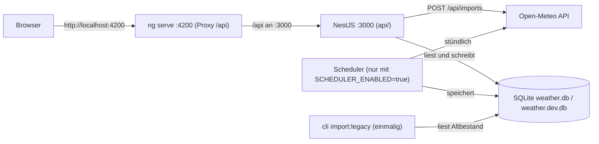

# Projektdokumentation – Wetter-Dashboard Heubach

> Stand: 22.11.2026 · Roadmap-Schritt 11 · Pflege: siehe Abschnitt „11. Pflege dieser Datei“

Diese Datei ist eine Landkarte des **aktuellen** Systems: was es gibt, wo es liegt, wie es zusammenhängt. Sie enthält keinen Code und keine Planung (die steht in `docs/umbau/`).

---

## 1. Überblick

Lokales Wetter-Dashboard für Heubach (Ostalbkreis, 48,7936 °N, 9,9369 °O). Ein NestJS-Backend (`api/`, Port 3000) ruft stündlich Daten von Open-Meteo ab (nur mit `SCHEDULER_ENABLED=true`), speichert sie in SQLite und liefert sie über eine REST-API. Ein Angular-Frontend zeigt Tag, Monat, Jahr und Rekorde. Der frühere Express-Server (`backend/src`) ist seit der Übergabe (Schritt 9c) entfernt; `backend/data/` ist nur noch Altbestand (siehe 3a.14). Der Dev-Proxy leitet `/api` an Nest (4.6).



---

## 2. Ordnerstruktur

| Ordner / Datei | Zweck |
|---|---|
| `README.md` | Kurzbeschreibung und Startanleitung für Menschen |
| `.gitignore` | schließt `node_modules/`, `backend/dist/`, `frontend/dist/`, `frontend/.angular/`, `backend/data/`, Datenbankdateien (`*.db*`, auch `-wal`, `-shm`, Sicherungen), `.env*` (außer `.env.example`) und Logs aus |
| `backend/` | nur noch Altbestand: `backend/data/` (**nicht im Git**: Ordner `YYYY-MM/` mit Tagesdateien plus `forecast.json`, Quelle für `cli import:legacy`; der User löscht es selbst), dazu vorerst `package.json`, `package-lock.json`, `tsconfig.json`, `node_modules`. `backend/src/` ist seit 9c gelöscht |
| `frontend/` | Angular-21-App (eigene `package.json`, Angular-CLI-Konfiguration, stylelint, Vitest) |
| `frontend/proxy.conf.json` | Dev-Proxy: `/api` an `http://localhost:3000` (Nest), siehe 4.6 |
| `frontend/vitest.config.mjs` | Vitest-Ergänzung (`maxWorkers: 2`) |
| `frontend/.stylelintrc.json` | stylelint-Regeln (u. a. `color-no-hex`), `tokens.css` ausgenommen |
| `frontend/src/main.ts`, `index.html` | Einstieg, `lang="de"`, Standardtitel „Wetter Heubach“ |
| `frontend/src/app/` | App-Shell (`app.ts`, `app.html`, `app.css`, `app.config.ts`, `app.routes.ts`) |
| `frontend/src/app/components/` | gemeinsame UI-Komponenten (siehe 4.3), je Ordner `.ts/.html/.css/.spec.ts` |
| `frontend/src/app/pages/` | vier Gastseiten, je ein Ordner, dazu `pages/admin/`: `login-page` (Schritt 10), `admin-layout` (Rahmen mit Unternavigation), `status-page`, `imports-page`, `import-detail-page`, `gaps-page`, `import-feedback` (Rückmeldung nach dem Start eines Imports) und `import-table.ts` (Spalten und Zeilen der Importtabelle), Schritt 11 (siehe 4.2, 4.8) |
| `frontend/src/app/services/` | `weather.service.ts` (HTTP zum Backend), `auth.service.ts` (Anmeldung, 4.7), `admin-api.service.ts` (Importe, Lücken, Health; 4.8) |
| `frontend/src/app/testing/` | `admin-fixtures.ts`: Testdaten der Admin-Specs (Import, Liste, Status, Lücke, Fehlerkörper); nur von `*.spec.ts` importiert, nicht im Bundle |
| `frontend/src/app/guards/` | `admin.guard.ts` (`/admin` nur angemeldet, 4.7) |
| `frontend/src/app/interceptors/` | `api-error.interceptor.ts` (Fehlerantworten → `ApiError`, siehe 4.4), `auth.interceptor.ts` (Bearer-Token, 401, 4.7) |
| `frontend/src/app/models/` | Typen: `api.ts` (neue API), `load-state.ts` |
| `frontend/src/app/pipes/` | `unit.pipe.ts` |
| `frontend/src/app/utils/` | Datum, Titel, Parameterprüfung, Jahresauswahl (`year-options.ts`), Wettersymbole, Server-Fehler an Formulare (`apply-server-errors.ts`), Rückkehrziel der Anmeldung (`return-url.ts`), Admin-Beschriftungen und -Formate (`admin-format.ts`), Prüfung Von/Bis (`date-range.ts`) |
| `frontend/src/app/config/` | `data-range.ts` (Datenbeginn) |
| `frontend/src/styles/` | `tokens.css` (Design-Tokens, Schriften, `.surface-dark`) |
| `frontend/src/styles.css` | globale Klassen: Buttons, Seitenlayout, Raster, `.kicker`, `.visually-hidden`, Admin-Formular, Blättern, Angabenliste (Schritt 11) |
| `frontend/public/assets/fonts/` | lokale Schriften (woff2) und Lizenz `OFL.txt` |
| `api/` | NestJS-11-Backend (eigene `package.json`, `nest-cli.json`, `tsconfig.json` strict, `tsconfig.build.json`, `.gitignore` für `node_modules/`, `dist/`, `coverage/`), siehe Abschnitt 3a. `api/.env.example` ist die eingecheckte Vorlage der Konfiguration; die echte `api/.env` ist nicht im Git (3a.5) |
| `api/src/` | Quellen der Nest-API (Dateien siehe 3a.1): je Modul ein Ordner mit `*.module.ts` (`common/`, `database/`, `auth/`, `users/`, `locations/`, `observations/`, `forecasts/`, `weather-provider/`, `imports/`, `scheduler/`, `stats/`, `status/`, `health/`; Module siehe 3a.0), dazu `days/`, `summaries/` und `records/` (gehören zum `StatsModule`); Eingabe-Schemas je Ressource in `dto/` (3a.7); `config/` (`EnvSchema`, `AppConfigModule`, `loadEnv`, 3a.5); ohne Modul: `openapi/` (Swagger-Einrichtung und Zod → OpenAPI, 3a.11), `fixtures/` (`loadFixture`), `legacy/` (Altdatenimport und DST-Stichprobe, 3a.13) und `cli.ts` (`npm run cli`) |
| `api/test/` | e2e-Tests (`app.e2e-spec.ts`, `imports.e2e-spec.ts`, `errors.e2e-spec.ts`, `stats.e2e-spec.ts`, `lists.e2e-spec.ts`, `openapi.e2e-spec.ts`, `database.e2e-spec.ts`, `auth.e2e-spec.ts`, `access.e2e-spec.ts` (Schritt 11), `corrections.e2e-spec.ts` (Schritt 12a), `jest-e2e.json`) |
| `api/test/support/` | Testhilfen, nicht im Build: `fakes.ts` (Open-Meteo-Antworten, `fetch`-Ersatz, `hourValues`), `app.ts` (`createTestApp`, App wie `main.ts`), `database.ts` (`openTestDatabase`, `insertImport`, `storedRow`), `seed.ts` (`seedApp`, `fixtureOf`, `dayObservations`: Fixtures per `applySeed`), `legacy-files.ts` (Altdateien schreiben, `copyLegacySubset`, `importLegacy`), `test-env.ts` (`NODE_ENV=test`, `DB_PATH=:memory:`, Test-`JWT_SECRET`, `SCHEDULER_ENABLED=false`, hohes `THROTTLE_GLOBAL_LIMIT`, keine `.env`; 3a.5), `config.ts` (`testConfig`, `withConfig`: `ConfigService` mit anderen Werten), `auth.ts` (`adminToken`, `authHeader`, `ResettableThrottlerStorage`), `password-scan.ts` und `no-password-leaks.ts` (jede e2e-Antwort ohne „password“, 3a.15), `routes.ts` (`registeredRoutes`), `route-access.ts` (`routeAccess`, `accessViolations`: jede Route genau `@Public` oder `@Roles`, 3a.16) |
| `api/test/fixtures/` | Fixtures für `npm run db:seed -- --fixture <name>` und die e2e-Tests (`us16-ok`, `us16-delayed`, `us20-frost`, `us06-records`, `us02-dst`, seit 12a `us06-corrected`; Inhalt in `README.md`), siehe 3a.10 |
| `api/test/characterization/` | Golden Files der Express-API (`golden/*.json`, `capture.sh`), Charakterisierungstest `characterization.e2e-spec.ts` mit der Liste `expected-differences.json`, `README.md` (Abbildung der Felder), siehe 3a.10 |
| `docs/` | Dokumentation; diese Datei |
| `docs/umbau/` | Planung des Umbaus: `01`–`05` (siehe Abschnitt 9) |
| `docs/umbau/screenshots/` | Screenshots der Seiten (Ist-Stand, `nachher/` mit dem neuen Design) |

---

## 3. Backend (Express, entfernt)

Der Express-Server (`backend/src/`) ist mit Schritt 9c gelöscht. Seine Aufgaben übernimmt Nest (Abschnitt 3a). Vom Altsystem bleibt nur das Dateiformat des Altbestands (`backend/data/YYYY-MM/YYYY-MM-DD.json`, `forecast.json`; `time` ohne Offset, Regel `fixed+01:00`), das `cli import:legacy` liest (3a.13). Die Antworten der alten API stehen als Golden Files unter `api/test/characterization/golden/` (6).

---

## 3a. Backend (NestJS, `api/`)

NestJS 11 auf Express 5 (`@nestjs/platform-express`), TypeScript strict, Jest, Zod 4 (`zod` ^4.6.7) für Open-Meteo-Antworten und für jede Eingabe (Pfad, Query, Body; 3a.7), `@nestjs/schedule` ^6.1.3 (nutzt `cron` 4.4.0) für den stündlichen Abruf, `@nestjs/swagger` ^11.4.8 für die OpenAPI-Doku (3a.11). Module je Ressource nach 03 B4.1 (3a.0); Controller rufen nur Services auf, Services greifen über DI-Tokens auf Stores zu (3a.3). Seit Roadmap-Schritt 7 liegen die Fachregeln R06–R14 im `AggregationService` (3a.9), Tage, Zusammenfassungen und Rekorde haben berechnete Felder. Seit Schritt 9a liegen alle Daten in **SQLite** (`better-sqlite3` ^12.11.1 über `typeorm` ^0.3.31 und `@nestjs/typeorm` ^11.0.3, 3a.12): Stundenwerte, Vorhersagen und Importe überleben einen Neustart. Die App liest keine JSON-Dateien; der Altbestand kam mit `npm run cli -- import:legacy --dir <pfad>` (Schritt 9b, 3a.13) in die Datenbank. Die Dev-DB enthält Seeds bzw. Fixtures; die Sammel-DB enthält seit der Übergabe (9c) den Altbestand (3a.14). Seit Schritt 10 gibt es eine Anmeldung für den Admin (3a.15): `@nestjs/jwt` ^11.0.2 (`jsonwebtoken` 9.0.3, HS256), `bcryptjs` ^3.0.3 (Kosten 12), `@nestjs/throttler` ^6.8.0; kein `passport`. Seit Schritt 11 (3a.5, 3a.16): Konfiguration über `@nestjs/config` ^4.0.4 (`EnvSchema`, `.env`), `RolesGuard` (ohne `@Public()`/`@Roles()` → 403), `helmet` ^8.3.0, globales Rate Limit, Log-Ereignisse. Seit Schritt 12a (3a.17): Korrekturen mit `ETag`/`If-Match`, Änderungsprotokoll, Übersicht und Rücknahme (N03), `nextScheduledUpdateAt` (N01) und Kennzahlen `daysWithData`/`daysComplete`/`gapCount` (N04) unter `/api/status`. Lauscht auf `HOST` (Standard `127.0.0.1`), globales Präfix `/api`.

### 3a.0 Module und Abhängigkeiten

`AppModule` importiert nur die Module und registriert `APP_FILTER` = `ApiExceptionFilter`; die globalen Guards (`APP_GUARD`) registriert das `AuthModule`. Ein Modul nutzt von einem anderen nur, was dieses unter `exports` freigibt (Nest bricht sonst beim Start ab); keine Zyklen, kein `forwardRef`, kein `@Global()`. Einzige Ausnahme ist die Konfiguration: `AppConfigModule` (`ConfigModule.forRoot({ isGlobal: true })`, 03 B4.8) stellt den `ConfigService` allen Modulen bereit.

| Modul (Datei) | Controller | Provider | `exports` | importiert |
|---|---|---|---|---|
| `AppConfigModule` (`config/app-config.module.ts`, `ConfigModule.forRoot`, **global**) | – | `ConfigService` mit den geprüften Werten aus `EnvSchema` (`validateEnv`, `skipProcessEnv`), 3a.5 | `ConfigService` | – (liest `.env` und Umgebung beim Laden) |
| `DatabaseModule` (`database/database.module.ts`) | – | `TypeOrmModule.forRootAsync` (Optionen aus `database-options.ts`, `retryAttempts: 0`); darin `DbPathModule` mit `DB_PATH` (`resolveDbPath(config.DB_PATH)`, 3a.5) | `DB_PATH` (über `DbPathModule`); `DataSource` und Repositories stellt `TypeOrmModule` global bereit | – |
| `CommonModule` (`common/common.module.ts`) | – | `Clock` (`SystemClock`, oder `FixedClock(FAKE_NOW)` über `clockFor(config.FAKE_NOW)`, 3a.5) | `Clock` | – |
| `UsersModule` (`users/users.module.ts`) | – (kein Endpunkt `/users`) | `UsersService` | `UsersService` | `TypeOrmModule.forFeature([User, Role, UserRole])` |
| `AuthModule` (`auth/auth.module.ts`) | `AuthController` | `AuthService`, `JWT_CONFIG`, **`APP_GUARD` = `AppThrottlerGuard`, dann `JwtAuthGuard`, dann `RolesGuard`** (in dieser Reihenfolge, 3a.15, 3a.16) | – | Common, Users, `JwtModule.registerAsync` (Optionen aus `JWT_SECRET`/`JWT_EXPIRES_IN` über den `ConfigService`), `ThrottlerModule.forRootAsync` (Throttler `global` mit `THROTTLE_GLOBAL_LIMIT` und `login`) |
| `LocationsModule` (`locations/locations.module.ts`) | `LocationsController` | `LocationsService` | `LocationsService` | – |
| `ObservationsModule` (`observations/observations.module.ts`) | `GapsController`, `ObservationsController`, `CorrectionsController` (Schritt 12a) | `GapsService`, `CorrectionsService`, `OBSERVATION_STORE` (`TypeOrmObservationStore`) | `OBSERVATION_STORE`, `GapsService` (R26 im `StatusModule`) | Common, `TypeOrmModule.forFeature([Observation])`; `CorrectionsService` nutzt die globale `DataSource` (Tabellen `observation`, `correction`) |
| `ForecastsModule` (`forecasts/forecasts.module.ts`) | `ForecastsController` | `ForecastsService`, `FORECAST_STORE` (`TypeOrmForecastStore`) | `FORECAST_STORE` | `TypeOrmModule.forFeature([DailyForecast])` |
| `WeatherProviderModule` (`weather-provider/weather-provider.module.ts`) | – | `OpenMeteoClient`, `OPEN_METEO_CONFIG` (Adressen und Zeitlimit aus `OPEN_METEO_*`) | `OpenMeteoClient` | – |
| `ImportsModule` (`imports/imports.module.ts`) | `ImportsController` | `ImportsService`, `ImportRunner`, `IMPORT_STORE` (`TypeOrmImportStore`) | `ImportsService`, `IMPORT_STORE` | Common, Observations, Forecasts, WeatherProvider, `TypeOrmModule.forFeature([Import])` |
| `SchedulerModule` (`scheduler/scheduler.module.ts`, `SchedulerModule.forRoot(enabled?)`) | – | `SCHEDULER_ENABLED` (aus dem `ConfigService`; mit Argument fest, für Tests), `SchedulerService` | – | Common, Imports, `ScheduleModule.forRoot()` **nur** bei `SCHEDULER_ENABLED=true` (über `ConditionalModule.registerWhen` von `@nestjs/config`) |
| `StatsModule` (`stats/stats.module.ts`) | `DaysController` (`days/`), `SummariesController` (`summaries/`), `RecordsController` (`records/`) | `AggregationService`, `RevisionCache`, `DaysService`, `SummariesService`, `RecordsService` | `AggregationService`, `RevisionCache` (seit 12a, für das `StatusModule`) | Common, Observations |
| `StatusModule` (`status/status.module.ts`) | `StatusController` | `StatusService` (nimmt die `SchedulerRegistry` optional, 3a.17) | – | Common, Observations, Imports, Stats (seit 12a: `daysComplete`, US17-1) |
| `HealthModule` (`health/health.module.ts`) | `HealthController` | `HealthService` (nutzt die globale `DataSource`) | – | – |

```
AppModule ─┬─ AppConfig (ConfigModule.forRoot, global: ConfigService; zuerst)
           ├─ Database (TypeORM, DB_PATH; global: DataSource)
           ├─ Common · Locations · WeatherProvider · Forecasts · Observations   (unten, kennen niemanden über sich)
           ├─ Auth ──► Users, Common          (Login, JWT; globale Guards per APP_GUARD, kein Fachmodul importiert Auth)
           ├─ Imports ──► Observations, Forecasts, WeatherProvider
           ├─ Scheduler ──► Imports
           ├─ Stats ──► Observations           (Lesemodelle: days, summaries, records)
           ├─ Status ──► Observations, Imports, Stats   (seit 12a; SchedulerRegistry global, nur mit Scheduler)
           └─ Health                            (nur DataSource)
```

- **Auth und Users (Schritt 10, 11):** `AuthModule` hängt nur von `UsersModule` (und der Uhr) ab. Die Dekoratoren `@Public()` und `@Roles()` liegen in `common/` (03 B4.1). Gast-Controller tragen `@Public()` am Controller; `ImportsController`, `GapsController` und `CorrectionsController` tragen `@Roles('admin')` am Controller, `GET /api/auth/me` am Handler (3a.16). `ObservationsController` (Schritt 12a) setzt die Dekoratoren je Handler: `GET /api/observations/:id` `@Public()`, PATCH, Historie und Rücknahme `@Roles('admin')`.
- **Imports ↔ Observations:** `ObservationsModule` importiert das `ImportsModule` nicht. Der Runner gibt die `importId` nur als Wert an `upsertHours` (Spalte `import_id`, 03 B4.1). Entities dürfen sich gegenseitig referenzieren (`observation.entity.ts` kennt `Import` für den Fremdschlüssel); das ist kein Modulimport.
- **Locations:** Die anderen Module nutzen Heubach weiter als TypeScript-Konstante `HEUBACH` (`locations/location.ts`, `id = 1`), nicht per DI; in der DB steht derselbe Standort als Stammdatum (Migration `Stammdaten`). Die Pfeile Observations/Forecasts/Imports/Stats → Locations aus B4.1 kommen mit dem Locations-Repository. Status → Stats gibt es seit Schritt 12a (`daysComplete`, US17-1).
- **Legacy und Fixtures:** `LegacyModule` und `FixturesModule` sind seit Schritt 9a entfernt; die App liest nur noch die Datenbank. Seit Schritt 9b sind auch `LegacyFileSource`, `legacy-data-dir`, die In-Memory-Stores für Stunden und Vorhersage und der Testpfad `useLegacyStores` gelöscht. `api/src/legacy/` enthält nur noch den Altdatenimport (kein Nest-Modul, aufgerufen von `cli.ts` und den Tests mit den Stores der App, 3a.13); `loadFixture` bleibt für `db:seed --fixture` und die e2e-Tests. `InMemoryImportStore` bleibt als Test-Fake (3a.3).
- **Stats:** B4.1 ordnet `days`, `summaries` und `records` dem `StatsModule` zu. Controller, Services und Mapper liegen in `days/`, `summaries/` und `records/`; `stats/` enthält das Modul, den `AggregationService` (Fachregeln, 3a.9) und den `RevisionCache` (3a.12).
- **Scheduler** (`scheduler/scheduler.service.ts`): `@Cron('0 5 * * * *', { name: 'scheduled-import', timeZone: 'Europe/Berlin' })` an `tick()`. Ein Lauf legt über `ImportsService.createScheduled(gestern, heute)` einen Import `kind = "scheduled"` an (Berliner Tage, US08; der Runner holt dazu die 7-Tage-Vorhersage). Läuft schon ein Import (`queued`/`running`, R19), wird der Lauf übersprungen: Warnung `Scheduler-Lauf übersprungen: Import <id> läuft noch (R19)`, kein zweiter Import, keine Exception. Andere Fehler werden geloggt, `tick()` wirft nie. `scheduled` bleibt über HTTP verboten (`ImportCreateSchema`). Beim Start loggt `SchedulerService` `Scheduler deaktiviert (SCHEDULER_ENABLED=false)` bzw. `Scheduler aktiv: 0 5 * * * * (Europe/Berlin) …`. Bei `false` wird `ScheduleModule` nicht geladen, also kein Cron-Job registriert, und `tick()` tut nichts.

### 3a.1 Dateien und Aufgaben

| Datei (`api/src/`) | Aufgabe |
|---|---|
| `main.ts` | Start: wartet zuerst auf `AppConfigModule` (`.env` und Umgebung, geprüft mit `EnvSchema` beim Laden von `app.module.ts`); bei Fehler `Start abgebrochen: Konfiguration ungültig (…): <Feld> …` im Log (nennt Felder, nie Werte), Exit-Code 1, kein Aufbau der App. Dann `NestFactory.create(AppModule, APP_OPTIONS)` (öffnet die DB; nicht lesbar → Abbruch mit `SqliteError`), `configureApp`, `listen(PORT, HOST)` aus dem `ConfigService`, loggt Adresse und `Datenbank: <DB_PATH>`. Andere Startfehler (z. B. ungültiges `TRUST_PROXY`) ebenfalls als `Start abgebrochen: …`, Exit-Code 1 |
| `app.setup.ts` | `APP_OPTIONS` (`bodyParser: false`) und `configureApp(app)` für `main.ts` **und** die e2e-Tests, Werte aus dem `ConfigService` der App: Präfix `/api`, `x-powered-by` aus, `trust proxy` aus `TRUST_PROXY`, dann in dieser Reihenfolge `securityHeadersMiddleware` (helmet, 3a.16), CORS nur bei `CORS_ORIGINS`, `requestIdMiddleware`, `cacheControlMiddleware` (B4.5), `ContentNegotiationMiddleware` (406/415), JSON-Parser (`useBodyParser('json', { limit: '64kb', type: [application/json, application/merge-patch+json] })`), `bodyParserErrorMiddleware` (3a.8), zuletzt nur bei `SWAGGER_ENABLED=true` `setupSwagger` (3a.11) |
| `common/cache-control.ts` | `cacheControlMiddleware`: für `GET`/`HEAD` unter `/api` `Cache-Control: no-cache`, für `/api/forecasts` und `/api/status` `max-age=60` (`cacheControlFor`, `SHORT_CACHE_PATHS`); Swagger-Pfade ausgenommen. Den schwachen `ETag` und 304 bei `If-None-Match` liefert Express selbst |
| `database/db-path.ts` | Token `DB_PATH`, `resolveDbPath(dbPath, cwd)` (absolut; relativ zum Arbeitsverzeichnis; `:memory:` bleibt; seit Schritt 11 kein Standard mehr, `DB_PATH` ist Pflicht), `MEMORY_DB` (`:memory:`), `isMemoryDatabase` |
| `database/prepare-database.ts` | `prepareDatabase(db)`: `journal_mode = WAL`, `foreign_keys = ON`, `busy_timeout = 5000`, `synchronous = NORMAL` (je Verbindung, vor TypeORM) |
| `database/database-options.ts` | `dataSourceOptions(dbPath)`: die **eine** Konfiguration für App und CLI (`better-sqlite3`, `ENTITIES` und `MIGRATIONS` als Klassen, `synchronize: false`, `migrationsRun` nur bei `:memory:`, `prepareDatabase`) |
| `database/data-source.ts` | Default-Export: Promise auf die `DataSource` für die TypeORM-CLI (`migration:*`, gebaut als `dist/database/data-source.js`); Werte über `loadEnv(DatabaseEnvSchema)` (`NODE_ENV`, `DB_PATH`, **kein** `JWT_SECRET`) |
| `database/database.module.ts` | `DatabaseModule` (TypeORM-Verbindung, `retryAttempts: 0`) und `DbPathModule` (`DB_PATH` aus dem `ConfigService`) |
| `database/migrations/` | `1795259262137-InitialSchema.ts` (alle Tabellen mit `CHECK`, FK, Unique-Indizes, partiellem Index; von Hand, je Tabelle eine SQL-Zeile aus Teilen), `1795259300000-Stammdaten.ts` (Heubach `id = 1`, `ON CONFLICT DO NOTHING`), `1795356900000-Users.ts` (Tabellen `user`, `role`, `user_role`, Schritt 10), `1795356960000-RolleAdmin.ts` (Daten-Migration Rolle `admin`, `ON CONFLICT DO NOTHING`), `1795443600000-CorrectionUser.ts` (Schritt 12a: FK `correction.corrected_by → user` per Neuaufbau der Tabelle, 3a.12), `index.ts` (`MIGRATIONS`, neue Migrationen hier eintragen) |
| `database/seeds/dev-admin.ts` | Dev-Seed-Admin (Schritt 10): `DEV_ADMIN_USERNAME` = `admin`, `devAdminPasswordFromEnv(env)` (fehlt/leer → `null`; verletzt die Passwortregeln → Fehler vor jeder Änderung), `seedDevAdmin` (anlegen oder Passwort neu setzen über `UsersService.upsertAdmin`), `DEV_ADMIN_SKIPPED` (Hinweis im Log) |
| `database/seeds/dev.seed.ts` | `DEV_SEED` im Fixture-Format: 24.10.2026 vollständig, 25.10.2026 mit 25 Stunden, 26.10.2026 ohne 03:00–05:00 Uhr und mit Temperatur `null` um 12:00 Uhr, ein Import `range` |
| `database/seeds/apply-seed.ts` | `applySeed(dataSource, seed, now)`: löscht in einer Transaktion `correction`, `observation`, `daily_forecast`, `import` (Standort bleibt, IDs wieder ab 1) und legt Importe, Stunden (Herkunft wie in der Datei, auch `prediction`), Korrekturen der Fixture (seit 12a: Eintrag in `correction` mit `corrected_by` = erster Admin, an der Stunde `corrected_at` und `version + 1`; ohne Admin-Konto Abbruch ohne Änderung) und Vorhersage an; `seedKind` macht aus `legacy`/`scheduled` ein `range`; `SeedSummary.corrections` |
| `database/collected-data.ts` | Schutz der gesammelten Daten (B4.4): `assertNotProduction`, `assertMayDeleteData` (Abbruch bei `import.kind IN ('legacy','scheduled')`, außer `FORCE_FLAG` = `--force-delete-collected-data`), `countCollectedImports`, `CollectedDataError` |
| `database/db-maintenance.ts` | `runSeed(options)` (verlangt Datei und aktuelles Schema; Ergebnis `SeedResult` mit `devAdmin`; seit 12a entsteht der Dev-Admin **vor** den Daten, weil Korrekturen einer Fixture ein Konto brauchen), `runReset(options)` (Schutz, `VACUUM INTO '<DB_PATH>-before-reset.db'`, ältere Sicherung → `…-before-reset.<UTC-Zeitstempel>.db`, Datei plus `-wal`/`-shm` löschen, Migrationen, Seed), `backupPathOf` |
| `database/db-cli.ts` | Einstieg für `npm run db:seed`/`db:reset` (`seed|reset [--fixture <name>] [--force-delete-collected-data]`); Werte über `loadEnv(SeedEnvSchema)` (`NODE_ENV`, `DB_PATH`, `DEV_ADMIN_PASSWORD`, kein `JWT_SECRET`); druckt zusätzlich eine Zeile zum Dev-Admin (angelegt, Passwort neu gesetzt oder Hinweis „DEV_ADMIN_PASSWORD ist nicht gesetzt“); Exit-Code 0, 1 bei Abbruch/Fehler (auch ungültige Konfiguration), 2 bei falschem Aufruf |
| `database/utc.transformer.ts` | `utcTransformer` für alle Zeitspalten (`TEXT` `YYYY-MM-DDTHH:MM:SSZ`, kein `datetime`), `UTC_TEXT` |
| `locations/location.entity.ts`, `imports/import.entity.ts`, `observations/observation.entity.ts`, `forecasts/daily-forecast.entity.ts`, `observations/correction.entity.ts` | Entities `Location`, `Import`, `Observation` (`@VersionColumn`, `WMO_CODES`), `DailyForecast`, `Correction` (`CORRECTION_FIELDS`; Tabelle seit Schritt 9, genutzt seit 12a, FK `FK_correction_user` auf `User`); Spalten und Constraints 3a.12 |
| `observations/typeorm-observation.store.ts` | `TypeOrmObservationStore` (3a.12): Lesen per `local_date`-Index (je Stunde mit `id` und `correctedAt`, seit 12a), Upsert in Blöcken (`UPSERT_CHUNK_SIZE` = 500) in einer Transaktion, `fetched_at` und R08-Grenze je Stunde aus `fetchedAt` (sonst jetzt), R20 mit `overwriteCorrections` (`updateCondition`, 3a.4), `getRevision` |
| `forecasts/typeorm-forecast.store.ts` | `TypeOrmForecastStore`: `save` per Upsert je Tag (`UNIQUE(location_id, date)`), `getLatest` = Tage des jüngsten `fetched_at` |
| `imports/typeorm-import.store.ts` | `TypeOrmImportStore`: R19 per Abfrage plus partiellem Unique-Index (Verletzung → `ImportAlreadyRunningError`), `findPage` (`ORDER BY requested_at DESC, id DESC`, `findAndCount`), `findLastFinished`, `markInterrupted` |
| `observations/gap.ts`, `gaps.service.ts`, `gaps.controller.ts`, `dto/gaps-query.schema.ts` | Typ `Gap`/`GapList`, `GAP_REASONS`; `GapsService.find(from, to)` (3a.2, US12); `GapsController` (`GET /api/gaps`); `GapsQuerySchema` (`MAX_GAP_DAYS` = 1096) |
| `observations/observation-resource.ts` | Schritt 12a: Typ `ObservationResource` (B2.2 „observation“, `timeLocal` mit Offset), `ObservationRow`, `OBSERVATION_ROW_COLUMNS`, `isPredictionRow` (R08), `valuesOfRow`, Mapper `toObservationResource` |
| `observations/correction.ts` | Schritt 12a: Typen `CorrectionResource`, `CorrectionHistory`, `CorrectionListItem`, `CorrectionList`, `CorrectionRow`; `CORRECTION_COLUMNS` (API camelCase → DB snake_case), `fieldOfColumn`, `toCorrectionResource`; R33: `notReversibleReason`, `hasEffectiveCorrection` (3a.17) |
| `observations/corrections.service.ts` | `CorrectionsService` (3a.17): `findObservation`, `history`, `findPage` (Übersicht), `correct` (PATCH), `revert` (Rücknahme); je Vorgang **eine** Transaktion; `UPDATE … WHERE id = ? AND version = ? RETURNING …`; DB-Fehler: FK → 401, `UNIQUE(reverts_correction_id)` → 409 |
| `observations/observations.controller.ts`, `corrections.controller.ts` | `GET /api/observations/:id` (`@Public()`, `ETag`), `PATCH /api/observations/:id`, `GET /api/observations/:id/corrections`, `POST /api/observations/:id/corrections/:correctionId/reversal` (`@HttpCode(200)`; alle drei `@Roles('admin')`, `If-Match` über `ifMatchVersions`, `correctedBy` = `sub` aus `@CurrentUser()`); `GET /api/corrections` (`@Roles('admin')` am Controller) |
| `observations/dto/observation-patch.schema.ts`, `reversal.schema.ts`, `correction-param.schema.ts`, `corrections-query.schema.ts` | `ObservationPatchSchema` (R16, `MEASUREMENT_FIELDS`, `ReasonSchema`, `REASON_MIN_LENGTH`/`REASON_MAX_LENGTH` = 3/500), `ReversalSchema`, `CorrectionParamSchema` (`id`, `correctionId`), `CorrectionsQuerySchema` (`MAX_CORRECTION_DAYS` = 366); 3a.7 |
| `common/etag.ts` | Schritt 12a: `etagOf(version)` (starkes ETag `"3"`), `ifMatchVersions(header)` (R17: fehlt, leer oder `*` → 428; sonst die Versionen der starken Tags) |
| `common/dto/page-query.schema.ts` | Schritt 12a: `PAGE_QUERY_FIELDS` (`page`, `limit`, R24) und `DEFAULT_PAGE`/`DEFAULT_LIMIT`/`MAX_LIMIT`, gemeinsam für `ImportsQuerySchema` und `CorrectionsQuerySchema` |
| `health/health.ts`, `health.service.ts`, `health.controller.ts`, `health.module.ts` | `GET /api/health` (US14-3): `SELECT COUNT(*) FROM location`, bei Fehler 503 `SERVICE_UNAVAILABLE` mit `details.database = "error"`, Ursache nur im Log |
| `stats/revision-cache.ts` | `RevisionCache.get(name, now, compute)` für `records`, `summaries/years` und seit 12a die Kennzahlen von `/api/status` (`status/coverage`, 3a.12) |
| `app.module.ts` | Wurzelmodul: importiert zuerst `AppConfigModule`, dann die Module aus 3a.0 (`SchedulerModule.forRoot()` wertet `SCHEDULER_ENABLED` aus der Konfiguration aus) und registriert `APP_FILTER` = `ApiExceptionFilter`; sonst keine Provider (die Guards kommen aus dem `AuthModule`) |
| `config/env.schema.ts` | `EnvObjectSchema`/`EnvSchema` (03 B4.8, wörtlich, nicht `.strict()`, Regel für `FAKE_NOW`), Typ `Env`; `validateEnv` (`validate` des `ConfigModule`: `EnvSchema`, dazu Format von `JWT_EXPIRES_IN` und Abbruch bei `FIXTURE`); `parseEnv` mit `EnvConfigError` (eine deutsche Meldung je Feld, **ohne** Wert); Teilschemas der CLI `DatabaseEnvSchema`, `SeedEnvSchema`, `OpenMeteoEnvSchema` |
| `config/config.ts` | Typ `AppConfig` (`ConfigService<Env, true>`), `envSourceOptions` (`.env` im Arbeitsverzeichnis; mit `NODE_ENV=test` in der Umgebung keine `.env`), `loadEnv(schema)` für die CLI (gleiche Lade-Logik über `ConfigModule.forRoot`, Teilschema) |
| `config/app-config.module.ts` | `AppConfigModule` = `ConfigModule.forRoot({ isGlobal: true, validate: validateEnv, skipProcessEnv: true })`, beim Laden ausgewertet; `main.ts` wartet darauf |
| `common/public.decorator.ts`, `common/roles.decorator.ts` | `@Public()` (`IS_PUBLIC_KEY`, an Controller oder Handler: ohne Token erreichbar) und `@Roles(...)` (`ROLES_KEY`; geprüft vom `RolesGuard`, Schritt 11). Jede Route braucht genau einen der beiden (3a.16) |
| `auth/auth.module.ts`, `auth.controller.ts`, `auth.service.ts` | `AuthModule` (3a.0); `AuthController`: `POST /api/auth/tokens` (`@Public()`, `@LoginThrottle()`, `@HttpCode(200)`, `LoginSchema`) und `GET /api/auth/me` (`@Roles('admin')`, `@CurrentUser()`); `AuthService`: `login` (Konto lesen, **ein** `verifyPassword` gegen den eigenen Hash oder `DUMMY_PASSWORD_HASH`, dann 401 `INVALID_CREDENTIALS` für falsch/unbekannt/gesperrt, sonst `lastLoginAt` und Token), `issueToken(user)` (signiert `{ sub, username, roles }`), `me(sub)`; `INVALID_CREDENTIALS_MESSAGE` |
| `auth/jwt-config.ts` | `JWT_ISSUER` (`wetter-heubach`), `JWT_AUDIENCE` (`wetter-heubach-admin`), `JWT_ALGORITHM` (`HS256`), `MIN_JWT_SECRET_LENGTH` (32), `DEFAULT_JWT_EXPIRES_IN` (`1h`), `jwtConfig(secret, expiresIn)` (aus den geprüften Werten; wirft `JwtConfigError` ohne Secret in der Meldung), `parseExpiresIn` (`3600`, `90s`, `30m`, `1h`, `1d`), `jwtModuleOptions` (HS256 fest beim Signieren und Prüfen, `iss`/`aud`), Token `JWT_CONFIG` |
| `auth/jwt-auth.guard.ts`, `jwt-payload.ts`, `current-user.decorator.ts` | `JwtAuthGuard` (global, 3a.15), `bearerToken(header)`, Typ `AuthenticatedRequest`; `JwtPayloadSchema` (Zod: `sub` positive ganze Zahl, `username`, `roles[]`, `iat`, `exp`), `JwtClaims`, `toAuthUser`; `@CurrentUser()` (liefert `request.user`) |
| `auth/login-throttle.ts` | `LOGIN_THROTTLER` (`name: 'login'`, 5 je 60 s, `skipIf`: nur Handler mit `@LoginThrottle()`), `LoginThrottle()`, `LOGIN_THROTTLE_LIMIT`, `LOGIN_THROTTLE_TTL_MS` |
| `auth/throttling.ts` | `globalThrottler(limit)` (`name: 'global'`, 60 s, Schlüssel nur die Client-IP, also für alle Routen zusammen), `throttlerOptions(limit)` (global und login), `AppThrottlerGuard` (`ThrottlerGuard` mit Standard-Header `Retry-After` bei jeder 429) |
| `auth/roles.guard.ts` | `RolesGuard` (dritter `APP_GUARD`, 3a.16): `@Public()` → durch; sonst `@Roles(...)` mit einer Rolle aus `request.user.roles` nötig; ohne Dekorator, leeres `@Roles()` oder fehlende Rolle → 403 `FORBIDDEN`; `requiredRoles` |
| `auth/dto/login.schema.ts`, `auth/token.ts` | `LoginSchema` (3a.7); Typ `TokenResponse` (`accessToken`, `tokenType: 'Bearer'`, `expiresIn`, `user`) |
| `users/user.entity.ts`, `role.entity.ts`, `user-role.entity.ts` | Entities `User` (`passwordHash` mit `select: false`), `Role` (`ADMIN_ROLE` = `admin`, `ADMIN_ROLE_DESCRIPTION`), `UserRole` (zusammengesetzter Schlüssel, FKs `ON DELETE CASCADE`); Spalten 3a.12 |
| `users/users.service.ts` | `UsersService` (auch ohne Nest: `new UsersService(dataSource.getRepository(User))`): `findForLogin` (einzige Abfrage mit `password_hash`), `findById`, `findByUsername`, `countAdmins`, `recordLogin`, `createAdmin` (Transaktion; schon ein Admin oder Name vergeben → `UserConflictError`), `upsertAdmin` (Dev-Seed), `setPasswordHash` |
| `users/user.ts`, `username.schema.ts`, `password.ts` | Typen `AuthUser`, `TokenUser`, `UserResource`, `UserAccount`, `LoginAccount`; Mapper `toUserResource`, `toTokenUser` (nie `return entity`); `UsernameSchema` (getrimmt, klein, 3–50 Zeichen; Login und CLI); `BCRYPT_COST` (12), `MIN_PASSWORD_LENGTH` (12), `MAX_PASSWORD_BYTES` (72), `passwordProblem`, `hashPassword`, `verifyPassword`, `DUMMY_PASSWORD_HASH` (fester Hash, Kosten 12), `costOf` |
| `users/admin-commands.ts`, `password-input.ts` | `createAdmin` und `setAdminPassword` für die CLI (3a.15, `AdminCommandError`, `ADMIN_INITIAL_PASSWORD`); `promptNewPassword` (Terminal: verdeckt im Raw-Modus, zweimal; Umleitung: erste Zeile), `readFirstLine`, `PasswordInputAborted` |
| `*/*.module.ts` | je ein Modul nach 03 B4.1 (Inhalt, `exports`, Importe: 3a.0) |
| `scheduler/scheduler-enabled.ts` | Token `SCHEDULER_ENABLED` (Wert aus dem `ConfigService`, `EnvSchema`: nur `true`/`false`, Standard `true`) |
| `scheduler/scheduler.service.ts` | `SchedulerService`: `@Cron` an `tick()` (3a.0), `SCHEDULER_CRON` = `0 5 * * * *`, Jobname `SCHEDULED_IMPORT_JOB` = `scheduled-import`, Startmeldung in `onApplicationBootstrap` |
| `common/clock.ts` | `Clock` (abstrakt, zugleich DI-Token), `SystemClock`, `FixedClock` (Tests: `set`, `advance`) |
| `common/fake-now.ts` | `clockFor(fakeNow)` (Provider-Fabrik für `Clock` mit dem geprüften `FAKE_NOW`; Warn-Log `Uhr steht fest auf FAKE_NOW=…`). Form und Regeln prüft `EnvSchema` (3a.5) |
| `common/security.ts` | `securityHeadersMiddleware(docsEnabled)` (helmet mit strenger CSP für JSON und eigener CSP für die Swagger UI), `corsOptions`, `parseCorsOrigins` (`CORS_ORIGINS`), `trustProxySetting` (`TRUST_PROXY`), 3a.16 |
| `common/log-text.ts` | `logText(value)`: Steuerzeichen und Zeilenumbrüche aus Werten einer Anfrage entfernen, auf 100 Zeichen kürzen (Log Injection, C1 A05) |
| `common/round.ts` | `round1` (R11): eine Nachkommastelle, kaufmännisch vom Nullpunkt weg, Gleitkomma-Reste geglättet, nie `-0`, `null` bleibt `null`. **Nur** in den Response-Mappern (`days/day.mapper.ts`, `summaries/summaries.service.ts`, `records/records.service.ts`) |
| `common/berlin-time.ts` | `BERLIN_TIMEZONE`, `localDate`, `localHour`, `localDateTime` (Ortszeit ohne Offset), `localDateTimeWithOffset` (`2026-11-12T04:00:00+01:00`, für `gaps`), `utcOffsetMinutes` (60/120, Spalte `utc_offset_min`), `startOfDayUtc` (00:00 Berlin als UTC), `addDays`, `hoursInDay` (23/24/25), `isIsoDate` |
| `common/utc.ts` | `formatUtc`: Zeitpunkt als `YYYY-MM-DDTHH:MM:SSZ` (Zeitfelder der Import-Ressource, `lastSuccessfulUpdateAt`) |
| `common/api-error.ts` | Typen des Fehlerformats (B3.3): `ApiFieldError` (`field, code, message`), `ApiErrorPayload` (Inhalt einer Exception), `ApiErrorBody` (plus `path`, `timestamp`, `requestId`), `ApiErrorCode` (alle festen Codes aus B3.3, `API_ERROR_CODES`); `statusText`, `codeForStatus`, `defaultMessage` (deutsche Standardmeldung je Code), `isApiErrorPayload`, `formatDateDe`, `INTERNAL_ERROR_MESSAGE` |
| `common/api.exception.ts` | `ApiException(status, code, message, { errors?, details?, cause? })` für Fachfehler; Fabriken `notFound(message)`, seit 12a `preconditionFailed(version)` (412), `observationIsPrediction(id)` (409), `correctionNotReversible(id, grund)` (409), `noData(date, dataFrom)` (R03, Tag), `noDataFor(period, dataFrom)` (R03, Monat „Dezember 2024“ bzw. Jahr „das Jahr 2024“), `importRunning(id)` (R19) |
| `common/api-exception.filter.ts` | `ApiExceptionFilter` (`@Catch()` für alles, `APP_FILTER`), `toErrorPayload` (Abbildung, 3a.8), `isUniqueViolation`; Log: ab 500 mit Stacktrace, 401/403/429 als Warnung mit Methode, Pfad und `code` (3a.16) |
| `common/content-negotiation.middleware.ts` | `ContentNegotiationMiddleware(docsEnabled)` (406/415, `BODY_TYPES`: PATCH seit 12a `application/merge-patch+json` oder `application/json`; Pfade `/api/docs*` nur bei `SWAGGER_ENABLED=true` ausgenommen), `acceptsJson`, `hasBody`, `contentNegotiationError` |
| `common/body-parser.ts` | `JSON_BODY_LIMIT` (`64kb`), `JSON_MEDIA_TYPES`, `bodyParserException` (Parser-Fehler → `ApiException`), `bodyParserErrorMiddleware` |
| `common/request-id.ts` | `REQUEST_ID_HEADER` (`X-Request-Id`), `newRequestId` (8 Hex-Zeichen), `requestIdOf(res)` (aus `res.locals`, sonst neu), `requestIdMiddleware` |
| `common/api-validation.exception.ts` | `ApiValidationException` (400, Body nach B3.3), `fromZod` (ein Eintrag je Feld, je unbekanntem Schlüssel ein eigener), `dateInFuture`; `assertNotInFuture` (R02, für Services) |
| `common/zod-validation.pipe.ts` | `ZodValidationPipe(schema)`: prüft Pfad, Query oder Body, gibt die geprüften Daten zurück, sonst `ApiValidationException.fromZod` (deutsche Zod-Meldungen als Rückfall) |
| `common/dto/iso-date.schema.ts`, `common/dto/id-param.schema.ts` | `IsoDateSchema` (R01), `IdSchema` (positive ganze Zahl bis `MAX_ID` = 2 147 483 647 → `number`, seit 12a auch für `:correctionId`), `IdParamSchema` (`{ id: IdSchema }`) |
| `days/dto/date-param.schema.ts` | `DateParamSchema` (`{ date }`, R01) |
| `days/dto/days-query.schema.ts` | `DaysQuerySchema` (`{ from, to }`, R23), `MAX_LIST_DAYS` = 366 |
| `forecasts/dto/forecasts-query.schema.ts` | `ForecastsQuerySchema` (leer, `.strict()`, R22) |
| `imports/dto/import-create.schema.ts` | `ImportCreateSchema` (R18), `MAX_IMPORT_DAYS` = 1096 |
| `imports/dto/imports-query.schema.ts` | `ImportsQuerySchema` (`status`, `kind`, `page`, `limit`; R24; `page`/`limit` seit 12a aus `PAGE_QUERY_FIELDS`), reicht `DEFAULT_PAGE` = 1, `DEFAULT_LIMIT` = 20, `MAX_LIMIT` = 100 weiter |
| `summaries/dto/year-month-param.schema.ts`, `year-param.schema.ts` | `YearMonthSchema`/`YearMonthParamSchema` (R04), `YearSchema`/`YearParamSchema` (R05, `FIRST_YEAR` = 1940), genutzt von `SummariesController` |
| `summaries/dto/summaries-query.schema.ts` | `MonthsQuerySchema` (`{ year }` wie R05), `YearsQuerySchema` (leer, R22) |
| `openapi/docs-path.ts` | `SWAGGER_PATH` (`api/docs`), `isDocsPath` (Ausnahme der 406-Prüfung; ohne `@nestjs/swagger`) |
| `openapi/swagger.ts` | `createOpenApiDocument` (`DocumentBuilder().addBearerAuth()`, `components.schemas.ApiError`), `setupSwagger` (3a.11; aufgerufen von `configureApp` bei `SWAGGER_ENABLED=true`) |
| `openapi/zod-openapi.ts` | `toOpenApiSchema(schema, io)` (`z.toJSONSchema`, Ziel OpenAPI 3.0) und Dekoratoren `ApiZodQuery`, `ApiZodParams`, `ApiZodBody`, `ApiZodResponse`, `ApiErrors` (Fehlerantworten mit `ApiError`, 406 und 500 immer), `ApiBearer` (Schloss `bearer` und 401 für geschützte Controller/Handler, seit Schritt 10); seit 12a `ApiZodResponse(…, headers)` (Antwort-Header, z. B. `ETag`) und `ApiIfMatch()` (Pflicht-Header `If-Match`) |
| `openapi/response.schemas.ts` | Zod-Fassungen der Antworttypen (nur für die Doku) und `ResponseSchemaChecks`: der Compiler prüft, dass jedes Schema genau dem Interface entspricht |
| `records/dto/records-query.schema.ts` | `RecordsQuerySchema` (leer, `.strict()`, R22, US06-6) |
| `fixtures/fixture.ts` | `FIXTURE_DIR` (`api/test/fixtures`, über `__dirname`, gleich für `src/` und `dist/`), `FixtureSchema` (Zod, `.strict()`; seit 12a optional `corrections[]`, Typ `FixtureCorrection`), `loadFixture(name, dir?)` (für `db:seed --fixture` und die e2e-Tests), `FixtureConfigError` (3a.10). `fixtureFromEnv` und `ACTIVE_FIXTURE` sind seit 9b entfernt |
| `stats/aggregation.service.ts` | `AggregationService` (3a.9): `aggregateDay(date, hours, now)`, `aggregateDays(days, now)`, `summarize(days, daysExpected)`, `records(days)`; dazu `isPredictionHour`, `daysInMonth`, `daysInYear`, Konstanten `DRY_DAY_THRESHOLD_MM` = 0,1, `MEAN_METHOD` = `mean_of_daily_means`. Reine Logik über Zeilenlisten, ungerundet, „jetzt“ als Parameter |
| `days/day.mapper.ts` | Response-Mapper `toDay(aggregat)`, `toDayListItem(aggregat)` (Listeneintrag B2.2) und `toDayTemperature` (rundet mit `round1`) |
| `summaries/summary.ts`, `summaries.service.ts`, `summaries.controller.ts` | Typen `MonthSummary`/`YearSummary`, `MonthSummaryList`, `YearListItem`/`YearList`; `SummariesService` (`findMonth`, `findMonths(year)`, `findYear`, `findYears`: R02 → `DATE_IN_FUTURE` an `yearMonth`/`year`, R03 → `NO_DATA`; Mapper mit `round1`), Controller (Routen `months`, `months/:yearMonth`, `years`, `years/:year`) |
| `records/record.ts`, `records.service.ts`, `records.controller.ts` | Typen `Records`/`HourRecordResource`, `RecordsService` (`find`: Tage vom Datenbeginn bis heute; Mapper mit `round1`; seit 12a `observationId` = id der Rekordstunde, `corrected` = `correctedAt` gesetzt, US06-7), Controller mit `RecordsQuerySchema` |
| `cli.ts` | Einstieg für `npm run cli -- <befehl>` (3a.13, 3a.15): `admin:create --username <name>`, `admin:set-password --username <name>` (Name wie `UsernameSchema`, sonst Exit-Code 2; gegen `DB_PATH`, migrierte Datei nötig), `import:legacy --dir <pfad> [--dry-run]` (Probelauf ohne Datenbank; echter Lauf gegen `DB_PATH`, verlangt eine migrierte Datei, baut die drei TypeORM-Stores ohne Nest-Kontext, druckt Bericht und Nachprüfung `COUNT(*)`/`COUNT(DISTINCT local_date)`/DST-Tage) und `legacy:dst-check --dir <pfad>` (vier Archivabfragen über `OpenMeteoClient`). Exit-Code 0 bei Erfolg, 1 bei ungültigen Dateien, `partial`/`failed`, nicht eindeutiger Regel oder Fehler, 2 bei falschem Aufruf |
| `legacy/legacy-day.schema.ts` | `LegacyDaySchema` (Zod, `.strict()`: `date`, `location = "Heubach"`, genau 24 `hourly` mit `time`, `temperature`, `apparentTemperature`, `precipitation`, `weathercode`, `windspeed`, `winddirection`; Zahlen `.nullable()`, Bereiche wie R16; jede `time` gehört zu `date`, keine doppelten Zeiten), `LegacyForecastSchema` (`forecast.json`), `describeLegacyIssues` |
| `legacy/legacy-time.ts` | `LEGACY_TIME_RULES` (`fixed+01:00`, `europe-berlin`), **`LEGACY_TIME_RULE = 'fixed+01:00'`** (Ergebnis der DST-Stichprobe, 3a.13), `legacyTimeToUtc(time, rule?)` (Ortszeit der Altdatei → UTC; `europe-berlin`: nicht existierende 02:00 → `null`, doppelte 02:00 → MESZ) |
| `legacy/legacy-files.ts` | `readLegacyArchive(dir)` (nur lesend: Monatsordner `YYYY-MM` aufsteigend, je Datei Schema, Dateiname = `date`, Änderungszeit als `modifiedAt`; Fehler je Datei in `LegacyMonth.errors`), `readLegacyDayFile`, `forecast.json` mit Änderungszeit, `LEGACY_FORECAST_FILE` |
| `legacy/legacy-import.ts` | `LegacyImporter` (`run({ dir, dryRun })` mit `ImportStore`, `ObservationStore`, `ForecastStore`, `Clock`), `checkLegacyArchive(dir)` (Probelauf ohne Stores), `LEGACY_ARCHIVE_UNTIL = '2026-11-08'`, `legacySourceOf(date)`, Typ `LegacyImportReport` (3a.13) |
| `legacy/legacy-dst-check.ts` | `runDstCheck(dir, client, dates?)`, `DST_CHECK_DATES`, `DST_MATCH_TOLERANCE` (0,1 °C mittlere Abweichung), `formatDstCheck` (3a.13) |
| `observations/observation.ts` | Typen `ObservationValues`, `ObservationSource` (`archive`, `forecast_api`, `prediction`), `ObservationHour` (`id`, `timeLocal`, `timeUtc`, `source`, `correctedAt`; `id` und `correctedAt` seit 12a; `null` bei `timeUtc`/`source` kommt seit 9b nicht mehr vor, siehe 3a.9), `ObservationInput` (UTC, `source` der abgefragten API, der TypeORM-Store verlangt sie; optional `fetchedAt`, 3a.3), `StoredDay` (`{ date, hours }`), `UpsertCounts` (`inserted`, `updated`, `unchanged`, `skippedCorrected`), `UpsertMode` |
| `observations/observation.store.ts` | Schnittstelle `ObservationStore` (`getDay`, `getRange(from, to)`, `getDataRange`, `getRevision`, `upsertHours`) mit Token `OBSERVATION_STORE` |
| `forecasts/forecast.store.ts` | Schnittstelle `ForecastStore` (`getLatest`, `save`) mit Token `FORECAST_STORE` |
| `forecasts/forecast.ts`, `forecasts.service.ts`, `forecasts.controller.ts` | Typ `Forecast`/`ForecastList`, `ForecastsService`, Controller |
| `days/day.ts`, `days.service.ts`, `days.controller.ts` | Typ `Day`/`DayHour` (seit 12a mit `id` und echtem `correctedAt`)/`DayTemperature`/`DayCurrent` (`observationId` = id der Stunde), `DayListItem` (`hasCorrections`)/`DayList`; `DaysService` (`today`, `findToday`, `findOne` mit Zukunftssperre R02, `NO_DATA` mit `dataFrom` aus `getDataRange()` (R03), dann `AggregationService.aggregateDay` und `toDay`; `findRange(from, to)`: R02 an `to`, `getRange`, `toDayListItem`), Controller für `?from&to`, `today` und `:date` |
| `locations/location.ts`, `locations.service.ts`, `locations.controller.ts` | Standort Heubach als Konstante (`id = 1`, `slug = "heubach"`), `LocationsService` (unbekannte `id` → 404 `NOT_FOUND`), Controller |
| `status/status.ts`, `status.service.ts`, `status.controller.ts` | Typ `Status`/`UpdateState`, `StatusService` mit R25 (`updateStateOf`, Schwelle `UPDATE_DELAYED_AFTER_MS` = 2 h, `UPDATE_KINDS`), seit 12a `nextScheduledUpdateAt` (Cron-Job `scheduled-import` aus der optionalen `SchedulerRegistry`, ab der `Clock` gerechnet) und R26 (`daysWithData`, `daysComplete`, `gapCount` über `GapsService`/`AggregationService`, im `RevisionCache` als `COVERAGE_CACHE`), Controller (3a.17) |
| `imports/import.ts` | Typen `ImportRecord` (`requestedBy` = Konto aus dem Token bzw. `null` für System, `overwriteCorrections` seit 12a wirksam), `ImportResource` (B2.2, mit `links.self`), `ImportKind`/`IMPORT_KINDS`, `ImportStatus`/`IMPORT_STATUSES`, `ImportCounts`, `PageMeta`, `ImportList`; `toImportResource`, `importPath` |
| `imports/import.store.ts`, `in-memory-import.store.ts` | Schnittstelle `ImportStore` (`create`, `findById`, `update`, `findPage`, `findLastFinished`, `markInterrupted`) mit Token `IMPORT_STORE`, `ImportPageQuery`/`ImportPage`, `ImportAlreadyRunningError` (R19), `INTERRUPTED_ERROR`; `InMemoryImportStore` (Test-Fake für Unit-Tests von Services, IDs ab 1 je Instanz, 3a.3). `findPage({ locationId, status?, kind?, offset, limit })` → `{ items, total }`, sortiert nach `requestedAt` absteigend, bei Gleichstand `id` absteigend |
| `imports/imports.service.ts` | `ImportsService`: `onApplicationBootstrap` → `recoverInterrupted()` (R19: hängengebliebene `queued`/`running` → `failed` mit `INTERRUPTED`, Warn-Log mit IDs); `create(input, requestedBy)` (HTTP): `to` nach heute → 400 `DATE_IN_FUTURE` (R02), Auftrag `queued` mit `overwriteCorrections` (fehlt = `false`) und `requestedBy` (seit 12a) anlegen, danach `ImportRunner.schedule`; 409 `IMPORT_RUNNING` mit `details.runningImportId` bei laufendem Import (R19); `createScheduled(from, to)` für den Scheduler (`kind = "scheduled"`, `requestedBy = null`, `overwriteCorrections = false`, wirft bei laufendem Import `ImportAlreadyRunningError` statt 409); `findPage(query)` (Liste mit `meta`); `findOne` mit 404 `NOT_FOUND` |
| `imports/import-plan.ts` | `planHourlyRequests`: Berliner Tage `from`–`to` → höchstens zwei Abfragen (Archiv für ältere Tage, Forecast-API für die letzten `RECENT_DAYS` = 10 Tage), jeweils einen UTC-Tag früher beginnend |
| `imports/import-runner.ts` | `ImportRunner`: Ablauf eines Imports (3a.4); `schedule` (per `setImmediate`), `run`, `whenIdle` (für Tests); gibt je Stunde die abgefragte API als `source` mit (`archive` bzw. `forecast_api`) und seit 12a `overwriteCorrections` des Auftrags an `upsertHours` (R20) |
| `imports/imports.controller.ts` | `POST /api/imports` (202, `Location`; seit 12a `requestedBy` = `sub` über `@CurrentUser()`), `GET /api/imports` (Liste), `GET /api/imports/:id` |
| `weather-provider/open-meteo.schema.ts` | das **eine** Variablen-Mapping (`HOURLY_VARIABLES`, `DAILY_VARIABLES`, S7) und die Zod-Schemas `OpenMeteoResponseSchema` (Stundenwerte, `utc_offset_seconds = 0`) und `OpenMeteoDailyResponseSchema` (Tagesvorhersage, `utc_offset_seconds` ∈ {3600, 7200}) (R32) |
| `weather-provider/open-meteo.client.ts` | `OpenMeteoClient`: natives `fetch`, 15 s Zeitlimit je Versuch (`AbortSignal.timeout`), 2 Wiederholungen mit Backoff (1 s, 3 s) bei Netzfehler, Zeitüberschreitung, HTTP 5xx/429; `fetchHourly` (Archiv oder Forecast-API, `timezone=GMT`), `fetchDailyForecast` (7 Berliner Tage, `timezone=Europe/Berlin`). Fehler als `OpenMeteoError` mit `code` (`UPSTREAM_INVALID`, `UPSTREAM_TIMEOUT`, `UPSTREAM_ERROR`). Optionale Tokens `OPEN_METEO_FETCH`, `OPEN_METEO_RETRY_DELAYS_MS` für Tests |

Tests: je `*.spec.ts` neben der Quelle (`app.module` als Boot-Test: `AppModule` kompiliert ohne Zyklus, alle Services erreichbar, mit `SCHEDULER_ENABLED=false` (Tests) keine `SchedulerRegistry`; `config/env.schema` (Standardwerte, Pflichtfelder, Meldungen ohne Wert, Teilschemas, `.env`-Quelle), `auth/roles.guard`, `auth/throttling`, `common/security`; `scheduler.service` (R19/US08-4 mit Logger-Spy), `scheduler.module` (`forRoot(false)` ohne Cron-Job, `forRoot(true)` mit Job `0 5 * * * *` in Europe/Berlin), `berlin-time`, `clock`, `open-meteo.client`, `import-runner` (seit 9b mit den TypeORM-Stores auf `:memory:`), `import-plan`, `imports.service`, `days.service` mit Fake-Store ohne Dateien, `status.service` mit den R25-Grenzen, `zod-validation.pipe`, `api-exception.filter` (Abbildung Status/Code, Body, Log bei 500), `content-negotiation.middleware`, je Schema unter `dto/` mit den Grenzfällen aus B1.3, `aggregation.service` mit je einem Fall pro Grenze aus R07–R14 und R08 (14:30 → ab 15:00 Vorhersage, Grenze 15:00:00, veraltete Vorhersage, Trockentag 0,09/0,1, Periode mit Lücke, Rekord 30,04/30,03, Gleichstand, Mittel bei 23/25 Stunden, `null`, Vollständigkeit), `round` (`−0,04` → `0`, x,x5), `fake-now`, `fixture` (alle mitgelieferten Fixtures gültig), `in-memory-import.store` (`findPage`: Sortierung, Filter, Seite), `zod-openapi` (Umwandlung, `isSwaggerEnabled`, `isDocsPath`)), dazu `api/test/app.e2e-spec.ts` (GET-Endpunkte mit Altdateien im Temp-Ordner, per Altdatenimport in die `:memory:`-DB, `FixedClock`, 400-Fälle, `MAX_ID`), `api/test/imports.e2e-spec.ts` (Altbestand 01.–02.10.2026 per Altdatenimport als Import 1 mit Protokoll, danach Importe mit gemocktem `OpenMeteoClient`, kein Netzaufruf, 400-Fälle des Bodys, 409 `IMPORT_RUNNING`), `api/test/errors.e2e-spec.ts` (Fehlerformat: `NO_DATA`, `DATE_IN_FUTURE`, 406, 415, 413, kaputtes JSON, JSON-404 für unbekannte Routen, 500 über einen per `overrideProvider` ersetzten Service), `api/test/stats.e2e-spec.ts` (Fachregeln mit Fixtures per `seedApp` (`applySeed`) und `FixedClock`: US01-2/-3/-6, US02-6/-7, US06-2…-6, US16-1/-2, Zusammenfassungen mit 400/404), `api/test/lists.e2e-spec.ts` (Schritt 8: Fertig-Kriterien der Roadmap gegen `backend/data` (Kopie der Dateien bis 19.11.2026 per Altdatenimport) mit `FixedClock` 2026-11-19T13:30:00Z, übersprungen ohne `backend/data`, dazu `GET /api/imports?kind=legacy`; leere Listen, Fixture `us16-ok` und `GET /api/imports` mit vier Importen im Store), `api/test/openapi.e2e-spec.ts` (`/api/docs-json` mit `SWAGGER_ENABLED=true`: OpenAPI 3, alle Pfade, Fehlerschema je Endpunkt, `/api/docs/` als HTML ohne 406; ohne Variable 404) und `api/test/characterization/characterization.e2e-spec.ts` (3a.10). e2e-Apps entstehen über `test/support/app.ts` (`createTestApp`: `APP_OPTIONS` + `configureApp` wie `main.ts`).

Seit Schritt 9a: Jede Testdatei läuft mit `DB_PATH=:memory:` (`test/support/test-env.ts`, Jest `setupFiles` in beiden Konfigurationen, überschreibt auch einen gesetzten Wert der Shell). Neue Unit-Tests: `typeorm-observation.store` (Upsert-Zähler inkl. `skippedCorrected`, R08, `gaps`-Modus, 1.200 Zeilen in Blöcken, alles oder nichts bei CHECK-Verstoß, DST-Tag 25 Stunden, Revision), `typeorm-import.store` (R19 auch per Index, `markInterrupted`, `findPage`), `typeorm-forecast.store`, `revision-cache`, `gaps.service`, `gaps-query.schema`, `db-maintenance` (Reset-Schutz mit Dateien im Temp-Ordner: `legacy`/`scheduled` → Abbruch, `COUNT(*)` gleich; Produktion; `--force-delete-collected-data` mit Sicherung; ältere Sicherung umbenannt; Seeds), `health.service`, `cache-control`, `db-path` (mit `prepareDatabase`), `berlin-time-offset`. Neue e2e-Datei `test/database.e2e-spec.ts` (auf der DB): `PRAGMA foreign_keys = 1`, FK-Fehler bei `location_id = 99`, CHECK-Fehler bei `temperature = 51`, Health 200/503, `Cache-Control`/`ETag`/304, `range`-Import ändert einen Wert → sofort in `/api/records` und `/api/summaries` (`version` 2, `updated_at` neu), Neustart mit Datei-DB (`GET /api/imports/1` gleich, hängengebliebener Lauf `INTERRUPTED`), Gaps US12-1/-2/-3 mit gemocktem Provider. Hilfen: `test/support/database.ts` (`openTestDatabase`, `insertImport`, `storedRow`). `openapi.e2e-spec.ts` läuft jetzt auf `:memory:`.

Seit Schritt 10 (Anmeldung, 3a.15): `test-env.ts` setzt ein festes Test-`JWT_SECRET` und löscht `JWT_EXPIRES_IN`, `DEV_ADMIN_PASSWORD`, `ADMIN_INITIAL_PASSWORD` aus der Shell. Neue Unit-Tests: `auth.service` (Erfolg, falsches Passwort, unbekannter Name mit genau einem `compare` gegen `DUMMY_PASSWORD_HASH`, gesperrtes Konto, Mapper ohne Hash), `jwt-auth.guard` (`@Public()` an Handler/Controller, ohne Token, gültig, abgelaufen, falsches `aud`/`iss`, anderes Secret, HS384, `alg: none`, falsche Form), `jwt-config`, `login.schema`, `password` (Regeln, Kosten des Dummy-Hashs), `users.service` (Constraints der neuen Tabellen, `select: false`, Kaskade), `admin-commands` (zweiter Admin, zu kurz, `ADMIN_INITIAL_PASSWORD`, `set-password`), `password-input` (Umleitung und Terminal mit Raw-Modus), `db-maintenance` (Dev-Admin). Neue e2e-Datei `test/auth.e2e-spec.ts`: alle Zeilen „Fertig, wenn …“ der Roadmap (außer Browser), Timing (Median je 10 Anfragen), Reihenfolge der Guards, Gast- und Admin-Routen aller registrierten GET-Routen mit/ohne Token, Scheduler ohne Token. Bestehende e2e-Tests holen für `/api/imports` und `/api/gaps` ein Token über `adminToken(app)` (`test/support/auth.ts`); die Gast-Aufrufe laufen weiter ohne Token. Jede e2e-Antwort wird auf „password“ durchsucht (`password-scan.ts`, 3a.15).

Seit Schritt 12a (3a.17): Neue Unit-Tests `corrections.service` (auf `:memory:`: Ressource, Version n → n + 1 mit `updated_at`, ein Eintrag je geändertem Feld, unveränderter Wert ohne neue Version, 412 auch mit Liste, R08 → 409 für gespeicherte und künftige Vorhersage, Transaktion bei FK-Fehler → 401 und nichts geschrieben, R20 mit/ohne `overwriteCorrections`, R33: Rücknahme, schon zurückgenommen, Rücknahme einer Rücknahme, ältere Korrektur desselben Felds, nach Rücknahme der jüngeren wieder rücknehmbar, zwei Felder, nach Import ersetzt, 412/404, `UNIQUE(reverts_correction_id)`; Übersicht mit Berliner Tagesgrenze, Sortierung, Seiten, `DATE_IN_FUTURE`), `correction` (Feldabbildung, `notReversibleReason`, `hasEffectiveCorrection`), `dto/observation-patch.schema` (R16-Grenzen, `4.25`, `"9,6"`, WMO-Code, Windrichtung ganzzahlig, `unrecognized_keys`, `missing_measurement`, `reason` 3/500; `ReversalSchema`, `CorrectionParamSchema`), `dto/corrections-query.schema` (R23/R24), `common/etag` (428-Fälle, starke/schwache Tags), `database/migrations/correction-user.migration` (Datei im Stand von Schritt 11 mit Daten: Inhalt gleich, `foreign_key_check` leer, FK und RESTRICT wirken, `undoLastMigration`; Abbruch bei unbekanntem Konto), `status.service` (R25 genau 2 h/2 h 1 s, US16-2, `never`, `range`/`gaps` zählen; `nextScheduledUpdateAt` mit Registry, genau zur Laufzeit, Sommerzeit, ohne Registry/gestoppter Job → `null`; R26-Kennzahlen und Cache), `typeorm-observation.store` (R20 `overwriteCorrections` bei `upsert` und `gaps`, `id`/`correctedAt`), `content-negotiation.middleware` (PATCH mit beiden Typen), `db-maintenance`/`fixture` (`us06-corrected`). Neue e2e-Datei `test/corrections.e2e-spec.ts`: alle Zeilen „Fertig, wenn …“ von 12a ohne Browser (US13-1 bis -18, US06-7, US16-1 bis -3, US17-1/-2, R20, Cache nach PATCH und Rücknahme, Fixture `us06-corrected`); die Stunde bekommt dort per SQL `version = 3`, damit das Beispiel `ETag "3"` → `"4"` → `"5"` aus 03 gilt. `access`, `auth` und `openapi` kennen die neuen Routen (`EXPECTED_PATHS`, `PROTECTED`, `SAMPLE_URLS`).

Seit Schritt 9b laufen **alle** Tests auf der Datenbank; der Testpfad `useLegacyStores` mit In-Memory-Stores ist entfernt. `app`, `imports`, `lists` (Teil mit `backend/data`) und die Charakterisierung schreiben Altdateien per `importLegacy` (`test/support/legacy-files.ts`, derselbe `LegacyImporter` wie die CLI) in ihre `:memory:`-DB; `errors`, `stats` und `lists` (Fixtures) per `seedApp` (`test/support/seed.ts`, `applySeed`). Neue Unit-Tests: `legacy-time` (beide Regeln, 02:00 an DST-Tagen), `legacy-day.schema` (Seed-Format F16, `.strict()`, 24 Einträge, fremde/doppelte Zeiten, R16-Grenzen, `forecast.json`), `legacy-import` (Probelauf schreibt nichts, US15-2/-3, Herkunft und R08 nach Änderungszeit, DST-Tage 23/25 Stunden, Seed-Format → Monat übersprungen und `partial`, alles ungültig → `failed`, unbekannter Wettercode, `forecast.json`), `legacy-dst-check` (Regel `fixed+01:00`, `europe-berlin`, nicht eindeutig), im `typeorm-observation.store` `fetchedAt` je Stunde; `status.service` nutzt einen Stub-Store, `id-param.schema` prüft `MAX_ID`.

### 3a.2 Endpunkte

Antwort nur JSON. **Jede** Fehlerantwort hat das Format aus B3.3 mit `path`, `timestamp` und `requestId` (3a.8); jede Antwort trägt den Header `X-Request-Id`. Für alle Endpunkte gelten zusätzlich: 406 `NOT_ACCEPTABLE` (`Accept` ohne JSON), 500 `INTERNAL_ERROR`; für `POST` außerdem 415 `UNSUPPORTED_MEDIA_TYPE`, 413 `PAYLOAD_TOO_LARGE` und 400 `VALIDATION_FAILED` bei kaputtem JSON. Unbekannte Pfade und Methoden → 404 `NOT_FOUND` als JSON. **Anmeldung und Rollen** (3a.15, 3a.16): Endpunkte ohne `@Public()` (`/api/imports*`, `/api/gaps`, `/api/auth/me`, seit 12a `PATCH /api/observations/:id`, `/api/observations/:id/corrections*`, `/api/corrections`) verlangen `Authorization: Bearer <token>`, sonst 401 `UNAUTHENTICATED`, und die Rolle `admin` (`@Roles('admin')`), sonst 403 `FORBIDDEN`; 406/413/415 kommen aus der Middleware und damit vor 401/403. **Alle** Endpunkte zählen zum globalen Limit (`THROTTLE_GLOBAL_LIMIT` je 60 s und IP): darüber 429 `TOO_MANY_REQUESTS` mit Header `Retry-After`. Jede Antwort trägt die Sicherheitsheader von helmet (`X-Content-Type-Options: nosniff`, CSP …), kein `X-Powered-By`, ohne `CORS_ORIGINS` kein `Access-Control-Allow-Origin`.

| Methode und Pfad | Antwort bei Erfolg | Fehlercodes |
|---|---|---|
| `POST /api/auth/tokens` | Body `{ username, password }` (`LoginSchema`). **200** (nicht 201, keine `Location`): `{ accessToken, tokenType: "Bearer", expiresIn: 3600, user: { id, username, roles } }`; Token HS256 mit `sub`, `username`, `roles`, `iss = "wetter-heubach"`, `aud = "wetter-heubach-admin"`, `exp` nach `JWT_EXPIRES_IN`. Öffentlich, 5 Versuche je 60 s und IP | 400 `VALIDATION_FAILED` (Feld fehlt, `too_small`/`too_big`, `unrecognized_keys` z. B. `roles`), 401 `INVALID_CREDENTIALS` („Benutzername oder Passwort ist falsch.“ für falsches Passwort, unbekannten Namen und gesperrtes Konto), 413, 415, 429 `TOO_MANY_REQUESTS` (Header `Retry-After` und `Retry-After-login`) |
| `GET /api/auth/me` | `{ id, username, roles, isActive, createdAt, lastLoginAt }` (ohne Hash). `@Roles('admin')` | 401 `UNAUTHENTICATED` (Token fehlt, ungültig, abgelaufen; Konto gibt es nicht mehr), 403 `FORBIDDEN` (Token ohne Rolle `admin`) |
| `GET /api/locations` | `{ items: [Location] }` mit genau Heubach | – |
| `GET /api/locations/:id` | `Location` (`id, slug, name, postalCode, region, latitude, longitude, timezone, isDefault`) | 400 `id` keine positive ganze Zahl (`field: "id"`), 404 `NOT_FOUND` unbekannt |
| `GET /api/days?from&to` | `{ items: [DayListItem], meta: { from, to, count } }`, aufsteigend nach Datum, nur Tage mit mindestens einer Stunde (ohne Daten `items = []`, R03). Eintrag (B2.2): `id, date, locationId, hoursExpected, hoursObserved, complete, temperature { mean, min, max }, precipitationSum, isDryDay, hasCorrections` (seit 12a: mindestens eine Stunde mit wirksamer Korrektur, US13-12); Werte wie `observed` bei `GET /api/days/:date` (ohne Vorhersagestunden), gerundet | 400 `VALIDATION_FAILED` (`DaysQuerySchema`, 3a.7: `invalid_date`, `to_before_from`/`range_too_long` an `to`, `unrecognized_keys` z. B. für `sort`), 400 `DATE_IN_FUTURE` an `to` (`to` nach heute, Service; deshalb fragt das Frontend den laufenden Monat mit `to = min(Monatsende, heute)` ab) |
| `GET /api/days/today` | `Day` für den Berliner Tag, Header `Content-Location: /api/days/<datum>` | 404 `NO_DATA` (noch keine Stunde für heute, `details.dataFrom`), 406 bei `Accept: text/html` (US01-4) |
| `GET /api/days/:date` | `Day`: `id, date, locationId, timezone, isToday, hoursExpected, hoursObserved, hoursPredicted, complete, current, observed, predicted, hours[]` (Felder und Regeln in 3a.9). Stunde: `id` (seit 12a, für `/api/observations/:id`), `timeLocal` (Ortszeit **ohne** Offset), `temperature, apparentTemperature, precipitation, weatherCode, windSpeed, windDirection` (ungerundet), `source, isPrediction, correctedAt` (Zeitpunkt der wirksamen Korrektur oder `null`) | 400 `invalid_date` an `date` (Format oder kein Kalendertag, R01), 400 `DATE_IN_FUTURE` an `date` (nach dem Berliner Heute, R02), 404 `NO_DATA` für jeden Tag ohne Stunde, vor oder nach dem Datenbeginn (R03): `message` „Für den 31.12.2024 liegen keine Daten vor. Daten gibt es ab 01.01.2025.“, `details.dataFrom` = erster Tag laut Store (`null`, wenn es gar keine Daten gibt) |
| `GET /api/forecasts` | `{ items: [Forecast], fetchedAt }`; Eintrag: `locationId, date, maxTemp, minTemp, precipitationSum, weatherCode, fetchedAt`. `fetchedAt` (`YYYY-MM-DDTHH:MM:SSZ`) = Änderungszeit von `forecast.json` bzw. Abrufzeit des Imports; `date` ist ein Berliner Kalendertag | 400 `unrecognized_keys` je Query-Parameter, es gibt noch keinen (R22). Ohne Vorhersage: `items = []`, `fetchedAt = null` |
| `GET /api/summaries/months?year=` | `{ items: [MonthSummary] }`: alle Monate des Jahres mit mindestens einer Stunde (bis heute), aufsteigend, je Eintrag wie `GET /api/summaries/months/:yearMonth` | 400 `VALIDATION_FAILED` an `year` (Pflicht, R05: `abc`, `26`, `1939`), `unrecognized_keys`; 400 `DATE_IN_FUTURE` an `year` (Jahr nach dem laufenden); 404 `NO_DATA` („Für das Jahr 2024 …“, `details.dataFrom`) |
| `GET /api/summaries/years` | `{ items: [{ id, year, complete, daysComplete }] }` (B2.2 „year list“), Jahre mit mindestens einer Stunde vom Datenbeginn bis heute, aufsteigend; `complete`/`daysComplete` wie `GET /api/summaries/years/:year`; ohne Daten `items = []` | 400 `unrecognized_keys` je Query-Parameter (R22) |
| `GET /api/summaries/months/:yearMonth` | `MonthSummary`: `id, year, month, locationId, daysExpected, daysComplete, complete, temperature { mean, min, max, minAt, maxAt }, precipitationSum, dryDays, meanMethod` (3a.9) | 400 `VALIDATION_FAILED` an `yearMonth` (R04, z. B. `2025-13`), 400 `DATE_IN_FUTURE` an `yearMonth` (Monat nach dem laufenden; der laufende ist gültig), 404 `NO_DATA` (keine Stunde im Monat, Meldung „Für Dezember 2024 liegen keine Daten vor. …“, `details.dataFrom`) |
| `GET /api/summaries/years/:year` | `YearSummary`: `id, year, locationId, daysExpected, daysComplete, monthsWithData, complete, temperature {…}, precipitationSum, dryDays, meanMethod` | 400 an `year` (R05: `1939`, `26`, `abc`), 400 `DATE_IN_FUTURE` an `year` (Jahr nach dem laufenden), 404 `NO_DATA` („Für das Jahr 2024 …“) |
| `GET /api/records` | `Records`: `locationId, hottest, coldest, wettestDay, longestDryPeriod, daysCounted, excludesPredictions (true)`; `hottest`/`coldest` = `{ value, timeLocal, date, observationId, corrected }` (seit 12a: `observationId` echt, `corrected = true` bei wirksamer Korrektur der Rekordstunde, US06-7); ohne Daten alle Rekorde `null`, `daysCounted = 0` (3a.9) | 400 `unrecognized_keys` je Query-Parameter (R22, US06-6) |
| `GET /api/status` | `{ locationId, today, timezone, dataFrom, dataTo, lastSuccessfulUpdateAt, nextScheduledUpdateAt, updateState, daysWithData, daysComplete, gapCount }` (Reihenfolge wie B2.2), ohne Fehlertext (kein `error`, `message`, `reason`); `dataFrom`/`dataTo` = erster/letzter Tag mit Daten laut `ObservationStore.getDataRange()` (V35); `updateState` siehe 3a.4; `nextScheduledUpdateAt` (UTC, `null` ohne Scheduler), `daysWithData`, `daysComplete`, `gapCount` (R26) siehe 3a.17 | – |
| `POST /api/imports` | Body `{ kind: "range" \| "gaps", from, to, overwriteCorrections? }` (Berliner Daten `YYYY-MM-DD`; `overwriteCorrections` boolean, fehlt = `false`; `true` überschreibt korrigierte Stunden, R20, 3a.4). `requestedBy` = Konto aus dem Token (seit 12a). **202**, Header `Location: /api/imports/<id>`, Body = Import-Ressource mit `status = "queued"` | 401 `UNAUTHENTICATED` ohne gültiges Token (US10-1), 403 `FORBIDDEN` ohne Rolle `admin` (US10-2), 400 `VALIDATION_FAILED` (`ImportCreateSchema`, 3a.7), 400 `DATE_IN_FUTURE` an `to` (`to` nach heute), 400 `VALIDATION_FAILED` kaputtes JSON, 409 `IMPORT_RUNNING` (es läuft schon ein Import, `queued`/`running`) mit `details.runningImportId`, 413 `PAYLOAD_TOO_LARGE` (Body über 64 KB), 415 `UNSUPPORTED_MEDIA_TYPE` (Body nicht `application/json`) |
| `GET /api/imports?status&kind&page&limit` | `{ items: [Import-Ressource], meta: { page, limit, total } }` (B2.2, US11-2), sortiert nach `requestedAt` absteigend (Gleichstand: `id` absteigend); `total` = alle Treffer des Filters; Seite hinter dem Ende → `items = []`. Standard `page = 1`, `limit = 20`. Nur Admin (US11-5) | 401 `UNAUTHENTICATED` ohne Token, 403 `FORBIDDEN` ohne Rolle `admin`, 400 `VALIDATION_FAILED` (`ImportsQuerySchema`, 3a.7) an `status`/`kind` (`invalid_value`), `page` (`too_small`, `invalid_type`), `limit` (`too_small`/`too_big`, z. B. `500`), `unrecognized_keys` |
| `GET /api/imports/:id` | Import-Ressource (B2.2): `id, locationId, kind, status, from, to, overwriteCorrections, requestedBy` (Konto bei HTTP-Importen, `null` bei Scheduler und Altdatenimport), `requestedAt, startedAt, finishedAt, counts { inserted, updated, unchanged, skippedCorrected }, warnings[], error, links.self`; bleibt über einen Neustart erhalten (F32). Nur Admin | 401 `UNAUTHENTICATED` ohne Token, 403 `FORBIDDEN` ohne Rolle `admin`, 400 `id` keine positive ganze Zahl (`field: "id"`), 404 `NOT_FOUND` unbekannt |
| `GET /api/gaps?from&to` | `{ items: [Gap] }`, aufsteigend; Eintrag (B2.2): `id` (UTC der ersten Stunde), `from`/`to` (Beginn der ersten/letzten Stunde, Berliner Ortszeit **mit** Offset, z. B. `2026-11-12T04:00:00+01:00`), `hours`, `reason` ∈ `missing` (Zeile fehlt) / `null_values` (Temperatur oder Niederschlag `null`) / `stale_prediction` (nur Vorhersage, Zeit vorbei). Geprüft werden nur **abgeschlossene** Stunden (Ende ≤ jetzt), alle 23/24/25 UTC-Stunden je Berliner Tag; aufeinanderfolgende Stunden mit gleichem Grund = eine Lücke. Nur Admin (US12-4) | 401 `UNAUTHENTICATED` ohne Token, 403 `FORBIDDEN` ohne Rolle `admin`, 400 `VALIDATION_FAILED` (`GapsQuerySchema`: `invalid_date`, `to_before_from`/`range_too_long` an `to`, `unrecognized_keys`), 400 `DATE_IN_FUTURE` an `to` |
| `GET /api/observations/:id` | Seit 12a, öffentlich (US13-1): `ObservationResource` (B2.2) `id, locationId, timeUtc, timeLocal` (Ortszeit **mit** Offset), `localDate, temperature, apparentTemperature, precipitation, weatherCode, windSpeed, windDirection, source, isPrediction, importId, fetchedAt, correctedAt, version`; Header **`ETag: "<version>"`** (stark); mit passendem `If-None-Match` → 304 | 400 an `id`, 404 `NOT_FOUND` |
| `PATCH /api/observations/:id` | Seit 12a, `@Roles('admin')` (US13-2): Header **`If-Match: "<version>"`** Pflicht, `Content-Type` `application/merge-patch+json` oder `application/json`, Body `ObservationPatchSchema` (fehlendes Feld = unverändert, `null` = unbekannt, `reason` Pflicht). **200** mit der geänderten Stunde (`version + 1`, `correctedAt` = jetzt) und neuem `ETag`; ein Eintrag in `correction` je geändertem Feld (3a.17) | 400 `VALIDATION_FAILED` (R16, `unrecognized_keys`, `missing_measurement` an `field: null`), 401, 403, 404, 409 `OBSERVATION_IS_PREDICTION` (R08), 412 `PRECONDITION_FAILED` (veraltet), 413, 415, 428 `PRECONDITION_REQUIRED` (ohne `If-Match` oder `*`) |
| `GET /api/observations/:id/corrections` | Seit 12a, `@Roles('admin')` (US13-11): `{ items: [CorrectionResource] }` = `id, observationId, field` (camelCase), `oldValue, newValue, reason, correctedBy, correctedAt, revertsCorrectionId`; neueste zuerst (`correctedAt`, dann `id` absteigend) | 400 an `id`, 401, 403, 404 (Stunde unbekannt) |
| `POST /api/observations/:id/corrections/:correctionId/reversal` | Seit 12a, `@Roles('admin')` (R33, US13-16): `If-Match` Pflicht, Body `{ reason }` (`.strict()`, `application/json`). **200** (nicht 201) mit der Stunde (Feld = `oldValue` der Korrektur, `version + 1`, `correctedAt = null` ohne verbleibende wirksame Korrektur) und neuem `ETag`; neuer Eintrag mit `revertsCorrectionId` | 400 (`reason`, `unrecognized_keys`, IDs), 401, 403, 404 (Stunde unbekannt, Korrektur unbekannt oder von einer anderen Stunde), 409 `CORRECTION_NOT_REVERSIBLE`, 412, 413, 415, 428 |
| `GET /api/corrections?from&to&page&limit` | Seit 12a, `@Roles('admin')`, nur lesend (US13-14): `{ items: [CorrectionListItem], meta: { page, limit, total } }`; Eintrag wie oben plus `observationTimeLocal` (Ortszeit der Stunde mit Offset, Reihenfolge B2.2); `from`/`to` = Berliner Kalendertag von `correctedAt`; neueste zuerst; Standard `page = 1`, `limit = 20` | 401, 403, 400 `VALIDATION_FAILED` (`CorrectionsQuerySchema`: `invalid_date`, `to_before_from`/`range_too_long` an `to`, `page`/`limit` 1–100, `unrecognized_keys`), 400 `DATE_IN_FUTURE` an `to` |
| `GET /api/health` | `{ status: "ok", database: "ok" }` (US14-3; Abfrage auf `location`) | 503 `SERVICE_UNAVAILABLE` mit `details.database = "error"` (DB wird **zur Laufzeit** unlesbar, Ursache nur im Log). Ist `DB_PATH` schon beim Start unlesbar oder nicht migriert, startet Nest gar nicht (Exit 1, roher SQLite-Fehler) |

Ein `DELETE` für Importe entfällt (begründet in der Roadmap, Schritt 3). **Sortierung** ist je Liste fest (`days`, `summaries` aufsteigend, `imports` absteigend); einen `sort`-Parameter gibt es bewusst nicht (B3.1), er ergibt wie jeder unbekannte Parameter 400 `unrecognized_keys`. Mit `SWAGGER_ENABLED=true` kommen `GET /api/docs` (Swagger UI, HTML) und `GET /api/docs-json` (OpenAPI 3.0) dazu, sonst 404 (3a.11).

**HTTP-Cache (B4.5, seit Schritt 9a):** Jede `GET`-Antwort unter `/api` trägt `Cache-Control: no-cache` (bei `/api/forecasts` und `/api/status` `max-age=60`) und einen schwachen `ETag` von Express; mit passendem `If-None-Match` kommt 304 ohne Body. Fehlerantworten haben denselben Header. Ausnahme seit 12a: `GET /api/observations/:id` (und die Antworten von PATCH und Rücknahme) setzen das **starke** ETag `"<version>"` selbst; Express übernimmt es und vergleicht `If-None-Match` damit.

### 3a.3 Stores und DI-Tokens

| Token | Schnittstelle | App (seit Schritt 9a) und CLI | Tests (seit Schritt 9b) |
|---|---|---|---|
| `OBSERVATION_STORE` | `ObservationStore` | `TypeOrmObservationStore`, Tabelle `observation` | derselbe Store auf `:memory:` (e2e über die App, Unit über `openTestDatabase`); `status.service.spec` mit Stub |
| `FORECAST_STORE` | `ForecastStore` | `TypeOrmForecastStore`, Tabelle `daily_forecast` | derselbe Store auf `:memory:` |
| `IMPORT_STORE` | `ImportStore` | `TypeOrmImportStore`, Tabelle `import` (`findPage` per `findAndCount` mit `ORDER BY requested_at DESC, id DESC` und `skip`/`take`) | e2e und `import-runner.spec`: derselbe Store auf `:memory:` (Fremdschlüssel `observation.import_id`); Unit-Tests von `ImportsService`, `SchedulerService`, `StatusService`: `InMemoryImportStore` |
| `Clock` (Klasse) | `Clock` | `SystemClock` bzw. `FixedClock(FAKE_NOW)` | `overrideProvider(Clock)` (`FAKE_NOW` aus dem `ConfigService`, `EnvSchema`) |
| `DB_PATH` | `string` | `resolveDbPath(config.DB_PATH)` (3a.5) | `:memory:` (`test-env.ts`) oder `overrideProvider(DB_PATH)` mit Datei im Temp-Ordner |

**Erweiterte Schnittstellen (Schritt 9a, begründet):** `ObservationStore.getRevision()` (Schlüssel des Caches, B2.4; nur der Store kennt die Datenrevision; In-Memory `null` = nicht zwischenspeichern, weil sich dort die Datei für heute ohne Schreibvorgang ändert), `UpsertCounts.skippedCorrected` (R20, bisher setzte der Runner fest 0), `ImportStore.markInterrupted(finishedAt)` (R19 beim Start). Sonst unverändert.

**Erweiterung in Schritt 12a (begründet):** `ObservationHour.id` und `ObservationHour.correctedAt` (für `hours[].id`, `current.observationId`, `hottest/coldest.observationId`/`corrected` und `hasCorrections`; vorher Übergangswerte) und `UpsertOptions.overwriteCorrections?` (R20, fehlt = `false`). Die Korrekturen selbst laufen nicht über den Store, sondern über den `CorrectionsService` mit der `DataSource` (Lesen und Schreiben derselben Zeile in einer Transaktion mit Versionsprüfung; der Store kennt nur ganze Tage und Upserts).

**Erweiterung in Schritt 9b (begründet):** `ObservationInput.fetchedAt?` (optional, je Stunde). Der Altdatenimport kennt den Abrufzeitpunkt jeder Datei (Änderungszeit, 03 Z2/B2.7 Schritt 6), und der unterscheidet sich je Datei innerhalb **einer** Monats-Transaktion (November 2026: 19.11. 14:36, 22:04, 20.11., 21.11.). Daraus folgen `fetched_at` und die R08-Grenze (Stunde danach = `prediction`); `updated_at` bleibt der Schreibzeitpunkt. Ohne das Feld gälte `Clock.now()`: Alle Vorhersagestunden der letzten Dateien würden Messwerte, und ein zweiter Lauf wäre nicht mehr idempotent. Ohne Angabe (alle API-Importe) bleibt alles wie bisher.

**`InMemoryImportStore` bleibt als Test-Fake** (Begründung): Er hängt nicht am Altbestand, ist synchron und schnell und hat dieselben Regeln (R19, Sortierung von `findPage`, eigener Spec). Er dient nur den Unit-Tests von `ImportsService`, `SchedulerService` und `StatusService`, die keine Datenbank brauchen. Die In-Memory-Stores für Stunden und Vorhersage sind gelöscht: Ihr einziger Zweck war das Mischen mit den Altdateien, `import-runner.spec` nutzt jetzt die TypeORM-Stores.

**Tagesaggregat:** `getRange(from, to)` ist **eine** SQL-Abfrage `WHERE location_id = ? AND local_date BETWEEN ? AND ? ORDER BY time_utc` über den Index `(location_id, local_date)`; der Store gruppiert die Zeilen nach `local_date` zu `{ date, hours }`. Ein SQL-`GROUP BY local_date` mit `AVG`/`MIN`/`MAX` passt nicht zur Schnittstelle: Die Regeln hängen von „jetzt“ ab (R08 je Stunde, `minAt`/`maxAt`, R13 Vollständigkeit, 23/25-Stunden-Tage), sie stehen nur im `AggregationService` (3a.9) und würden sonst doppelt gepflegt. Wiederholte Aufrufe von `records` und `summaries/years` fängt der `RevisionCache` ab (3a.12).

Services injizieren die Stores mit `@Inject(<TOKEN>)`; Tests ersetzen sie per `overrideProvider` oder übergeben Fakes direkt. Jedes Token stellt genau ein Modul bereit und exportiert es (`OBSERVATION_STORE`: `ObservationsModule`, `FORECAST_STORE`: `ForecastsModule`, `IMPORT_STORE`: `ImportsModule`, `Clock`: `CommonModule`, `DB_PATH`: `DbPathModule`; 3a.0). `overrideProvider(Clock)`, `overrideProvider(DB_PATH)` usw. wirken in e2e-Tests über alle Module.

### 3a.4 Importe und Datenstand

- **Ablauf** (`ImportRunner`): `queued` → `running` → `succeeded` / `partial` / `failed`. Zuerst werden **alle** Stundenwerte abgefragt (`timezone=GMT`, Zuordnung der UTC-Zeitpunkte zu Berliner Tagen über BerlinTime), erst danach geschrieben. Ein Fehler dabei (z. B. R32-Verstoß → `error.code = "UPSTREAM_INVALID"`, Zeitüberschreitung → `UPSTREAM_TIMEOUT`) ergibt `failed`, und nichts wird geschrieben. Danach wird **getrennt** die Tagesvorhersage geholt: Scheitert nur sie, bleiben die Stunden gespeichert, der Import wird `partial` mit Warnung `FORECAST_FAILED` (US08-2, F01). Unerwartete Fehler → `failed` mit `INTERNAL_ERROR`, ohne Stacktrace.
- **Arten:** `range` (und `scheduled`) legt neue Stunden an und überschreibt geänderte; `gaps` legt fehlende Stunden an und ersetzt nur Stunden, die selbst eine Lücke im Sinn von `GET /api/gaps` sind: eine veraltete Vorhersage (`source = "prediction"`), die jetzt als Messwert kommt (R08, `updated` auch bei gleichen Werten), sowie im TypeORM-Store eine Stunde mit `null` bei Temperatur oder Niederschlag, wenn neue Werte kommen (US12-3). Alle übrigen vorhandenen Stunden zählen bei `gaps` als `unchanged`.
- **Upsert (TypeORM-Store, R20, B2.4):** Blöcke zu 500 Zeilen in **einer** Transaktion (alles oder nichts), je Block `INSERT … ON CONFLICT (location_id, time_utc) DO UPDATE SET <Werte>, source, import_id, fetched_at, updated_at = :now, version = version + 1 WHERE corrected_at IS NULL AND (<Werte unterscheiden sich, null-sicher mit IS NOT> OR <Vorhersage-Eigenschaft wechselt>) RETURNING time_utc`. **Mit `overwriteCorrections = true`** (seit 12a, R20): zusätzlich `SET corrected_at = NULL`, und die Bedingung gilt auch für korrigierte Stunden; bei `range`/`scheduled` wird jede korrigierte Stunde des Zeitraums überschrieben (auch mit gleichen Werten, `updated`), bei `gaps` nur eine korrigierte Stunde, die selbst eine Lücke ist. Die Einträge in `correction` bleiben. Zähler: neu → `inserted`, zurückgegeben → `updated`, nicht zurückgegeben und korrigiert mit anderen Werten → `skippedCorrected`, sonst `unchanged`. Neue Zeilen: `version = 1`, `updated_at = :now`, `fetched_at` = `fetchedAt` der Stunde bzw. `:now`, `local_date`/`local_hour`/`utc_offset_min` über BerlinTime. Ein Wert außerhalb der `CHECK`-Grenzen lässt den ganzen Import scheitern (`failed`, `INTERNAL_ERROR`, nichts geschrieben).
- **Herkunft (`source`, R08):** Der Runner gibt je Stunde die abgefragte API mit (`archive` bzw. `forecast_api`). Der Store speichert eine Stunde, deren UTC-Zeitpunkt nach ihrem Abrufzeitpunkt liegt (`fetchedAt`, sonst der Schreibzeitpunkt), als `prediction`. Beim Altdatenimport ist der Abrufzeitpunkt die Änderungszeit der Datei (3a.13).
- **Speicher:** SQLite (`DB_PATH`, 3a.12). Importe, ihre IDs und die importierten Werte überleben einen Neustart (F32). Die App schreibt nie in `backend/data` und liest es nicht; nur `cli import:legacy` und `legacy:dst-check` lesen den angegebenen Ordner.
- **Zeitzonen:** Stundenwerte werden mit `timezone=GMT` abgefragt (`utc_offset_seconds = 0`, R32) und über BerlinTime den Berliner Tagen zugeordnet. Die Tagesvorhersage wird mit `timezone=Europe/Berlin` abgefragt, weil Max/Min/Summe für **Berliner** Kalendertage gelten müssen (Fachregel „Tag = Kalendertag Europe/Berlin“ geht vor). Ihr `utc_offset_seconds` muss 3600 oder 7200 sein, sonst `UPSTREAM_INVALID` für den Vorhersageteil (→ `partial`).
- **Fehler- und Warncodes eines Imports:**

  | Code | Art | Bedeutung | Folge |
  |---|---|---|---|
  | `UPSTREAM_INVALID` | `error` (Stunden) bzw. in der Warnung | Antwort verletzt `OpenMeteoResponseSchema`/`OpenMeteoDailyResponseSchema` oder ist kein JSON (R32) | Stunden: `failed`, nichts geschrieben; Tagesvorhersage: `partial` |
  | `UPSTREAM_TIMEOUT` | `error` bzw. in der Warnung | keine Antwort innerhalb von 15 s, auch nach 2 Wiederholungen | wie oben |
  | `UPSTREAM_ERROR` | `error` bzw. in der Warnung | HTTP-Fehler (4xx sofort, 5xx/429 nach 2 Wiederholungen) oder Netzwerkfehler | wie oben |
  | `INTERNAL_ERROR` | `error` | unerwarteter Fehler in Nest (z. B. im Store), Meldung ohne Stacktrace | `failed` |
  | `FORECAST_FAILED` | `warnings[]` | Tagesvorhersage nicht gespeichert; die Meldung nennt den Code der Ursache in Klammern | `partial`, Stunden gespeichert |
  | `INTERRUPTED` | `error` | Neustart während eines Laufs (R19) | beim Start setzt `ImportsService.recoverInterrupted` jeden Import mit `queued`/`running` auf `failed` mit `finishedAt` = Startzeit; danach ist R19 wieder frei |
- **`updateState`** (R25, `StatusService`): maßgeblich ist der zuletzt abgeschlossene Import mit `kind` ∈ `scheduled`/`range`/`gaps` und `status` ∈ `succeeded`/`partial` (auch manuelle `range`-/`gaps`-Importe des Admins zählen; in 12a gegen R25 geprüft, so ist es gewollt). Gibt es keinen → `never`, `lastSuccessfulUpdateAt = null`. Sonst `lastSuccessfulUpdateAt` = dessen `finishedAt`, `ok` bis einschließlich 2 h danach, darüber `delayed`. Da Express-Läufe keine Nest-Importe sind, zählt nur, was in der DB steht (nach `db:seed --fixture us16-ok` → `ok`, `us16-delayed` → `delayed` bei `FAKE_NOW=2026-11-19T13:30:00Z`; mit echter Uhr nach dem 19.11.2026 beide `delayed`).
- **Scheduler (Z3):** holt wie bisher gestern und heute (`SchedulerService.tick`, 3a.0); läuft nur mit `SCHEDULER_ENABLED=true`. Seit der Übergabe (9c) ist Nest der einzige Schreiber; der User startet ihn mit Scheduler selbst (3a.14).

### 3a.5 Konfiguration (`.env`, `EnvSchema`; Schritt 11)

**Woher die Werte kommen:** `ConfigModule.forRoot({ isGlobal: true, validate })` (`config/app-config.module.ts`, 03 B4.8) liest beim Start die Datei `.env` im **Arbeitsverzeichnis** (bei `npm start`, `npm run …` also `api/.env`) und die Umgebungsvariablen des Prozesses; **die Umgebung hat Vorrang** (z. B. `PORT=3002 npm start`). Geprüft wird mit `EnvSchema` (`config/env.schema.ts`, wörtlich nach B4.8, nicht `.strict()`, fremde Variablen fallen weg). Ist ein Wert ungültig oder fehlt ein Pflichtwert, startet Nest **nicht**: `Start abgebrochen: Konfiguration ungültig (.env bzw. Umgebungsvariablen): JWT_SECRET ist zu kurz (mindestens 32 Zeichen), …`, Exit-Code 1. Die Meldung nennt jedes Feld, aber nie einen Wert. Im Code liest nur der `ConfigService` die Werte (`skipProcessEnv`: nur geprüfte Werte); `process.env` wird nirgends mehr direkt gelesen (Ausnahme: `envSourceOptions` fragt `NODE_ENV` der Umgebung, `ConditionalModule` den von `ConfigModule` gesetzten `SCHEDULER_ENABLED`).

**Vorlage:** `api/.env.example` (eingecheckt, alle Schlüssel mit Kommentar, Platzhalter ohne echte Werte; der Platzhalter von `JWT_SECRET` ist absichtlich zu kurz, damit Nest ohne eigenes Secret nicht startet). Kopieren nach `api/.env` und anpassen. `.env*` steht in `.gitignore` (außer `.env.example`). In Produktion kommen die Werte später aus der systemd-`EnvironmentFile` (C5).

| Variable | Standard | Zweck |
|---|---|---|
| `NODE_ENV` | – (**Pflicht**) | `development` \| `test` \| `production`. `production` verbietet `db:seed`/`db:reset` (auch mit `--force-delete-collected-data`) und `FAKE_NOW`. Jest setzt `test` (dann keine `.env`, siehe unten) |
| `DB_PATH` | – (**Pflicht**, seit Schritt 11 kein Standard mehr) | SQLite-Datei für App, `migration:*`, `db:seed`, `db:reset`, `cli` (03 B4.4); relativ zum Arbeitsverzeichnis; den Ordner legt der Treiber an. Dev-DB: `%LOCALAPPDATA%\wetter-heubach\weather.dev.db`, Sammel-DB: `…\weather.db` (Altbestand, seit 9c). `%LOCALAPPDATA%` wird in `.env` **nicht** ersetzt, den vollen Pfad eintragen. `:memory:` nur für Tests (dann laufen die Migrationen beim Verbinden) |
| `JWT_SECRET` | – (**Pflicht** für Nest, nicht für die CLI) | Secret für HS256 (3a.15), mindestens 32 Zeichen, erzeugen mit `openssl rand -base64 48` |
| `JWT_EXPIRES_IN` | `1h` | Laufzeit der Tokens: Sekunden oder Zahl mit `s`/`m`/`h`/`d`; bestimmt auch `expiresIn` der Login-Antwort (3600). Unlesbar → Start abgebrochen (`validateEnv`) |
| `HOST` | `127.0.0.1` | Adresse für `listen` (S9: nicht `0.0.0.0`) |
| `PORT` | `3000` | Port (1–65535) |
| `TRUST_PROXY` | `loopback` | Express `trust proxy` (3a.16): `true`, `false`, Anzahl Proxys oder Liste für `proxy-addr` (`loopback`, IP, CIDR, Komma-getrennt). Ungültig → Start abgebrochen |
| `CORS_ORIGINS` | – (CORS aus) | Komma-Liste freigegebener Origins, z. B. `http://localhost:4200`; leer/fehlt → kein CORS-Header (gleiche Origin über den Proxy) |
| `SWAGGER_ENABLED` | `false` | `true`/`false` (andere Schreibweisen wie `TRUE`, `1` → Start abgebrochen). `true` richtet `/api/docs` und `/api/docs-json` ein (3a.11), sonst 404 |
| `SCHEDULER_ENABLED` | `true` | `true`/`false` (sonst Start abgebrochen). Stündlicher Import über Nest (3a.0). **Standard an** (B4.8): für die Dev-DB und Prüfungen in `.env` auf `false` setzen (`.env.example` tut das), für die Sammel-DB `true`. Tests setzen `false` (`test-env.ts`); die CLI startet nie einen Scheduler |
| `THROTTLE_GLOBAL_LIMIT` | `120` | Anfragen je 60 s und Client-IP für alle Routen zusammen (3a.16), zusätzlich zum Login-Limit (5) |
| `OPEN_METEO_FORECAST_URL` | `https://api.open-meteo.com/v1/forecast` | Forecast-API (Stundenwerte der letzten Tage, Tagesvorhersage) |
| `OPEN_METEO_ARCHIVE_URL` | `https://archive-api.open-meteo.com/v1/archive` | Archiv-API (ältere Stundenwerte, `legacy:dst-check`) |
| `OPEN_METEO_TIMEOUT_MS` | `15000` | Zeitlimit je Versuch (1000–60000 ms) |
| `DEV_ADMIN_PASSWORD` | – | Nur für `db:seed`/`db:reset`: legt den Dev-Admin `admin` an bzw. setzt sein Passwort neu (mindestens 12 Zeichen, höchstens 72 Byte). Steht es in `.env`, prüft auch Nest beim Start die Länge. Fehlt es → kein Admin, Hinweis im Log |
| `FAKE_NOW` | – (echte Uhr) | feste Uhr für Prüfungen (03 B4.8): UTC mit `Z`, z. B. `2026-11-19T13:30:00Z` → `FixedClock`, Warn-Log. Nur mit `SCHEDULER_ENABLED=false` und nicht mit `NODE_ENV=production` (sonst Start abgebrochen am Feld `FAKE_NOW`) |
| `ADMIN_INITIAL_PASSWORD` | – | **Nur CLI** (nicht im `EnvSchema`): Passwort für `npm run cli -- admin:create` ohne Abfrage; danach wieder entfernen |
| `FIXTURE`, `LEGACY_DATA_DIR` | – | **entfallen** (Schritt 9). `FIXTURE` gesetzt → Start abgebrochen mit Hinweis auf `npm run db:seed -- --fixture <name>` |

**Leere Werte:** Optionale Werte auskommentieren statt leer lassen; `FAKE_NOW=` oder `DEV_ADMIN_PASSWORD=` sind ungültig (leeres `CORS_ORIGINS=` gilt als „aus“).

**CLI (Teilschemas, kein `JWT_SECRET`):** Die CLI startet keinen HTTP-Server und signiert keine Tokens. Sie lädt dieselbe `.env` mit derselben Logik (`loadEnv` über `ConfigModule.forRoot`), prüft aber nur, was der Befehl braucht: `migration:*` (`data-source.ts`), `import:legacy` und `admin:*` → `DatabaseEnvSchema` (`NODE_ENV`, `DB_PATH`; `admin:*` dazu `ADMIN_INITIAL_PASSWORD`); `db:seed`/`db:reset` → `SeedEnvSchema` (dazu `DEV_ADMIN_PASSWORD`); `legacy:dst-check` → `OpenMeteoEnvSchema` (nur Standardwerte); `import:legacy --dry-run` liest keinen Wert. Fehlt ein Pflichtwert → `Abbruch: Konfiguration ungültig …: DB_PATH fehlt`, Exit-Code 1.

**Tests:** `test/support/test-env.ts` setzt `NODE_ENV=test` (dann liest weder `ConfigModule` noch `loadEnv` eine `.env`), `DB_PATH=:memory:`, ein Test-`JWT_SECRET`, `SCHEDULER_ENABLED=false`, `THROTTLE_GLOBAL_LIMIT=1000000` und entfernt die übrigen Werte aus der Shell. Andere Werte in einem e2e-Test: `overrideProvider(ConfigService).useValue(testConfig({ … }))` bzw. `withConfig(builder, { … })` (`test/support/config.ts`).

### 3a.6 Skripte

| Befehl (in `api/`) | Wirkung |
|---|---|
| `npm start` | `nest start` (baut und startet); Werte aus `api/.env` und der Umgebung (3a.5) |
| `npm run start:dev` | `nest start --watch` |
| `npm run start:prod` | `node dist/main` (nach `build`) |
| `npm run build` | `nest build` nach `api/dist/` |
| `npm test` | Unit-Tests (Jest, `src/**/*.spec.ts`) |
| `npm run test:e2e` | e2e-Tests (`test/jest-e2e.json`, supertest), einschließlich Charakterisierungstest (importiert eine Kopie von `backend/data` bis 20.11.2026 per Altdatenimport in `:memory:`) |
| `npm run migration:run` | baut und führt offene Migrationen gegen `DB_PATH` aus (`typeorm migration:run -d dist/database/data-source.js`); braucht nur `NODE_ENV` und `DB_PATH` (kein `JWT_SECRET`); Exit-Code 0 |
| `npm run migration:revert` | baut und nimmt die letzte Migration zurück |
| `npm run migration:generate -- src/database/migrations/<Name>` | baut und erzeugt eine Migration aus dem Unterschied Entities ↔ `DB_PATH` (gegen eine migrierte DB); von Hand prüfen, lesbar machen, in `migrations/index.ts` eintragen. Ohne Änderung: „No changes in database schema were found“ |
| `npm run db:seed` | baut und ersetzt alle Daten der Dev-DB durch den Dev-Seed (verlangt `migration:run` vorher); mit `DEV_ADMIN_PASSWORD` außerdem Dev-Admin `admin` (Konten bleiben beim Seed erhalten); Abbruch (Exit-Code 1, DB unverändert) bei `NODE_ENV=production` oder Importen `legacy`/`scheduled`, außer `-- --force-delete-collected-data` |
| `npm run db:seed -- --fixture <name>` | dasselbe mit einer Fixture (`us16-ok`, `us16-delayed`, `us20-frost`, `us06-records`, `us02-dst`, seit 12a `us06-corrected`; diese braucht `DEV_ADMIN_PASSWORD`, sonst Abbruch ohne Änderung) |
| `npm run db:reset [-- --fixture <name>] [-- --force-delete-collected-data]` | baut; gleicher Schutz; `VACUUM INTO '<DB_PATH>-before-reset.db'` (eine ältere Sicherung wird zu `…-before-reset.<UTC-Zeitstempel>.db`), löscht `DB_PATH`, `-wal`, `-shm`, führt die Migrationen aus und spielt den Seed ein |
| `npm run cli -- legacy:dst-check --dir ../backend/data` | baut; DST-Stichprobe (B2.7 Schritt 2): 4 Archivabfragen bei Open-Meteo (`timezone=GMT`, ohne Schlüssel), Tabelle je Tag und Regel, `Regel: …`; Exit-Code 0 nur bei eindeutiger Regel (3a.13) |
| `npm run cli -- import:legacy --dir <pfad> --dry-run` | baut; prüft alle Tagesdateien und `forecast.json`, Bericht „N Dateien gültig, M Fehler“ mit Herkunft je Quelle; öffnet **keine** Datenbank (legt auch keine Datei an), schreibt nichts; Exit-Code 0 ohne Fehler (US15-1) |
| `npm run cli -- import:legacy --dir <pfad>` | baut; Altdatenimport in `DB_PATH` (vorher `npm run migration:run`; ohne Datei oder mit offenen Migrationen Abbruch mit Exit-Code 1): Import `kind = "legacy"`, Transaktion je Monatsordner, idempotent, danach Nachprüfung (`COUNT(*)`, `COUNT(DISTINCT local_date)`, Stunden der DST-Tage). Exit-Code 0 bei `succeeded`, 1 bei `partial`/`failed` (3a.13) |
| `npm run cli -- admin:create --username admin` | baut; erster Admin in `DB_PATH` (vorher `migration:run`): Passwort verdeckt von stdin (im Terminal zweimal) oder einmalig aus `ADMIN_INITIAL_PASSWORD`; mindestens 12 Zeichen, höchstens 72 Byte; bcrypt-Kosten 12. Gibt es schon einen Admin → Abbruch vor der Abfrage. Exit-Code 0, 1 bei Abbruch/Fehler, 2 bei falschem Aufruf (3a.15) |
| `npm run cli -- admin:set-password --username admin` | baut; neues Passwort (verdeckt von stdin, gleiche Regeln); unbekannter Name → Exit-Code 1. Kein HTTP-Endpunkt dafür (03 B4.6) |
| `node dist/main.js` | Start aus dem Build (nach `npm run build`, im Ordner `api/`), Werte aus `api/.env`. Fehlt `JWT_SECRET`, `DB_PATH` oder `NODE_ENV` oder ist ein Wert ungültig, bricht der Start mit Exit-Code 1 ab (Meldung nennt das Feld). `npm start`/`start:dev` ebenso |
| `FAKE_NOW=2026-11-19T13:30:00Z node dist/main.js` | Prüfstart mit fester Uhr (nach `npm run db:seed -- --fixture us16-ok`; `.env` mit Dev-DB und `SCHEDULER_ENABLED=false`) |
| `SWAGGER_ENABLED=true node dist/main.js` | mit OpenAPI-Doku: Swagger UI `http://127.0.0.1:3000/api/docs`, JSON `http://127.0.0.1:3000/api/docs-json` (oder `SWAGGER_ENABLED=true` in `.env`) |

### 3a.7 Validierung (Zod)

- **Weg:** Jede Eingabe geht durch `new ZodValidationPipe(<Schema>)` am Parameter (`@Param()`, `@Query()`, `@Body()`). Das Schema prüft die Form; Regeln mit „heute“ (R02) prüft der Service über `Clock` und BerlinTime (`assertNotInFuture`), weil Zod keine festsetzbare Uhr kennt. Typen der DTOs nur über `z.infer` (keine eigenen Interfaces).
- **Schemas** (`*/dto/*.schema.ts`), alle Objekte `.strict()`:

  | Schema | Eingang | Regeln |
  |---|---|---|
  | `DateParamSchema` | `GET /api/days/:date` | `z.iso.date()` plus Rückrechnung (R01), Feldcode immer `invalid_date` |
  | `DaysQuerySchema` | Query von `GET /api/days` | `from`, `to` Pflicht wie R01 (fehlt → `invalid_type`); `to < from` → `to_before_from` an `to`; mehr als 366 Tage (beide mitgezählt; genau 366 erlaubt) → `range_too_long` an `to` (R23). `to` nach heute prüft der `DaysService` (`DATE_IN_FUTURE` an `to`) |
  | `IdParamSchema` | `GET /api/locations/:id`, `GET /api/imports/:id`, `/api/observations/:id…` (seit 12a; `CorrectionParamSchema` prüft `id` und `correctionId` gleich) | `^[1-9]\d{0,9}$` → `number`; sonst `invalid_format` an `id` (ersetzt `ParseIntPipe`); größer als `MAX_ID` = 2 147 483 647 → `too_big` an `id` (seit 9b) |
  | `ForecastsQuerySchema` | Query von `GET /api/forecasts` | kein Parameter erlaubt (R22) |
  | `ImportCreateSchema` | Body von `POST /api/imports` | `kind` ∈ `range`/`gaps` (`invalid_value`), `from`/`to` wie R01, `to < from` → `to_before_from` an `to`, mehr als 1096 Tage (beide mitgezählt) → `range_too_long` an `to`, `overwriteCorrections` optional boolean (R18) |
  | `YearMonthParamSchema`, `YearParamSchema` | `GET /api/summaries/months/:yearMonth`, `GET /api/summaries/years/:year` | `YYYY-MM` mit Monat 01–12 (R04, sonst `invalid_format` an `yearMonth`); `YYYY` ≥ 1940 → `number` (R05, `invalid_format` bzw. `too_small` an `year`). Zukunft prüft der `SummariesService` (`DATE_IN_FUTURE` an `yearMonth`/`year`) |
  | `RecordsQuerySchema` | Query von `GET /api/records` | kein Parameter erlaubt (R22, US06-6) |
  | `MonthsQuerySchema` | Query von `GET /api/summaries/months` | `year` Pflicht, gleiches Schema wie `YearParamSchema` (R05: `invalid_format` bzw. `too_small` an `year`, fehlt → `invalid_type`); Zukunft und „keine Daten“ prüft der `SummariesService` |
  | `YearsQuerySchema` | Query von `GET /api/summaries/years` | kein Parameter erlaubt (R22) |
  | `ImportsQuerySchema` | Query von `GET /api/imports` | `status` ∈ `queued`/`running`/`succeeded`/`partial`/`failed`, `kind` ∈ `legacy`/`range`/`gaps`/`scheduled` (optional, sonst `invalid_value`); `page`, `limit` per `z.coerce.number().int()` (B4.2): `page` ≥ 1 (Standard 1), `limit` 1–100 (Standard 20), sonst `too_small`/`too_big`, keine ganze Zahl → `invalid_type` (R24) |
  | `LoginSchema` | Body von `POST /api/auth/tokens` | nach 03 B4.6: `username` = `UsernameSchema` (getrimmt, klein, 3–50 Zeichen), `password` mindestens 1 Zeichen (`too_small`, fehlt → `invalid_type`) und höchstens 72 Byte (`too_big`, per `refine`); `.strict()` (`roles` → `unrecognized_keys`, US09-5). Die 12-Zeichen-Regel gilt nur für neue Passwörter (CLI) |
| `ObservationPatchSchema` | Body von `PATCH /api/observations/:id` (seit 12a) | R16: `temperature` −50…50, `apparentTemperature` −70…60, `precipitation` 0…200, `windSpeed` 0…300 (alle `multipleOf(0.1)`: höchstens eine Nachkommastelle, `4.25` → `not_multiple_of`), `windDirection` ganze Zahl 0…360, `weatherCode` ganze Zahl aus R15 (`invalid_value`); jeweils `.nullable().optional()`; Text wie `"9,6"` → `invalid_type`; `reason` Pflicht, getrimmt 3–500 Zeichen; `.strict()` (`source`, `timeUtc`, `id`, `version` → `unrecognized_keys`); kein Messwert → `{ field: null, code: "missing_measurement" }` (US13-7) |
| `ReversalSchema` | Body der Rücknahme (seit 12a) | nur `reason` wie oben, `.strict()` (R33) |
| `CorrectionsQuerySchema` | Query von `GET /api/corrections` (seit 12a) | `from`, `to` Pflicht wie R01, `to_before_from`/`range_too_long` (366 Tage) an `to` (R23), `page`/`limit` wie `ImportsQuerySchema` (`PAGE_QUERY_FIELDS`, R24); `to` nach heute prüft der `CorrectionsService` |
| `GapsQuerySchema` | Query von `GET /api/gaps` | wie `DaysQuerySchema` (Muster R23: `from`, `to` Pflicht, `to_before_from`/`range_too_long` an `to`, `.strict()`), aber höchstens **1096** Tage (`MAX_GAP_DAYS`, wie ein Import, R18), weil US17-2 vom Datenbeginn bis heute zählt. `to` nach heute prüft der `GapsService` (`DATE_IN_FUTURE` an `to`) |

- **400-Body** (Form aus B3.3; `path`, `timestamp`, `requestId` ergänzt der Filter, 3a.8):

  | Feld | Wert |
  |---|---|
  | `statusCode`, `error` | `400`, `"Bad Request"` |
  | `code` | `VALIDATION_FAILED` (Schema) oder `DATE_IN_FUTURE` (Service: `date` bei Tagen, `to` bei Tageslisten und Importen, `yearMonth`/`year` bei Zusammenfassungen) |
  | `message` | „Die Anfrage enthält ungültige Werte.“ bzw. bei `DATE_IN_FUTURE` die Meldung mit dem heutigen Datum |
  | `errors[]` | `{ field, code, message }`, ein Eintrag je Feld (erstes Problem gewinnt); bei `unrecognized_keys` je Schlüssel ein Eintrag mit `field` = Schlüssel; `field = null` für den ganzen Body (z. B. kein JSON-Objekt). `code`: Zod-Code oder `invalid_date`, `to_before_from`, `range_too_long`, `missing_measurement` (seit 12a); bei `DATE_IN_FUTURE` `too_big` |
  | `details` | `null` |

- **Geänderte Fehlerfälle gegenüber Schritt 3:** ungültiges Datum bei `/api/days/:date` 404 → 400; Tag nach heute (bisher 404 mangels Daten) → 400 `DATE_IN_FUTURE`; `?…`-Parameter bei `/api/forecasts` bisher ignoriert → 400; `id` `0` oder negativ bei `/api/locations/:id` und `/api/imports/:id` 404 → 400; Import-Body jetzt vollständig geprüft (Zusatzfelder, Reihenfolge, Spanne, Zukunft).
- **Meldungen** sind deutsch: eigene Texte in den Schemas, sonst die deutsche Zod-Locale als Rückfall.

### 3a.8 Fehlerbehandlung (Filter, Middleware, Body-Limit)

- **Weg einer Anfrage** (B4.3, eingerichtet in `configureApp`): `requestIdMiddleware` → `ContentNegotiationMiddleware` → JSON-Parser (64 KB) → `bodyParserErrorMiddleware` → Nest (Guards: `ThrottlerGuard` → `JwtAuthGuard` seit Schritt 10, dann Pipes, Controller, Service). Jede Exception, auch aus Middleware und Router, landet im **einen** `ApiExceptionFilter` (`@Catch()`, `APP_FILTER`).
- **Body** (Reihenfolge der Schlüssel fest): `statusCode, error, code, message, errors (immer Array), path (ohne Query), timestamp (UTC ohne ms, über Clock und formatUtc), requestId, details (Objekt oder null)`.
- **`requestId`:** 8 Hex-Zeichen je Anfrage, auch als Header `X-Request-Id` bei **jeder** Antwort (auch 200). Eine vom Client gesendete ID wird nicht übernommen.
- **Abbildung** (`toErrorPayload`):

  | Herkunft | Status / `code` | `message` |
  |---|---|---|
  | `ApiException`, `ApiValidationException` | wie geworfen (`NO_DATA`, `NOT_FOUND`, `IMPORT_RUNNING`, `DATE_IN_FUTURE`, `VALIDATION_FAILED`, `INVALID_CREDENTIALS`, `UNAUTHENTICATED` aus dem `JwtAuthGuard` …) | wie geworfen |
  | andere `HttpException` (Router-404, Nest-Pipes) | Status bleibt; `code` je Status: 400 `VALIDATION_FAILED`, 401 `UNAUTHENTICATED`, 403 `FORBIDDEN`, 404/405/410 `NOT_FOUND`, 406 `NOT_ACCEPTABLE`, 409 `CONFLICT`, 412 `PRECONDITION_FAILED`, 413 `PAYLOAD_TOO_LARGE`, 415 `UNSUPPORTED_MEDIA_TYPE`, 428 `PRECONDITION_REQUIRED`, 429 `TOO_MANY_REQUESTS`, 503 `SERVICE_UNAVAILABLE`, sonst 4xx `VALIDATION_FAILED`, 5xx `INTERNAL_ERROR` | deutsche Standardmeldung je Code (`defaultMessage`), nie der Text von Nest |
  | Body-Parser | zu groß → 413 `PAYLOAD_TOO_LARGE`; kaputtes JSON → 400 `VALIDATION_FAILED` (`errors = []`); Zeichensatz/Kodierung → 415 | „Der Body ist größer als 64 KB.“ / „Der Body ist kein gültiges JSON.“ |
  | `ThrottlerException` (Login-Limit) | 429 `TOO_MANY_REQUESTS` | „Zu viele Anfragen. Bitte später erneut versuchen.“ |
| Unique-Verletzung der DB (`SQLITE_CONSTRAINT_UNIQUE`/`_PRIMARYKEY`, auch als `driverError`) | 409 `CONFLICT` | Standardmeldung |
  | alles andere | 500 `INTERNAL_ERROR` | „Interner Fehler“ |

  Bei Status 500 stehen immer nur „Interner Fehler“, `errors = []` und `details = null` im Body; Fehlertext und Stacktrace gehen mit `[requestId]`, Methode und Pfad ins Log (`Logger` `ApiExceptionFilter`).
- **406/415** (`ContentNegotiationMiddleware`): `Accept` fehlt oder leer → erlaubt; sonst muss ein Eintrag mit q > 0 `application/json`, `application/*` oder `*/*` sein, sonst 406. `POST` mit Body (`Content-Length` > 0 oder `Transfer-Encoding`) muss `application/json` sein, `PATCH` `application/merge-patch+json` oder seit 12a auch `application/json` (gleiche Bedeutung, Parameter wie `charset` erlaubt), sonst 415. `POST` ohne Body läuft weiter zur Pipe (400).
- **Fachfehler:** `NO_DATA` (R03, `DaysService`, `SummariesService`), `NOT_FOUND` (`LocationsService`, `ImportsService`, `CorrectionsService`), `IMPORT_RUNNING` (R19), `DATE_IN_FUTURE` (R02, Tage, Monate, Jahre, Import-Ende, Ende der Korrekturübersicht), seit 12a `PRECONDITION_REQUIRED` (428, `ifMatchVersions`), `PRECONDITION_FAILED` (412), `OBSERVATION_IS_PREDICTION` (409, R08), `CORRECTION_NOT_REVERSIBLE` (409, R33). Neue Fachfehler werfen `ApiException`, nie Nest-Standardexceptions mit losen Feldern.
- **Geänderte Fehlerfälle gegenüber Schritt 4:** 404 haben `code` `NO_DATA` bzw. `NOT_FOUND`; 409 hat `code = "IMPORT_RUNNING"` und `details.runningImportId` statt `runningImportId` oben; kaputtes JSON 400 ohne Parser-Text; neu 406, 413 (bisher Nest-Standard 100 KB) und 415; unbekannte Routen JSON nach B3.3.

### 3a.9 Fachregeln und berechnete Felder (`AggregationService`)

`stats/aggregation.service.ts` rechnet über die Zeilenlisten aus `ObservationStore.getDay`/`getRange` (03 B1.3). Die Services holen „jetzt“ aus der `Clock` und geben es als Parameter weiter (wie `:now` in SQL ab Schritt 9). Gerechnet und verglichen wird **ungerundet**; `round1` (R11) steht nur in den Response-Mappern. Stundenwerte in `hours[]` werden gar nicht gerundet (wie gespeichert).

| Regel | Umsetzung |
|---|---|
| R06 Tag | Berliner Kalendertag (BerlinTime); `isToday` = Datum gleich `localDate(now)` |
| R07 Stunden je Tag | `hoursExpected` = `hoursInDay(date)` (23/24/25) |
| R08 Vorhersage | `isPrediction` = `source = "prediction"` **oder** Beginn der Stunde nach „jetzt“ (mit `timeUtc` per Zeitpunkt, im Altbestand per Ortszeit). Die aktuelle volle Stunde (14:00 bei 14:30) ist vergangen, ab 15:00 Vorhersage; um 15:00:00 ist 15:00 vergangen. Eine veraltete Vorhersage (`prediction`, Zeit vorbei) bleibt `isPrediction = true` und zählt nirgends |
| Tagesaggregat | `observed` nur aus Stunden mit `isPrediction = false`: `temperature { mean, min, max, minAt, maxAt }` (`minAt`/`maxAt` = `timeLocal`, Gleichstand → früheste Stunde), `precipitationSum`, `isDryDay`. `predicted` nur aus Vorhersagestunden: `temperature { min, max }`, `precipitationSum`. `hoursObserved`/`hoursPredicted` = Anzahl der Stunden je Art |
| `current` (US01-6) | nur heute: jüngste vergangene Stunde `{ observationId, timeLocal }` (normal die aktuelle volle Stunde); an anderen Tagen `null`. `observationId` = `hours[].id` dieser Stunde (seit 12a) |
| R13 vollständiger Tag (`complete`) | Tag vor heute (heute nie), keine Vorhersagestunde, alle erwarteten Stunden vergangen, `temperature` und `precipitation` jeder Stunde nicht `null`. **Übergang Z1:** Enthält der Tag Stunden aus dem Altbestand (ohne `timeUtc`), reichen 24 Stunden (am 25.10. hat die Datei nur 24 Ortszeiten, am 29.03. steht die nicht existierende 02:00 darin; dort ist `hoursObserved = 24` bei `hoursExpected = 23`). Seit Schritt 9b ohne Wirkung: Der Altdatenimport rechnet in UTC um (Regel `fixed+01:00`, 3a.13), jede Stunde hat `timeUtc`, DST-Tage haben 23/25 Stunden |
| R09 Trockentag | `isDryDay` nur bei vollständigen Tagen: Summe < 0,1 mm (`DRY_DAY_THRESHOLD_MM`; 0,09 trocken, 0,1 nicht, Gleitkomma-Rest wie 0,0999… zählt als 0,1); sonst `null` |
| R14 `null` | `null` wird ignoriert und ist nie 0; ohne einen Wert sind Mittel, Min, Max, Summe `null`. Ein `null` bei Temperatur oder Niederschlag macht den Tag unvollständig, bei anderen Feldern nicht |
| R12 Mittel, R13 Zeiträume | Monat/Jahr: nur vollständige Tage. `temperature.mean` = Mittel der Tagesmittel (`meanMethod = "mean_of_daily_means"`), das Jahresmittel direkt aus den Tagesmitteln; Min/Max = Extremwerte der Stunden vollständiger Tage; `precipitationSum` = Summe der Tagessummen; `dryDays`; `daysExpected` = Tage des Monats/Jahres (auch im laufenden Zeitraum), `complete` = `daysComplete = daysExpected`; `monthsWithData` (Jahr) = Monate mit mindestens einer Stunde. Kein vollständiger Tag → Werte `null` |
| R10, R11 Rekorde | `hottest`/`coldest` = höchster/niedrigster vergangener Stundenwert aller Tage bis heute (auch heutige vergangene Stunden, nie Vorhersagen), Gleichstand → früheste Stunde; seit 12a mit `observationId` der Stunde und `corrected = true`, wenn sie eine wirksame Korrektur hat (`correctedAt`, US06-7); `wettestDay` = höchste Tagessumme vollständiger Tage (Gleichstand → frühester Tag); `longestDryPeriod` über aufeinanderfolgende Kalendertage, ein fehlender oder unvollständiger Tag beendet die Serie, Gleichstand → früheste Periode, endet spätestens gestern; `daysCounted` = Zahl der vollständigen Tage |
| R02, R03 | Tage wie bisher; Monat/Jahr nach dem laufenden → 400 `DATE_IN_FUTURE`, ohne einzige Stunde → 404 `NO_DATA` |

**Antwortformen** (gekürzt; `hours[]` je Stunde: `id, timeLocal, temperature, apparentTemperature, precipitation, weatherCode, windSpeed, windDirection, source, isPrediction, correctedAt`):

```json
{ "id": "2026-11-19", "date": "2026-11-19", "locationId": 1, "timezone": "Europe/Berlin", "isToday": true,
  "hoursExpected": 24, "hoursObserved": 15, "hoursPredicted": 9, "complete": false,
  "current": { "observationId": 16503, "timeLocal": "2026-11-19T14:00" },
  "observed": { "temperature": { "mean": 9, "min": 8.4, "max": 9.8, "minAt": "2026-11-19T06:00", "maxAt": "2026-11-19T13:00" },
                "precipitationSum": 0.4, "isDryDay": null },
  "predicted": { "temperature": { "min": 8.1, "max": 9.4 }, "precipitationSum": 5.4 },
  "hours": [ { "id": 16503, "timeLocal": "2026-11-19T14:00", "temperature": 9.6, "apparentTemperature": 5.1, "precipitation": 0.4,
               "weatherCode": 61, "windSpeed": 21.3, "windDirection": 232, "source": "forecast_api",
               "isPrediction": false, "correctedAt": "2026-11-19T13:20:00Z" } ] }
```

`/api/records`: `{ "locationId": 1, "hottest": { "value": 30, "timeLocal": "2026-07-02T15:00", "date": "2026-07-02", "observationId": 4463, "corrected": false }, "coldest": {…}, "wettestDay": { "value": 12.3, "date": "2026-07-09" }, "longestDryPeriod": { "days": 4, "from": "2026-07-05", "to": "2026-07-08" }, "daysCounted": 11, "excludesPredictions": true }`.

**Abweichungen von 03 B2.2 (Stand 12a):** `timeLocal`, `minAt`, `maxAt` bei Tagen, Zusammenfassungen und Rekorden weiter ohne Offset (Altformat, Befund Z1; die neuen Ressourcen `observation`, `corrections` und `gaps` haben den Offset wie in B2.2); `indicators` (US18) fehlt noch (12b). Erledigt in 12a: `hours[].id`, `current.observationId`, `hottest/coldest.observationId`, `corrected`, `correctedAt` und `hasCorrections` sind echt befüllt; `source` ist seit dem Altdatenimport immer gesetzt (3a.13).

### 3a.10 Fixtures und Charakterisierungstest

- **Fixtures** (`api/test/fixtures/<name>.json`, Inhalt und Zweck in der dortigen `README.md`): `us16-ok`, `us16-delayed`, `us20-frost`, `us06-records`, `us02-dst`, seit 12a `us06-corrected` (wie `us16-ok` mit zwei Korrekturen; die korrigierte Stunde 18.11. 06:00 ist die kälteste, US06-7, US13-12, US13-14), alle für `FAKE_NOW=2026-11-19T13:30:00Z`. Format: `name`, `description`, `fakeNow` (Hinweis), `observations[]` (volle UTC-Stunde, sechs Werte, `source`), `imports[]` (abgeschlossene Importe für `updateState`), `forecast` (`{ fetchedAt, days[] }` oder `null`), optional `corrections[]` (seit 12a, `{ timeUtc, field, oldValue, newValue, reason, correctedAt }`, braucht ein Admin-Konto für `corrected_by`); geprüft mit `FixtureSchema`. **App:** `npm run db:seed -- --fixture <name>` schreibt sie in die Dev-DB (`applySeed`; Importe `legacy`/`scheduled` werden `range`, Fixtures ohne Import bekommen einen Import `range` mit `finishedAt = fakeNow`). **Tests (seit 9b):** Jede e2e-App läuft auf `:memory:`. `seedApp(app, loadFixture('<name>'), now)` (`test/support/seed.ts`) schreibt eine Fixture mit `applySeed` in deren Datenbank (`fixtureOf`/`dayObservations` für kleine Fixtures im Test); Altdateien kommen mit `importLegacy(app, dir, clock)` (`test/support/legacy-files.ts`) über den `LegacyImporter` hinein. Der frühere Testpfad `useLegacyStores` ist entfernt.
- **Charakterisierungstest** `api/test/characterization/characterization.e2e-spec.ts`: Nest im Test (ohne Express) mit `FixedClock` 2026-11-20T12:00:00Z auf `:memory:`; der Altbestand kommt per Altdatenimport hinein (Kopie der Tagesdateien aus `backend/data` bis zum 20.11.2026 mit ihren Änderungszeiten, `copyLegacySubset`; die Datei vom 21.11. und spätere bleiben draußen, `backend/data` wird nur gelesen). Vergleich gegen die Golden Files, Toleranz 0,05; Stunden der Tagesdateien werden über dieselbe UTC-Stunde verglichen (Regel `fixed+01:00`, im Sommer eine Stunde später); Abbildung der Felder in `api/test/characterization/README.md`. Jede Abweichung muss in `expected-differences.json` stehen (Muster, F-/R-Nummer, Begründung); ein Eintrag, der nicht mehr auftritt, lässt den Test ebenfalls scheitern, außer er ist `mayBeAbsent`. Stand (9b): R11 (sechs Tagesmittel außerhalb der Sommerzeit genau auf x,x5, Express rundet mit `Math.round` zur falschen Seite), F13/Z3 (Teiltag 19.11.2026), F13/R13 (November 2026, Jahressumme 2026, `totalDays` 688 → `daysCounted` 687), F28/R12 (Jahresmittel 2026: 11,4 → 11,7 °C), **Z1** (Regel `fixed+01:00`, B2.7 Schritt 9): Stundenzahl der DST-Tage 30.03.2025/29.03.2026 (23) und 26.10.2025 (25), Tagesmittel an 275 und Tagessummen an 81 **einzeln aufgezählten** Sommertagen (Stunde 23:00 der Altdatei gehört zum Folgetag), Monatswerte April 2025 (Mittel), März/April 2026 (Summe), Mai 2026 (Mittel); F14 und F27 kommen im Altbestand nicht vor (`mayBeAbsent`). Alle Stundenwerte der zehn Tage, alle Rekorde und alle Jahreswerte 2025 stimmen genau (US15-5). Fehlt `backend/data`, wird der Test übersprungen.

### 3a.11 OpenAPI (Swagger)

- **Einschalten:** `SWAGGER_ENABLED=true` in `api/.env` oder der Umgebung (3a.5; nur `true`/`false`). `configureApp` ruft dann `setupSwagger` auf: `SwaggerModule.setup('api/docs', …)` mit `DocumentBuilder().addBearerAuth()`; Swagger UI unter `/api/docs`, JSON unter `/api/docs-json` (OpenAPI 3.0.0), YAML unter `/api/docs-yaml`. Ohne die Variable sind die Pfade 404 (JSON nach B3.3).
- **406-Ausnahme:** `/api/docs`, `/api/docs/…`, `/api/docs-json`, `/api/docs-yaml` (`isDocsPath`) überspringen die `ContentNegotiationMiddleware`, weil die UI HTML, CSS und JS liefert (B3.1), **seit Schritt 11 nur bei `SWAGGER_ENABLED=true`**; ohne Swagger gilt für sie die 406-Prüfung wie für jeden Pfad. Alle anderen Pfade prüfen `Accept` immer.
- **CSP (Schritt 11):** Die Swagger UI bekommt eine eigene CSP (3a.16): eigene Skripte und Styles, Inline-Styles, `data:`-Bilder, kein `upgrade-insecure-requests`. `openapi.e2e-spec.ts` prüft Header und dass HTML, `swagger-ui-bundle.js`, `swagger-ui-init.js` und `swagger-ui.css` laden.
- **Eine Quelle für Eingaben:** `@ApiZodQuery`, `@ApiZodParams`, `@ApiZodBody` erzeugen Parameter und Body aus den Zod-Schemas unter `dto/` (`z.toJSONSchema`, Ziel `openapi-3.0`, `io: "input"`). Regeln aus `refine`/`superRefine` (Kalendertag, `from ≤ to`, Spanne) kann JSON Schema nicht ausdrücken; sie stehen in der Beschreibung bzw. in der 400-Antwort.
- **Antworten:** `@ApiZodResponse(status, Schema, Text)` mit den Zod-Fassungen aus `openapi/response.schemas.ts`. Die Antworttypen bleiben Interfaces neben den Ressourcen; `ResponseSchemaChecks` lässt `npm run build` scheitern, wenn ein Schema vom Interface abweicht (Feld, Typ, `null`, optional). Neue oder geänderte Antwortfelder also in beiden ändern.
- **Fehler:** `@ApiErrors({ <status>: 'Codes …' })` dokumentiert je Endpunkt die Fehlerantworten mit `$ref: '#/components/schemas/ApiError'` (aus `ApiErrorSchema`, B3.3); 406 und 500 kommen immer dazu.
- **Neuer Endpunkt:** `@ApiTags`, `@ApiOperation`, die passenden `@ApiZod…`-Dekoratoren und `@ApiErrors` ergänzen, bei geschützten Endpunkten `@ApiBearer()`; `api/test/openapi.e2e-spec.ts` (`EXPECTED_PATHS`, seit 9a mit `/api/gaps` und `/api/health`, seit 10 mit `/api/auth/tokens` und `/api/auth/me`, seit 12a mit `/api/observations/{id}` (get, patch), `/api/observations/{id}/corrections`, `/api/observations/{id}/corrections/{correctionId}/reversal` und `/api/corrections`) prüft, dass genau die erwarteten Pfade im Dokument stehen. Neue Antwortschemas seit 9a: `GapListSchema`, `HealthSchema`; seit 10: `TokenResponseSchema`, `UserResourceSchema`; seit 12a: `ObservationResourceSchema`, `CorrectionHistorySchema`, `CorrectionListSchema` (und die neuen Felder in `StatusSchema`, `DaySchema`, `RecordsSchema`).
- **Header (Schritt 12a):** `ApiZodResponse(…, { ETag: … })` dokumentiert den Antwort-Header `ETag` (GET, PATCH, Rücknahme), `ApiIfMatch()` den Pflicht-Header `If-Match`; `@ApiConsumes('application/merge-patch+json', 'application/json')` legt den PATCH-Body unter beiden Typen ab. `openapi.e2e-spec.ts` prüft Header, Body-Typen, Grenzen (`minimum`, `maximum`, `multipleOf`) und die Fehlerantworten 409/412/415/428.
- **Anmeldung (Schritt 10, 11):** `@ApiBearer()` an `ImportsController`, `GapsController` und `GET /api/auth/me` setzt `security: [{ bearer: [] }]` (Schema aus `addBearerAuth()`, Schloss in der Swagger UI) und die 401- und 403-Antwort. `openapi.e2e-spec.ts` prüft, dass genau diese Operationen (`PROTECTED`, seit 12a neun: dazu PATCH, Historie, Rücknahme und `/api/corrections`) gesichert sind und Gast-Routen (auch `GET /api/observations/{id}`) keine 401 dokumentieren. Die Swagger-Pfade sind Express-Middleware und laufen nicht durch die Guards.

### 3a.12 Datenbank (SQLite, TypeORM; Schritt 9a)

- **Dateien:** Dev-DB `%LOCALAPPDATA%\wetter-heubach\weather.dev.db` (Beispiel in `.env.example`; Seeds, Fixtures, `db:reset`). Sammel-DB `…\weather.db` für den Altbestand und den stündlichen Abruf (seit 9c). Seit Schritt 11 gibt es keinen Standard: `DB_PATH` steht in `api/.env` (3a.5). Tests: `:memory:`; Neustart-/Reset-Tests: Dateien im Temp-Ordner. `.gitignore`: `*.db*`, `api/backups/`.
- **Verbindung:** `prepareDatabase` je Verbindung (WAL, `foreign_keys = ON`, `busy_timeout = 5000`, `synchronous = NORMAL`); `synchronize: false` immer; Migrationen nur per `npm run migration:run` (Ausnahme `:memory:`). Natives Modul `better-sqlite3` 12.11.1 (Prebuild für Node 24, SQLite 3.53).
- **Tabellen und Spalten** (03 B2.3; Zeitpunkte `TEXT` `YYYY-MM-DDTHH:MM:SSZ` über `utcTransformer`, Wahrheitswerte `0/1`):

  | Tabelle | Spalten | Absicherung (B2.6, R15, R16, R19) |
  |---|---|---|
  | `location` | `id`, `slug`, `name`, `postal_code`, `region`, `latitude`, `longitude`, `timezone` (Standard `Europe/Berlin`), `is_default`, `created_at` | `UQ_location_slug`, `CHK_location_latitude` (−90…90), `CHK_location_longitude` (−180…180); Heubach `id = 1` per Migration `Stammdaten` |
  | `import` | `id`, `location_id`, `kind`, `status`, `from_date`, `to_date`, `overwrite_corrections`, `requested_by` (null), `requested_at`, `started_at`, `finished_at`, `count_inserted`, `count_updated`, `count_unchanged`, `count_skipped_corrected`, `warnings_json` (`[]`), `error_code`, `error_message` | `FK_import_location`, `CHK_import_kind`, `CHK_import_status`, `CHK_import_dates` (`from_date <= to_date`), partieller Unique-Index `UQ_import_active ON import(location_id) WHERE status IN ('queued','running')` |
  | `observation` | `id`, `location_id`, `time_utc`, `local_date`, `local_hour`, `utc_offset_min`, `temperature`, `apparent_temperature`, `precipitation`, `weather_code`, `wind_speed`, `wind_direction`, `source`, `import_id`, `fetched_at`, `corrected_at` (null), `version` (Standard 1, `@VersionColumn`), `updated_at` | `FK_observation_location`, `FK_observation_import`, `UQ_observation_location_time (location_id, time_utc)`, `IDX_observation_location_date`, `IDX_observation_updated_at`, `CHECK`s für `source`, `local_hour` 0–23, `utc_offset_min` 60/120, Temperatur −50…50, gefühlt −70…60, Niederschlag 0…200, Wind 0…300, Richtung 0…360, 28 WMO-Codes (jeweils `IS NULL OR …`) |
  | `daily_forecast` | `id`, `location_id`, `date`, `max_temp`, `min_temp`, `precipitation_sum`, `weather_code`, `fetched_at`, `import_id` (null) | `UQ_daily_forecast_location_date`, `CHK_daily_forecast_min_max`, `FK_daily_forecast_location`, `FK_daily_forecast_import` |
  | `correction` | `id`, `observation_id`, `field`, `old_value`, `new_value`, `reason`, `corrected_by`, `corrected_at`, `reverts_correction_id` | `FK_correction_observation` (RESTRICT), `FK_correction_reverts`, `UQ_correction_reverts` (eine Korrektur höchstens einmal zurückgenommen, R33), `IDX_correction_corrected_at` (Übersicht), `CHK_correction_field`, `CHK_correction_reason` (3–500 Zeichen), seit 12a `FK_correction_user` (`corrected_by → user(id)`, RESTRICT; Migration `CorrectionUser`). Genutzt seit 12a (3a.17) |
  | `user` (Schritt 10) | `id`, `username`, `password_hash` (`select: false`), `is_active` (Standard 1), `created_at`, `last_login_at` (null) | `UQ_user_username` |
  | `role` | `id`, `name`, `description` | `UQ_role_name`; Rolle `admin` (`id = 1`) per Daten-Migration `RolleAdmin` |
  | `user_role` | `user_id`, `role_id`, `assigned_at` | `PRIMARY KEY (user_id, role_id)`, `FK_user_role_user` und `FK_user_role_role` mit `ON DELETE CASCADE` |

- **Migrationen:** von Hand geschrieben mit denselben Constraint-Namen wie die Entity-Dekoratoren (`@Check`, `@Unique`, `@Index`, `foreignKeyConstraintName`). Prüfung: nach `migration:run` meldet `migration:generate` „No changes in database schema were found“. Jede Tabelle steht in **einer** SQL-Zeile, weil TypeORM `CHECK`s aus dem gespeicherten `CREATE TABLE` per Regex zurückliest.
- **Migration `CorrectionUser` (Schritt 12a):** SQLite legt keinen Fremdschlüssel nachträglich an; die Migration baut `correction` neu auf: `defer_foreign_keys = ON`, alte Tabelle in `temporary_correction` umbenennen (SQLite schreibt dabei auch den Selbstverweis `reverts_correction_id` um), Index löschen, neue Tabelle mit `FK_correction_user` anlegen, Daten in ID-Reihenfolge kopieren, alte löschen, Index neu, dann `PRAGMA foreign_key_check("correction")` (Treffer → Abbruch und Rollback). `migration:run` schaltet `foreign_keys` vorher aus (TypeORM `beforeMigration`), `migration:revert` nicht; die Reihenfolge funktioniert in beiden Fällen. Geprüft auf einer Datei im Stand von Schritt 11 mit Daten: Inhalt aller Tabellen gleich (Prüfsumme), `foreign_key_check` leer, danach `migration:generate` „No changes“, `migration:revert` stellt den Stand 11 wieder her (gleicher Inhalt aller Tabellen) (Unit-Test `correction-user.migration.spec.ts`).
- **Datenrevision und Cache (B2.4):** `getRevision()` = `COUNT(*)`, `MAX(updated_at)` und `SUM(version)` aus `observation`. `SUM(version)` ist nötig, weil zwei Schreibvorgänge in derselben Sekunde (oder mit stehender Uhr `FAKE_NOW`) dasselbe `updated_at` haben. `RevisionCache` hält je Name (`records`, `summaries/years`) einen Eintrag mit Schlüssel Revision + laufende UTC-Stunde (R08 wechselt nur zur vollen Stunde, „heute“ nur um Mitternacht). Jeder Schreibweg muss `updated_at` und `version` setzen (rohes SQL, TypeORM setzt sie dabei nicht); seit 12a auch PATCH und Rücknahme (`CorrectionsService`), deshalb zeigen `records`, `summaries/years` und die Kennzahlen von `/api/status` eine Korrektur sofort (US13-13).
- **Seeds und Reset:** siehe 3a.6; Schutz (B4.4): (1) nie bei `NODE_ENV=production`, (2) nicht bei Importen `legacy`/`scheduled` außer mit `--force-delete-collected-data`, (3) `db:reset` sichert vorher per `VACUUM INTO`. Bei Abbruch Exit-Code 1 und unveränderte DB.
- **Altdatenimport (9b):** schreibt über `ObservationStore.upsertHours` (mit `fetchedAt` je Stunde), `ImportStore.create/update` (`kind = "legacy"`, R19) und `ForecastStore.save`, siehe 3a.13.

### 3a.13 Altdatenimport und DST-Stichprobe (Schritt 9b)

Befehle in `api/` (3a.6), Code in `src/legacy/` und `src/cli.ts`. Die Admin-Befehle derselben CLI (`admin:create`, `admin:set-password`, Schritt 10) stehen in 3a.15. Der Quellordner wird **nur gelesen**. Ohne Nest-Kontext: kein Scheduler, kein Start-Hook (`recoverInterrupted`), aber dieselben Stores wie die App (03 B2.7).

**DST-Stichprobe (B2.7 Schritt 2, Befund Z1):** `npm run cli -- legacy:dst-check --dir ../backend/data` holt für vier Tage die Archivwerte (`archive-api.open-meteo.com`, `timezone=GMT`, Heubach, je Tag UTC-Vortag bis Tag) und vergleicht die 24 Temperaturen der Altdatei mit beiden Lesarten der Ortszeit. Eine Regel „passt“, wenn jede Stunde abbildbar ist und die mittlere Abweichung ≤ 0,1 °C ist; gewählt ist sie, wenn sie an allen Tagen passt und die andere nicht. **Ergebnis des echten Laufs am 22.11.2026** (Exit-Code 0):

| Tag | Regel | verglichen | ohne Wert | gleich | mittlere / max. Abweichung °C | passt |
|---|---|---|---|---|---|---|
| 15.07.2025 | `fixed+01:00` | 24 | 0 | 24 | 0,00 / 0,00 | ja |
| 15.07.2025 | `europe-berlin` | 24 | 0 | 2 | 0,64 / 1,70 | nein |
| 30.03.2025 | `fixed+01:00` | 24 | 0 | 24 | 0,00 / 0,00 | ja |
| 30.03.2025 | `europe-berlin` | 23 | 1 (02:00 gibt es nicht) | 3 | 0,74 / 2,10 | nein |
| 26.10.2025 | `fixed+01:00` | 24 | 0 | 24 | 0,00 / 0,00 | ja |
| 26.10.2025 | `europe-berlin` | 24 | 0 | 23 | 0,01 / 0,20 | ja (nur 00–02 Uhr sind Sommerzeit) |
| 29.03.2026 | `fixed+01:00` | 24 | 0 | 24 | 0,00 / 0,00 | ja |
| 29.03.2026 | `europe-berlin` | 23 | 1 (02:00 gibt es nicht) | 3 | 0,65 / 2,30 | nein |

**Regel: `fixed+01:00`** (96 von 96 Stunden genau gleich). Sie steht als Konstante `LEGACY_TIME_RULE` in `legacy/legacy-time.ts` und als erste Warnung `LEGACY_TIME_RULE` im Protokoll jedes Altdatenimports. Bedeutung: Express hat den ganzen Altbestand mit festem Offset +01:00 beschriftet (lange Archivabfrage ab Januar mit `timezone=Europe/Berlin`). Im Sommer steht der Wert von 01:00 MESZ unter `00:00`; nach der Umrechnung liegt jede Sommerstunde eine Stunde später, die Stunde 23:00 einer Datei gehört zum Folgetag.

**`import:legacy --dir <pfad> [--dry-run]`** (US15, B2.7 Schritte 4–9):

1. **Lesen und prüfen:** Monatsordner `YYYY-MM`, Dateien `YYYY-MM-DD.json` mit `LegacyDaySchema` (3a.1), Dateiname = `date`; `forecast.json` mit `LegacyForecastSchema`. Eine ungültige Datei wird mit Pfad und den ersten Zod-Problemen gemeldet (Seed-Format: `hourly.0.apparentTemperature: … received undefined`).
2. **Umrechnen:** `time` → `time_utc` nach `LEGACY_TIME_RULE`, dann `local_date`, `local_hour`, `utc_offset_min` im Store über BerlinTime. Jeder Berliner Tag wird gegen `hoursInDay` (23/24/25) gezählt; Abweichungen kommen als Warnung `LEGACY_HOURS_PER_DAY`.
3. **Herkunft (Z2, R08):** Datei bis `LEGACY_ARCHIVE_UNTIL` = 08.11.2026 → `archive`, danach `forecast_api`; `fetched_at` = Änderungszeit der Datei (`ObservationInput.fetchedAt`, 3a.3). Eine Stunde nach diesem Zeitpunkt speichert der Store als `prediction`. Unbekannter WMO-Code → `null` plus Warnung `LEGACY_UNKNOWN_WEATHER_CODE` (mit `timeUtc`).
4. **Probelauf (`--dry-run`):** Schritte 1–3, Bericht, keine Datenbank, kein Import-Eintrag. Exit-Code 0 ohne ungültige Datei, sonst 1.
5. **Schreiben:** Import `kind = "legacy"` (`from`/`to` = erste/letzte Datei, R19: läuft schon ein Import, Abbruch mit Exit-Code 1), dann **ein `upsertHours` je Monatsordner** = eine Transaktion je Monat. Ein Monat mit ungültiger Datei wird nicht geschrieben (`LEGACY_INVALID_FILE`, `LEGACY_MONTH_SKIPPED`), ein Schreibfehler rollt nur diesen Monat zurück (`LEGACY_MONTH_FAILED`); die übrigen Monate werden geschrieben. `forecast.json` → `daily_forecast` (`fetched_at` = Änderungszeit, `import_id` = dieser Import); fehlt sie: Hinweis `LEGACY_NO_FORECAST`, ungültig: `LEGACY_INVALID_FORECAST`.
6. **Status und Exit-Code:** `succeeded` (alle Monate geschrieben, Exit 0); `partial` (Monat übersprungen oder Vorhersage ungültig, Exit 1); `failed` mit `error.code = "LEGACY_INVALID"` (kein Monat geschrieben, Exit 1); unerwarteter Fehler → `failed` mit `INTERNAL_ERROR`. Idempotent: Ein zweiter Lauf zählt alles als `unchanged`, weil Herkunft und R08 nur von der Datei abhängen (US15-3).
7. **Protokoll:** Das Import-Modell hat neben `counts` und `error` nur `warnings[]`; deshalb stehen dort auch die beiden Hinweise `LEGACY_TIME_RULE` (Regel) und `LEGACY_SOURCES` (Zählung je Herkunft: Tage/Stunden für `archive`, `forecast_api`, `prediction`). Sie machen den Import nicht `partial`.
8. **Nachprüfung (B2.7 Schritt 9):** Die CLI liest danach `COUNT(*)`, `COUNT(DISTINCT local_date)`, ersten/letzten Tag und die Stunden der DST-Tage direkt aus `observation`.

**Lauf gegen `backend/data` am 22.11.2026** (Temp-DB, nach `migration:run`; der Lauf auf der Sammel-DB steht in 3a.14):

| Prüfung | Ergebnis |
|---|---|
| `--dry-run` | „690 Dateien gültig, 0 Fehler“, Exit-Code 0, keine DB-Datei angelegt |
| Herkunft | `archive` 677 Tage / 16 248 Stunden (01.01.2025–08.11.2026), `forecast_api` 13 Tage / 292 Stunden (09.–21.11.2026), `prediction` 20 Stunden (19.11. 23:00; 20.11. 18–23 Uhr, Datei 17:25 MEZ; 21.11. 11–23 Uhr, Datei 10:20 MEZ); keine Warnung zur Stundenzahl |
| 1. Lauf | `succeeded`, `inserted = 16560`; `COUNT(*) = 16560`, `COUNT(DISTINCT local_date) = 690` (2025-01-01 bis 2026-11-21) |
| 2. Lauf | `succeeded`, `inserted = 0, updated = 0, unchanged = 16560` |
| DST-Tage | 30.03.2025 23, 26.10.2025 25, 29.03.2026 23, 25.10.2026 25 Stunden |
| `GET /api/imports?kind=legacy` (Nest auf dieser DB) | 200, zwei Einträge mit den Zählern oben |
| Kopie mit `2025-07-15.json` im Seed-Format | „689 Dateien gültig, 1 Fehler“, Exit-Code 1, `partial`; `inserted = 15816` (16 560 − 744 Stunden des Juli); Warnungen für 01.07.2025 (1 Stunde, aus der Juni-Datei) und 01.08.2025 (23 Stunden) |

`COUNT(DISTINCT local_date)` = 690 und nicht 691: Die Regel verschiebt nur Sommerstunden über Mitternacht. Erster (01.01.2025) und letzter Tag (21.11.2026) liegen in der Winterzeit, dort ist `fixed+01:00` gleich der Berliner Zeit; die Stunde 23:00 des 21.11. bleibt am 21.11.

### 3a.14 Übergabe (Schritt 9c)

Express ist abgeschaltet, Nest auf Port 3000 der einzige Backend-Prozess.

- **Sammel-DB:** `%LOCALAPPDATA%\wetter-heubach\weather.db`; `migration:run` ausgeführt.
- **Archiv:** `%LOCALAPPDATA%\wetter-heubach\legacy-archiv` ist eine Kopie von `backend/data` mit erhaltenen Zeitstempeln (Herkunft und R08 hängen daran). `backend/data` bleibt als Altbestand liegen; der User löscht es selbst.
- **Importe in die Sammel-DB:** (1) `import:legacy` aus dem Archiv: `inserted` 16 560; (2) derselbe Import nochmals: `unchanged` 16 560; (3) `POST /api/imports` mit `kind=gaps` für 19.–22.11.2026: `inserted` 24, `updated` 20. Danach ist `GET /api/gaps` leer.
- **Zeitregel:** `fixed+01:00` (3a.13); der Import rechnet die Altzeiten richtig um.
- **Gelöscht:** `backend/src/` (Express, Scheduler, Backfill); danach (Freigabe des Users am 22.11.2026) auch `backend/package.json`, `package-lock.json`, `tsconfig.json` und `node_modules`; in `backend/` liegt nur noch `data/` (nicht im Git). Der Proxy kennt nur noch `/api` → `http://localhost:3000` (4.6). Standardport von Nest: 3000 (vorher 3001).
- **Start mit Sammel-DB und Scheduler (macht der User selbst, kein Autostart, kein Pi-Betrieb):** seit Schritt 11 über `api/.env` (Vorlage `api/.env.example`): `NODE_ENV=development`, `DB_PATH=C:\Users\<name>\AppData\Local\wetter-heubach\weather.db` (voller Pfad), `JWT_SECRET=<openssl rand -base64 48>`, `SCHEDULER_ENABLED=true`; dann in `api/` `npm run build` und `node dist/main.js` (oder `npm run start:prod`). Seit Schritt 10 vorher einmal `npm run migration:run` (Tabellen `user`, `role`, `user_role`, Rolle `admin`) und `npm run cli -- admin:create --username admin` mit diesem `DB_PATH` (3a.15).

### 3a.15 Anmeldung, JWT, Guards (Schritt 10)

- **Ablauf Login** (`POST /api/auth/tokens`, 03 B4.6, R21): `ThrottlerGuard` (Throttler `login`) → `JwtAuthGuard` (`@Public()`, durch) → `ZodValidationPipe(LoginSchema)` → `AuthService.login`: `findForLogin(username)`, dann **immer genau ein** bcrypt-`compare` (eigener Hash oder `DUMMY_PASSWORD_HASH` mit denselben Kosten 12), erst danach die Entscheidung; falsch, unbekannt und gesperrt (`is_active = 0`) ergeben dieselbe 401 `INVALID_CREDENTIALS`. Gemessen (e2e, je 10 Anfragen): Median falsches Passwort 323 ms, unbekannter Name 321 ms. Erfolg: `last_login_at` = jetzt (`Clock`), Token und Mapper-Antwort ohne Hash.
- **Token:** HS256, Payload `{ sub, username, roles }`, dazu `iss`, `aud`, `iat`, `exp` aus den `JwtModule`-Optionen (`jwtModuleOptions`). Kein Refresh-Token, Abmelden nur im Client (B4.6); ein neues Passwort (`admin:set-password`) macht ausgestellte Tokens nicht ungültig, sie laufen nach `JWT_EXPIRES_IN` ab.
- **`JwtAuthGuard`** (global): `@Public()` an Handler oder Controller lässt durch. Sonst `Authorization: Bearer <token>` (Schema ohne Groß-/Kleinschreibung), Prüfung mit `algorithms: ['HS256']` (kein `none`, kein HS384/HS512), `issuer`, `audience`, `exp` und `JwtPayloadSchema`; Erfolg setzt `request.user = { sub, username, roles }`. Fehler → 401 `UNAUTHENTICATED` („Anmeldung erforderlich.“ ohne Token, „Das Token ist ungültig oder abgelaufen. Bitte neu anmelden.“ sonst). Der Guard liest die DB nicht; `GET /api/auth/me` lädt das Konto.
- **Reihenfolge der Guards:** Alle `APP_GUARD` stehen in **einem** Provider-Array des `AuthModule` (Nest führt sie in Registrierungsreihenfolge aus): `AppThrottlerGuard`, dann `JwtAuthGuard`, seit Schritt 11 dann `RolesGuard` (3a.16). Belegt in `auth.e2e-spec.ts` und `access.e2e-spec.ts` über `invocationCallOrder`; bei 429 läuft der `JwtAuthGuard` nicht (also auch kein bcrypt).
- **Login-Limit:** Throttler `login` (5 Anfragen je 60 s, `skipIf` für alle Handler ohne `@LoginThrottle()`); seit Schritt 11 zusätzlich das globale Limit für alle Routen (3a.16). Gezählt wird jede Anfrage, die bis zu den Guards kommt (auch 400 und 200; 406/413/415 aus der Middleware nicht). Schlüssel ist `req.ip` (IPv6 auf /64 gekürzt), seit Schritt 11 nach `TRUST_PROXY` (Standard `loopback`, 3a.16). Speicher im Arbeitsspeicher (Neustart leert ihn). Eine 429 trägt seit Schritt 11 auch `Retry-After`.
- **Öffentlich (`@Public()` am Controller):** `DaysController`, `ForecastsController`, `SummariesController`, `RecordsController`, `StatusController`, `HealthController`, `LocationsController`; dazu `POST /api/auth/tokens` am Handler. **Nur Admin (`@Roles('admin')`, seit Schritt 11 vom `RolesGuard` geprüft):** `ImportsController` (`POST/GET /api/imports`, `GET /api/imports/:id`), `GapsController` (`GET /api/gaps`), `GET /api/auth/me`. `/api/docs` bleibt nur an `SWAGGER_ENABLED` gebunden.
- **Ohne HTTP kein Token:** Scheduler (`SchedulerService.tick` ruft `ImportsService.createScheduled` direkt), CLI (`import:legacy`, `admin:*`, ohne Nest) und `db:seed`/`db:reset` laufen an den Guards vorbei (e2e-Test „Scheduler läuft intern ohne Token“).
- **Erster Admin:** Sammel-DB und später Produktion: `npm run migration:run`, dann `npm run cli -- admin:create --username admin` (Passwort verdeckt oder `ADMIN_INITIAL_PASSWORD`). Dev-DB: `DEV_ADMIN_PASSWORD=<…> npm run db:seed`. Es gibt keinen Registrierungsendpunkt.
- **Kein `password` in Antworten:** Spalte mit `select: false`, Antworten nur über `toUserResource`/`toTokenUser`. In den e2e-Tests hängt `createTestApp` `passwordScanMiddleware` vor alle Middlewares; jede JSON-Antwort (außer `/api/docs*`) wird auf Schlüssel oder Texte mit „password“ und auf bcrypt-Hashes durchsucht (erlaubt nur `errors[].field = "password"`, US09-4), und `no-password-leaks.ts` (`setupFilesAfterEnv`) lässt die Testdatei sonst scheitern. `auth.e2e-spec.ts` ruft zusätzlich jede registrierte GET-Route mit und ohne Token auf.
- **Frontend (Schritt 10b):** Login-Seite, `AuthService`, `authInterceptor`, `adminGuard` und Header siehe 4.7.
- **Erledigt in 12a:** FK `correction.corrected_by → user` (Migration `CorrectionUser`, 3a.12).
- **Offen:** Ein Start auf einer DB ohne die neuen Migrationen läuft an, aber der Login endet mit 500 (Tabelle `user` fehlt); deshalb `migration:run` vor dem Start.

### 3a.16 Rollen, Sicherheitsheader, Limits, Logging (Schritt 11)

- **Standard: verboten (03 B4.7).** Drei globale Guards in dieser Reihenfolge (ein Provider-Array im `AuthModule`): `AppThrottlerGuard` (429) → `JwtAuthGuard` (401) → `RolesGuard` (403). Der `RolesGuard` lässt `@Public()` durch; sonst muss `@Roles(...)` am Handler oder Controller stehen (der Handler gewinnt) und `request.user.roles` eine der Rollen enthalten. Ohne Dekorator, mit leerem `@Roles()` oder ohne Rolle → 403 `FORBIDDEN` („Dieser Endpunkt ist nicht freigegeben.“ bzw. „Für diese Anfrage fehlt die nötige Rolle.“). Die Rollen kommen aus dem Token, der Guard liest die DB nicht. Reihenfolge belegt in `access.e2e-spec.ts` (`invocationCallOrder`; bei 401 läuft der `RolesGuard` nicht, bei 429 weder JWT noch Rollen).
- **`@Roles('admin')`** an `ImportsController` (`POST/GET /api/imports`, `GET /api/imports/:id`), `GapsController`, `CorrectionsController` (`GET /api/corrections`) und `GET /api/auth/me`, seit 12a außerdem an den Handlern `PATCH /api/observations/:id`, `GET /api/observations/:id/corrections` und `POST …/reversal`; `GET /api/observations/:id` und alle anderen Controller `@Public()`. `@ApiBearer()` dokumentiert 401 und 403.
- **Prüfung aller Routen:** `access.e2e-spec.ts` sucht alle Handler über den `DiscoveryService` (`test/support/route-access.ts`), vergleicht sie mit dem Express-Router und verlangt je Route **genau einen** der Dekoratoren (`accessViolations` = `[]`). Gegenprobe: ein Test-Controller ohne Dekorator wird gemeldet und liefert 403 (auch mit Admin-Token), einer mit beiden wird ebenfalls gemeldet. **Neuer Endpunkt:** `@Public()` oder `@Roles('admin')` setzen, sonst 403 und roter Test.
- **helmet ^8.3.0** (`common/security.ts`, erste Middleware, also auch auf 404/406/413/415/429): `X-Content-Type-Options: nosniff`, `X-Frame-Options: SAMEORIGIN`, `Referrer-Policy: no-referrer`, `Strict-Transport-Security` (wirkt erst über https), Cross-Origin-Header. CSP für JSON: `default-src 'none'; base-uri 'none'; form-action 'none'; frame-ancestors 'none'`. CSP für `/api/docs*` (nur mit Swagger): Standard von helmet (Skripte nur `'self'`, `img-src 'self' data:`), Styles mit `'unsafe-inline'`, **ohne** `upgrade-insecure-requests` (sonst lädt die UI auf `http://127.0.0.1` ihre Dateien über https und bleibt leer). `x-powered-by` ist aus (`app.disable` und helmet).
- **CORS:** aus, solange `CORS_ORIGINS` fehlt oder leer ist: kein `Access-Control-Allow-Origin`, auch nicht bei Preflight. Mit Liste: nur diese Origins, Methoden GET/POST/PATCH, Header `Accept`, `Authorization`, `Content-Type`, `If-Match`, sichtbar `ETag`, `Location`, `Retry-After`, `X-Request-Id`, keine Cookies.
- **`trust proxy`** = `TRUST_PROXY` (Standard `loopback`): `X-Forwarded-For` gilt nur, wenn die Anfrage von `127.0.0.1`/`::1` kommt (Caddy auf demselben Rechner, C5). Dann sehen Throttler und Logs die Client-IP; ein Client im Netz kann sie nicht vortäuschen. Mit `false` zählt immer die Verbindungs-IP (e2e belegt beides).
- **Limits (03 B4.8, C1 A06/A07):** Throttler `global` = `THROTTLE_GLOBAL_LIMIT` (Standard 120) je 60 s und IP für **alle** Routen zusammen (eigener Schlüssel nur aus der IP; der Standard des Throttlers zählte je Route). Die 121. Anfrage → 429 `TOO_MANY_REQUESTS` im Fehlerformat mit **`Retry-After`** (Sekunden, vom `AppThrottlerGuard`; zusätzlich `Retry-After-global` bzw. `Retry-After-login`). Jede Antwort trägt `X-RateLimit-Limit-global`, `-Remaining-global`, `-Reset-global`. `/api/health` ist **nicht** ausgenommen: ein Monitor fragt weit seltener, das Limit gilt je IP, und auch `health` liest die DB (B4.8/C1 nennen keine Ausnahme). Dazu wie bisher `login` (5 je 60 s nur am Login). Speicher im Arbeitsspeicher; ein Neustart leert ihn.
- **Log-Ereignisse (C1 A09):** `Anmeldung erfolgreich: Benutzer "admin" (Konto 1)`, `Anmeldung fehlgeschlagen: Benutzer "<name>" (unbekannter Benutzername | falsches Passwort | Konto gesperrt)` (`AuthService`); `[<requestId>] GET /api/imports → 401 UNAUTHENTICATED` bzw. `403 FORBIDDEN`, `429 TOO_MANY_REQUESTS` (Warnung im `ApiExceptionFilter`, nur Methode, Pfad ohne Query und `code`); `Import <id> (<kind> <from>–<to>) gestartet`, `… fertig: succeeded` (bei `partial` als Warnung mit den Warnungscodes), `… fehlgeschlagen: <CODE> <Meldung>` (`ImportRunner`); `Start abgebrochen: Konfiguration ungültig …` (`main.ts`). **Nie** im Log: Passwort, Token, `Authorization`-Header, `JWT_SECRET`, Hash; **keine IP** (C2: keine IPs im Anwendungslog). Werte aus der Anfrage (Benutzername, Pfad) laufen durch `logText` (keine Zeilenumbrüche, Log Injection). Belegt in `access.e2e-spec.ts` mit einem Test-Logger (`app.useLogger`).
- **`npm audit --omit=dev`** (22.11.2026): 0 high/critical; 3 moderate (`glob`/`minimatch` in `typeorm` 0.3.31; Behebung nur mit TypeORM 1.x, Breaking Change).

### 3a.17 Korrekturen, Datenstand, Kennzahlen (Schritt 12a: N03, N01, N04)

- **Ablauf PATCH** (`CorrectionsService.correct`, US13-2 bis -10): `ZodValidationPipe(ObservationPatchSchema)` (400) → Controller: `ifMatchVersions` (R17: `If-Match` fehlt, leer oder `*` → **428**) → Service in **einer** Transaktion: Stunde lesen (404) → R08: `source = prediction` oder Stunde nach „jetzt“ → **409** `OBSERVATION_IS_PREDICTION` → Version aus `If-Match` ≠ aktuelle → **412** → geänderte Felder bestimmen (Feld fehlt = unverändert, gleicher Wert = keine Änderung; ändert sich nichts, bleibt die Stunde wie sie ist, ohne neue Version und ohne Eintrag) → `UPDATE observation SET <Felder>, corrected_at = :now, updated_at = :now, version = version + 1 WHERE id = ? AND version = ? RETURNING …` (0 Zeilen → 412) → je geändertem Feld ein `INSERT INTO correction` (`field` snake_case, `old_value`, `new_value`, `reason`, `corrected_by` = `sub` aus dem Token, `corrected_at`). Antwort 200 mit der Stunde und `ETag: "<neue Version>"`. Scheitert ein Eintrag (FK: Konto gibt es nicht mehr) → Rollback und 401 `UNAUTHENTICATED`.
- **Ablauf Rücknahme** (`revert`, R33, US13-16 bis -18): 400/428 wie oben → Stunde (404) → Korrektur muss zur Stunde gehören (sonst 404) → `notReversibleReason` (409 `CORRECTION_NOT_REVERSIBLE`): selbst eine Rücknahme; schon zurückgenommen; nicht die jüngste noch nicht zurückgenommene Korrektur des Felds; Feld hat nicht mehr den korrigierten Wert (ein Import mit `overwriteCorrections` hat ihn ersetzt) → Version (412) → Feld = `oldValue`, `version + 1`, `updated_at` neu; `corrected_at` = `NULL`, wenn danach keine **wirksame** Korrektur bleibt (`hasEffectiveCorrection`: je Feld die jüngste nicht zurückgenommene Korrektur, solange das Feld ihren neuen Wert hat), sonst unverändert → neuer Eintrag mit `revertsCorrectionId` (`old_value` = bisheriger Wert, `new_value` = wiederhergestellter). Zwei gleichzeitige Rücknahmen fängt `UQ_correction_reverts` ab (→ 409). Nach der Rücknahme der jüngeren ist eine ältere Korrektur desselben Felds wieder rücknehmbar.
- **R20 (Import gegenüber Korrektur):** ohne `overwriteCorrections` bleibt eine korrigierte Stunde (`counts.skippedCorrected`, Wert und Version unverändert); mit `true` wird sie überschrieben, `corrected_at = NULL`, die Historie in `correction` bleibt (3a.4). Nach einer Rücknahme ohne verbleibende Korrektur aktualisiert ein Import die Stunde wieder normal.
- **Übersicht** (`findPage`, US13-14): `corrected_at >= startOfDayUtc(from) AND corrected_at < startOfDayUtc(to + 1)` (Berliner Kalendertage, Index `IDX_correction_corrected_at`), `ORDER BY corrected_at DESC, id DESC`, `COUNT(*)` für `meta.total`; `observationTimeLocal` aus `observation.time_utc` per Join.
- **Lesemodelle:** `hours[].id`, `hours[].correctedAt`, `hasCorrections`, `current.observationId`, `hottest/coldest.observationId` und `corrected` kommen aus `ObservationHour.id`/`correctedAt` (3a.9). Cache: PATCH und Rücknahme ändern `version` und `updated_at`, also die Datenrevision; `records`, `summaries/years` und `/api/status` rechnen beim nächsten Aufruf neu (US13-13, e2e `corrections.e2e-spec.ts`).
- **N01 `updateState` (R25):** `ok` bis einschließlich 2 h nach dem `finishedAt` des letzten erfolgreichen Imports (`scheduled`/`range`/`gaps`, `succeeded`/`partial`), ab 2 h 1 s `delayed`, ohne solchen Import (nur `legacy`) `never`. Beispiel US16-2: letzter Erfolg 11:05 MEZ, jetzt 14:30 MEZ → `delayed`.
- **N01 `nextScheduledUpdateAt`:** Mit `SCHEDULER_ENABLED=true` lädt das `SchedulerModule` `ScheduleModule.forRoot()` (global); der `StatusService` nimmt die `SchedulerRegistry` mit `@Optional()`, holt den Cron-Job `scheduled-import` und rechnet mit dessen `CronTime` (`0 5 * * * *`, Europe/Berlin) den nächsten Lauf ab der `Clock` (`getNextDateFrom`): bei 14:30 MEZ → `2026-11-19T14:05:00Z` (US16-1). Ohne Scheduler (keine Registry) oder bei gestopptem Job → `null` (US16-3). `FAKE_NOW` verlangt `SCHEDULER_ENABLED=false`; mit fester Uhr ist der Wert deshalb immer `null`.
- **N04 Kennzahlen (R26, US17-1/-2):** von `dataFrom` bis heute: `daysWithData` = Tage mit mindestens einer Stunde, `daysComplete` = vollständige Tage nach R13 (`AggregationService`), `gapCount` = `GapsService.find(dataFrom, heute).items.length` (gleich der Länge von `GET /api/gaps`; zusammenhängende Lücken `missing`/`null_values`/`stale_prediction`, die laufende und künftige Stunden zählen nicht). Ohne Daten alle 0. Gecacht im `RevisionCache` unter `status/coverage` (Revision + laufende UTC-Stunde); `lastSuccessfulUpdateAt`, `updateState` und `nextScheduledUpdateAt` werden je Anfrage gelesen. Die öffentliche Antwort enthält keine Fehlertexte.
- **Fixtures für die Browser-Prüfung** (3a.10, `api/test/fixtures/README.md`): `us16-ok` (US16-4, US17-4/-5), `us16-delayed` (US16-5), `us06-corrected` (US06-7, US13-12, `/admin/korrektur` mit zwei Einträgen am 19.11.; braucht `DEV_ADMIN_PASSWORD`). US16-6 (`/tag/2026-11-10`) geht mit jeder dieser Fixtures.

---

## 4. Frontend (Angular 21)

Standalone-Komponenten, Signals, `OnPush` bei den gemeinsamen Komponenten, Lazy Loading je Seite, Chart.js für das Diagramm, Locale `de-DE`. Die Gastseiten laufen über `WeatherService` und den Pfad `/api`, die Anmeldung über `AuthService` (4.7), der Admin-Bereich über `AdminApiService` (Importe, Lücken, Health) und `WeatherService.getStatus()` (4.8).

### 4.1 Routen

Quelle: `frontend/src/app/app.routes.ts`. Parameter gehen per `withComponentInputBinding()` als `input()` in die Seite. Der Titel kommt aus `page-title.ts` und erhält per `AppTitleStrategy` den Zusatz „ – Wetter Heubach“.

| Pfad | Seite | Parameter | Titel |
|---|---|---|---|
| `` (leer) | `TodayPageComponent` | – (heute, Berlin) | „<19. November 2026> – Heute“ |
| `tag/:date` | `TodayPageComponent` | `date` (`YYYY-MM-DD`) | wie oben für das Datum, bei ungültigem Datum „Ungültiges Datum“ |
| `monat` | `MonthlyPageComponent` | – (aktueller Monat) | „<November 2026> – Monat“ |
| `monat/:year/:month` | `MonthlyPageComponent` | `year`, `month` | wie oben, bei Fehler „Ungültiger Monat“ |
| `jahr` | `YearlyPageComponent` | – (aktuelles Jahr) | „<2026> – Jahr“ |
| `jahr/:year` | `YearlyPageComponent` | `year` | wie oben, bei Fehler „Ungültiges Jahr“ |
| `statistiken` | `StatsPageComponent` | – | „Rekorde“ |
| `admin/anmeldung` | `LoginPageComponent` (lazy) | Query `returnUrl` (nur interne Pfade, 4.7) | „Anmeldung“ |
| `admin` (`canMatch: [adminGuard]`) | `AdminLayoutComponent` (lazy): Unternavigation und `<router-outlet>` | – | – |
| `admin`, Kind `''` | `StatusPageComponent` (lazy) | – | „Status – Admin“ |
| `admin/importe` | `ImportsPageComponent` (lazy) | Query `seite` (1-basiert, ungültig → 1), `status` (Filter, unbekannt → alle) | „Importe – Admin“ |
| `admin/importe/:id` | `ImportDetailPageComponent` (lazy) | `id` (positive ganze Zahl) | „Import #12 – Admin“, bei ungültiger Nummer „Ungültiger Import – Admin“ |
| `admin/luecken` | `GapsPageComponent` (lazy) | – | „Lücken – Admin“ |
| `**` | Weiterleitung auf `` | – | – |

`admin/anmeldung` steht vor `admin`, damit der Guard die Login-Seite nicht sperrt. Gäste sehen keinen Link auf den Admin-Bereich; die Login-Seite ist nur über die URL erreichbar (02 E3.7.1). Ohne gültiges Token führt jeder Pfad unter `/admin` zu `/admin/anmeldung?returnUrl=<Pfad mit Query>`. Der Guard sitzt als `canMatch` am Eltern-Pfad `admin` und läuft bei **jeder** Navigation, also auch beim Wechsel zwischen den Kindseiten (abgelaufenes Token, Klick auf „Importe“ → `returnUrl=%2Fadmin%2Fimporte`). Ein unbekannter Pfad unter `/admin` (angemeldet) fällt auf `**`. Die Titel bauen `adminViewTitle` und `importDetailTitle` (`page-title.ts`).

### 4.2 Seiten

| Seite (`pages/…`) | Beschreibung |
|---|---|
| `today-page` (Heute und Tagesansicht) | Tagesverlauf mit Kennzahlen, Klimadiagramm und 7-Tage-Vorschau, Daten aus Nest: `getToday()` (`/api/days/today`) bzw. `getDay(date)` (`/api/days/:date`), Vorschau aus `getForecasts()` (`/api/forecasts`, `items`). Tag nur aus der URL (`date`-Input, `selectedDate`), Datumsfeld und Pfeile ‹ › navigieren per Router. Zustand `state: LoadState`, Signale `dayData` (`Day`), `forecast`, `apiError`, `fieldError` (Prüfung im Browser), `serverFieldError` (400 mit `errors[].field = "date"`), `dateStatus` (`valid`/`invalid`/`future`/`before-start`). Zukunft und ungültige Daten lösen keinen Request aus. **Laufender Tag** (`liveDay` = Server-`isToday`): Hero „Jetzt · HH:00 Uhr“ mit Temperatur, Wettertext, „Gefühlt …“ und `<dl>` (Wind, „Rest des Tages“ aus `predicted.temperature`) der Stunde `hours[]` mit `timeLocal = current.timeLocal` (ohne `current` kein Hero); Kennzahlen „Höchstwert/Tiefstwert bis jetzt“ (mit Uhrzeit aus `maxAt`/`minAt`) und „Niederschlag bis jetzt“ aus `observed`, Zusatz „+… mm erwartet“ mit Chip „Vorhersage“ aus `predicted.precipitationSum`; 7-Tage-Vorschau. **Anderer Tag:** Hero „Höchstwert“ (`observed.temperature.max`, Tiefstwert darunter), Kennzahlen „Niederschlag gesamt“ und „Temperaturschwankung“. Das Frontend rechnet Min/Max/Summe nicht mehr selbst. Vorhersageband im Diagramm ab der ersten Stunde mit `isPrediction` (`chartPredictionFrom`). Fehler (V20, über `apiErrorOf`): 404 `NO_DATA` → Fehlerbox „Für den … liegen keine Daten vor. Daten gibt es ab dem …“ (`details.dataFrom`) mit Link zum Datenbeginn aus `app-error`, ohne „Erneut versuchen“; 400 → Meldung der API in der Fehlerbox, Feldfehler `date` am Datumsfeld (sperrt ‹ › nicht, entfällt beim nächsten Request oder einer Eingabe), ohne „Erneut versuchen“; Netzwerk/5xx → „Server nicht erreichbar.“ mit „Erneut versuchen“. Tipp-Eingaben im Datumsfeld werden verzögert übernommen (`KEYBOARD_COMMIT_DELAY_MS`) |
| `monthly-page` | Monatsdiagramm (Tagesmittel und Niederschlag) mit Kennzahlen, Daten aus Nest: je Wechsel **zwei parallele Requests** (`forkJoin`) `getMonthSummary(ym)` (`/api/summaries/months/:ym`) und `getDays(from, to)` (`/api/days?from=YYYY-MM-01&to=…`, `to = min(Monatsende, heute Berlin)`, US04-9). Kennzahlen „Ø Temperatur“ (`temperature.mean`), „Gesamtniederschlag“ (`precipitationSum`) und „Vollständige Tage“ (`daysComplete` „von `daysExpected` Tagen“) kommen aus der Zusammenfassung; das Frontend rechnet kein Mittel und keine Summe (S8). Bei `complete = false` stehen unter der Überschrift die Chips „Unvollständig“ und „18 von 30 Tagen“ (`daysComplete`/`daysExpected`, `.period-chips`). Diagramm aus `days.items` (`temperature.mean`, `precipitationSum`); die Achse füllt das Frontend bis zum Monatsende mit `null` auf (V21; Tage ohne Eintrag = Lücke). Auswahl Jahr und Monat aus der URL (`year`, `month`), zwei Selects navigieren per Router; Jahresliste aus `getYearList()` (`/api/summaries/years`, F20), einmal je Seitenaufruf (kein Request beim Monatswechsel). Signale `state: LoadState`, `monthData` (`MonthData` = `{ summary, days }`), `summary`, `dataPeriod` (Zeitraum der angezeigten Daten, damit die Achse beim Nachladen stabil bleibt), `years`, `error`, `retryable`. Zustände: ungültige Parameter → Hinweis, kein Request; Monat nach dem laufenden (nur per URL, die Monatsauswahl bietet alle 12 Monate an) → kein Request, Leerzustand „Für Dezember 2026 liegen noch keine Daten vor.“; 404 `NO_DATA` → Leerzustand „Keine gespeicherten Daten für diesen Monat.“; 400 → Meldung der API ohne „Erneut versuchen“; sonst „Fehler beim Laden der Monatsdaten.“ mit „Erneut versuchen“ (`retry()`, Zähler im Request, wieder beide Requests) |
| `yearly-page` | Jahresdiagramm (Monatsmittel und Niederschlag) mit Kennzahlen, Daten aus Nest: je Wechsel **zwei parallele Requests** (`forkJoin`) `getYearSummary(y)` (`/api/summaries/years/:y`) und `getMonthSummaries(y)` (`/api/summaries/months?year=`). „Ø Jahrestemperatur“ und „Jahresniederschlag“ aus der Jahreszusammenfassung (Ø nach R12 aus der API, nicht Mittel der Monatsmittel, F28); „Wärmster/Kältester Monat (Ø)“ = Monat mit dem höchsten bzw. niedrigsten `temperature.mean` der Monatsliste (Auswahl, keine Rechnung; `null` zählt nicht, Gleichstand → früherer Monat), Monatsname als Zusatzzeile. Chips „Unvollständig“ und „322 von 365 Tagen“ bei `complete = false`. Volle Achse Jan–Dez, Monate ohne Eintrag `null`. Auswahl Jahr aus der URL (`year`), ein Select mit der Jahresliste aus `getYearList()` (einmal je Seitenaufruf). Signale `state: LoadState`, `yearData` (`YearData` = `{ summary, months }`), `summary`, `years`, `error`, `retryable`. Zustände wie Monat: 404 → Leerzustand, 400 → Meldung der API ohne Retry, sonst Fehler mit „Erneut versuchen“ (`retry()`, Zähler im Request) |
| `stats-page` | Rekorde aus Nest `getRecords()` (`/api/records`): Hinweisbox „Datenbasis“ (`daysCounted` vollständige Tage, ohne Vorhersagestunden) und vier Rekordkarten: heißester und kältester Tag mit Wert, Datum **und** Stunde („02.07.2026, 15:00 Uhr“), regenreichster Tag mit Datum, längste Trockenperiode mit Zeitraum. Je Karte ein Textlink „Tag ansehen →“ auf `/tag/:date` (Trockenperiode: „Ersten Tag ansehen →“ auf `from`); ein fehlender Rekord zeigt „–“ und „Noch keine Daten“. Kein Router-Parameter. `state: LoadState`, `records`, `error`, `apiError`; Skelett beim Laden, Leerzustand, wenn alle Rekorde `null` sind und `daysCounted = 0` (US06-5), Fehlerbox mit „Erneut versuchen“ (`retry()`, Zähler) |
| `admin/login-page` (`/admin/anmeldung`, Schritt 10) | Anmeldeformular im hellen Bereich (Karte, 02 „Neu: Admin“), Felder über `app-form-field` (E3.7.3): sichtbare Labels „Benutzername“ (`autocomplete="username"`) und „Passwort“ (`current-password`), Reactive Forms. Client-Prüfung erst beim Absenden: leeres Feld (Benutzername auch nur Leerzeichen) → Meldung am Feld per `[error]` mit `aria-invalid` und `aria-describedby`, Fokus auf das erste fehlerhafte Feld, kein Request. Server: 400 mit `errors[].field` → `applyServerErrors` (Meldung am Feld über `[control]`), Felder ohne Formularfeld (z. B. `roles`) oben; 401 → „Benutzername oder Passwort ist falsch.“, 429 → „Zu viele Anmeldeversuche …“, Status 0/502–504 → „Server nicht erreichbar …“, sonst „Die Anmeldung ist fehlgeschlagen.“, jeweils als Fehlerbox (`app-notice` `error`, `role="alert"`) als erstes Element im Formular. Während des Sendens: Button mit `aria-disabled`, `aria-busy` und Text „Wird angemeldet …“ (ein zweites Absenden wird ignoriert). Erfolg → `returnUrl` (nur intern, `safeReturnUrl`), sonst `/admin`. Signale `submitted`, `pending`, `generalError`; Input `returnUrl` |
| `admin/admin-layout` (Rahmen `/admin`, Schritt 11) | `.page` mit Unternavigation `<nav class="admin-nav" aria-label="Admin-Bereich">`: „Status“ (`/admin`, nur exakt aktiv), „Importe“ (auch auf `/admin/importe/:id` aktiv), „Lücken“; aktiver Punkt mit `aria-current="page"` und 3-px-Linie unter dem Text. Darunter `<router-outlet>`; die Kindseiten beginnen mit `.page-header`. Der Header bleibt wie in 10b |
| `admin/status-page` (`/admin`, US14) | Ersetzt die vorläufige Admin-Seite aus 10b. `GET /api/status`, danach parallel (`forkJoin`) `GET /api/imports?limit=10`, `GET /api/gaps?from=<heute − 30>&to=<heute>` (heute = `status.today`) und `GET /api/health`. Karten (`.admin-grid`): „Stündlicher Abruf“ (Chip aus `updateState`: `ok` „Läuft“, `delayed` „Verzögert“, `never` „Noch nie“; letzte erfolgreiche Aktualisierung in Berliner Zeit, Heute), „Datenstand“ (`dataFrom`–`dataTo`, ohne Daten Leerzustand „Es sind noch keine Wetterdaten gespeichert.“), „Lücken der letzten 30 Tage“ (Zahl und Stunden, Link auf `/admin/luecken`), „Datenbank“ (Chip „OK“; 503 mit `details.database = "error"` → „Fehler“, keine Antwort → „Unbekannt“; kein Seitenfehler), „Letzter fehlgeschlagener Import“ (unter den letzten zehn, mit Fehlercode und -text und Link) und die Tabelle „Letzte Importe“ (wie das Protokoll) mit Link „Alle Importe →“. Fällt `status`, `imports` oder `gaps` aus: Fehlerbox „Der Betriebsstatus konnte nicht geladen werden.“ mit API-Meldung und „Erneut versuchen“, alte Werte entfallen |
| `admin/imports-page` (`/admin/importe`, US10, US11) | **Formular „Import starten“** (Reactive Forms, `app-form-field`): Von, Bis (`type="date"`, `max` = `status.today`), Art (`range` „Zeitraum neu laden“ / `gaps` „Nur Lücken füllen“, mit Hilfetext). Prüfung beim Absenden und danach live (`validateDateRange`): Pflicht, Format, Bis vor Von, Spanne über 1096 Tage, Bis nach heute → Meldung am Feld mit `aria-invalid` und `aria-describedby`, Fokus aufs Feld, kein Request. Senden: Button „Wird gestartet …“ mit `aria-busy`/`aria-disabled`, zweites Absenden ignoriert. 400 mit `errors[].field` → am Feld (`applyServerErrors`), Rest oben in der Fehlerbox; 409 `IMPORT_RUNNING` → Fehlerbox „Es läuft bereits ein Import. …“ mit Link „Laufenden Import #42 ansehen →“ (`details.runningImportId`); Netzwerk/5xx → „Server nicht erreichbar.“; Erfolg (202) → Box „ERFOLG – Import #43 gestartet.“ (`role="status"`) mit Link zur Detailseite, das Protokoll lädt neu. Rückmeldung als erstes Element im Formular (`app-import-feedback`). **Protokoll** (E3.7.5): `GET /api/imports?page=<seite>&limit=20[&status=]`, darüber `meta.total` („45 Importe“, mit Filter „… mit Status „Fehler““), Tabelle Nr. (Link `#12` → Detail), Art, Zeitraum, Angefordert (Berlin), Neu, Geändert, Status (Chip); unter 768 px nur Nr., Zeitraum, Status. Filter „Status“ (Select: Alle, Wartet, Läuft, OK, Mit Warnungen, Fehler) navigiert auf `?status=…` ohne `seite`. Blättern: Links „‹ Vorherige Seite“/„Nächste Seite ›“ (`?seite=`, Seite 1 ohne Parameter) und „Seite 2 von 3“; Seite hinter dem Ende → „Auf dieser Seite gibt es keine Einträge.“. Laden: Skelett, beim Nachladen Karte `busy`; Fehler: Fehlerbox mit „Erneut versuchen“ |
| `admin/import-detail-page` (`/admin/importe/:id`, US11-1) | `GET /api/imports/:id`, **Polling alle 2 s**, solange `queued`/`running` (4.8). Kopf: „Import #12“, Status-Chip in einer Live-Region (`aria-live="polite"`), beim Pollen „Wird alle 2 Sekunden aktualisiert.“, Link „← Zum Importprotokoll“. Karten: Auftrag (Art, Zeitraum, Angefordert, Gestartet, Beendet in Berliner Zeit), Zähler (Neu, Geändert, Unverändert, „Korrigiert, nicht überschrieben“ in Stunden), Fehler (`code: message`, Fehlerbox ohne Rolle), Warnungen (Liste mit Code, Text und Stunde) bzw. „Keine Warnungen.“. Ungültige Nummer → Hinweis ohne Request; 404 → Leerzustand „Import #999 gibt es nicht.“ mit Link; sonst Fehlerbox „Der Import konnte nicht geladen werden.“ mit „Erneut versuchen“ (startet das Polling neu) |
| `admin/gaps-page` (`/admin/luecken`, US12) | Heute aus `GET /api/status` (`today`, nicht die Uhr des Browsers); Standard die letzten 7 Tage bis heute, sofort `GET /api/gaps?from&to`. Formular Von/Bis wie beim Import (Meldung am Feld „Bis“), Button „Lücken anzeigen“; 400 mit Feldbezug → am Feld ohne Fehlerbox. Ergebnis: „3 Lücken mit zusammen 93 Stunden im Zeitraum …“, Button **„Nachladen“** (`POST /api/imports` mit `kind: "gaps"` für den **angezeigten** Zeitraum, US12-3; Rückmeldung wie beim Import) und Tabelle Von, Bis (Ortszeit aus der API, ohne Umrechnung), Stunden, Grund („Stunde fehlt“, „Werte leer“, „Veraltete Vorhersage“); unter 768 px drei Spalten (Zeitraum in einer umbrechenden `<td>`, „Std.“, Grund), die Seite scrollt bei 375 px nicht seitlich. Ohne Lücken: Leerzustand „Keine Lücken“, kein „Nachladen“. `/api/status` fällt aus → Fehlerbox mit „Erneut versuchen“ |
| `admin/import-feedback` (Komponente `app-import-feedback`) | Input `feedback` (`ImportFeedback`: `started` mit `importId`, `running` mit `runningImportId`, `error` mit `message`); `importFeedbackFromError(error)` macht aus 409 `IMPORT_RUNNING` `running`, sonst `error` mit der API-Meldung. Erfolg `role="status"`, Fehler `role="alert"` |

Alle Seiten setzen den Seitentitel per `setPageTitle` aus einem `effect` (Rekorde, Anmeldung und Admin-Bereich: fester Titel aus der Route, Detailseite mit der Nummer aus `:id`).

Datenquelle je Seite: Seit Schritt 8 lesen alle Seiten nur von Nest: Heute/Tag (`/api/days/today`, `/api/days/:date`, `/api/forecasts`), Monat (`/api/summaries/months/:ym`, `/api/days?from&to`, `/api/summaries/years`), Jahr (`/api/summaries/years/:y`, `/api/summaries/months?year=`, `/api/summaries/years`), Rekorde (`/api/records`), Footer (`/api/status`, `/api/locations`), Admin-Bereich (`/api/status`, `/api/imports`, `/api/imports/:id`, `/api/gaps`, `/api/health`, `POST /api/imports`). Es gibt keinen Aufruf auf `/api/data/*`, `/api/stats` oder `/api/forecast` (Express ist seit 9c entfernt).

### 4.3 Gemeinsame Komponenten

Ordner `frontend/src/app/components/`. Alle Selektoren beginnen mit `app-`.

| Selektor | Inputs | Outputs / Inhalt | Zweck |
|---|---|---|---|
| `app-card` | `edge`, `busy`, `reveal`, `revealIndex` | Content Projection | Grundkarte mit Akzentkante, Ladebalken bei `busy`, gestaffeltes Einblenden |
| `app-kpi-card` | `kicker` (Pflicht), `value`, `unit`, `digits`, `meta`, `loading`, `busy`, `reveal`, `revealIndex` | Zusatzzeile per Projection | Kennzahl-Karte; Zahl wird hier deutsch formatiert, ohne Wert „–“ und „keine Daten“ |
| `app-chip` | `variant` (`status`/`forecast`/`success`/`danger`) | Text per Projection | nicht klickbare Markierung, Text per CSS versal, z. B. „Vorhersage“ (Heute), „Unvollständig“ und „18 von 30 Tagen“ (Monat, Jahr); `success`/`danger` (seit Schritt 11) färben nur den Text (`--color-success`/`--color-danger`) für den Importstatus „OK“/„Fehler“ |
| `app-notice` | `variant` (`info`/`error`/`forecast`/`success`), `kicker`, `announce` | Text per Projection | Hinweisbox mit Linie links; `announce` setzt `role="alert"` (Fehler) bzw. `status`; `success` (seit Schritt 11): Kicker „ERFOLG“, Linie `--color-success`, Fläche `--color-success-bg` |
| `app-form-field` | `label` und `fieldId` (Pflicht), `hint`, `error`, `control` (`AbstractControl`) | Feld per Projection | Label, Hilfetext, Fehlermeldung, setzt `aria-describedby` und `aria-invalid` am Feld. Mit `control` zeigt es auch dessen Server-Fehler (`errors.server`, gesetzt von `applyServerErrors`) im Fehlerstil E3.7.3; `error` hat Vorrang. Ändert sich der Wert, entfällt der Server-Fehler. `control` setzen die Anmeldung, das Importformular und die Lücken-Seite; das Datumsfeld der Tagesansicht ist kein Reactive-Forms-Feld und gibt Server-Fehler über `error` weiter |
| `app-data-table` | `caption`, `columns`, `rows` (Pflicht), `captionHidden`, `columnsNarrow`, `emptyText` | – (Zellen: Text, Zahl, Chip, Icon, Link) | barrierefreie Tabelle; unter 48em optional anderer Spaltensatz. Link-Zelle (seit Schritt 11) `{ link, text, label? }` als `routerLink`, auch im Zeilenkopf; `label` wird `aria-label` (muss den sichtbaren Text enthalten). `tbody th` bricht nicht um (`nowrap`), lange Texte deshalb nicht als Zeilenkopf |
| `app-climate-chart` | `data` (`ClimateChartDataset`), `title`, `caption`, `labelHeading`, `predictionFromIndex` | – | Chart.js-Diagramm (Temperatur Linie, Niederschlag Balken) mit Kernaussage, HTML-Legende und Wertetabelle in `<details>`; Vorhersageteil gestrichelt/schraffiert |
| `app-skeleton` | `width`, `height` | – | Platzhalter in Endgröße, `aria-hidden` |
| `app-loading` | `label` | Skelette per Projection | Ladezustand mit `aria-live="polite"`-Text |
| `app-empty` | `message` (Pflicht), `kicker`, `announce` | Link per Projection | Leerzustand als Hinweisbox |
| `app-error` | `message` (`string \| null`, Vorrang), `apiError` (`ApiError \| null`), `details`, `retryable`, `retryLabel`, `announce` | Output `retry`; Projection | Fehlerbox mit Button „Erneut versuchen“. Text: `message`, sonst `apiError.message`, sonst „Fehler beim Laden.“. Bei `apiError.code = "NO_DATA"` mit gültigem `details.dataFrom` zusätzlich der Link „Zum Datenbeginn (TT.MM.JJJJ)“ auf `/tag/<dataFrom>`. `apiError` übergeben Heute/Tag und Rekorde; Monat und Jahr übergeben `message` (bei 400 die Meldung der API) und `retryable` |

`loading`, `empty` und `error` liegen gemeinsam in `components/state/` (Datei `state.css` geteilt).

### 4.4 Services, Modelle, Pipes, Utils, Config

| Datei (`frontend/src/app/…`) | Exporte | Zweck |
|---|---|---|
| `services/weather.service.ts` | `WeatherService`, nur neue API (3a.2): `getStatus` (`/api/status`), `getLocation(id)` (`/api/locations/:id`), `getToday` (`/api/days/today`), `getDay(date)` (`/api/days/:date`), `getDays(from, to)` (`/api/days?from&to`, `DayList`), `getForecasts` (`/api/forecasts`, `ForecastList`), `getRecords` (`/api/records`), `getMonthSummary(ym)` (`/api/summaries/months/:ym`), `getMonthSummaries(year)` (`/api/summaries/months?year=`, `MonthSummaryList`), `getYearSummary(year)` (`/api/summaries/years/:year`), `getYearList()` (`/api/summaries/years`, `YearList`) | ein HTTP-Aufruf je Endpunkt, Basis `/api`, Query-Parameter über `params`. Die Express-Methoden `getForecast`, `getStats` (Schritt 7), `getMonth` und `getYear` (Schritt 8) sind entfallen, ebenso `models/weather.ts` |
| `services/admin-api.service.ts` | `AdminApiService`: `getImports(query)` (`/api/imports?status&kind&page&limit`, nur gesetzte Parameter), `getImport(id)` (`/api/imports/:id`), `createImport(request)` (`POST /api/imports`), `getGaps(from, to)` (`/api/gaps?from&to`), `getHealth()` (`/api/health`) | Admin-Bereich (3a.2, US10–US14); ein Aufruf je Endpunkt, Token vom `authInterceptor`, Fehler unverändert an den Aufrufer |
| `models/api.ts` | `Location`, `LocationList`, `UpdateState`, `Status`, `ObservationSource`, `DayHour`, `DayTemperature`, `DayCurrent`, `Day`, `DayListItem`, `DayList`, `MeanMethod`, `MonthSummary`, `YearSummary`, `MonthSummaryList`, `YearListItem`, `YearList`, `Forecast`, `ForecastList`, `HourRecord`, `Records`, `ApiFieldError`, `ApiError`, `TokenUser`, `TokenResponse`, `UserResource`; seit Schritt 11 `ImportKind`, `ImportStatus`, `ImportCounts`, `ImportWarning`, `ImportFailure` (Feld `error` der Import-Ressource), `ImportResource`, `PageMeta`, `ImportList`, `ImportsQuery`, `ImportCreateRequest`, `GapReason`, `Gap`, `GapList`, `Health` | Typen der neuen API (3a.2, Antwortformen 3a.9), Messwerte `number \| null`. `DayListItem` (`/api/days?from&to`): `temperature { mean, min, max }`, `precipitationSum`, `isDryDay`, `complete`, `hasCorrections`; `DayList` mit `meta { from, to, count }`. `MonthSummary`/`YearSummary`: `daysExpected`, `daysComplete`, `complete`, `temperature` (`DayTemperature`), `precipitationSum`, `dryDays`, `meanMethod`; Jahr zusätzlich `monthsWithData`. `YearListItem`: `id, year, complete, daysComplete`. `Day` mit `hoursObserved`/`hoursPredicted`, `complete`, `current`, `observed` (`temperature { mean, min, max, minAt, maxAt }`, `precipitationSum`, `isDryDay`), `predicted`; `DayHour` mit `source`, `isPrediction`, `correctedAt`. `Records` mit `hottest`/`coldest` (`HourRecord`: `value`, `timeLocal`, `date`), `wettestDay`, `longestDryPeriod`, `daysCounted`. Fehlerformat B3.3 (3a.8), `path`/`timestamp`/`requestId` optional (fehlen bei übersetzten Fehlern), `statusCode = 0` = keine Antwort |
| `interceptors/api-error.interceptor.ts` | `apiErrorInterceptor`, `ApiErrorResponse`, `toApiError`, `apiErrorOf`, `isApiErrorBody`, `codeForStatus` | Wandelt jede HTTP-Fehlerantwort in eine `ApiErrorResponse` um: eine `HttpErrorResponse` mit unverändertem `status`, `headers` und `error` (Body) plus `apiError` (`ApiError`). So unterscheiden die Seiten weiter nach `status` und Express-Text `error.error` (V20). Übersetzung: B3.3-Body unverändert; Express `{ error }` → `code` je Status, `message` = Text von Express; Status 0/502/503/504 → `SERVICE_UNAVAILABLE`, „Server nicht erreichbar.“; andere 5xx ohne B3.3 → `INTERNAL_ERROR`, „Interner Fehler“. `apiErrorOf(err)` liefert das `ApiError` auch ohne Interceptor (z. B. in Specs) |
| `interceptors/auth.interceptor.ts` | `authInterceptor`, `isProtectedApiRequest` | Bearer-Token nur für relative `/api/`-URLs außer `/api/auth/tokens`; 401 → `logout()` und `/admin/anmeldung?returnUrl=…` (4.7) |
| `services/auth.service.ts` | `AuthService` (`session`, `isLoggedIn`, `user`, `login`, `logout`, `me`, `accessToken`, `isAuthenticated`), `AuthSession`, `AUTH_STORAGE_KEY` (`wetter-heubach.auth`), `LOGIN_ENDPOINT`, `ME_ENDPOINT` | Anmeldung mit Signal und `sessionStorage`, Ablauf-Timer (4.7) |
| `guards/admin.guard.ts` | `adminGuard` (`CanMatchFn`) | `/admin` nur mit gültigem Token, sonst UrlTree auf die Anmeldung mit `returnUrl` (4.7) |
| `utils/return-url.ts` | `LOGIN_PATH`, `ADMIN_HOME`, `safeReturnUrl`, `loginUrlTree` | Rückkehrziel nur als interner Pfad (kein Open Redirect, 4.7) |
| `models/load-state.ts` | `LoadState`, `LoadResult<T>` | Ladezustand `idle/loading/success/empty/error` |
| `pipes/unit.pipe.ts` | `UnitPipe` (`unit`), `UNIT_SEPARATOR` | Zahl in deutscher Schreibweise plus Einheit, fehlend = „–“ |
| `utils/apply-server-errors.ts` | `applyServerErrors(response, form)`, `isApiError`, `SERVER_ERROR_KEY` (`server`) | B5.2: setzt bei 400 mit `errors[]` je `field` (auch Punktpfad) `{ server: message }` am Control und markiert es als berührt; gibt die Fehler ohne passendes Control zurück (für eine Meldung oben im Formular). Andere Antworten: leere Liste, Formular unverändert |
| `utils/berlin-date.ts` | `berlinToday`, `berlinHour`, `addDays`, `isValidIsoDate`, `formatDateLongDe`, `formatDateDe` | Datumsrechnung in Europe/Berlin (`berlinHour` nutzt keine Seite mehr; das Vorhersageband kommt aus `isPrediction`) |
| `utils/page-title.ts` | `SITE_TITLE`, `MONTH_LONG`, `viewTitle`, `fullTitle`, `longDateLabel`, `monthLabel`, `dayViewTitle`, `monthViewTitle`, `yearViewTitle`, `adminViewTitle`, `importDetailTitle`, `setPageTitle`, `AppTitleStrategy` | Seitentitel und Beschriftungen |
| `utils/admin-format.ts` | `IMPORT_POLL_INTERVAL_MS` (2000), `IMPORTS_PAGE_SIZE` (20), `IMPORT_STATUS_VALUES`, `IMPORT_STATUS_LABEL` (Wartet, Läuft, OK, Mit Warnungen, Fehler), `IMPORT_STATUS_VARIANT`, `IMPORT_KIND_LABEL`, `GAP_REASON_LABEL`, `isActiveImport`, `isImportStatus`, `parsePageParam`, `parseImportId`, `formatDateTimeBerlin` (UTC → „22.11.2026, 14:05“), `formatLocalDateTime` (Ortszeit mit Offset ohne Umrechnung), `formatPeriod`, `runningImportIdOf`, `hoursLabel` | Beschriftungen und Formate des Admin-Bereichs |
| `utils/date-range.ts` | `validateDateRange(from, to, today?)`, `hasDateRangeErrors`, `MAX_RANGE_DAYS` (1096), Meldungen (`TO_BEFORE_FROM_MESSAGE` u. a., gleicher Text wie die API), `toInFutureMessage` | Prüfung Von/Bis im Browser (Importformular, Lücken); Fehler an `from` bzw. `to` |
| `pages/admin/import-table.ts` | `IMPORT_COLUMNS`, `IMPORT_COLUMNS_NARROW`, `importRow` | Importtabelle für Protokoll und Statusseite (Nummer als Link, Status als Chip) |
| `utils/route-params.ts` | `dayParamStatus`, `isValidYearParam`, `isValidMonthParam` | Prüfung der Route-Parameter (Jahre weiter von `DATA_START` bis zum aktuellen Jahr) |
| `utils/year-options.ts` | `yearOptions(list, selected, today?)` | Jahre der Jahresauswahl (Monat, Jahr), neuestes zuerst: genau die Jahre aus `/api/summaries/years` (F20); solange die Liste lädt oder wenn sie fehlschlägt, der Übergang `DATA_START` bis aktuelles Jahr; ein gültiges gewähltes Jahr ohne Daten kommt dazu, damit das Feld dasselbe Jahr zeigt wie die Seite |
| `utils/weather-icon.ts` | `getWeatherIcon`, `describeWeather`, `getWeatherDescription`, `getWindDirection` | WMO-Wettercode zu Symbol und Text, Windrichtung |
| `config/data-range.ts` | `DATA_START` (`2025-01-01`) | erster Tag mit Daten (Übergangslösung): Datumsfeld und ‹ der Tagesansicht, `route-params.ts`, Übergang in `yearOptions`, Hinweistext „Daten gibt es ab …“ auf Monat und Jahr. Die Jahresauswahl selbst kommt aus der API |
| `app.config.ts` | `appConfig` | Router mit Input-Binding, HttpClient mit `withInterceptors([authInterceptor, apiErrorInterceptor])` (Reihenfolge 4.7), Locale `de-DE`, `AppTitleStrategy` |
| `app.ts` | `App`, `footerData`, `FooterDataState` | Kopfzeile mit Navigation (Heute, Monat, Jahr, Rekorde; angemeldet zusätzlich Link „Admin“ und Button „Abmelden“, `loggedIn`, `logout()` → `AuthService.logout()`, dann `/`), Skip-Link, Footer mit Datenquelle und Block Standort/Datenstand: „Wetterdaten für <Ort>“ (Name aus `getLocation(status.locationId)`) und „Daten vom TT.MM.JJJJ bis TT.MM.JJJJ“ (`dataFrom`–`dataTo` aus `getStatus`). Ein Request-Paar je App-Start. Beim Laden ein `app-skeleton` in der Zeitraum-Zeile; bei Fehler oder ohne Zeitraum nur der statische Text „Wetterdaten für Heubach“, die Zeile behält ihre Höhe |

### 4.5 Zustände und Datenfluss

1. Die Route liefert Parameter. `withComponentInputBinding()` setzt sie als `input()` der Seite.
2. Die Seite leitet daraus per `computed` die Auswahl ab (ohne Parameter: heute, aktueller Monat, aktuelles Jahr) und baut ein Anfrage-Objekt.
3. `toObservable(request)` mit `distinctUntilChanged` und `switchMap` löst genau einen Request-Satz je Wechsel aus (Heute/Tag: ein Request; Monat und Jahr: zwei parallele Requests per `forkJoin`, Ergebnis erst, wenn beide da sind; schlägt einer fehl, gilt der Fehler); ein überholter Request wird abgebrochen. Die Jahresliste für Monat und Jahr lädt getrennt davon einmal je Seitenaufruf.
4. Der Service-Aufruf wird in ein `LoadResult` übersetzt: `loading` (Start), `success`, `empty` (404 oder leere Liste; Rekorde: alle `null`; Monat nach dem laufenden ohne Request), `error` (anderer Fehler; Monat und Jahr bei 400 ohne „Erneut versuchen“); ungültige Parameter ergeben `idle` ohne Request. Ausnahme Heute/Tag: 404 `NO_DATA` ist `error` und erscheint als Fehlerbox mit Link zum Datenbeginn (`app-error` mit `apiError`).
5. Die Seite setzt `state`, `error` und die Daten. Bei `loading` bleiben alte Daten sichtbar (Karte `busy`), bei `empty` und `error` werden sie entfernt.
6. Die Vorlage zeigt je Zustand `app-loading`, `app-empty`, `app-error` oder den Inhalt. „Erneut versuchen“ erhöht einen Zähler und löst denselben Weg neu aus (Heute, Monat, Jahr, Rekorde; auf Heute nicht bei 400 und `NO_DATA`).
7. HTTP-Fehler laufen durch den `apiErrorInterceptor` (4.4): Die Seite bekommt eine `HttpErrorResponse` mit zusätzlichem `apiError`. Davor (außen) liegt der `authInterceptor` (4.7); er reicht Fehler unverändert weiter und reagiert nur auf 401.

Die Auswahl steht ausschließlich in der URL; Select und Datumsfeld rufen `router.navigate` auf.

### 4.6 Dev-Proxy

Quelle: `frontend/proxy.conf.json`. Seit Schritt 9c gibt es nur noch einen Eintrag:

| Pfad-Präfix | Ziel | Backend |
|---|---|---|
| `/api` | `http://localhost:3000` | Nest |

Proxy-Fehler (z. B. Nest nicht gestartet) sind nicht B3.3; der `apiErrorInterceptor` übersetzt sie (4.4).

### 4.7 Anmeldung (Schritt 10)

Backend-Vertrag siehe 3a.15. Alles hier ist Komfort für die Oberfläche; die Sicherheit liegt im Backend.

| Baustein | Verhalten |
|---|---|
| `AuthService` (`services/auth.service.ts`) | `login(username, password)` → `POST /api/auth/tokens`. Erfolg: `{ accessToken, tokenType, expiresIn, expiresAt, user }` im Signal `session` und als JSON unter `wetter-heubach.auth` in `sessionStorage`; `expiresAt = Date.now() + expiresIn · 1000` (Uhr des Browsers, kein Dekodieren des JWT). Eine Antwort ohne gültige Form gilt als Fehler. `isLoggedIn`/`user` sind `computed`. Beim Start liest der Konstruktor `sessionStorage` (F5 behält die Anmeldung, ein neuer Tab nicht); abgelaufene oder kaputte Einträge werden gelöscht. Ein `setTimeout` läuft bis `expiresAt` (über 2^31 − 1 ms wird neu geplant); danach `logout()` und, nur wenn gerade `/admin…` offen ist, Weiterleitung auf die Anmeldung mit `returnUrl`. `accessToken()` prüft den Ablauf zusätzlich (Timer im Hintergrund-Tab verspätet) und meldet dann ab. `logout()` leert Signal, Timer und `sessionStorage`, ruft keinen Server (B4.6) und navigiert nicht. `me()` → `GET /api/auth/me`. Jeder Zugriff auf `sessionStorage` steht in `try/catch`; ohne Speicher gilt die Anmeldung bis F5 |
| `authInterceptor` (`interceptors/auth.interceptor.ts`) | Geschützt = URL beginnt mit `/api/` (relativ, gleiche Origin) und ist nicht `/api/auth/tokens`. Nur dort `Authorization: Bearer <token>`, und nur mit gültigem Token. Absolute (`https://…`, `http://localhost:3000/…`), protokollrelative (`//host/…`) und andere Pfade bleiben ohne Header. 401 auf eine geschützte Anfrage → `logout()` und `/admin/anmeldung?returnUrl=<router.url>` (nicht, wenn die Login-Seite schon offen ist); der Fehler geht trotzdem an den Aufrufer. 401 vom Login (`INVALID_CREDENTIALS`) zeigt die Login-Seite selbst an. 403/5xx/Netzwerk melden nicht ab |
| Reihenfolge der Interceptoren | `withInterceptors([authInterceptor, apiErrorInterceptor])` wie in 03 B5.1. Anfragen laufen in Listenreihenfolge, Antworten umgekehrt: `authInterceptor` ist der äußere, setzt den Header zuerst und sieht Fehler erst als `ApiErrorResponse`; er gibt sie unverändert weiter, sodass die Seiten auch bei 401 `apiError` bekommen |
| `adminGuard` (`guards/admin.guard.ts`) | `CanMatchFn` an `admin`: `isAuthenticated()` → durch; sonst UrlTree `/admin/anmeldung?returnUrl=<Ziel>` (Ziel aus `router.currentNavigation().extractedUrl` mit Query, sonst aus den Segmenten). Als `canMatch`, damit die Admin-Seiten für Gäste nicht geladen werden |
| `returnUrl` (`utils/return-url.ts`) | `safeReturnUrl` lässt nur interne Pfade zu: beginnt mit genau einem `/`, kein `//`, kein Backslash, keine Leer- oder Steuerzeichen, höchstens 2000 Zeichen, nicht die Login-Seite selbst. Sonst `null` → Ziel `/admin`. Geprüft wird beim Erzeugen (`loginUrlTree`) und beim Lesen (Login-Seite) |
| Header (`app.html`) | Gäste: nur Heute, Monat, Jahr, Rekorde, kein Hinweis auf den Admin-Bereich. Angemeldet: zusätzlich Link „Admin“ (`/admin`, `routerLinkActive`) und Button „Abmelden“ (Textbutton, unterstrichen) in der Navigation. Mobil laufen beide in die zweite Rasterzeile; von 768 bis 1023 px werden die Pillen angemeldet schmaler (`.header-admin`), das Logo bleibt einzeilig, der Header 64 px hoch |

**Ablauf:** Gast ruft `/admin` → Guard → `/admin/anmeldung?returnUrl=%2Fadmin` → Formular → `login()` → `navigateByUrl(returnUrl ?? '/admin')` → Statusseite lädt `/api/status`, `/api/imports`, `/api/gaps` (mit Bearer) und `/api/health` (seit Schritt 11; die vorläufige Seite „Angemeldet als admin“ mit `/api/auth/me` aus 10b ist entfallen, `AuthService.me()` bleibt). F5: `AuthService` stellt die Sitzung aus `sessionStorage` wieder her, der Guard lässt durch. „Abmelden“: `logout()`, dann `/`; der nächste Aufruf von `/admin` führt wieder zur Anmeldung (US09-9). Token abgelaufen oder vom Server abgelehnt (401): abmelden, Anmeldung mit Rückkehrziel.

**Im Browser geprüft (Schritt 10b, 375 und 1280 px):** sichtbare Labels, leeres Passwort → Meldung am Feld mit `aria-invalid`, falsches Passwort → allgemeiner Fehler oben, Anmeldung → `/admin`, F5 behält die Anmeldung, „Abmelden“ leert `sessionStorage`, Header vorher/nachher, axe auf `/admin/anmeldung` und `/admin` ohne Verstöße, Konsole ohne Fehler. Screenshots: `docs/umbau/screenshots/nachher/schritt-10/`.

### 4.8 Admin-Bereich (Schritt 11)

Backend-Vertrag siehe 3a.2 und 3a.16 (alle Endpunkte außer `/api/health` mit Rolle `admin`). Seiten siehe 4.2, Routen 4.1.

| Thema | Verhalten |
|---|---|
| Datenzugriff | `AdminApiService` (Importe, Lücken, Health) und `WeatherService.getStatus()` (Heute laut Server). Das Bearer-Token und die 401-Behandlung kommen vom `authInterceptor` (4.7) und gelten damit für alle Admin-Seiten; es gibt keinen zweiten 401-Weg |
| Heute | Statusseite, Lücken und das Importformular nehmen `status.today` (Berliner Tag laut Server) statt der Uhr des Browsers: Standardzeitraum der Lücken, Lückenfenster der Statusseite, `max` der Datumsfelder und die Prüfung „Bis nicht nach heute“ |
| Polling (Detailseite) | Ein Request, danach je Antwort mit `queued`/`running` nach `IMPORT_POLL_INTERVAL_MS` (2 s) der nächste (`expand` + `timer`), also nie zwei gleichzeitig. Ende: Endzustand (`succeeded`/`partial`/`failed`), Verlassen der Seite (`takeUntilDestroyed`), andere Nummer (`switchMap`) und **jeder Fehler** (429, 401, 5xx, Netzwerk): kein Dauerfeuer; „Erneut versuchen“ startet neu. Last: 30 Anfragen je Minute, gut unter dem globalen Limit von 120 je Minute und IP (3a.16) |
| Requests je Seite | Status: 4 (plus Footer 2 beim App-Start); Importe: `status` + Liste, nach jedem Start oder Blättern die Liste; Lücken: `status` + Lücken, „Nachladen“ 1 |
| Zustände | Laden: Skelett (`app-loading`), beim Nachladen bleibt der Inhalt mit `busy`; Fehler: `app-error` mit „Erneut versuchen“, alte Werte entfallen (B5.2); Leer: `app-empty` bzw. `emptyText` der Tabelle; Feldfehler am Feld (E3.7.3); Erfolg und 409 als Hinweisbox über `app-import-feedback` (E3.7.7) |
| Chips (E3.7.5) | Wartet, Läuft (neutral), OK (`success`), Mit Warnungen (neutral), Fehler (`danger`); Farbe nur am Text, die Bedeutung trägt das Wort |

**Im Browser geprüft (Schritt 11b, Edge headless, eigener Nest mit Temp-DB):** `/admin/importe` bei 1280 px: Bis vor Von → „Das Enddatum darf nicht vor dem Startdatum liegen.“ am Feld „Bis“ mit `aria-invalid="true"`, `aria-describedby="import-to-error"`, Fokus auf dem Feld, kein Request; gültiger `range`-Import → „ERFOLG – Import #5 gestartet.“ (`role="status"`), ein zweiter Auftrag direkt danach → 409-Box mit Link auf #5; Detailseite Chip „Läuft“ → „OK“, danach 5 s lang kein Request mehr. `/admin/luecken` bei 375 px: `scrollWidth = clientWidth = 375`, „Nachladen“ startet Import `kind = "gaps"` für 16.11.–22.11.2026, danach keine Lücken mehr. Abgelaufenes Token (Uhr +2 h) und Token, das der Server ablehnt (401): Klick auf „Importe“ → `/admin/anmeldung?returnUrl=%2Fadmin%2Fimporte`. axe auf `/admin`, `/admin/importe`, `/admin/importe/:id`, `/admin/luecken` (1280 und 375 px): 0 Verstöße. Konsole ohne JS-Fehler (nur die absichtlichen 401/409 als Netzwerkmeldung). Screenshots: `docs/umbau/screenshots/nachher/schritt-11/`.

---

## 5. Design-System

| Thema | Stand |
|---|---|
| Ort der Tokens | `frontend/src/styles/tokens.css` (einzige Datei mit festen Farb- und Schriftwerten), im Build vor `styles.css` eingebunden |
| Farben | `--color-bg`, `--color-surface`, `--color-text(-muted/-subtle)`, `--color-border`, `--color-accent(-bright/-strong)`, `--color-on-accent`, `--color-danger(-bg)`, `--color-success(-bg)`, `--color-notice(-line/-bg)`, `--color-skeleton`, `--color-border-control` |
| Dunkelwerte | `--dark-bg`, `--dark-surface-hover`, `--dark-text(-muted/-subtle)`, `--dark-accent(-hover/-active)`, `--dark-border` |
| Typografie | `--font-heading` (Space Grotesk), `--font-body` (Inter), Größen `--fs-xs` bis `--fs-xl`, Zeilenhöhen `--lh-*`, Gewichte `--fw-*`, `--tracking-*` |
| Abstände und Layout | `--space-1` bis `--space-7`, `--content-max`, `--page-margin`, `--gutter`, `--target-min` (Zielgröße) |
| Radien und Linien | `--radius`, `--radius-pill`, `--line`, `--line-strong`, `--edge-card`, `--edge-notice` |
| Fokus | `--color-focus`, `--focus-width`, `--focus-offset` |
| Bewegung | `--motion-duration`, `--motion-distance`, `--motion-stagger(-max)`, `--motion-ease`, `--motion-fast`; Klasse `.reveal`; bei `prefers-reduced-motion` ohne Animation |
| Diagramm | `--chart-temp`, `--chart-precip`, `--chart-compare`, `--chart-forecast-band`, `--chart-forecast-dash`, `--chart-grid`, `--chart-axis`, `--chart-now`, `--chart-tooltip-bg/-text`; das Diagramm liest sie zur Laufzeit |
| Dunkelbereich | Klasse `.surface-dark` setzt die Farb-Tokens auf die Dunkelwerte um; genutzt in Kopfzeile, Fußzeile und der Hero-Karte der Tagesansicht |
| Buttons | in `styles.css`: `.btn` mit `.btn-primary`, `.btn-secondary`, `.btn-text`, `.btn-icon`; Zustände `:disabled`, `[aria-disabled]`, `[aria-busy]` |
| Globale Klassen | `.kicker`, `.num`, `.visually-hidden`, `.page`, `.page-header`, `.page-title`, `.page-controls`, `.page-stack`, `.card-stack`, `.kpi-grid`, `.card-head`; Admin (Schritt 11): `.admin-form`, `.admin-form-fields` (Felder nebeneinander, mobil untereinander), `.admin-form-submit`, `.pager`, `.pager-info`, `.admin-dl` (Angaben als `<dl>`), `.admin-grid` (Kartenraster der Statusseite) |
| Schriften | lokal in `frontend/public/assets/fonts/`: `inter-latin-wght-normal.woff2`, `space-grotesk-latin-wght-normal.woff2`, Lizenz SIL OFL in `OFL.txt`; eingebunden per `@font-face` in `tokens.css` (keine externen Schrift-Server) |
| Breakpoint | `48em` (768 px) für Tablet und größer |

Regeln:
- Farben, Schriften, Abstände und Radien in Komponenten **nur über Tokens**; keine festen Hex- oder rgb-Werte.
- stylelint (`npm run lint:css`) verbietet Hex-Farben (`color-no-hex`); `tokens.css` ist ausgenommen.
- Keine Schatten (`box-shadow`); Tiefe entsteht über Rand, Fläche und Kante.

---

## 6. Tests und Qualität

| Thema | Stand |
|---|---|
| Frontend-Tests | Vitest über den Angular-Builder `@angular/build:unit-test` (`ng test`), Umgebung jsdom |
| Befehl | `cd frontend && npm test -- --watch=false` |
| Worker | `vitest.config.mjs` setzt `maxWorkers: 2`. Auf der USB-Platte (FAT32) laufen sonst zu viele jsdom-Worker gleichzeitig an und brechen mit „Timeout waiting for worker to respond“ ab |
| Umfang | 36 Spec-Dateien, 497 Tests (Schritt 11b; vorher 395). Neu in 11b: `admin-api.service.spec.ts` (Pfade, Query nur mit gesetzten Werten, 409 mit `runningImportId`, 503 von `health`), `admin-format.spec.ts`, `date-range.spec.ts`, `status-page.spec.ts` (vier Requests mit `today − 30`, Chips, 503, Leer, Fehler, Abbruch bei 403), `imports-page.spec.ts` (Tabelle mit Link und Chips, `?seite=` gültig/ungültig, Klick „Nächste Seite“, Filter `?status=`, Fehler, Bis vor Von mit `aria-invalid`, Feldfehler vom Server, 409 mit Link, Erfolgsbox, Senden), `import-detail-page.spec.ts` (Polling mit Fake-Timern: alle 2 s, Stopp bei Endzustand, beim Zerstören, bei 429/401/500, bei 404, Wechsel der Nummer), `gaps-page.spec.ts` (Heute vom Server, Standardzeitraum, Tabelle, Leer, „Nachladen“ mit `kind: "gaps"`, 409, Feldfehler), `admin-layout.spec.ts` (Unternavigation, `aria-current`, Titel, Gast → Anmeldung, abgelaufenes Token und 401 beim Klick auf „Importe“ → `returnUrl=/admin/importe`), Ergänzungen in `chip`, `notice`, `data-table` (Link-Zelle) und `page-title`; `admin-page.spec.ts` ist mit der Seite entfallen. Stand Schritt 10b: 29 Spec-Dateien, 395 Tests (vorher 303), neu: `auth.service.spec.ts` (Login, Wiederherstellen, Ablauf-Timer mit Fake-Timern, Logout, gesperrter Speicher), `auth.interceptor.spec.ts` (nur `/api/`, nicht beim Login, 401 → Logout und Umleitung), `admin.guard.spec.ts` (Umleitung mit `returnUrl`), `return-url.spec.ts` (nur interne Ziele), `login-page.spec.ts` (Feldfehler, Serverfehler am Feld, allgemeiner Fehler, Senden, Erfolg), `admin-page.spec.ts`, in `app.spec.ts` der Header (Admin/Abmelden nur angemeldet); je Komponente, Seite, Service, Pipe und Util eine `*.spec.ts` neben der Quelle, dazu `app.spec.ts` |
| Erster Lauf | kann wegen der langsamen Platte (jsdom laden, ca. 130 s) mit dem Worker-Timeout abbrechen; erneut starten, danach ist der Cache warm |
| stylelint | `cd frontend && npm run lint:css` (Basis `stylelint-config-standard`, siehe `.stylelintrc.json`) |
| Backend Nest (`api/`) | Jest + ts-jest: `cd api && npm test` (Unit: BerlinTime mit vier Tagen Zeitumstellung und Mitternacht MEZ/MESZ, Clock, Altdatenimport und DST-Stichprobe, Open-Meteo-Client mit `fetch`-Ersatz und R32-Fällen, ImportRunner mit gemocktem Client und `FixedClock` (`partial`, `UPSTREAM_INVALID`), R19, R25-Grenzen, Stores, `DaysService` mit Fake-Store, `ApiExceptionFilter`, `ContentNegotiationMiddleware`), `npm run test:e2e` (GET-Endpunkte mit importierten Altdateien bzw. Fixtures per `applySeed` und `FixedClock`; Charakterisierung gegen `backend/data` per Altdatenimport; Importe mit gemocktem `OpenMeteoClient`: 202 + `Location`, 409, 404; Fehlerformat B3.3 mit 404 `NO_DATA`, 406, 413, 415, JSON-404, 500 ohne Stacktrace). Kein Test ruft Open-Meteo wirklich auf; Testhilfen in `api/test/support/fakes.ts`. Seit Schritt 9a laufen alle Tests mit SQLite `:memory:` (`test/support/test-env.ts`), Reset- und Neustart-Tests mit Dateien im Temp-Ordner; seit 9b ohne In-Memory-Stores und ohne `useLegacyStores`. Stand Schritt 9: 499 Unit-Tests (44 Suites), 120 e2e-Tests (8 Suites). Stand Schritt 10a: 554 Unit-Tests (52 Suites), 151 e2e-Tests (9 Suites, neu `auth.e2e-spec.ts`; jede e2e-Antwort ohne „password“). Stand Schritt 11a: 591 Unit-Tests (56 Suites; neu `env.schema.spec.ts`, `roles.guard.spec.ts`, `throttling.spec.ts`, `security.spec.ts`), 175 e2e-Tests (10 Suites; neu `access.e2e-spec.ts`: jede Route genau ein Dekorator, 403 ohne Rolle, 121 → 429, Header, CORS, `trust proxy`, Log ohne Geheimnisse). Stand Schritt 12a (Backend): 673 Unit-Tests (62 Suites; neu `corrections.service`, `correction`, `observation-patch.schema`, `corrections-query.schema`, `etag`, `correction-user.migration`), 201 e2e-Tests (11 Suites; neu `corrections.e2e-spec.ts`). Tests lesen keine `.env` (3a.5); Einzelheiten 3a.1, 3a.15, 3a.16, 3a.17 |
| Golden Files | `api/test/characterization/golden/` (Antworten der Express-API vom 19.11.2026: `day-*`, `month-*`, `year-*`, `stats.json`). Zweck: Vergleichsstand für eine spätere neue API. Aufnehmen mit `bash api/test/characterization/capture.sh` bei laufendem Backend (`BASE` ändert die Adresse); das Skript **überschreibt** `golden/`. Bekannte Abweichungen und Hinweise stehen in `api/test/characterization/README.md` |
| axe-core | als devDependency im Frontend vorhanden, Prüfwerkzeug für Barrierefreiheit (z. B. im Browser oder in einem Skript); in den Specs ist es derzeit nicht eingebunden |

---

## 7. Starten, Bauen, Testen

| Aufgabe | Ordner | Befehl |
|---|---|---|
| Konfiguration anlegen (einmal) | `api/` | `copy .env.example .env` (Git Bash: `cp`), dann `DB_PATH` (voller Pfad) und `JWT_SECRET` (`openssl rand -base64 48`) eintragen; alle Werte 3a.5 |
| Nest-Datenbank anlegen/aktualisieren | `api/` | `npm run migration:run` (Ziel `DB_PATH` aus `.env`), danach `npm run db:seed` bzw. `npm run db:seed -- --fixture <name>`; alles neu: `npm run db:reset` |
| Nest-API starten (:3000, nur `127.0.0.1`) | `api/` | `npm start` oder `npm run start:dev` (Watch); Werte aus `api/.env` (mit `.env.example` als Vorlage: Dev-DB, ohne Scheduler). Einzelne Werte für einen Lauf über die Umgebung überschreiben, z. B. `PORT=3002 npm start` |
| Admin anlegen | `api/` | Dev-DB: `DEV_ADMIN_PASSWORD` in `.env` (oder Umgebung), dann `npm run db:seed`; Sammel-DB: `npm run cli -- admin:create --username admin` (3a.15) |
| Nest mit Sammel-DB und Scheduler | `api/` | in `api/.env`: `DB_PATH=C:\Users\<name>\AppData\Local\wetter-heubach\weather.db`, `SCHEDULER_ENABLED=true`, `JWT_SECRET=<…>`, `NODE_ENV=development`; dann `npm run build` und `node dist/main.js` (3a.14) |
| Nest-API bauen / aus dem Build starten | `api/` | `npm run build` / `npm run start:prod` |
| Nest-API testen | `api/` | `npm test` (Unit), `npm run test:e2e` |
| Altbestand prüfen / übernehmen | `api/` | `npm run cli -- import:legacy --dir ../backend/data --dry-run`, danach ohne `--dry-run` (Ziel `DB_PATH`, vorher `migration:run`); DST-Regel prüfen: `npm run cli -- legacy:dst-check --dir ../backend/data` (3a.13) |
| Frontend entwickeln (:4200, Proxy `/api` auf :3000) | `frontend/` | `npm start` (= `ng serve`) |
| Frontend bauen | `frontend/` | `npm run build` (Ausgabe in `frontend/dist/`) |
| Frontend-Tests | `frontend/` | `npm test -- --watch=false` |
| CSS prüfen | `frontend/` | `npm run lint:css` |
| Golden Files neu aufnehmen | Repo-Wurzel | `bash api/test/characterization/capture.sh` (Backend muss laufen) |

Reihenfolge für die Entwicklung: zuerst Nest (`:3000`), dann Frontend (`:4200`). Der Browser spricht nur mit `:4200`; `/api` leitet der Dev-Proxy an Nest (4.6). Läuft Nest nicht, zeigen alle Seiten die Fehlerbox „Server nicht erreichbar.“ und der Footer nur den statischen Standorttext. Nest zeigt nur, was in der gewählten Datenbank steht: die Sammel-DB (Altbestand, 3a.14) oder die Dev-DB (Seed oder Fixture). Ohne Daten für heute ist `/api/days/today` → 404.

---

## 8. Stolperfallen

| Thema | Hinweis |
|---|---|
| USB-Platte (FAT32) | Laufwerk D: ist langsam: Installationen, Builds und der erste Testlauf dauern lange; keine rekursiven Suchen über `node_modules`. Git meldet unter Umständen „dubious ownership“; dann das Repo einmalig als `safe.directory` eintragen |
| Windows: Kindprozesse | Nach dem Stoppen von `npm`/`ng`/`nest` bleiben oft Node-Kindprozesse zurück und belegen die Ports 3000/4200. Von Hand beenden, z. B. mit `Get-CimInstance Win32_Process` (nach Name und Befehlszeile filtern) und `Stop-Process -Id <PID>` |
| Vitest-Worker-Timeout | siehe Abschnitt 6: Lauf wiederholen, `maxWorkers` nicht erhöhen |
| Nest nur auf `127.0.0.1` | Das Backend ist von außen nicht erreichbar. Zugriff im Betrieb nur über den Proxy von `ng serve` |
| Nest zeigt nicht die echten Daten | Nest liest nur SQLite, und zwar die Datei aus `DB_PATH` in `api/.env`. Mit der Dev-DB (Seeds oder Fixtures) gibt es mit echter Uhr meist 404 `NO_DATA` für heute. Die echten Daten stehen in der Sammel-DB `weather.db` (3a.14). `db:seed`/`db:reset` verweigern sich auf ihr (Import `legacy`) |
| Dev-DB und Sammel-DB | Seit Schritt 11 gibt es **keinen** Standard mehr: App, `migration:*`, `db:seed`, `db:reset` und `cli` arbeiten auf `DB_PATH` aus `api/.env` bzw. der Umgebung; ohne Wert Abbruch `DB_PATH fehlt`. Wer zwischen Dev-DB und Sammel-DB wechselt, ändert `DB_PATH` in `.env` oder setzt ihn für einen Befehl in der Umgebung. `db:seed`/`db:reset` verweigern sich, sobald ein Import `legacy`/`scheduled` in der DB steht |
| `better-sqlite3` (natives Modul) | Kommt als Prebuild für die Node-Version (hier Node 24). Wechselt die Node-Version oder blockiert npm das Install-Skript (`allow-scripts`-Warnung bei `npm install`), lädt das Modul nicht (`Could not locate the bindings file`); dann `npm rebuild better-sqlite3` |
| Neue Migration | `migration:generate` erzeugt für SQLite unlesbare Tabellen-Umbauten (`temporary_…`). Von Hand prüfen und vereinfachen; jede Tabelle als **eine** SQL-Zeile anlegen (TypeORM liest die `CHECK`s per Regex zurück). Danach `migration:generate` erneut: „No changes“ |
| Tests und Datenbank | Jest setzt `NODE_ENV=test`, `DB_PATH=:memory:` und die übrigen Testwerte immer (`test/support/test-env.ts`) und liest **keine** `.env`. Ein Test, der ein Modul mit Store allein bootet (ohne `AppModule`), muss `AppConfigModule` und `DatabaseModule` mit importieren, sonst „Nest can't resolve dependencies of the …“ (`ConfigService` bzw. `DataSource`) |
| Mehrere Prozesse auf einer DB | App und CLI (`db:seed`) dürfen gleichzeitig auf dieselbe Datei; `busy_timeout = 5000` wartet auf Sperren. Nicht auf Netzlaufwerke legen (WAL braucht `-shm` lokal, 03 B4.4) |
| Zeitstempel ohne Offset | `time` in den Altdateien ist Ortszeit ohne Offset, aber mit **festem Offset +01:00** auch im Sommer (DST-Stichprobe, 3a.13, Befund Z1). An Tagen mit Zeitumstellung hat die Datei 24 Einträge; nach dem Import haben 30.03.2025/29.03.2026 23 und 26.10.2025/25.10.2026 25 Stunden, und jede Sommerstunde liegt eine Stunde später als in der Datei |
| Heutige Tagesdatei | Die Altdatei für heute enthielt 24 Stunden, auch die Stunden nach der aktuellen Uhrzeit: das sind **Vorhersagewerte**. Nest kennzeichnet sie mit `isPrediction` (R08); Heute und Rekorde rechnen sie nicht mit |
| `backend/data/` | nicht im Git; Altbestand und Quelle für `import:legacy`, nur lesen; der User löscht es selbst |
| Nest-Importe schreiben in die DB | `POST /api/imports` ruft Open-Meteo wirklich auf und schreibt in `DB_PATH` (Standard Dev-DB); Importe und Werte bleiben über einen Neustart. Ein Import mit `kind` `range`/`gaps` sperrt `db:seed` nicht, ein `scheduled`-Import schon (gesammelte Daten) |
| Nest-Module und `exports` | Ein neuer Provider, den ein anderes Modul braucht, muss in dessen Quellmodul unter `exports` stehen und das nutzende Modul muss das Quellmodul importieren; sonst bricht der Start mit „Nest can't resolve dependencies“ ab (der Boot-Test `src/app.module.spec.ts` fängt das). Keine Pfeile nach oben (z. B. Observations → Imports), kein `forwardRef`; Zyklen prüfen mit `npx madge@8.0.0 --circular --extensions ts src` in `api/` |
| `SCHEDULER_ENABLED` (Standard `true`) | Ohne Eintrag in `.env` läuft der Scheduler (B4.8)! Nest schreibt dann stündlich `scheduled`-Importe in `DB_PATH` (danach verweigern `db:seed`/`db:reset` diese DB), und ein laufender Scheduler-Import blockiert für seine Dauer `POST /api/imports` (409 `IMPORT_RUNNING`). Für die Dev-DB deshalb `SCHEDULER_ENABLED=false` (steht so in `.env.example`). Nur `true`/`false` erlaubt; mit `FAKE_NOW` nur `false`. Auf der Sammel-DB startet der User den Scheduler selbst (3a.14) |
| Stunden UTC, Tage Berlin | Stundenwerte fragt Nest mit `timezone=GMT` ab, die Tagesvorhersage mit `timezone=Europe/Berlin`. Wer eine weitere Open-Meteo-Abfrage ergänzt, muss entscheiden, welche Regel gilt, und das passende Schema (Offset 0 bzw. 3600/7200) verwenden |
| Start bricht ab (`Start abgebrochen: Konfiguration ungültig …`) | `EnvSchema` prüft beim Start (3a.5). Häufig: `api/.env` fehlt oder liegt nicht im Arbeitsverzeichnis (Nest im Ordner `api/` starten), `JWT_SECRET` fehlt oder hat weniger als 32 Zeichen, `DB_PATH`/`NODE_ENV` fehlt, `TRUE` statt `true`, ein leerer optionaler Wert (`FAKE_NOW=`, `DEV_ADMIN_PASSWORD=`), `FAKE_NOW` mit Scheduler an. Die Meldung nennt das Feld, nie den Wert. Exit-Code 1 |
| `.env` wird nicht gelesen | Gelesen wird nur `.env` im Arbeitsverzeichnis; `npm run …` läuft immer in `api/`, `node dist/main.js` dort, wo es gestartet wird. Steht `NODE_ENV=test` in der **Umgebung** (nicht in der Datei), wird die `.env` absichtlich ignoriert (Tests). Umgebungsvariablen haben Vorrang vor der Datei: eine alte `set DB_PATH=…` in der Shell gewinnt |
| CLI ohne `JWT_SECRET` | `migration:*`, `db:seed`, `db:reset` und `cli` brauchen kein `JWT_SECRET` (Teilschemas, 3a.5), aber `NODE_ENV` und `DB_PATH`. Nur Nest selbst verlangt das Secret |
| Login liefert 500 / `no such table: user` | Die DB hat die Migrationen aus Schritt 10 noch nicht: `npm run migration:run` mit demselben `DB_PATH`, danach `admin:create` bzw. `db:seed` mit `DEV_ADMIN_PASSWORD` |
| 429 beim Login oder überall | Login: 5 Versuche je Minute und IP (auch erfolgreiche und 400). Global: `THROTTLE_GLOBAL_LIMIT` (Standard 120) Anfragen je Minute und IP über **alle** Routen, auch `/api/health`. `Retry-After` nennt die Sekunden bis zum Ende der Sperre; Neustart leert den Speicher. Wer mehr braucht (Lastmessung, newman mehrfach hintereinander), setzt das Limit vorübergehend höher. In e2e-Tests ist es hoch gesetzt (`test-env.ts`); `ResettableThrottlerStorage` aus `test/support/auth.ts` leert den Speicher |
| Neuer Endpunkt ist 401 oder 403 | Seit Schritt 10 ist alles ohne `@Public()` geschützt (401 ohne Token), seit Schritt 11 sperrt der `RolesGuard` jeden Handler ohne `@Public()` **und** ohne `@Roles(...)` mit 403, auch für den Admin. Gast-Endpunkte: `@Public()` am Controller oder Handler; Admin-Endpunkte: `@Roles('admin')` und `@ApiBearer()` für die Doku. `access.e2e-spec.ts` meldet jede Route ohne oder mit beiden Dekoratoren |
| Swagger UI bleibt leer | Nur bei `SWAGGER_ENABLED=true`; die CSP der Doku lässt nur Dateien derselben Origin zu (3a.16). Wer `customJs`/`customCssUrl` von fremden Servern einbindet, muss die CSP in `common/security.ts` anpassen |
| Altbestand um eine Stunde versetzt (Z1) | Bestätigt (DST-Stichprobe 22.11.2026, Regel `fixed+01:00`). Der Altdatenimport rechnet richtig um; Tagesmittel und -summen der Sommertage weichen deshalb von den Express-Werten ab (Stunde 23:00 der Datei gehört zum Folgetag, `expected-differences.json`, 3a.10). Wer Altdateien anders als über `import:legacy` liest, muss die Regel selbst anwenden (`legacyTimeToUtc`) |
| `import:legacy` und Dateizeitstempel | Herkunft und Vorhersage-Kennzeichen (R08) hängen an der Änderungszeit jeder Datei. Kopien des Altbestands deshalb nur mit erhaltenen Zeitstempeln anlegen (`cp --preserve=timestamps`, `fs.cp` mit `preserveTimestamps`, `robocopy /COPY:DAT`); sonst werden Vorhersagestunden zu Messwerten |

---

## 9. Weiterführende Dokumente

| Datei (`docs/umbau/`) | Inhalt |
|---|---|
| `01-analyse.md` | Ist-Analyse: Befunde, Fehlerliste F01–F34, Entscheidungen des Auftraggebers |
| `02-verbesserungen-und-design.md` | Verbesserungen V01–V35, neue Funktionen N01–N10, Design-System mit Kontrastwerten |
| `03-zielbild.md` | Zielarchitektur (NestJS, Datenbank, Sicherheit, Betrieb), Anforderungen und Akzeptanzkriterien |
| `04-roadmap.md` | Umsetzungsplan in Schritten 0.1 bis 14 mit „Fertig, wenn …“-Kriterien und Statusspalte |
| `05-pruefung.md` | Prüfung der Pläne 01–04 (Befunde P01–P37) |

Roadmap-Status (aus der Übersicht in `04-roadmap.md`):

| Schritt | Status |
|---|---|
| 0.1 Sicherheitsnetz | erledigt (`a4ec0b6`) |
| 0.2 Kritische und hohe Frontend-Fehler | erledigt (`76986a3`) |
| 0.3 Quick Wins | erledigt (`9e783e8`) |
| 0.4 URL-Zustand und Datumsfeld | erledigt (`f912292`) |
| 1 Design-Grundlage und Umstellung aller Seiten | erledigt (`79cc815` bis `2fcccd5`) |
| 2 bis 14 (NestJS `api/`, Datenbank, Login, Rollen, Zusatzfunktionen, Abnahme) | offen |

---

## 10. Änderungsprotokoll

Neueste oben.

| Datum | Schritt | Commit | Änderung |
|---|---|---|---|
| 2026-11-22 | 11 | siehe `git log` (Merge Schritt 11) | `RolesGuard` als drittes `APP_GUARD` (ohne Dekorator 403, e2e prüft jede Route auf genau `@Public`/`@Roles`), `@Roles('admin')` an `imports`/`gaps`; `ConfigModule` mit `EnvSchema` (B4.8), `api/.env` + `.env.example`, Teilschemas für die CLI; Helmet (eigene CSP für Swagger), CORS nur mit `CORS_ORIGINS`, `trust proxy`, ohne `X-Powered-By`, Swagger nur bei `SWAGGER_ENABLED`; globales Limit 120/60 s je IP mit `Retry-After`; Log-Ereignisse nach A09 ohne IP/Token/Passwort; Frontend: Admin-Layout mit Status-, Import-, Importdetail- (Polling 2 s) und Lückenseite („Nachladen“); Postman-Ordner SEC, README auf `.env` |
| 2026-11-22 | 10 | siehe `git log` (Merge Schritt 10) | Anmeldung: `POST /api/auth/tokens` (Zod-`LoginSchema`, bcrypt 12, Dummy-compare, 5 Versuche/min), `GET /api/auth/me`, JWT HS256 mit `iss`/`aud`, globaler `ThrottlerGuard` + `JwtAuthGuard`, `@Public()` auf den Gast-Endpunkten, `@Roles('admin')` vorbereitet; `user`/`role`/`user_role` mit Migrationen, CLI `admin:create`/`admin:set-password`, Dev-Admin per `db:seed` mit `DEV_ADMIN_PASSWORD`; `JWT_SECRET` Pflicht beim Start; Frontend: `AuthService` (`sessionStorage`, Ablauf-Timer), `authInterceptor`, `adminGuard`, Seiten `/admin/anmeldung` und `/admin`, Header mit „Admin“/„Abmelden“; Postman-Ordner US09/US12; Express-Reste in `backend/` gelöscht |
| 2026-11-22 | 9 | siehe `git log` (Merge Schritt 9) | SQLite über TypeORM (Migrationen, CHECKs, FKs, WAL), TypeORM-Stores unter den bisherigen Tokens, Revisions-Cache, `Cache-Control`/ETag, `GET /api/health` und `/api/gaps`, Seeds/Fixtures per `db:seed`, `db:reset` mit Schutz der Sammel-DB, Start-Bereinigung `INTERRUPTED`; CLI `import:legacy` (Transaktion je Monat, Herkunft Z2, `fetchedAt` je Stunde) und `legacy:dst-check` (Regel `fixed+01:00`); Tests auf der DB; In-Memory-Observation-/Forecast-Store, `LegacyFileSource`, `LEGACY_DATA_DIR`, `FIXTURE` entfernt; Übergabe: Sammel-DB mit 16 560 Stunden plus gaps-Import, Nest auf Port 3000, Proxy nur `/api` → 3000, `backend/src` gelöscht, README neu |
| 2026-11-21 | 8 | `2099d52` | `GET /api/days?from&to`, `/api/summaries/months?year=`, `/api/summaries/years`, `GET /api/imports` mit Filter und Pagination, alle Query-Schemas `.strict()`; OpenAPI unter `/api/docs` (`SWAGGER_ENABLED`, Schemas aus Zod); Postman-Collection `docs/api/`; Monat und Jahr lesen von Nest (je 2 parallele Requests, Jahresauswahl aus der API, Chips „Unvollständig“ und „N von M Tagen“), `models/weather.ts` entfernt |
| 2026-11-21 | 7 | `ed8d361` | AggregationService mit Fachregeln R06–R14 und R08, `/api/records`, `/api/summaries/months/:yearMonth`, `/api/summaries/years/:year`, `FAKE_NOW`/`FIXTURE` mit Fixtures, Charakterisierungstest; Heute und Rekorde lesen von Nest (Hero „Jetzt“, „bis jetzt“-Werte, Vorhersageband aus `isPrediction`, Rekorde mit Stunde und „Tag ansehen“) |
| 2026-11-20 | 6 | `4b1955d` | Module je Ressource (Common, Legacy, Locations, Observations, Forecasts, WeatherProvider, Imports, Stats, Status, Scheduler) ohne Zyklen; `SchedulerService` mit `@nestjs/schedule`, stündlich xx:05 Berlin, R19-Überspringen, `SCHEDULER_ENABLED` (Standard `false`) |
| 2026-11-20 | 5 | `08c3711` | Einheitliches Fehlerformat (`ApiExceptionFilter`, `X-Request-Id`), 406/413/415, `NO_DATA`/`IMPORT_RUNNING`/`NOT_FOUND`, JSON-404; Frontend `apiErrorInterceptor`, `app-error` mit NO_DATA-Link, Retry auf Monat und Jahr |
| 2026-11-20 | 4 | `f2108f9` | Zod-Validierung (Pipe, `ApiValidationException`, Schemas für Datum, Id, Forecasts-Query, Import-Body, Jahr/Monat), 400 mit `errors[]` je Feld, `DATE_IN_FUTURE` über die Clock; Frontend `applyServerErrors` und Serverfehler in `form-field` |
| 2026-11-20 | 3 | `0a2c7b9` | Services und DI-Stores (In-Memory), OpenMeteoClient mit Zod-Prüfung (Stunden GMT, Tage Europe/Berlin), `POST /api/imports` (202 + Location, partial, 409) und `GET /api/imports/:id`; `updateState` nach R25 |
| 2026-11-20 | 2 | `8cca517` | NestJS-Projekt `api/` mit Clock/BerlinTime, LegacyFileSource (nur lesend) und GET `/api/locations`, `/api/days/today`, `/api/days/:date`, `/api/forecasts`, `/api/status`; Proxy verteilt `/api/locations` und `/api/status` an :3001; Footer zeigt Ort und Datenzeitraum aus Nest |
| 2026-11-20 | Doku | `7b3c416` | `docs/PROJEKTDOKU.md` angelegt; Rollen-Dateien und Ablauf auf laufende Pflege der Doku umgestellt |
| 2026-11-20 | Doku | `33acb33` | Kopfzeilen der Status-Spalten in der Roadmap ergänzt |
| 2026-11-20 | Doku | `cd51458` | Status der erledigten Roadmap-Schritte und behobenen Fehler in 01 und 04 eingetragen |
| 2026-11-19 | 1 (Feinschliff) | `2fcccd5` | Feinschliff nach der Endprüfung: Diagramm, Datentabelle, Formularfeld, Heute-Seite |
| 2026-11-19 | 1d | `f8e9a7b` | Aliase aus `styles.css` entfernt, Vorschau-Tabelle schmal (`columnsNarrow`), Icon-Zellen in der Tabelle |
| 2026-11-19 | 1c | `4020359` | Seiten Heute, Monat, Jahr und Rekorde im neuen Design; Seiten-CSS auf gemeinsame Klassen umgestellt |
| 2026-11-19 | 1b | `ee8bb2f` | App-Shell (Kopf, Navigation, Skip-Link, Fuß), gemeinsame Komponenten, barrierefreies Klimadiagramm |
| 2026-11-19 | 1a | `79cc815` | Design-Tokens, lokale Schriften, stylelint, Farbwerte über Tokens |
| 2026-11-19 | 0.4 | `f912292` | Auswahl in der URL (`tag/:date`, `monat/:year/:month`, `jahr/:year`) und robustes Datumsfeld |
| 2026-11-19 | 0.3 | `9e783e8` | Quick Wins aus der Analyse (E1) |
| 2026-11-19 | 0.2 | `76986a3` | Kritische und hohe Frontend-Fehler behoben |
| 2026-11-19 | 0.1 | `a4ec0b6` | Sicherheitsnetz: Frontend-Tests (Vitest) und Golden Files der Alt-API |
| 2026-11-19 | Planung | `c01e54c` | Umbauplanung Phase 2 und 3 (Verbesserungen, Zielbild, Roadmap, Prüfung) |
| 2026-11-19 | Vorarbeit | `3b8603d` | Backfill historischer Wetterdaten, Fix des Vorhersage-Abrufs, Ist-Analyse |

Basis dieser Liste: `git log` seit `9e5583a` (Pfeil-Navigation und Zukunftsdaten-Sperrung in der Tagesansicht, 2026-05-07).

---

## 11. Pflege dieser Datei

1. Wer in einem Roadmap-Schritt Struktur, Routen, Komponenten, Endpunkte, Skripte oder Befehle ändert, aktualisiert die betroffenen Abschnitte **im selben Schritt**.
2. Der Prüfer kontrolliert die Übereinstimmung der Datei mit dem Code.
3. Der Architekt trägt beim Commit eine Zeile ins Änderungsprotokoll (Abschnitt 10) ein und aktualisiert „Stand“ im Kopf.
4. Keine Code-Kopien, keine Planungsinhalte; Planung gehört nach `docs/umbau/`.
