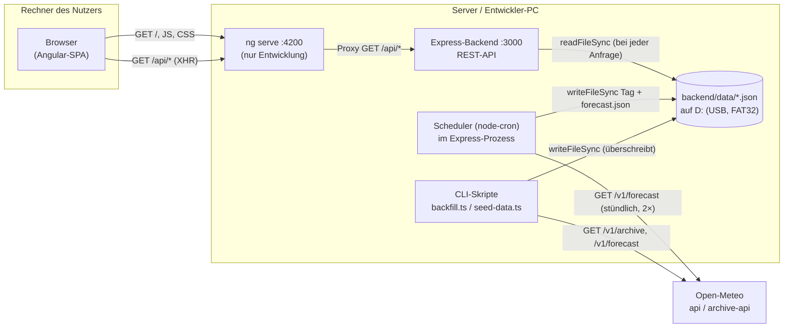

# 01 – Ist-Analyse Wetter-Dashboard Heubach

Stand: 19.11.2026 · Grundlage: Code im Arbeitsverzeichnis `D:\Projekte\wetter-Dashboard` (Branch `main`, Commit `9e5583a` plus nicht committete Änderungen, siehe 0.3), Browser-Test mit Microsoft Edge 157 headless, API-Tests mit curl.

**Kennzeichnung:** **B** = Befund (steht im Code oder ist getestet) · **A** = Annahme (vermutet) · **E** = Empfehlung

---

## 0. Rahmen der Analyse

### 0.1 Ausgangslage, abweichend von der Vorlage

- **B:** Die Analysevorlage geht von einer reinen Frontend-Seite ohne Backend aus. Das trifft hier nicht zu. Das Projekt besteht bereits aus zwei Teilen:
  - **Backend:** Node.js, TypeScript und Express 4, ein Scheduler mit node-cron, Datenhaltung in **JSON-Dateien** (`backend/src/server.ts`, `data-store.ts`)
  - **Frontend:** Angular 21 mit Standalone Components, Signals und Chart.js (`frontend/src/app`)

  Es gibt **keine Datenbank, keine Anmeldung, keine Rollen und keine schreibenden Endpunkte**.
- **Projekt:** Wetter-Dashboard für Heubach (73540, Ostalbkreis). Es zeigt stündliche Wetterdaten von Open-Meteo als Tages-, Monats- und Jahresansicht sowie Rekorde (README.md:1-4).
- **Start:**
  - Backend: `cd backend && npm run dev` (Port 3000)
  - Frontend: `cd frontend && npm start` (Port 4200, Proxy `/api` → 3000)
- **A, Rahmen:** Nach deiner Vorgabe offen gelassen. Ich nehme an: Einzelarbeit, privates Lern- bzw. Kursprojekt, kein fester Termin, Betrieb lokal oder auf einem Raspberry Pi. Siehe Abschnitt 6.

### 0.2 Testumgebung

- **B:** Das Projekt liegt auf `D:`, einer **externen USB-Festplatte mit FAT32**.
  - Dadurch sind Dateizugriffe sehr langsam: `npm install` im Frontend brauchte über 20 Minuten.
  - Alle Antwortzeiten in dieser Analyse sind auf dieser Platte gemessen. Auf einer SSD sind sie deutlich kürzer (**A**).
- **B:** Getestet wurde mit dem **Dev-Build** (`ng serve`, Vite, unminifiziert). Lighthouse, ein echter Screenreader, Touch-Geräte sowie Firefox und Safari wurden **nicht** getestet.
- **B:** Daten: 688 Tagesdateien vom 01.01.2025 bis 19.11.2026. Sie stammen aus dem Backfill-Skript (siehe 0.3), lückenlos, je 24 Stunden, ohne `null`-Werte.

### 0.3 Nicht committete Änderungen vor dieser Analyse

Diese Änderungen sind vor der Analyse in der vorigen Aufgabe entstanden und gehören zum geprüften Stand:

- `backend/src/backfill.ts`: neu. Lädt historische Daten von der Open-Meteo-Archive-API.
- `backend/package.json`: neues Skript `backfill`.
- `backend/src/weather-api.ts`: In `fetchForecast()` wurde `start_date` entfernt. **B:** Open-Meteo hat die Kombination aus `start_date` ohne `end_date` und `forecast_days` mit HTTP 400 abgelehnt.

Während der Analyse selbst wurde kein Code geändert. Zusätzlich installiert wurde nur `npm install` im Frontend, mit deiner Zustimmung.

---

## 1. Befunde

### 1.1 Struktur und Technik (A1)

| Bereich | Inhalt | Beleg |
|---|---|---|
| Backend | Express 4.22, axios 1.16, cors, helmet 8, node-cron 3. Laufzeit lokal Node 24.22 (README verlangt 20+) | `backend/package.json` · **B** |
| Backend-Dateien | `server.ts` (7 GET-Endpunkte, startet den Scheduler), `scheduler.ts` (Cron `0 * * * *` Europe/Berlin plus Abruf beim Start), `weather-api.ts` (Open-Meteo), `data-store.ts` (Lesen, Schreiben, Aggregation), `seed-data.ts` (Testdaten), `backfill.ts` (Altdaten) | **B** |
| Frontend | Angular 21.2 zoneless mit Signals, Chart.js 4.5, rxjs 7.8. Keine Tests, kein ESLint, Prettier nur konfiguriert | `frontend/package.json`, `angular.json` · **B** |
| Routing | `/` Heute · `/monat` · `/jahr` · `/statistiken`, alle lazy geladen. `**` leitet auf `/` um. **Keine Pfad- oder Query-Parameter** | `app.routes.ts:3-9` · **B** |
| Proxy | `/api` → `localhost:3000`, nur in der Serve-Konfiguration `development`. Für Produktion gibt es keinen Proxy und das Backend liefert kein Frontend aus | `proxy.conf.json`, `angular.json:84-90`, `server.ts` · **B** |

**Endpunkte** (alle GET, keine Authentifizierung, `server.ts:14-77`, **B**):

| Pfad | Antwort | Fehler |
|---|---|---|
| `/api/status` | `{lastFetch, lastStatus, lastError, storedDays}` | – |
| `/api/data/today` | `DayData` (UTC-Datum!) | 404 |
| `/api/data/day/:date` | `DayData` | 400 Format, 404 |
| `/api/data/month/:year/:month` | `{year, month, data: MonthSummary[]}` | 400 Format; Monat 13 → 200 `[]` |
| `/api/data/year/:year` | `{year, data: YearSummary[]}` | 400 |
| `/api/forecast` | `DayForecast[]` (7 Tage) | 404 |
| `/api/stats` | `{hottestDay, coldestDay, rainiestDay, driestStreak, totalDays}` | – |

**Funktionen aus Nutzersicht** (**B**):

- **Heute (`/`)**
  - Bedienung: Pfeile ‹ ›, Datumsfeld und Button „Heute“; Zukunftsdaten sind gesperrt.
  - Für heute: Hero-Karte mit aktueller Stunde, gefühlter Temperatur und Wind.
  - Für vergangene Tage: Max, Min und Summe.
  - Außerdem: 7-Tage-Vorschau und Tagesdiagramm (Temperatur als Linie, Niederschlag als Balken) (`today-page.*`).
- **Monat:** Auswahl von Jahr und Monat, Button „Laden“, Kennzahlen, Diagramm aus Tagesmitteln (`monthly-page.*`).
- **Jahr:** Auswahl des Jahres, Kennzahlen, Diagramm aus Monatsmitteln (`yearly-page.*`).
- **Rekorde:**
  - heißester Tag (höchster Stundenwert)
  - kältester Tag (niedrigster Stundenwert)
  - regenreichster Tag
  - längste Trockenperiode (Tage mit weniger als 0,1 mm)

  Angezeigt als 4 Karten plus Gesamtzahl der Tage (`stats-page.*`, `data-store.ts:141-193`).
- **Nicht vorhanden:** Filter, Suche, Sortierung, Export, Konten, Einstellungen. `/api/status` wird im Frontend nicht genutzt (`weather.service.ts:12`).

### 1.2 Daten, Zustand und Logik (A2)

| Daten | Ort | Wer schreibt | Wer liest | Beleg |
|---|---|---|---|---|
| Stundenwerte je Tag | `backend/data/YYYY-MM/YYYY-MM-DD.json` | Scheduler (nur „heute“), Backfill, Seed | alle `/api/data/*`, `/api/stats` | `data-store.ts:20-45` · **B** |
| 7-Tage-Vorhersage | `backend/data/forecast.json` | Scheduler, Backfill | `/api/forecast` | `data-store.ts:102-114` · **B** |
| Scheduler-Status | Arbeitsspeicher, geht beim Neustart verloren | `runFetch` | `/api/status` | `scheduler.ts:5-7` · **B** |
| Monats-, Jahres- und Rekordwerte | nicht gespeichert, **bei jeder Anfrage aus allen Dateien berechnet** | – | `server.ts:48-77` | **B** |
| Auswahl in der UI (Tag, Monat, Jahr) | nur Signals in der Komponente, **nicht in der URL** | – | – | `today-page.ts:25`, `monthly-page.ts:20-21` · **B** |
| localStorage, Cookies, Sessions | nicht verwendet | – | – | Grep · **B** |

- **Stammdaten hartkodiert und mehrfach (B):**
  - Koordinaten 48.7936/9.9369 stehen in `weather-api.ts:3-4` und in `backfill.ts:15-16`.
  - Zeitzone dreifach.
  - Ortsname „Heubach“ in über 10 Dateien.
  - Monatsnamen doppelt (`monthly-page.ts:8`, `yearly-page.ts:8`).
  - Das Feld `location` wird je Datei gespeichert, aber nie gelesen.
- **Typen dreifach gepflegt (B):**
  - Die Interfaces stehen in `weather-api.ts`/`data-store.ts`, in `frontend/.../models/weather.ts` und in abweichender Form in `seed-data.ts:6-17` (ohne `apparentTemperature` und Wind).
  - Die Typen erklären alle Werte als `number`, der Code rechnet aber mit `null`.
  - Dateien werden ohne Schemaprüfung gelesen (`JSON.parse(...) as DayData`).

**Regeln und Berechnungen:**

| Regel | Umsetzung | Bewertung |
|---|---|---|
| „Heute“ | `new Date().toISOString().slice(0,10)` = **UTC** (`server.ts:25`, `weather-api.ts:58`, `today-page.ts:25,31,32,86,102,119,126`). Nur `backfill.ts:22-24` rechnet in Berliner Zeit | **B: Fehler.** Zwischen 00:00 und 01:00 (MEZ) bzw. 02:00 (MESZ) gilt der Vortag als heute |
| Aktuelle Stunde | `getHours()` = Ortszeit des Browsers (`today-page.ts:37`), kombiniert mit dem UTC-Tag | **B: Fehler** nach Mitternacht; im Browser per Zeitzonen-Emulation bestätigt |
| Inhalt des heutigen Tags | Abruf aller 24 Stunden vom Forecast-Endpunkt (`weather-api.ts:31-40`). Die noch kommenden Stunden sind **Vorhersagen** und fließen in die Tagessumme, Monatswerte und Rekorde ein | **B.** Die UI spricht trotzdem von „Messdaten“ und „Messtagen“ (`today-page.html:20`, `stats-page.html:71`) |
| Herkunft der Daten | Modell- und Reanalysewerte von Open-Meteo, keine Stationsmessung. Der Backfill mischt Archiv-API (bis heute−11) und Forecast-API (letzte 10 Tage) | **B** |
| Rekorde | Vergleich des ungerundeten Werts mit dem bereits gerundeten Rekord (`data-store.ts:168-170`) | **B: Fehler.** Ein niedrigerer Wert kann den Rekord verdrängen |
| Trockenperiode | zählt aufeinanderfolgende **Dateien**, nicht Kalendertage (`data-store.ts:176-190`) | **B: Fehler** bei Lücken. Im aktuellen Bestand gibt es keine Lücken, Ergebnis 12 Tage (22.04.–03.05.2026) |
| Mittelwerte | Backend: Monat = Mittel aller Stunden (`data-store.ts:95`). Frontend: Monat = Mittel der gerundeten Tagesmittel, Jahr = **ungewichtetes** Mittel der Monatsmittel (`monthly-page.ts:49`, `yearly-page.ts:41`) | **B.** Uneinheitlich; 2026 ergibt 11,42 statt 11,65 °C. Für unvollständige Jahre und Monate gibt es keinen Hinweis |
| `null`-Werte | Backend filtert `!== null` bzw. `!= null` uneinheitlich. Frontend: `Math.min/max` ohne Filter macht aus `null` **0 °C** (`today-page.ts:50,56`). Niederschlag `null` zählt als 0, also als Trockentag | **B** |
| WMO-Codes | 56/57 (gefrierender Niesel) wird als „Regen“ angezeigt, **66/67 (gefrierender Regen) als „Schneefall“**. Jeder unbekannte Code über 86 gilt als „Gewitter“, `null` als „Nebel“ | `weather-icon.ts:6-23` · **B** |
| Validierung | nur Regex. `2026-02-30` und Monat `13` werden akzeptiert, Ergebnis 404 bzw. 200 `[]`. Path Traversal ist durch die Regex ausgeschlossen (getestet) | `server.ts:36,50,59` · **B** |
| Zukunftssperre | dreifach im Frontend (`today-page.ts:32,119,126`), im Backend gar nicht | **B** |
| Sommer- und Winterzeit | Zeitstempel `YYYY-MM-DDTHH:00` ohne Offset. Umstellungstage haben 24 statt 23 bzw. 25 Einträge | **B.** **A:** Ob Open-Meteo bei langen Archivabfragen die Sommerstunden richtig beschriftet, ist nicht verifiziert |

**Datenintegrität (B):**
- Schreiben ohne temporäre Datei und Umbenennen (`data-store.ts:33`); ein Absturz hinterlässt eine abgeschnittene Datei.
- Kaputte Dateien werden still übersprungen.
- Gültiges JSON ohne `hourly` führt zu einem 500-Fehler für den ganzen Monat oder das ganze Jahr.
- `Promise.all` im Scheduler (`scheduler.ts:15`): Scheitert die Vorhersage, wird **auch der Tag nicht gespeichert**. Im committeten Stand ist deshalb **jeder** Abruf gescheitert (siehe 0.3).
- `seed-data.ts` überschreibt ohne Rückfrage echte Daten vom 01.–06.05.2026 mit Zufallswerten im alten Format. Die README empfiehlt das Skript (README.md:120-125).
- Der Backfill überschreibt ebenfalls alles ab dem Startdatum.

**Was verloren geht (B):**
- **Neustart:** der Scheduler-Status. `lastStatus` startet mit `'ok'`, obwohl noch kein Abruf gelaufen ist.
- **Server läuft zum Tagesende nicht:** Die Vorhersagestunden bleiben dauerhaft in der Tagesdatei stehen.
- **Neuladen oder Zurück:** die Auswahl in der UI.
- **Gerätewechsel:** nichts, weil es keine Nutzerdaten gibt.
- **Umzug des Servers:** alle Daten, weil `backend/data/` in `.gitignore` steht.

**Rechte und Secrets (B):** Es gibt keine Anmeldung, keine Rollen und keinen simulierten Login. Im Code, in der Git-History und in `.vscode` stehen keine Passwörter, Tokens oder API-Keys. Der früher in der Remote-URL hinterlegte GitHub-Token ist widerrufen und entfernt.

### 1.3 Netzwerk, Sicherheit und Code-Qualität (A3)

**Requests (B):**
- **Browser:** nur Requests an `localhost:4200` (Dokument, JS-Chunks, `styles.css`, Favicon) und XHR auf `/api/*`. Es gibt **keine fremden Hosts**: keine Google Fonts, kein CDN, keine Analytics, keine Bilder. Icons sind Emojis, Chart.js ist gebündelt.
- **Backend:**
  - normal: 2 Requests pro Stunde an `api.open-meteo.com/v1/forecast`
  - Backfill: zusätzlich `archive-api.open-meteo.com/v1/archive`
  - In `weather-api.ts` gibt es **kein Timeout** (Standard: unbegrenzt) und keinen Retry; die Antworten werden nicht validiert.
- **A:** Die kostenlose Open-Meteo-API ist nur für nicht-kommerzielle Nutzung freigegeben.

**Sicherheit:**

| Thema | Befund | Beleg | Schwere |
|---|---|---|---|
| XSS | kein `innerHTML` und kein `bypassSecurityTrust*`; Angular escaped alle Ausgaben | Grep · **B** | – |
| CORS | `cors()` ohne Optionen: `Access-Control-Allow-Origin: *` | `server.ts:11` · **B** | mittel |
| Netzwerk-Bindung | `listen(PORT)` auf allen Interfaces, also im LAN erreichbar | `server.ts:81` · **B** | mittel |
| Rate Limiting | keines | **B** | hoch zusammen mit der nächsten Zeile |
| Teure Endpunkte | `/api/stats` liest bei **jedem** Aufruf alle 688 Dateien synchron: **3,3–3,7 s** pro Aufruf. `/api/data/year/2025` braucht 1,9–3,4 s. Der Event-Loop ist währenddessen blockiert, es gibt keinen Cache | `data-store.ts:141-193`, curl × 5 · **B** | hoch |
| Fehlerbehandlung | keine Error-Middleware. Express liefert ohne `NODE_ENV=production` Stacktraces als HTML. `lastError` gibt rohe Fehlermeldungen öffentlich aus | `server.ts`, `scheduler.ts:24` · **B** | mittel |
| Abhängigkeiten | `npm audit --omit=dev` im Backend: **8 Schwachstellen (1 critical, 4 high, 3 moderate)**, u. a. axios 1.16.0 (direkt), body-parser, proxy-addr, qs (über Express 4) und uuid (über node-cron 3) | **B** | mittel |
| Überflüssig | `express.json()` ohne POST-Routen; `@types/helmet` unter `dependencies` | `server.ts:12`, `package.json` · **B** | niedrig |
| Öffentliches Repo | Das GitHub-Repo ist **öffentlich**. Die Commit-Metadaten enthalten die E-Mail-Adresse des Autors (personenbezogenes Datum) | `gh repo view`, `git log` · **B** | niedrig |
| Weitere Kennungen | `angular.json:6` enthält eine Analytics-ID der Angular CLI (Telemetrie der Entwickler an Google). `.vscode/mcp.json` startet `npx -y @angular/cli mcp` ohne feste Version | **B** | niedrig |
| README-Link | Der PM2-Link `pm2.keymaster.io` ist eine Tippfehler-Domain; richtig ist `pm2.keymetrics.io` | README.md:190 · **B** | niedrig |

**Code-Struktur und technische Schulden:**

| # | Schuld | Beleg | Warum wird der Umbau dadurch teurer? |
|---|---|---|---|
| S1 | JSON-Dateibaum mit synchronem `fs`, Aggregation bei jedem Lesen | `data-store.ts` | Datenmigration mit Prüfregeln nötig; Aggregationen müssen als SQL oder Service neu geschrieben und gegen die alten Ergebnisse geprüft werden |
| S2 | **Keine Tests** (keine `*.spec.ts`, `npm test` nicht lauffähig, `skipTests: true`) | `angular.json:12-37` | Kein Sicherheitsnetz für gleiches Verhalten nach dem Umbau; Charakterisierungstests müssen zuerst entstehen |
| S3 | Persistenz und Fachlogik vermischt | `data-store.ts:47-193` | Muss in Repository und Service zerlegt werden |
| S4 | `server.ts` ohne Modulgrenzen; der Scheduler startet beim Import | `server.ts:79` | Nicht testbar; Module, ScheduleModule und Lifecycle-Hooks müssen neu geschnitten werden |
| S5 | Typen dreifach dupliziert, `any`, ungeprüfte Casts | siehe 1.2 | Entities und DTOs kommen als vierte Variante dazu; es gibt keine einzige Quelle der Wahrheit |
| S6 | Datumslogik in UTC an über 10 Stellen | siehe 1.2 | Für den Schlüssel in der DB braucht es eine klare Zeitregel; Altdaten müssen eventuell neu geladen werden |
| S7 | Zwei Mappings für Open-Meteo-Variablen (alte und neue Namen) | `weather-api.ts:44-52` gegenüber `backfill.ts:32-42` | Müssen zu einem Import-Service zusammengeführt werden |
| S8 | Aggregationen doppelt in Front- und Backend mit unterschiedlichen Ergebnissen | `monthly-page.ts:49`, `yearly-page.ts:41` | Es muss entschieden werden, was richtig ist; geänderte Zahlen wirken wie Regressionen |
| S9 | Offene Konfiguration (CORS `*`, 0.0.0.0, nur `PORT` konfigurierbar, API-URL hart codiert) | `server.ts:8-12`, `weather.service.ts:6` | Für Anmeldung müssen ConfigModule, `.env`, CORS-Freigabeliste und `trust proxy` von null aufgebaut werden |
| S10 | Veraltete Pakete (Express 4, node-cron 3, axios mit Schwachstellen) | `npm audit` | NestJS bringt eigene Versionen mit; alte Pakete werden ersetzt statt migriert |
| S11 | CSS je Seite vierfach dupliziert, 38 feste Hex- und 18 rgb-Werte | siehe 1.5 | Beim Design-Umbau muss jede Datei einzeln angefasst werden |
| S12 | Toter Code: `getStatus()`, `FormsModule`, `@Input() title`, `seed-data.ts`, `eslint-disable` ohne ESLint | A1/A3 | Unklar, was migriert werden muss; `seed-data.ts` gefährdet echte Daten |

### 1.4 Funktionalität im Browser, Bedienbarkeit, Responsiveness, Barrierefreiheit, Performance (A4)

**Was funktioniert (B):**
- Unbekannte Routen leiten auf `/` um.
- F5 auf allen 4 Routen funktioniert.
- Der Button › ist für heute und Zukunftstage gesperrt.
- Die Konsole ist im Normalbetrieb ohne Fehler.
- `prefers-reduced-motion` wird beachtet (`styles.css:9-15`, `climate-chart.ts:50`).
- `lang="de"` ist gesetzt, und die Landmarken header, nav, main und footer sind vorhanden.

**Bedienbarkeit (B):**
- **Ladezustand:** Es gibt nur den Text „Daten werden geladen...“ mit Kontrast 2,41:1. Während des Ladens verschwindet der ganze Inhalt, deshalb flackert die Seite bei jedem Klick auf ‹ ›.
- **Lange Wartezeiten ohne Anzeige:** `/statistiken` lädt 4–7 s und `/jahr` etwa 2 s, ohne Skelett- oder Fortschrittsanzeige.
- **Fehlermeldungen:** teils allgemein gehalten („Fehler beim Laden.“). Es fehlt der Hinweis, dass es Daten erst ab dem 01.01.2025 gibt.
- **Zahlenformat:** Zahlen erscheinen englisch formatiert (`9.7°C`), weil keine `LOCALE_ID` `de` gesetzt ist. Die Diagrammachsen sind deutsch formatiert. Auch die Einheiten sind uneinheitlich: `9.7°C` gegenüber `6.1 °C`.
- **Monatsdiagramm:** Es zeigt nur die vorhandenen Tage. Die x-Achse deckt deshalb nicht den ganzen Monat ab, und Lücken sind nicht zu erkennen.

**Responsiveness**

Gemessen mit `scrollWidth` gegen `clientWidth` und `getBoundingClientRect` (**B**):

| Seite | 375 px | 768 px | 1280 px | 1920 px |
|---|---|---|---|---|
| Heute | **Überlauf 475/375** (Navigation). Datum bricht um („2026-11- / 19“). Diagramm nur etwa 200 px Plotbreite | Datumskarte bricht um | ok | ok, Inhalt auf 1200 px begrenzt |
| Monat | **Überlauf 475/375** | Label „Gesamtniederschlag“ läuft über | ok | ok |
| Jahr | **Überlauf 475/375**. Labels laufen über den Kartenrand | Labels laufen über | ok | ok |
| Statistiken | **Überlauf 475/375** | ok | ok; viel Leerraum (`app.css:61`) | ok |

- Bei 320 px läuft die Seite ebenfalls auf 475 px über. **WCAG 1.4.10 (Reflow) ist nicht erfüllt.**
- Alle Klickflächen sind kleiner als 44 × 44 px, z. B. Navigation 62–89 × 32,8 und ‹ › 34,5 × 38,8. Das 24-px-Minimum von WCAG 2.5.8 ist erfüllt.

**Barrierefreiheit (B):**
- **Seitentitel** auf allen Routen gleich („Wetter Heubach“). Verstößt gegen 2.4.2.
- **`aria-current`** fehlt in der Navigation; die aktive Seite ist nur farblich markiert.
- **Fokus kaum sichtbar.** Verstößt gegen 2.4.7 und 1.4.11:
  - Der Fokusring `--sky-mid` hat im Header einen Kontrast von 1,0–1,44:1.
  - Datumsfeld und Selects setzen `outline: none` (`today-page.css:24`, `monthly-page.css:9`, `yearly-page.css:9`).
- **Diagramm ohne Textalternative.** Verstößt gegen 1.1.1:
  - Das Canvas hat weder `aria-label` noch Fallback-Inhalt oder eine Datentabelle (`climate-chart.html:2`).
  - Die Wettersymbole der 7-Tage-Vorschau haben keinen Text (`today-page.html:112`).
- **Formularfelder** haben nur ein `aria-label`, keine sichtbaren Labels.
- **Tastatur:** Die Tab-Reihenfolge ist logisch.
- **Kontraste:** 14 Text-Kombinationen bestehen AA nicht, darunter:
  - Kartenlabels `#94a3b8` auf Weiß: 2,56:1
  - Navigation inaktiv: 1,75–2,11:1
  - Footer: 2,91 bzw. 4,08:1
  - Fehlertext: 4,41:1

  Die vollständige Kontrasttabelle steht in Anhang A.

**Performance (B, Dev-Build):**
- **Erstaufruf:** 22–28 Requests mit 1,9–2,6 MB. Der First Contentful Paint liegt bei etwa 210–240 ms. Fertig angezeigt ist `/` nach 0,54 s, `/jahr` nach 2,3 s und `/statistiken` nach 4,7 s.
- **Unnötig geladen:** `FormsModule` wird geladen, aber nicht genutzt (148 KB im Dev-Build). Chart.js wird komplett registriert (`registerables`).
- **Schriften und Caching:** Es gibt keine Webfonts, also auch keine blockierenden Fonts. Die API sendet keine `Cache-Control`-Header, nur ETag.

### 1.5 Optik und Vergleich mit der Designvorgabe (A4)

- **Ist-Stil (B):**
  - himmelblaue Verläufe im Header, in der Hero-Karte und den Buttons
  - weiße Karten mit Schatten und Radius 14px
  - Systemschrift (`-apple-system, 'Segoe UI', Roboto`), Gewicht 800 bei Überschriften
- **Uneinheitlich (B):**
  - Kantenfarben haben keine feste Bedeutung: Grün steht für Wind und für Höchsttemperatur.
  - Statistik-Karten haben eine linke 5-px-Kante, die anderen eine obere 3-px-Kante.
  - Formularelemente laufen in **Arial**, weil `font: inherit` fehlt.
  - Die Seitenköpfe sind unterschiedlich aufgebaut.
  - Die Diagramme nutzen die Standardfarben von Chart.js.
- **Feste Farbwerte (B):** 38 Hex- und 18 rgb-Werte außerhalb von Token-Definitionen. Am meisten in `stats-page.css` (7 Hex) und `today-page.css` (5 Hex, 7× `white`), dazu inline in `climate-chart.ts`.

**Die Vorgabe wird bisher in keinem Punkt umgesetzt.** Abweichungen:

| Element | Ist (Beleg) | Soll |
|---|---|---|
| Schrift Text, Navigation, Formulare | Systemschrift (`styles.css:19`), Formulare Arial | Inter 400–700 |
| Schrift Überschriften und Zahlen | Systemschrift 800 (`today-page.css:12,87`, `stats-page.css:34,49`) | Space Grotesk 500/600/700 |
| Einbindung der Schriften | keine `@font-face`, keine woff2-Dateien | lokal als woff2 |
| Kicker | 12px, 600/700, letter-spacing 0.05–0.06em, `#94a3b8` | Inter 600, GROSS, 0.08em, Akzentfarbe |
| Seitenhintergrund | `#f0f9ff` (`styles.css:20`, `app.css:62`) | `#F4F2EE` |
| Karten | `white`, Schatten, Radius 14px, obere Kante 3px in wechselnden Farben | `#FBFAF7`, Rand 1px `#D6D1C7`, obere Kante 6px `#E8772E`, Radius 8px, kein Schatten |
| Text, gedämpfter und dezenter Text | `#0f172a` / `#475569` / `#94a3b8` | `#1B1F24` / `#3E434A` / `#5A5F66` |
| Akzent | Blautöne `#0369a1`, `#0ea5e9`, Verläufe | `#C2571A` / `#E8772E` |
| Header und Footer | blauer Verlauf mit Schatten, Footer `#0369a1` | dunkel `#1B1F24`, Text `#F4F2EE`, Akzent `#E8772E` |
| Chips und Navigation | Segment-Control mit Radius 7–10px | Pillenform 999px, 2px `#C9C3B8` |
| Hinweise und Fehler | Rahmen 1,5px ringsum | 4px Linie links `#E8772E` |
| Tabellen und Listen | keine Tabellen, nur Kachelraster | 1px-Linien, Spaltenköpfe GROSS mit 2px-Linie |
| Bewegung | nur Hover-Übergänge | Einblenden mit Opacity und 16px, 0,5 s, gestaffelt |
| `prefers-reduced-motion` | vorhanden | vorhanden ✔ |

**Vorabprüfung der Soll-Farben**

Gerechnet nach der WCAG-Formel (**B**). Grundlage für Phase 2:

| Kombination | Kontrast | Normaler Text (4,5) | Großer Text und Bedienelemente (3) |
|---|---|---|---|
| `#C2571A` auf `#F4F2EE` | 4,02:1 | ✘ | ✔ |
| `#C2571A` auf `#FBFAF7` | 4,31:1 | ✘ | ✔ |
| `#E8772E` auf `#FBFAF7` | 2,83:1 | ✘ | ✘, nur für Deko und Kanten |
| `#E8772E` auf `#1B1F24` | 5,61:1 | ✔ | ✔ |
| `#5A5F66` auf `#FBFAF7` | 6,16:1 | ✔ | ✔ |
| `#F4F2EE` auf `#1B1F24` | 14,81:1 | ✔ | ✔ |

**E:** Für kleinen Text und Links in Akzentfarbe braucht es eine dunklere Akzentstufe. Das wird in Phase 2 (E3) mit nachgerechnetem Kontrast festgelegt.

---

## 2. Fehlerliste

> **Stand 20.11.2026:** Die Spalte „behoben in“ nennt den Roadmap-Schritt aus `04-roadmap.md`, in dem der Fehler behoben wurde, bzw. „offen → Schritt“. Die übrigen Spalten zeigen den Ist-Stand vom 19.11.2026 vor dem Umbau.

Sortiert nach Schwere. Die Spalte **Quelle** nennt, wer den Fehler gefunden hat: Browser-Test (A4) oder Code-Analyse (A1–A3). Screenshots liegen in `docs/umbau/screenshots/`.

| Nr. | Seite | Schritte zum Nachstellen | erwartet | tatsächlich | Schwere | Quelle / Beleg | behoben in (Schritt) |
|---|---|---|---|---|---|---|---|
| F01 | Backend (Scheduler) | Committeten Stand `9e5583a` starten | Tag und Vorhersage werden stündlich gespeichert | `fetchForecast()` bekommt HTTP 400 (`start_date` ohne `end_date`). Wegen `Promise.all` wird **gar nichts** gespeichert. **Im Arbeitsstand behoben, aber nicht committet** | kritisch | B · `weather-api.ts:62-71`, `scheduler.ts:15`; 400 selbst mit curl nachgestellt | 0.1 (Fix `3b8603d`) |
| F02 | /monat | `/monat` aufrufen | Monatsauswahl zeigt „Nov“ | Auswahl zeigt **„Jan“**, geladen ist Nov 2026. Wählt man nur ein anderes Jahr, wird der unsichtbare Monat 11 geladen | hoch | A4 · `monthly-page.html:10-14`; monat-1280.png. **A:** `[value]` wird vor den `@for`-Optionen gesetzt; `yearly-page.html:5` ist genauso gebaut | 0.2 |
| F03 | / | 10.11.2026 wählen, dann 31.12.2024 (oder Feld leeren) | Fehlermeldung ohne alte Werte | Fehlermeldung **und darunter die Werte vom 10.11.** | hoch | A4 · `today-page.ts:140`, `today-page.html:31`; heute-fehler-veraltete-daten-1280.png | 0.2 |
| F04 | / | Ab dem 17.11. fünfmal schnell auf ‹ klicken | Anzeige zeigt den 12.11. | Datumsfeld 12.11., angezeigte Daten vom **13.11.** | hoch | A4 · `today-page.ts:138` (kein `switchMap`); gleiches Muster in `monthly-page.ts:69`, `yearly-page.ts:58` | 0.2 |
| F05 | alle | Bei 375 px (oder 320 px) öffnen | kein horizontales Scrollen | Seite ist 475 px breit; „Rekorde“ in der Navigation nur durch seitliches Scrollen erreichbar | hoch | A4 · `app.css:11-37` ohne Media-Query; heute-375.png, statistiken-375-ueberlauf-scrollbreite.png | 0.2, endgültig 1 |
| F06 | / und API | Zwischen 00:00 und 01:00 (MEZ) bzw. 02:00 (MESZ) Seite öffnen oder `GET /api/data/today` | heutiger Tag | Vortag. Hero zeigt die Stunde 00:00 des Vortags. Der Scheduler schreibt in die Datei des Vortags | hoch | A4 (Zeitzonen-Emulation) und A1–A3 · `server.ts:25`, `weather-api.ts:58`, `today-page.ts:25-37` | 0.2 |
| F07 | alle | Mit Tab durch die Seite gehen | gut sichtbarer Fokus | Fokusring im Header unsichtbar (1,0–1,44:1). Datumsfeld und Selects ohne Outline | hoch | A4 · `styles.css:3-7`, `today-page.css:24`; fokus-nav-1280.png | 0.2, endgültig 1 |
| F08 | alle | Kontraste messen | Text mindestens 4,5:1 | 14 Kombinationen darunter, z. B. Labels 2,56, Navigation 1,75, Footer 2,91, Ladetext 2,41 | hoch | A4 · Anhang A | 1 |
| F09 | / | Datumsfeld leeren, dann ‹ oder › klicken | Hinweis oder Rücksprung | Leeren: Request `/api/data/day/` → Express-404 als HTML, „Fehler beim Laden.“ plus alte Daten. ‹ oder ›: `RangeError: Invalid time value` in der Konsole | mittel | A4 · `today-page.ts:95-99,108-118` | 0.4 |
| F10 | /statistiken, /jahr | Seite öffnen | Anzeige in unter 1 s | 4–7 s bzw. 2,3 s Ladezeit. Die Statistik zeigt so lange „aus **0** gespeicherten Tagen“. Backend: `/api/stats` 3,3–3,7 s, Event-Loop blockiert | mittel | A4 und A3 · `stats-page.html:4`, `data-store.ts:141-193`; statistiken-laden-375.png | teilweise: Frontend 1 (Skelett), Backend offen → 7/9 |
| F11 | /, /monat, /jahr | Tag oder Monat wählen, dann F5 oder Zurück | Auswahl bleibt, Link lässt sich teilen | Auswahl ist zurückgesetzt; `/monat/2025/03` leitet auf `/` um | mittel | A4 · `app.routes.ts:3-9` | 0.4 |
| F12 | /monat, /jahr | Request schlägt fehl (HTTP-Fehler) | alte Werte entfernt | Alte Werte bleiben stehen, die Überschrift zeigt aber den neuen Zeitraum | mittel | **A** (Code) · `monthly-page.ts:77-80`, `yearly-page.ts:66-69` | 0.2 |
| F13 | / und /statistiken | Heute um 10 Uhr Tagessumme oder Rekorde ansehen | nur Werte bis jetzt bzw. als Vorhersage gekennzeichnet | Die Summe enthält die Vorhersage bis 23 Uhr und geht so in die Rekorde ein; die UI nennt das „Messdaten“ | mittel | A2 · `weather-api.ts:31-40`, `today-page.html:20` | offen → 7 |
| F14 | /statistiken | Zwei Tage mit 30,04 °C und später 30,03 °C | Rekord bleibt 30,04 | Der spätere Tag verdrängt den Rekord, weil gegen den gerundeten Wert 30,0 verglichen wird | mittel | A2 · `data-store.ts:168-170` | offen → 7 |
| F15 | / | Tag mit fehlender Stunde (`temperature: null`) | Min/Max ohne die Lücke | Min bzw. Max = **0 °C** | mittel | A2 · `today-page.ts:50,56` (`Math.min(5,null)` ergibt 0, nachgeprüft) | 0.3 |
| F16 | Backend (Skript) | `npx ts-node src/seed-data.ts`, wie in der README empfohlen | Testdaten ohne Schaden | Echte Daten vom 01.–06.05.2026 werden mit Zufallswerten **ohne** gefühlte Temperatur und Wind überschrieben | mittel | A1 und A2 · `seed-data.ts:6-11,60`, README.md:120-125 | 0.3 (README), Skript bleibt bis 9 |
| F17 | /, /monat, /jahr | Mit dem Screenreader das Diagramm bzw. die Vorschau lesen | Textalternative | Canvas ohne Label oder Daten; Wettersymbole der Vorschau ohne Text | mittel | A4 · `climate-chart.html:2`, `today-page.html:112` | 1 |
| F18 | / | Vergangenen Tag wählen | Vorschau passt oder ist ausgeblendet | Immer die aktuelle 7-Tage-Vorschau mit Markierung „heute“ | niedrig | A4 · `today-page.ts:92`, `today-page.html:107` | 0.3 |
| F19 | / | Zukunftsdatum wählen | Weg zurück, Datumsfeld begrenzt | Nur ein Hinweis; die vorhandene Vorschau wird ausgeblendet; kein `min`/`max` am Feld | niedrig | A4 · `today-page.html:9,15-25`; heute-zukunft-1280.png | 0.4 |
| F20 | /monat, /jahr | Jahr auswählen | nur Jahre mit Daten | 2022–2026 angeboten, Daten gibt es erst ab 2025 | niedrig | A4 · `monthly-page.ts:29`, `yearly-page.ts:25` | 0.3 |
| F21 | /monat, /jahr | „Laden“ klicken | Button hat eine Funktion | Überflüssig, weil ein Wechsel der Auswahl schon lädt; 5 Klicks erzeugen 5 Requests | niedrig | A4 · `monthly-page.html:15` | 0.3 |
| F22 | API | `GET /api/data/month/2026/13`, `GET /api/data/day/2026-02-30` | 400 „ungültig“ | 200 `[]` bzw. 404 | niedrig | A4 (curl) · `server.ts:36,50` | offen → 4 |
| F23 | / | Vergangenen Tag wählen | große Zahl beschriftet | Großer Höchstwert ohne „Max“ | niedrig | A4 · `today-page.html:74-75` | 1 |
| F24 | / | Heutige Ansicht öffnen | jeder Wert einmal | Niederschlag, Wind und Datum doppelt (Hero und Karten); Datum als ISO `2026-11-19` | niedrig | A4 · `today-page.html:42-65` | 1 |
| F25 | / | Karten Höchst- und Tiefsttemperatur ansehen | Farbe passend zur Bedeutung | Klasse `wind` mit grüner Kante | niedrig | A4 · `today-page.html:91,95` | 1 |
| F26 | / | Wettercode 66/67 bzw. 56/57 | „Gefrierender Regen“ bzw. „Gefrierender Niesel“ | „Schneefall“ bzw. „Regen“ | niedrig | A1 und A2 · `weather-icon.ts:8-9,22-23` (im Bestand bisher nicht aufgetreten) | 0.3 |
| F27 | /statistiken | Datenlücke zwischen zwei Trockenphasen | zwei getrennte Perioden | Eine durchgehende Periode | niedrig | A2 · `data-store.ts:176-190` (im Bestand keine Lücken) | offen → 7 |
| F28 | /jahr | Jahr 2026 ansehen | gewichtetes Mittel, Hinweis auf unvollständiges Jahr | Ungewichtetes Mittel der Monatsmittel (11,42 statt 11,65 °C), kein Hinweis auf fehlende Monate | niedrig | A2 · `yearly-page.ts:38-42` | offen → 7 |
| F29 | alle | Zahlen ansehen | deutsches Format `9,7 °C` | `9.7°C`; Einheiten uneinheitlich | niedrig | A4 · fehlende `LOCALE_ID` | 0.3 |
| F30 | alle | Tab-Titel bzw. Screenreader | Titel je Seite, `aria-current` | Immer „Wetter Heubach“, kein `aria-current` | niedrig | A4 · `index.html:5`, `app.html:8-11` | 0.3 |
| F31 | alle | Klickflächen messen | mindestens 44 × 44 px | Alle kleiner (32–39 px hoch) | niedrig | A4 | 0.2/1 (Footer-Links 29 px offen) |
| F32 | API | `GET /api/status` direkt nach dem Start | Status „noch kein Abruf“ | `lastStatus: "ok"` bei `lastFetch: null` | niedrig | A2 · `scheduler.ts:6` | offen → 2/12a |
| F33 | Frontend | `npm test` | Tests laufen | Kein `test`-Ziel, keine Specs, vitest nicht installiert | niedrig | A1 und A3 · `angular.json`, `tsconfig.spec.json` | 0.1 |
| F34 | README | PM2-Link öffnen | pm2.keymetrics.io | `pm2.keymaster.io` (Tippfehler-Domain) | niedrig | A1 und A3 · README.md:190 | 0.3 |

---

## 3. Systemskizze Ist-Zustand

Die Pfeile zeigen vom Absender weg. Antworten sind nicht eingezeichnet.

**B:** Für die Produktion gibt es keinen festgelegten Weg. Die README nennt Nginx ohne Konfiguration für `/api` oder die SPA-Weiterleitung.

---

## 4. Ausfalltabelle Ist-Zustand

| Teil fällt aus | Was läuft weiter? | Was steht still? | Bemerken es die Nutzer? |
|---|---|---|---|
| **Client** (Browser oder Tab abgestürzt, offline) | Backend, Scheduler und Datensammlung | nur die Anzeige bei diesem Nutzer | Ja, nur der betroffene Nutzer. Es gehen keine Daten verloren, nur die Auswahl in der UI |
| **Datenort** (`backend/data` bzw. Laufwerk D: nicht erreichbar, voll oder beschädigt) | Express-Prozess und Open-Meteo-Abrufe; `/api/status` antwortet | alle Daten-Endpunkte (404 bzw. leere Listen, Stats zeigt 0 Tage); der Scheduler kann nicht speichern, die Daten der Stunde gehen verloren | Ja, sofort: alle Seiten leer oder „Keine Daten“. Die Ursache wird nicht angezeigt. Bei beschädigten Einzeldateien fehlen Tage **still** |
| **Fremder Dienst** (Open-Meteo nicht erreichbar oder Ratenlimit) | Alle Anzeigen aus vorhandenen Dateien | neue Stundenwerte und Vorhersage. Ohne Timeout können Abrufe hängen bleiben | Kaum. Die Seite zeigt den letzten Stand ohne Altershinweis. Nur `/api/status` (nicht im UI) meldet `error`. Nach Mitternacht fehlt der neue Tag (404) |
| *zusätzlich:* **Backend-Prozess** | nichts außer dem statischen Frontend | gesamte API **und** Datensammlung; die Stunden in dieser Zeit fehlen dauerhaft, außer per Backfill | Ja, alle Seiten zeigen Fehler |

---

## 5. Die 5 wichtigsten Befunde für den Umbau

1. **Uneinheitliche Zeitregel.** Backend und Frontend bestimmen „heute“ in UTC, der Backfill in Berliner Zeit. Zeitstempel haben keinen Offset (F06, S6). Vor dem Datenmodell muss feststehen, wie ein Tag definiert ist (Europe/Berlin) und wie Zeitstempel gespeichert werden.
2. **Fachliche Regeln sind unklar und teils falsch.**
   - Vorhersagestunden fließen in Summen und Rekorde ein (F13).
   - Der Rekordvergleich nutzt gerundete Werte (F14).
   - Die Trockenperiode übergeht Lücken (F27).
   - Mittelwerte unterscheiden sich zwischen Front- und Backend (F28, S8).

   Diese Regeln müssen festgelegt und mit Tests abgesichert werden, bevor die Daten in eine Datenbank wandern.
3. **Speichern als Dateien ist der Engpass.** Synchrones `fs`, Aggregation bei jeder Anfrage, 2–4 s für Jahr und Statistik, kein Cache, kein atomares Schreiben (F10, S1). Eine Datenbank mit vorberechneten Tageswerten löst das. Der Umzug der 688 Dateien braucht eine Import-Migration mit Prüfung.
4. **Frontend-Zustand und Bedienung sind fehleranfällig.** Falsche Monatsauswahl (F02), veraltete Daten bei Fehlern (F03), Race Condition (F04), kein Zustand in der URL (F11), Überlauf bei 375 px (F05), Fokus und Kontraste nicht nach WCAG (F07, F08). Dazu kommt: Die Designvorgabe wird in **keinem** Punkt umgesetzt, und es gibt 56 feste Farbwerte.
5. **Keine Sicherheits- und Qualitätsgrundlage.** Keine Tests, keine Validierung über Regex hinaus, keine Error-Middleware, CORS `*`, Bindung an alle Interfaces, kein Rate Limiting, 8 bekannte Schwachstellen, Konfiguration nur über `PORT`. Außerdem gibt es **heute keine Nutzerdaten**. Anmeldung und Rollen lohnen sich erst, wenn neue Funktionen sie brauchen, etwa ein Admin-Bereich für den Datenimport oder Favoriten.

---

## 6. Annahmen und offene Fragen

**Annahmen:**
- **A1:** Einzelarbeit, Lern- bzw. Kursprojekt, kein fester Abgabetermin, Betrieb lokal oder auf einem Raspberry Pi.
- **A2:** Zielgruppe sind Interessierte aus Heubach und Umgebung. Es gibt nur einen Standort.
- **A3:** Die Antwortzeiten sind auf der USB-Platte gemessen und auf einer SSD kürzer. Das Blockieren durch synchrones `fs` tritt aber überall auf.
- **A4:** Open-Meteo wird nicht kommerziell genutzt.

**Offene Fragen:**
1. **Rahmen:** Gibt es einen Abgabetermin? Arbeitest du allein oder zu zweit? Wie viel Zeit hast du pro Woche? Wo soll das Projekt später laufen (lokal, Raspberry Pi, Cloud)?
2. **Rollen:** Wer soll die Seite nutzen? Soll es einen Betreiber bzw. Admin geben, der z. B. den Datenimport anstößt, Daten korrigiert oder Standorte pflegt?
3. **Weitere Standorte:** Soll es bei Heubach bleiben, oder sind mehrere Orte denkbar? Das beeinflusst das Datenmodell stark.
4. **Fachregeln:**
   - Sollen Vorhersagestunden des laufenden Tags angezeigt bzw. mitgezählt werden?
   - Gilt ein Tag als „trocken“ unter 0,1 mm oder unter 1 mm?
   - Ist ein Rekord der höchste Stundenwert oder das Tagesmaximum?
5. **Begriffe:** Darf die UI weiter von „Messdaten“ sprechen, obwohl es Modelldaten sind?
6. **Daten:** Sollen die Daten der letzten 10 Tage aus der Vorhersage-API später durch Archivwerte ersetzt werden?
7. **Kursvorgaben:** Ist NestJS mit SQLite verbindlich, oder darf Express bleiben? Ist ein neues oder umgebautes Angular-Frontend erlaubt, oder ist im Kurs Handlebars gewünscht?
8. **Öffentliches Repo:** Soll das GitHub-Repo öffentlich bleiben? Die Commit-Metadaten enthalten die E-Mail-Adresse des Autors.
9. **Arbeitsstand:** Darf der nicht committete Stand (Backfill und Fix für F01) vor Phase 2 committet werden?

---

## 7. Entscheidungen nach Phase 1 (19.11.2026)

| Frage | Entscheidung |
|---|---|
| Rahmen | Lernprojekt, Einzelarbeit, kein fester Termin. Betrieb lokal oder auf einem Raspberry Pi im Heimnetz, ohne öffentliche Domain |
| Rollen | **Gast** (alles lesen, ohne Anmeldung) und **Admin** (Datenimport anstoßen, Lücken nachladen, Daten korrigieren, Status sehen). Keine Konten für Besucher |
| Standorte | Nur Heubach. Der Standort wird als Stammdatum in der DB gespeichert, nicht im Code |
| Stack | NestJS 11 + Zod + TypeORM/SQLite + JWT nach Kurs. Das **bestehende Angular-Frontend bleibt**, wird an die neue API angebunden und auf das neue Design umgestellt |
| Vorhersagestunden | Fließen **nicht** in Tagessummen, Monatswerte und Rekorde ein. Sie werden getrennt und gekennzeichnet angezeigt |
| Trockentag / Rekord | Trockentag bei < 0,1 mm. Rekord = höchster bzw. niedrigster Stundenwert. Der Rundungsfehler (F14) und der Lückenfehler (F27) werden behoben |
| Arbeitsstand | Lokal committet auf dem Branch `umbau/analyse` |

**Noch offen** (Vorschläge kommen in Phase 2):
- Wortwahl „Messdaten“ gegenüber „Modelldaten“ (Frage 5)
- Ersetzen der Werte aus der Vorhersage-API durch Archivwerte (Frage 6)
- Sichtbarkeit des öffentlichen Repos (Frage 8)

---

## Anhang A – Kontrasttabelle Ist-Zustand

Farben per `getComputedStyle` ermittelt. Bei Verläufen sind beide Enden berechnet, Opacity ist eingerechnet (A4, **B**).

| Kombination (Quelle) | Verhältnis | nötig | Ergebnis |
|---|---|---|---|
| Logo weiß 20px/800 auf Header-Verlauf (`app.css:2,20-27`) | 2,77–5,93 | 3 | teilweise |
| Navigation aktiv `#0369a1` auf Weiß (`app.css:54-58`) | 5,93 | 4,5 | ✔ |
| Navigation inaktiv weiß ×0,85 auf Verlauf (`app.css:34,40`) | 1,75–2,11 | 4,5 | ✘ |
| h1 `#0f172a` auf `#f0f9ff` | 16,75 | 3 | ✔ |
| Untertitel und Ladetext `#94a3b8` auf `#f0f9ff` (`today-page.css:13,155`) | 2,41 | 4,5 | ✘ |
| Labels, Vorschau-Tag, Min, Rekorddatum `#94a3b8` auf Weiß | 2,56 | 4,5 | ✘ |
| Kartenwert `#0f172a` auf Weiß | 17,85 | 3 | ✔ |
| Niederschlag in der Vorschau `#3b82f6` auf Weiß, 12px (`today-page.css:144`) | 3,68 | 4,5 | ✘ |
| Diagramm-h2 `#475569` auf Weiß | 7,58 | 4,5 | ✔ |
| Buttons „Heute“ und „Laden“ weiß auf Verlauf (`today-page.css:31`) | 2,77–5,93 | 4,5 | teilweise |
| Pfeil-Buttons `#0369a1` auf Weiß | 5,93 | 3 | ✔ |
| Hero-Temperatur weiß auf Verlauf (`today-page.css:72`) | 2,77–5,93 | 3 | teilweise |
| Hero „Gefühlt/Min“ weiß ×0,8 (`today-page.css:88`) | 2,26–4,40 | 4,5 | ✘ |
| Hero-Meta weiß ×0,9 (`today-page.css:91`) | 2,51–5,13 | 4,5 | ✘ |
| Gesamtzahl weiß 40px (`stats-page.css:49`) | 2,77–5,93 | 3 | teilweise |
| Beschriftung der Gesamtzahl weiß ×0,8 (`stats-page.css:50`) | 2,26–4,40 | 4,5 | ✘ |
| Footer-Text weiß ×0,55 auf `#0369a1` (`app.css:67`) | 2,91 | 4,5 | ✘ |
| Footer-Link weiß ×0,75 auf `#0369a1` (`app.css:73`) | 4,08 | 4,5 | ✘ |
| Fehlermeldung `#dc2626` auf `#fef2f2` | 4,41 | 4,5 | ✘ |
| Zukunftshinweis `#0369a1` / `#475569` auf `#e0f2fe` | 5,17 / 6,60 | 4,5 | ✔ |
| Text in Select und Datumsfeld auf Weiß | 17,85 | 4,5 | ✔ |
| *Nicht-Text:* Fokusring `#0ea5e9` gegen Header / Seite / Footer | 1,0–1,44 / 2,60 / 2,14 | 3 | ✘ |
| *Nicht-Text:* Fokus an Datum und Select, Rahmen gegen Weiß | 2,77 | 3 | ✘ |
| *Nicht-Text:* Feldrahmen `#cbd5e1` gegen Weiß | 1,48 | 3 | ✘ |
| *Nicht-Text:* Diagramm-Balken / -Linie gegen Weiß (`climate-chart.ts:62,72`) | 1,83 / 2,85 | 3 | ✘ |
| Achsentext im Diagramm (`#666`) | 5,74 | 4,5 | ✔ |

## Anhang B – Screenshots

Alle in `docs/umbau/screenshots/`, jeweils die ganze Seitenhöhe:

- **Je Seite und Breite:** `heute-`, `monat-`, `jahr-`, `statistiken-` jeweils mit `375.png`, `768.png`, `1280.png` und `1920.png` (16 Dateien)
- **Zustände:**
  - `heute-fehler-veraltete-daten-1280.png` (F03)
  - `heute-zukunft-1280.png` (F19)
  - `fokus-nav-1280.png` (F07)
  - `fokus-datum-1280.png`: zeigt den Fokus am ‹-Button; der Fokus des Datumsfelds ist nur gemessen
  - `statistiken-375-ueberlauf-scrollbreite.png` (F05)
  - `statistiken-laden-375.png` (F10)
