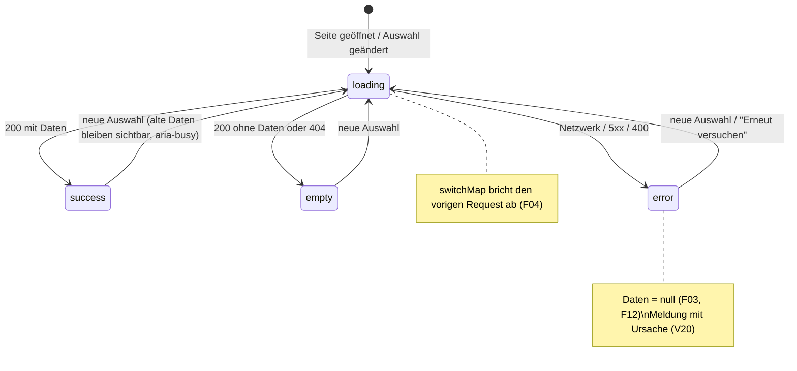
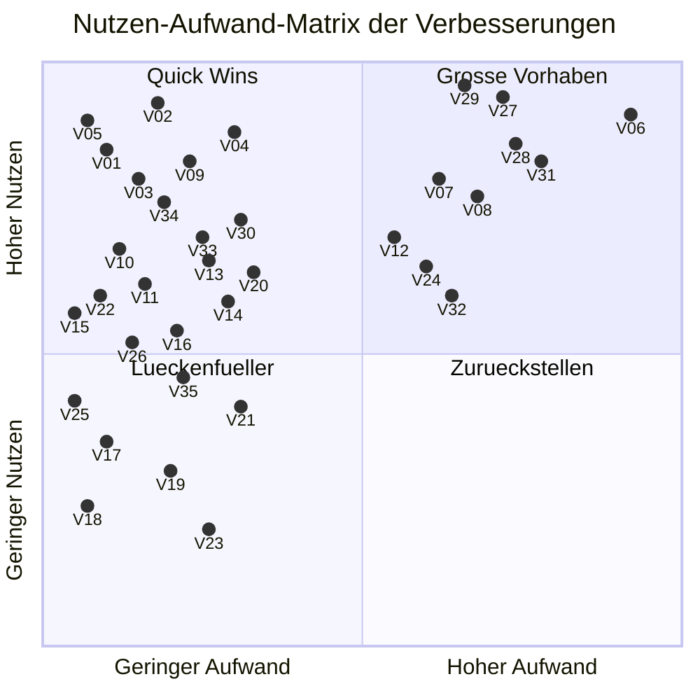
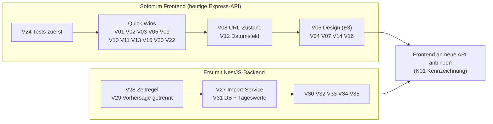
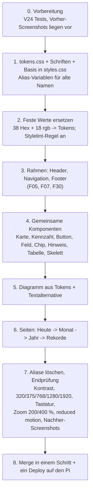

# 02 – Verbesserungen, neue Funktionen und Design

> **Umsetzungsstand (24.11.2026):** Dieses Dokument bleibt das Planungsdokument für Verbesserungen und Design und ist nicht umgeschrieben. Umgesetzt ist es mit den Roadmap-Schritten 0.2 bis 1 (Quick Wins, Design) und 7 bis 12c (Anzeige und Funktionen).
> - **Design (Schritt 1):** Die Tokens liegen in `frontend/src/styles/tokens.css` (PROJEKTDOKU Abschnitt 5), Schriften lokal, Komponenten ohne feste Farbwerte (stylelint). Nachher-Screenshots: `docs/umbau/screenshots/nachher/` (Übersicht in PROJEKTDOKU Abschnitt 9b).
> - **Neue Funktionen:** N01, N03, N04 in Schritt 12a, N05 und N06 in 12b, N07 in 12c, N02 (Anmeldung, Import, Lücken nachladen) in den Schritten 10 und 11. **N09 (Live-Aktualisierung) ist abgelehnt**, auch WebSockets und Events entfallen (Schritt 13).
> - **Bewusste Abweichungen:** Der Footer-Link heißt „Datenstand“ statt „Status“ (14b, siehe unten). Die Hinweisbox (N07) hat keinen Link zum DWD. Die 6 Kenntag-Karten (N05) stehen mobil untereinander (vom User bestätigt). Der Chip „11 von 12 Monaten“ (Jahr) und die Pfeile für Vor- und Folgemonat sind nicht umgesetzt (offen, PROJEKTDOKU Abschnitt 9a). V26 (Wortwahl „Messdaten“) ist nicht entschieden, die Kicker bleiben.
> - Die Liste aller Abweichungen steht in `03-zielbild.md` im Abschnitt „Abweichungen in der Umsetzung“; Betrieb ohne Pi: `04-roadmap.md`, Schritt 14.

Stand: 19.11.2026 · Grundlage: `docs/umbau/01-analyse.md` (Befunde, Fehlerliste F01–F34, Anhang A, Abschnitt 7 „Entscheidungen“), Code unter `frontend/src`, Screenshots unter `docs/umbau/screenshots/`.

**Kennzeichnung:** **B** = Befund (steht im Code oder in 01-analyse.md) · **A** = Annahme · **E** = Empfehlung
**Kontraste:** Alle Werte sind nach WCAG 2.2 (relative Luminanz, `(L1 + 0,05) / (L2 + 0,05)`) selbst gerechnet (per `node -e`). Die Kontrollwerte aus dem Auftrag stimmen: 4,02 · 4,31 · 2,83 · 5,61 · 6,16 · 14,81.
**Aufwand** (**A**, Einzelarbeit im Lernprojekt): **S** = bis ½ Tag · **M** = 1–3 Tage · **L** = mehr als 3 Tage
**Priorität:** **P1** = zuerst, blockiert anderes oder ist ein sichtbarer Fehler · **P2** = im selben Umbau · **P3** = wenn Zeit bleibt

**Verbindliche Entscheidungen (01-analyse.md, Abschnitt 7):**
- Rollen: Gast (lesen ohne Anmeldung) und Admin. Keine Besucherkonten.
- Standort: nur Heubach, als Stammdatum in der DB.
- Stack: NestJS 11, Zod, TypeORM/SQLite, JWT. Das bestehende Angular-21-Frontend bleibt.
- Vorhersagestunden zählen nicht in Summen, Monatswerten und Rekorden.
- Trockentag: < 0,1 mm. Rekord: höchster bzw. niedrigster Stundenwert.

---

## E1 Verbesserungen am Bestehenden

### E1.1 Verbesserungsliste

**Legende in der Spalte „Bereich“:**
- **FE** = sofort im Frontend möglich, mit der heutigen Express-API
- **BE** = erst mit dem neuen NestJS-Backend
- **Doku** = Repo oder README, unabhängig vom Backend

#### Sofort im Frontend möglich

| Nr. | Bereich | Problem (Befund / F-Nr.) | Vorschlag | Nutzen | Aufwand | Priorität |
|---|---|---|---|---|---|---|
| V01 | Bedienung · FE | **F02:** Die Monatsauswahl zeigt „Jan“, geladen ist aber Nov. Der Wert wird vor den `@for`-Optionen gesetzt (`monthly-page.html:10-14`). Gleicher Aufbau beim Jahr (`yearly-page.html:5`) | **E:** An jeder `<option>` `[selected]="m.value === selectedMonth()"` setzen bzw. das Feld an ein reaktives Formular-Control binden. Für Jahr und Monat gleich lösen | Anzeige und geladene Daten passen zusammen | S | P1 |
| V02 | Funktion · FE | **F03, F12:** Bei einem Fehler bleiben alte Werte stehen (`today-page.ts:140`, `monthly-page.ts:77-80`, `yearly-page.ts:66-69`) | **E:** Ein Zustandsmodell je Seite: `idle → loading → success / empty / error` (siehe Diagramm unten). Bei `error`/`empty` werden die Daten auf `null` gesetzt. Bei `loading` bleiben die alten Daten sichtbar und tragen `aria-busy="true"`; ein Ladebalken erscheint | Keine falschen Zahlen unter einer neuen Überschrift; kein Flackern | S | P1 |
| V03 | Funktion · FE | **F04:** Race Condition bei schnellem Klicken, kein `switchMap` (`today-page.ts:138`, `monthly-page.ts:69`, `yearly-page.ts:58`) | **E:** Die Auswahl als Observable führen (`toObservable(selectedDate)` oder Router-Parameter aus V08) und mit `switchMap` laden. Veraltete Requests werden dadurch abgebrochen | Angezeigte Daten = gewählter Tag | S | P1 |
| V04 | Bedienung · FE | **F05:** Überlauf 475/375 px, Navigation ohne Media-Query (`app.css:11-37`). **F31:** Klickflächen 32–39 px hoch | **E:** Unter 768 px zweizeiliger Header: Logo oben, darunter die Navigation als Raster aus 4 gleich breiten Spalten. Jede Klickfläche ≥ 44 × 44 px. Kein Hamburger-Menü, Begründung in E3.7.1. Alle Buttons und Felder `min-height: var(--target-min)` | Reflow nach WCAG 1.4.10 erfüllt; „Rekorde“ ohne seitliches Scrollen erreichbar | S | P1 |
| V05 | Barrierefreiheit · FE | **F07:** Fokusring 1,0–1,44:1; `outline: none` in `today-page.css:24`, `monthly-page.css:9`, `yearly-page.css:9` | **E:** Ein globaler Fokusring über das Token `--color-focus` (3 px, Abstand 2 px), Werte in E3.3. Alle `outline: none` entfernen | 2.4.7 und 1.4.11 erfüllt | S | P1 |
| V06 | Optik / Barrierefreiheit · FE | **F08:** 14 Textkombinationen unter AA (Anhang A). **F25:** Klasse `wind` an Temperaturkarten. **S11:** 38 Hex- und 18 rgb-Werte | **E:** Neues Design über `tokens.css` (E3). Kein fester Farbwert im Komponenten-Code; alle Karten mit derselben Akzentkante, Kantenfarben haben keine Bedeutung mehr | Alle Texte ≥ 4,5:1; ein einheitliches Bild; Farben an einer Stelle änderbar | L | P1 |
| V07 | Barrierefreiheit · FE | **F17:** Canvas ohne Textalternative (`climate-chart.html:2`); Wettersymbole ohne Text (`today-page.html:112`) | **E:** Das Diagramm steht in einem `<figure>`. Dazu kommen eine Kernaussage als `<figcaption>`, am Canvas `role="img"` mit `aria-label` und eine Datentabelle „Werte als Tabelle“ in `<details>`. Die Vorschau bekommt Text („Leichter Regen“) neben dem Symbol | 1.1.1 erfüllt; die Werte lassen sich auch ohne Diagramm ablesen | M | P1 |
| V08 | Funktion · FE | **F11:** Auswahl nicht in der URL (`app.routes.ts:3-9`); `/monat/2025/03` leitet auf `/` um | **E:** Routen `/tag/:datum`, `/monat/:jahr/:monat`, `/jahr/:jahr` mit `withComponentInputBinding()`. `/` bleibt „heute“. ‹ › und die Auswahlfelder navigieren über den Router. Ungültige Parameter zeigen einen Hinweis statt einer Umleitung | F5, Zurück und Lesezeichen funktionieren; Rekord-Karten können auf einen Tag verlinken | M | P1 |
| V09 | Funktion · FE | **F06 (Frontend-Teil):** „heute“ in UTC (`today-page.ts:25,31,32,86,102,119,126`); Stunde mit `getHours()` (`today-page.ts:37`) | **E:** Ein zentraler Helfer `berlinToday()` / `berlinHour()` mit `Intl.DateTimeFormat(…, { timeZone: 'Europe/Berlin' })`. Er ersetzt alle `toISOString().slice(0,10)`. Datumsrechnung (‹ ›) nur über Kalenderdaten, nicht über `Date`-Objekte in UTC | Zwischen 0 und 2 Uhr erscheint der richtige Tag | S | P1 |
| V10 | Barrierefreiheit · FE | **F30:** Titel immer „Wetter Heubach“ (`index.html:5`); kein `aria-current` (`app.html:8-11`) | **E:** `title` an jeder Route plus eigene `TitleStrategy` mit Zeitraum, z. B. „November 2025 – Monat – Wetter Heubach“. Dazu `ariaCurrentWhenActive="page"` an `routerLinkActive` | 2.4.2 erfüllt; Tabs und Verlauf sind unterscheidbar | S | P2 |
| V11 | Optik · FE | **F29:** `9.7°C` statt `9,7 °C`; keine `LOCALE_ID` | **E:** `registerLocaleData(localeDe)` und `LOCALE_ID: 'de-DE'`. Eine Pipe `unit` setzt Zahl, schmales geschütztes Leerzeichen (U+202F) und Einheit. Datum ausgeschrieben („Donnerstag, 19. November 2026“) | Einheitliche, deutsche Zahlen | S | P2 |
| V12 | Bedienung · FE | **F09:** Ein leeres Datumsfeld führt zu Request `/api/data/day/` und `RangeError`. **F19:** kein `min`/`max`, Zukunft ohne Rückweg (`today-page.html:9,15-25`) | **E:** Sichtbares Label „Tag wählen“, `min="2025-01-01"`, `max` = heute (Berlin). Ein leerer Wert lädt nicht; stattdessen Fehlermeldung am Feld (`aria-invalid`, `aria-describedby`), ‹ › sind dann deaktiviert. Bei Zukunftsdaten: Hinweisbox „Vorhersage“; liegt das Datum innerhalb der 7 Tage, wird diese Vorschauzeile gezeigt, dazu der Button „Zurück zu heute“ | Kein Fehlerzustand mehr durch Bedienung | M | P2 |
| V13 | Funktion · FE | **F15:** `Math.min/max` mit `null` ergibt 0 °C (`today-page.ts:50,56`) | **E:** Vor der Berechnung `null` herausfiltern. Fehlt ein Wert, wird „–“ angezeigt, dazu „2 Stunden ohne Wert“ | Keine erfundenen 0 °C | S | P2 |
| V14 | Bedienung · FE | **F10 (Frontend-Teil):** 4–7 s ohne Anzeige; die Statistik zeigt so lange „aus **0** gespeicherten Tagen“ (`stats-page.html:4`) | **E:** Skelett-Karten in Endgröße (E3.7.8). Den Satz „aus … Tagen“ erst nach dem Laden zeigen | Die Wartezeit wirkt kürzer; keine falsche 0 | S | P2 |
| V15 | Bedienung · FE | **F21:** Button „Laden“ überflüssig (`monthly-page.html:15`, `yearly-page.html:10`) | **E:** Button entfernen; ein Wechsel der Auswahl lädt sofort (zusammen mit V03) | Weniger Bedienelemente, keine doppelten Requests | S | P2 |
| V16 | Optik / Bedienung · FE | **F23:** große Zahl ohne „Max“ (`today-page.html:74-75`). **F24:** Niederschlag, Wind und Datum doppelt, Datum im ISO-Format (`today-page.html:42-65`) | **E:** Jede große Zahl bekommt einen Kicker („HÖCHSTWERT“). Jeder Wert erscheint nur einmal; das Datum wird nur im Seitenkopf ausgeschrieben | Klarere Aussage, weniger Lärm | S | P2 |
| V17 | Bedienung · FE | **F18:** An vergangenen Tagen wird die aktuelle Vorschau mit „heute“ gezeigt (`today-page.ts:92`, `today-page.html:107`) | **E:** Die 7-Tage-Vorschau nur bei „heute“ zeigen. Sonst ein Textlink „Aktuelle 7-Tage-Vorschau“ auf `/` | Kein Widerspruch auf der Seite | S | P3 |
| V18 | Bedienung · FE | **F20:** Jahre 2022–2026 angeboten, Daten erst ab 2025 (`monthly-page.ts:29`, `yearly-page.ts:25`) | **E:** Übergangsweise eine Konstante `DATA_START = '2025-01-01'`, endgültig aus `/api/status` (V35) | Keine leeren Auswahlwerte | S | P3 |
| V19 | Funktion · FE | **F26:** WMO 66/67 erscheint als „Schneefall“, 56/57 als „Regen“; unbekannt über 86 wird zu „Gewitter“, `null` zu „Nebel“ (`weather-icon.ts:6-23`) | **E:** Vollständige Tabelle der Open-Meteo-Codes (0–3, 45, 48, 51–57, 61–67, 71–77, 80–86, 95–99). Unbekannte Codes → „Unbekannt“, `null` → „Keine Angabe“. Charakterisierungstest dazu (V24) | Richtige Beschreibung, vor allem bei Glätte | S | P3 |
| V20 | Bedienung · FE | **B (01, 1.4):** Fehlermeldungen allgemein („Fehler beim Laden.“); kein Hinweis auf den Datenbeginn | **E:** Meldung je nach Ursache. 404: „Für den 31.12.2024 liegen keine Daten vor. Daten gibt es ab dem 01.01.2025.“ plus Link. Netzwerk/5xx: „Server nicht erreichbar“ plus Button „Erneut versuchen“ | Die Ursache ist klar, und der Nutzer sieht einen nächsten Schritt | S | P2 |
| V21 | Bedienung · FE | **B (01, 1.4):** Das Monatsdiagramm zeigt nur vorhandene Tage; Lücken sind nicht sichtbar | **E:** Die x-Achse zeigt immer den ganzen Monat (1. bis 28./30./31.); fehlende Tage sind `null` (Lücke in der Linie). Chip „18 VON 30 TAGEN“ (`daysComplete`/`daysExpected`, 03 US04-4) | Lücken und unvollständige Monate erkennbar | S | P3 |
| V22 | Barrierefreiheit / Optik · FE | **B (01, 1.4/1.5):** Felder nur mit `aria-label`, ohne sichtbares Label; Formulare in Arial, weil `font: inherit` fehlt | **E:** Sichtbare `<label>` über jedem Feld; global `button, input, select { font: inherit }` (E3.2) | 3.3.2 erfüllt; einheitliche Schrift | S | P2 |
| V23 | Performance · FE | **B (01, 1.4):** `FormsModule` geladen, aber ungenutzt (148 KB Dev); Chart.js komplett (`registerables`, `climate-chart.ts:5-7`); das Diagramm wird bei jeder Änderung neu gebaut (`climate-chart.ts:33-38`) | **E:** `FormsModule` entfernen. Nur die benötigten Chart.js-Teile registrieren (Bar-/Line-Controller, Elemente, Linear-/Category-Scale, Tooltip, Legend). `chart.update()` statt `destroy()` | Kleineres Bundle, ruhigerer Wechsel | S | P3 |
| V24 | Funktion (Qualität) · FE | **F33 / S2:** kein Testziel, keine Specs | **E:** `ng test` einrichten (**A:** in Angular 21 standardmäßig mit Vitest). Charakterisierungstests **vor** dem Umbau: Berliner Datum (V09), WMO-Tabelle (V19), `null`-Behandlung (V13), Zustandsmodell (V02) | Sicherheitsnetz für den Umbau | M | P2 |
| V25 | Funktion · Doku | **F34:** Link auf die Tippfehler-Domain `pm2.keymaster.io` (README.md:190). **F16:** Die README empfiehlt `seed-data.ts` (README.md:120-125) | **E:** Link auf `pm2.keymetrics.io` korrigieren. Die Seed-Empfehlung sofort aus der README streichen (das Skript selbst siehe V34) | Kein Klick auf eine fremde Domain; keine überschriebenen Echtdaten | S | P2 |
| V26 | Optik (Wortwahl) · FE | **B (01, 1.2):** Die UI spricht von „Messdaten“ und „Messtagen“ (`today-page.html:20`, `stats-page.html:71`), es sind aber Modelldaten. Offene Frage 5 | **E:** Begriffe „Wetterdaten“, „Rückblick“ (bis jetzt) und „Vorhersage“ (ab jetzt), „Tage mit Daten“. Im Footer: „Modelldaten von Open-Meteo, keine Stationsmessung“. **Entscheidung des Auftraggebers nötig** | Ehrliche Aussage; Grundlage für N01 | S | P2 |

#### Erst mit dem neuen Backend

| Nr. | Bereich | Problem (Befund / F-Nr.) | Vorschlag | Nutzen | Aufwand | Priorität |
|---|---|---|---|---|---|---|
| V27 | Funktion · BE | **F01:** Wegen `Promise.all` wird bei einem Fehler der Vorhersage gar nichts gespeichert (`scheduler.ts:15`). **F32:** `lastStatus: 'ok'` vor dem ersten Abruf (`scheduler.ts:6`). **B (01, 1.3):** kein Timeout, kein Retry | **E:** Ein Import-Service in NestJS mit getrennten, unabhängig protokollierten Schritten (Stundenwerte / Vorhersage). Dazu Timeout, begrenzter Retry und Status in der DB (Tabelle `import`, 03 B2.1). Anfangszustand: „noch kein Abruf“ | Daten gehen nicht mehr wegen eines Teilfehlers verloren; der Status ist ehrlich und übersteht einen Neustart | M | P1 |
| V28 | Funktion · BE | **F06 / S6:** „heute“ in UTC (`server.ts:25`, `weather-api.ts:58`); Zeitstempel ohne Offset; Umstellungstage mit 24 statt 23/25 Stunden | **E:** Zeitregel: Ein Tag ist ein Kalendertag in Europe/Berlin. Jede Stunde wird als UTC-Zeitpunkt **und** als lokales Datum (Index) gespeichert. Tests für die Umstellungstage | Eindeutige Tage, richtige Summen an Umstellungstagen | M | P1 |
| V29 | Funktion · BE | **F13:** Vorhersagestunden fließen in Tagessumme, Monatswerte und Rekorde (`weather-api.ts:31-40`) | **E:** Jede Stunde trägt ihre Herkunft `source` (`archive` · `forecast_api` · `prediction`) und das berechnete Feld `isPrediction` (03 B2.2, R08). Aggregationen und Rekorde nur über vergangene Stunden. Die API liefert die Tageswerte getrennt in `observed` und `predicted`. Die Darstellung beschreibt N01 | Entscheidung aus 01, Abschnitt 7 umgesetzt | M | P1 |
| V30 | Funktion · BE | **F14:** Rekordvergleich mit gerundetem Wert (`data-store.ts:168-170`). **F27:** Die Trockenperiode zählt Dateien statt Kalendertage (`data-store.ts:176-190`) | **E:** Rekorde per SQL-`MAX`/`MIN` auf ungerundeten Werten; gerundet wird erst in der Antwort. Trockenperiode über Kalendertage mit Tageswert < 0,1 mm; ein fehlender Tag beendet die Periode. Unit-Tests mit den Fällen aus F14 und F27 | Richtige Rekorde | S | P2 |
| V31 | Performance · BE | **F10:** `/api/stats` 3,3–3,7 s, `/api/data/year` 1,9–3,4 s, Event-Loop blockiert. **B (01, 1.4):** nur ETag, kein `Cache-Control` | **E:** SQLite mit Index auf dem lokalen Datum und vorberechneten Tageswerten (`daily_summary`, beim Import aktualisiert). **Umgesetzt als Berechnung plus Cache** (03 B2.4): Tageswerte per SQL `GROUP BY local_date`, Cache nach Datenrevision; die Tabelle `daily_summary` kommt erst, wenn p95 > 200 ms. Ziel: jede Antwort < 200 ms. `Cache-Control: max-age=300` für den laufenden Tag, längere Laufzeit für abgeschlossene Monate | Seiten in unter 1 s fertig | M | P1 |
| V32 | Funktion · BE | **F28 / S8:** Das Jahresmittel ist ein ungewichtetes Mittel der Monatsmittel (`yearly-page.ts:38-42`). Das Frontend **kann** gar nicht gewichten, weil `YearSummary` keine Tageszahl enthält (`models/weather.ts:29-33`) | **E:** Aggregation nur noch im Backend (Mittel der Tagesmittel vollständiger Tage, 03 R12). Jede Antwort enthält `daysComplete`, `daysExpected` und `complete` (03 B2.2); das Frontend rechnet nichts mehr selbst und zeigt den Chip „UNVOLLSTÄNDIG“ | Eine Wahrheit (S8); 11,65 statt 11,42 °C | M | P2 |
| V33 | Funktion · BE | **F22:** `2026-02-30` und Monat 13 werden akzeptiert (`server.ts:36,50`). **B (01, 1.3):** Stacktraces als HTML | **E:** Zod-Schemas für Pfad und Query (echtes Kalenderdatum, Monat 1–12, Bereich ab Datenbeginn). Ein globaler Exception-Filter liefert JSON `{ statusCode, message }` ohne Stacktrace | Klare 400-Antworten; das Frontend kann sie anzeigen (V20) | S | P2 |
| V34 | Funktion · BE | **F16:** `seed-data.ts` überschreibt echte Daten mit Zufallswerten (`seed-data.ts:6-11,60`) | **E:** Skript löschen. Testdaten nur über Seeds in eine **eigene** Test-DB (`DB_PATH` aus `@nestjs/config`; 03 B4.4: `weather.dev.db`, Seeds verweigern bei gesammelten Daten) | Echtdaten sind geschützt | S | P2 |
| V35 | Bedienung · BE | **F20 (Backend-Teil):** Der Datenbeginn ist nur dem Entwickler bekannt | **E:** `GET /api/status` liefert `dataFrom` und `dataTo` (03 US07-1). Daraus entstehen die Jahresliste und `min`/`max` am Datumsfeld | Die Auswahl passt automatisch zum Bestand | S | P3 |

**Kontrolle der Abdeckung (B):**

| Fehler | Verbesserung |
|---|---|
| F01 | V27 |
| F02 | V01 |
| F03 | V02 |
| F04 | V03 |
| F05 | V04 |
| F06 | V09 und V28 |
| F07 | V05 |
| F08 | V06 |
| F09 | V12 |
| F10 | V14 und V31 |
| F11 | V08 |
| F12 | V02 |
| F13 | V29 und N01 |
| F14 | V30 |
| F15 | V13 |
| F16 | V25 und V34 |
| F17 | V07 |
| F18 | V17 |
| F19 | V12 |
| F20 | V18 und V35 |
| F21 | V15 |
| F22 | V33 |
| F23 | V16 |
| F24 | V16 |
| F25 | V06 |
| F26 | V19 |
| F27 | V30 |
| F28 | V32 |
| F29 | V11 |
| F30 | V10 |
| F31 | V04 |
| F32 | V27 |
| F33 | V24 |
| F34 | V25 |

Damit kommt jede F-Nummer mindestens einmal vor.

**Zustandsmodell für V02/V03** (gilt für Heute, Monat, Jahr und Rekorde):



### E1.2 Nutzen-Aufwand-Matrix



Dieselbe Einordnung als Tabelle (Quick Wins zuerst):

| Quadrant | Frontend sofort | Mit Backend | Begründung |
|---|---|---|---|
| **Quick Wins** (hoher Nutzen, Aufwand S) | V05, V02, V01, V03, V09, V04, V10, V22, V11, V13, V20, V14, V15, V16, V26 | V34, V30, V33 | sichtbare Fehler (F02–F07) mit wenigen Zeilen behoben |
| **Große Vorhaben** (hoher Nutzen, Aufwand M/L) | V06, V07, V08, V12, V24 | V27, V28, V29, V31, V32 | Kern des Umbaus: Design, URL-Zustand, Zeit- und Vorhersageregel, Datenbank |
| **Lückenfüller** (geringer Nutzen, Aufwand S) | V17, V18, V19, V21, V23, V25 | V35 | nebenbei, wenn die Datei sowieso offen ist |
| **Zurückstellen** (geringer Nutzen, hoher Aufwand) | – | – | Kein Punkt fällt hierher. Die Fehlerliste enthält keine teuren Kleinigkeiten |

### E1.3 Reihenfolge: sofort im Frontend gegenüber erst mit Backend



- **E:** Die Frontend-Punkte lösen vorhandene Fehler **ohne** das Backend. Weil das Frontend bleibt, ist diese Arbeit nicht verloren.
- **E:** V09 (Berliner Datum im Frontend) bleibt auch nach V28 sinnvoll. Der Browser muss für `max` am Datumsfeld und den Button „Heute“ weiterhin selbst wissen, welcher Tag in Heubach ist.
- **A:** V13 und V20 bleiben nach dem Backend-Umbau als Absicherung im Code. Ihr Nutzen sinkt, wenn das Backend `null`-Werte und Fehler sauber liefert.

---

## E2 Neue Funktionen (Vorschläge)

Alle Funktionen sind **Vorschläge**; der Auftraggeber nimmt sie an oder lehnt sie ab. Keine setzt Besucherkonten voraus.

**Pfade** folgen REST: Ressource im Plural im Pfad, keine Verben, Filter als Query, je Ressource ein Controller mit Zod-DTO und Swagger-Doku (Aufbau wie im Beispielprojekt Beer API). **Verbindlich ist `03-zielbild.md`, Abschnitt B3.1.** Die Pfade und Feldnamen in diesem Abschnitt sind seit der Prüfung (05, P08) an 03 angeglichen. Die folgende Tabelle zeigt, was aus den ursprünglichen Vorschlägen geworden ist.

**Ressourcen, auf die sich die Vorschläge beziehen (Vorschlag → verbindlich nach 03 B3.1):**

| ursprünglicher Vorschlag in 02 | verbindlich (03 B3.1) |
|---|---|
| `GET /api/days/{date}` | `GET /api/days/{date}`, dazu `GET /api/days/today` und `GET /api/days?from&to` |
| `GET /api/months/{year}/{month}` | `GET /api/summaries/months/{yearMonth}` (`YYYY-MM`), Liste `GET /api/summaries/months?year=` |
| `GET /api/years/{year}` | `GET /api/summaries/years/{year}`, Liste `GET /api/summaries/years` |
| `GET /api/summaries?from&to` (N06) | `GET /api/summaries/periods?from&to` |
| `GET /api/records` | `GET /api/records` |
| `GET /api/forecast-days` (mit Feld `notices`) | `GET /api/forecasts`; Hinweise als eigene Ressource `GET /api/notices` |
| `GET /api/status`: `lastSuccessAt`, `nextRunAt`, `lastRunState` (`never`/`ok`/`error`), `firstDate`, `lastDate` | `GET /api/status`: `lastSuccessfulUpdateAt`, `nextScheduledUpdateAt`, `updateState` (`never`/`ok`/`delayed`), `dataFrom`, `dataTo`, `daysWithData`, `daysComplete`, `gapCount` |
| `POST /api/tokens` (N02) | `POST /api/auth/tokens`, dazu `GET /api/auth/me` |
| `POST /api/imports` `{ from, to, type: hourly/archive/forecast }` | `POST /api/imports` `{ kind: range/gaps, from, to, overwriteCorrections? }` |
| `POST /api/corrections`, `GET /api/corrections`, `DELETE /api/corrections/{id}` (N03) | `PATCH /api/observations/{id}` mit `If-Match`, `GET /api/observations/{id}/corrections`, Übersicht `GET /api/corrections?from&to&page&limit`, Rücknahme `POST /api/observations/{id}/corrections/{correctionId}/reversal` (kein DELETE, die Historie bleibt) |
| Stunde mit `kind: observed/forecast`, `totals.observed/forecast` (V29, N01) | `source` + `isPrediction`, Tageswerte in `observed`/`predicted` |
| `coverage: { days, expectedDays }` (V32) | `daysComplete`, `daysExpected`, `complete` |
| Tabelle `import_job` (V27) | Tabelle `import` |
| Tabelle `daily_summary` (V31) | Berechnung plus Cache (03 B2.4), Tabelle erst bei p95 > 200 ms |
| Frontend `/admin/anmeldung` | `/admin/anmeldung` (03 B5.1; deutscher Routenname, die REST-Regel gilt nur für API-Pfade) |
| Frontend `/status` (N04) | `/status` (03 B5.1) |

**Admin-Ressourcen:** Schutz per JWT-Guard mit Rolle `admin`; Passwort-Hash mit bcryptjs.

### N01 Vorhersage und Rückblick kennzeichnen, Datenstand anzeigen

- **User Story:** Als **Gast** möchte ich auf einen Blick sehen, welche Werte schon vergangen sind (Rückblick) und welche nur vorhergesagt sind, und wie aktuell die Daten sind. Damit verwechsle ich Prognose und Rückblick nicht.
- **Nutzen:** Setzt die Entscheidung aus 01, Abschnitt 7 sichtbar um (F13). Löst den Punkt aus der Ausfalltabelle, dass Gäste einen Ausfall von Open-Meteo „kaum bemerken“ (01, Abschnitt 4).
- **Ressourcen und Endpunkte:**
  - `GET /api/days/{date}`: jede Stunde mit `source` (`archive`/`forecast_api`/`prediction`) und `isPrediction`, die Tageswerte getrennt in `observed` und `predicted` (03 US01-3).
  - `GET /api/status`: `lastSuccessfulUpdateAt`, `nextScheduledUpdateAt` und `updateState` (`never`/`ok`/`delayed`, 03 R25).
  - Entität **observation** (Stundenwert) mit Spalte `source`.
- **Darstellung (E3):**
  - Chip „VORHERSAGE“; Diagramm mit Vorhersageband, gestrichelter Linie und schraffierten Balken.
  - „Stand: 14:05 Uhr“ im Seitenkopf.
  - Ab 2 h ohne Aktualisierung (**A:** Schwelle) eine Hinweisbox „Daten seit 3 Stunden nicht aktualisiert“.
- **Aufwand:** M (Backend V29 + Frontend)
- **Risiken:** Grenze „jetzt“ an der vollen Stunde (14:59 Uhr gehört zu welcher Stunde?) → Regel festlegen: Stunden mit Beginn ≤ jetzt gelten als Rückblick (**A**).
- **MoSCoW: Must.** Die Entscheidung des Auftraggebers verlangt getrennte, gekennzeichnete Anzeige.

### N02 Admin: Anmeldung, Datenimport und Lücken nachladen

- **User Story:** Als **Admin** möchte ich mich anmelden, einen Import für einen Zeitraum anstoßen und gefundene Datenlücken mit einem Klick nachladen. Damit sind die Daten vollständig, ohne dass ich Skripte auf dem Raspberry Pi starte.
- **Nutzen:** Ersetzt `backfill.ts` und das gefährliche Überschreiben (01, 1.2). Fehlende Stunden während eines Ausfalls des Backend-Prozesses (01, Abschnitt 4) lassen sich gezielt ergänzen. Zusätzlich möglich: ein **Archivabgleich**, der die Werte der letzten 10 Tage aus der Vorhersage-API später durch Archivwerte ersetzt (offene Frage 6).
- **Ressourcen und Endpunkte:**
  - `POST /api/auth/tokens`: Anmeldung, Body `{ username, password }` → **200** `{ accessToken, tokenType, expiresIn, user }`. Fehler 400 · 401 · 415 · 429 (Ratenbegrenzung 5 pro Minute). Dazu `GET /api/auth/me` (03 B3.1, B4.6).
  - `POST /api/imports`: Body `{ kind: 'range' | 'gaps', from, to, overwriteCorrections? }` → **202 Accepted** mit `Location: /api/imports/{id}`. 409, wenn bereits ein Import läuft (03 US10).
  - `GET /api/imports`, `GET /api/imports/{id}`: Protokoll mit Status, Zeit, Zählern (`counts`) und Fehlertext.
  - `GET /api/gaps?from=&to=`: fehlende Stunden, `null`-Werte und veraltete Vorhersagen.
  - Entitäten `user`, `role`, `user_role` (Benutzername, bcrypt-Hash, Rolle) und `import` (Importauftrag).
  - Frontend: `/admin/anmeldung`, `/admin/importe`; Guard und HTTP-Interceptor.
- **Aufwand:** L
- **Risiken:**
  - Ein Import darf korrigierte Werte (N03) nicht überschreiben.
  - Lange Imports dürfen den Server nicht blockieren (asynchron, ein Auftrag zur Zeit).
  - Ratenlimit von Open-Meteo (**A**).
  - Token-Ablage im Browser im Architekturdokument festlegen.
- **MoSCoW: Must.** „Datenimport anstoßen“ und „Lücken nachladen“ sind ausdrücklich beschlossene Admin-Rechte.

### N03 Admin: Daten korrigieren mit Änderungsprotokoll

- **User Story:** Als **Admin** möchte ich einen offensichtlich falschen Stundenwert korrigieren oder als ungültig markieren und dabei einen Grund angeben. Damit stimmen Rekorde und Summen, und jede Änderung ist nachvollziehbar.
- **Nutzen:** Ausreißer im Modell verfälschen sonst dauerhaft die Rekorde. Das Protokoll macht Änderungen transparent. Gäste sehen an korrigierten Werten den Chip „KORRIGIERT“.
- **Ressourcen und Endpunkte:**
  - `PATCH /api/observations/{id}` mit `If-Match` (ETag): Body mit den geänderten Messwerten und `reason` → **200** mit neuem `ETag`. Regeln nach 03 R16: Grund 3–500 Zeichen, 6 korrigierbare Felder (Temperatur, gefühlte Temperatur, Niederschlag, Wettercode, Windgeschwindigkeit, Windrichtung) mit Wertebereich je Feld.
  - `GET /api/observations/{id}/corrections`: Historie einer Stunde.
  - `GET /api/corrections?from=&to=&page=&limit=`: Übersicht aller Korrekturen eines Zeitraums (Änderungsprotokoll, 03 US13-14).
  - `POST /api/observations/{id}/corrections/{correctionId}/reversal`: Rücknahme; der alte Wert gilt wieder, die Rücknahme ist ein eigener Eintrag in der Historie (03 R33, US13-16).
  - Entität `correction`: Feld, alter Wert, neuer Wert, Grund, Admin, Zeitpunkt, ggf. zurückgenommene Korrektur. Der Originalwert bleibt erhalten.
  - Tageswerte, Rekorde und Zusammenfassungen sind sofort aktuell (Berechnung plus Cache nach Datenrevision, 03 B2.4).
- **Aufwand:** M
- **Risiken:** Rekorde ändern sich nachträglich → Hinweis auf der Rekordseite (Chip „KORRIGIERT“, 03 US06-7). Ein Import (N02) muss Korrekturen respektieren (03 R20).
- **MoSCoW: Must.** „Daten korrigieren“ ist beschlossen. Umfang: ein Formular je Stunde, eine Übersicht, eine Rücknahme. Der Umfang der Felder richtet sich nach 03 R16 (6 Felder) und nicht mehr nach dem ursprünglichen Vorschlag „nur Temperatur und Niederschlag“.

### N04 Status- und Datenqualitätsseite

- **User Story:**
  - Als **Gast** möchte ich sehen, wann zuletzt aktualisiert wurde und wie vollständig die Daten sind. Damit kann ich die Zahlen einschätzen.
  - Als **Admin** möchte ich zusätzlich Fehlerdetails und das Importprotokoll sehen. Damit erkenne ich Probleme, bevor Lücken entstehen.
- **Nutzen:**
  - Ein Ausfall von Open-Meteo wird sichtbar (01, Abschnitt 4).
  - `lastError` ist heute öffentlich mit Rohtext (01, 1.3) → künftig nur für den Admin.
  - `/api/status` wird heute im Frontend gar nicht genutzt (`weather.service.ts:12`).
- **Ressourcen und Endpunkte:**
  - `GET /api/status` (öffentlich): `lastSuccessfulUpdateAt`, `updateState` (`never`/`ok`/`delayed`, F32), `dataFrom`, `dataTo`, `daysWithData`, `daysComplete`, `gapCount` (03 US17-1).
  - Admin-Details über `GET /api/imports` und `GET /api/gaps` (N02).
  - Frontend: Seite `/status`, Link im Footer.
- **Aufwand:** S (aufbauend auf N02)
- **Risiken:** Keine internen Pfade oder Fehlertexte öffentlich zeigen.
- **MoSCoW: Must.** „Status sehen“ ist beschlossen. Der öffentliche Teil kostet kaum mehr.

### N05 Klimakennzahlen: Frost-, Eis-, Sommer- und Hitzetage

- **User Story:** Als **Gast** möchte ich für einen Monat oder ein Jahr sehen, wie viele Frost-, Eis-, Sommer-, heiße und Trockentage es gab. Damit kann ich den Zeitraum mit eigenen Erinnerungen und Wetterberichten vergleichen.
- **Nutzen:** Verständliche Zahlen statt nur Mittelwerte. Nutzt die vorhandenen Daten ohne neue Quelle.
- **Definitionen (A, angelehnt an die Kenntage des DWD, vom Auftraggeber zu bestätigen):**
  - Frosttag: Tagesminimum < 0 °C
  - Eistag: Tagesmaximum < 0 °C
  - Sommertag: Tagesmaximum ≥ 25 °C
  - heißer Tag: Tagesmaximum ≥ 30 °C
  - Trockentag: < 0,1 mm (Entscheidung)
  - Niederschlagstag: ≥ 0,1 mm

  Alles nur über Rückblick-Stunden.
- **Ressourcen und Endpunkte:**
  - Feld `indicators` in `GET /api/summaries/months/{yearMonth}`, `GET /api/summaries/years/{year}` und `GET /api/summaries/periods` (03 US18).
  - Berechnung aus den Tagesaggregaten (03 B2.4, R27).
- **Aufwand:** S–M
- **Risiken:** Unvollständige Monate verzerren die Werte → `daysComplete`, `daysExpected` und `complete` mitliefern (V32).
- **MoSCoW: Should.** Hoher Nutzen bei geringem Aufwand, sobald V31 steht. Gute Übung für SQL-Aggregation, aber nicht beschlossen.

### N06 Vergleich mit dem Vorjahr

- **User Story:** Als **Gast** möchte ich Monat oder Jahr mit demselben Zeitraum im Vorjahr vergleichen (z. B. Nov 2026 gegen Nov 2025, oder 01.01.–19.11. beider Jahre). Damit sehe ich, ob es wärmer oder nasser war.
- **Nutzen:** Die Daten reichen ab dem 01.01.2025 (01, 0.2), also ist ein Vergleich 2026 gegen 2025 sofort möglich. Ein vergleichbarer Zeitraum statt eines Vergleichs mit einem unvollständigen Jahr (F28).
- **Ressourcen und Endpunkte:**
  - Vollständiger Monat: zwei Abfragen auf `GET /api/summaries/months/{yearMonth}`; kein neuer Endpunkt.
  - Vergleichbarer Teilzeitraum: `GET /api/summaries/periods?from=2025-01-01&to=2025-11-18` (Zusammenfassung für einen frei gewählten Zeitraum bis gestern, Zod prüft `from ≤ to`, maximal 366 Tage; 03 R28, R29).
  - Frontend: Schalter-Chip „VORJAHR VERGLEICHEN“, im Diagramm eine zweite Linie in `--chart-compare` (gestrichelt), Differenz als Text („+1,2 °C wärmer“).
  - Zustand in der URL (`?vergleich=vorjahr`, V08).
- **Aufwand:** M
- **Risiken:** Mit der heutigen API wären die Zahlen falsch (F13, F28). Deshalb erst nach V29/V32.
- **MoSCoW: Should.** Echter Mehrwert eines Dashboards mit Verlauf. Hängt von V29/V32 ab, deshalb nicht Must.

### N07 Hinweise auf Frost, Hitze und Starkregen aus der Vorhersage

- **User Story:** Als **Gast** möchte ich in der 7-Tage-Vorschau einen deutlichen Hinweis sehen, wenn Frost, Hitze oder viel Regen vorhergesagt ist. Damit denke ich an Pflanzen, Auto oder Schirm.
- **Nutzen:** Macht die Vorschau handlungsrelevant.
- **Ressourcen und Endpunkte:**
  - Eigene Ressource `GET /api/notices` → `{ items: [{ id, type: 'frost', date, value, threshold, comparator, unit }], basedOnFetchedAt }`, berechnet aus `GET /api/forecasts` bzw. `daily_forecast` (03 US20).
  - Schwellen als Stammdaten in der DB (Tabelle `notice_threshold`) (**A:** Frost: Tagesminimum < 0 °C; Hitze: Tagesmaximum ≥ 30 °C; viel Regen: Tagessumme ≥ 20 mm).
  - Darstellung als Hinweisbox (E3.7.7), **nicht** in Fehlerrot.
- **Aufwand:** S
- **Risiken:**
  - Verwechslung mit amtlichen Warnungen. Deshalb immer der Text „Kein amtlicher Warnhinweis, siehe Deutscher Wetterdienst“.
  - Die Vorhersage liegt nur als Tageswert vor (`DayForecast`, `models/weather.ts:47-53`). Stündlicher Starkregen ist damit nicht erkennbar.
- **MoSCoW: Could.** Nützlich, aber mit dem Risiko einer Fehldeutung. Erst wenn Must und Should fertig sind.

### N08 Export als CSV und JSON

- **User Story:** Als **Gast** möchte ich die Stundenwerte eines Zeitraums als CSV oder JSON herunterladen. Damit kann ich eigene Auswertungen in einer Tabellenkalkulation machen.
- **Nutzen:** Offene Daten im Heimnetz; Lernziel Content Negotiation.
- **Ressourcen und Endpunkte:**
  - `GET /api/hours?from=&to=` mit `Accept: text/csv` oder `application/json` und `Content-Disposition: attachment`.
  - Spalten: Zeit (mit Offset), Temperatur, gefühlte Temperatur, Niederschlag, Wind, Code, `kind`, `corrected`.
  - Höchstens 366 Tage je Abfrage (Zod).
  - Kopfzeile mit Quellenangabe Open-Meteo (**A:** Lizenz CC BY 4.0, Namensnennung nötig).
  - Frontend: Link „Als CSV herunterladen“ unter der Datentabelle.
- **Aufwand:** S
- **Risiken:** Trennzeichen und Dezimalkomma für deutsches Excel (offene Frage); Last durch große Zeiträume.
- **MoSCoW: Could.** Wenig Aufwand, aber kein beschlossenes Ziel und nur für wenige Gäste relevant.

### N09 Live-Aktualisierung

- **User Story:** Als **Gast** mit offener Seite (z. B. Tablet an der Wand) möchte ich, dass neue Stundenwerte von selbst erscheinen. Damit muss ich nicht neu laden.
- **Nutzen:** Bequem für eine Daueranzeige.
- **Ressourcen und Endpunkte:**
  - `GET /api/events` als Server-Sent Events (`text/event-stream`), Ereignis `data-updated` `{ date, updatedAt }` nach jedem Import.
  - Alternative: WebSocket-Gateway (`@nestjs/websockets`).
  - Das Frontend lädt danach nur die betroffene Ressource neu; alte Daten bleiben bis dahin sichtbar (V02).
- **Aufwand:** M
- **Risiken:** Die Daten ändern sich nur stündlich, deshalb ist der Nutzen gering. Verbindungsabbrüche und Reverse-Proxy-Puffer auf dem Pi (**A**).
- **MoSCoW: Could.** Der Nutzen ist klein, weil es nur stündliche Daten gibt. Ein Hinweis auf den Datenstand (N01) deckt den Bedarf größtenteils ab. **A:** Verlangt eine Kurseinheit WebSockets als Lernziel, ist N09 die passende Stelle.

### N10 Persönliche Favoriten und Benachrichtigungen

- **User Story:** Als Besucher möchte ich Lieblingsansichten speichern und bei Frost benachrichtigt werden. Damit muss ich nicht selbst nachsehen.
- **Begründung der Ablehnung:** Das setzt **Besucherkonten** voraus, die ausgeschlossen sind (01, Abschnitt 7).
- **Ersatz ohne Konto:**
  - Ansichten als Lesezeichen über die URL (V08)
  - letzte Ansicht in `localStorage`, nur im Gerät
- **MoSCoW: Won't (jetzt).** Widerspricht der Rollenentscheidung. Auch weitere Standorte sind ausgeschlossen (nur Heubach).

### E2.1 Übersicht

| Nr. | Funktion | Rolle | nur mit Backend? | Aufwand | MoSCoW |
|---|---|---|---|---|---|
| N01 | Vorhersage und Rückblick kennzeichnen, Datenstand | Gast | ja (V29) | M | **Must** |
| N02 | Anmeldung, Import, Lücken nachladen | Admin | ja | L | **Must** |
| N03 | Korrektur mit Änderungsprotokoll | Admin (Gast sieht „korrigiert“) | ja | M | **Must** |
| N04 | Status- und Datenqualitätsseite | Gast + Admin | ja | S | **Must** |
| N05 | Klimakennzahlen (Frost-, Sommer-, Hitzetage …) | Gast | ja (sinnvoll erst mit V31) | S–M | **Should** |
| N06 | Vergleich mit dem Vorjahr | Gast | ja (richtige Zahlen erst mit V29/V32) | M | **Should** |
| N07 | Hinweise Frost/Hitze/Starkregen | Gast | ja (Schwellen als Stammdaten) | S | **Could** |
| N08 | Export CSV/JSON | Gast | ja | S | **Could** |
| N09 | Live-Aktualisierung (SSE/WebSocket) | Gast | ja | M | **Could** |
| N10 | Favoriten und Benachrichtigungen | (Besucherkonto) | ja | L | **Won't (jetzt)** |

### E2.2 Entscheidung des Auftraggebers (19.11.2026)

| Nr. | Funktion | Entscheidung | Einstufung in der Roadmap |
|---|---|---|---|
| N01 | Vorhersage und Rückblick kennzeichnen | **angenommen** | Must |
| N02 | Anmeldung, Import, Lücken nachladen | **angenommen** | Must |
| N03 | Korrektur mit Änderungsprotokoll | **angenommen**, mit Übersicht aller Korrekturen und Rücknahme (03 US13-13 bis US13-18, R33) | Must |
| N04 | Status- und Datenqualitätsseite | **angenommen** | Must |
| N05 | Klimakennzahlen | **angenommen** | Should |
| N06 | Vergleich mit dem Vorjahr | **angenommen** | Should |
| N07 | Hinweise Frost/Hitze/Starkregen | **angenommen** | Could |
| N08 | Export CSV/JSON | abgelehnt | – |
| N09 | Live-Aktualisierung | abgelehnt; N01 („Stand: …“) reicht | – |
| N10 | Favoriten und Benachrichtigungen | abgelehnt (keine Besucherkonten) | – |

Damit entfällt die optionale Roadmap-Stufe für WebSockets. **Verbindlich für Pfade und Ressourcennamen ist `03-zielbild.md`, Abschnitt B3.1.** Die Pfade und Feldnamen in E1 und E2 sind seit der Prüfung (05, P08) daran angeglichen; die Zuordnung steht am Anfang von E2.

---

## E3 Designkonzept nach der Vorgabe

### E3.1 Grundsätze

- **Warm, ruhig, sachlich.** Papier-Beige als Fläche, fast schwarzer Text, **ein** Akzent: Orange.
- **Akzentfarben nach Größe und Fläche:**
  - `--color-accent-bright` `#E8772E`: nur für Kanten und Linien auf hellem Grund sowie für Text auf dunklem Grund.
  - `--color-accent` `#C2571A`: für große Zahlen, Fokusring und die Temperaturlinie.
  - neue Stufe `--color-accent-strong` `#A04512`: für kleinen Text, Links, Kicker und den Primärbutton.
- **Linien statt Schatten.** Kein `box-shadow`, keine Verläufe.
- **Keine festen Werte im Komponenten-Code.** Alle Farben, Schriften und Abstände kommen aus `tokens.css`. Das Diagramm liest die Tokens zur Laufzeit (E3.8).
  - **E:** Stylelint mit `color-no-hex` und `declaration-property-value-disallowed-list` für alle Dateien außer `tokens.css`.
- **Farbe nie allein.** Zustände werden zusätzlich durch Form, Text oder Muster getragen: Rahmen bei `aria-current`, Häkchen bei ausgewählten Chips, Schraffur für Vorhersage, Kicker „FEHLER“.
- **Datenfarbe Niederschlag:** Ein gedecktes Stahlblau `#3D6A8A` gibt es **nur im Diagramm** als Datenfarbe, nicht in der Bedienoberfläche (**E**, offene Frage).

### E3.2 `tokens.css`

**Ort:** `frontend/src/styles/tokens.css`. In `angular.json` steht es unter `styles` **vor** `src/styles.css` (**B:** `angular.json:53-54`).

**Schriften:**
- Ablage unter `frontend/public/assets/fonts/`, weil `public` als Asset-Ordner eingetragen ist (**B:** `angular.json:47-50`). Die URL lautet dann `/assets/fonts/…`.
- Quelle: **A:** die Variable-Font-Dateien aus `@fontsource-variable/inter` und `@fontsource-variable/space-grotesk` (Dateinamen wie unten), Lizenzdatei `OFL.txt` daneben.
- Kein Aufruf von `fonts.googleapis.com`. Damit bleibt der Befund „keine fremden Hosts“ (01, 1.3) erhalten.

```css
/* ==========================================================================
   tokens.css – Wetter-Dashboard Heubach
   Einzige Datei mit festen Farb- und Schriftwerten.
   Kontraste (WCAG 2.2) siehe docs/umbau/02-verbesserungen-und-design.md, E3.3
   ========================================================================== */

/* ---------- 1. Schriften, lokal als woff2 (SIL Open Font License 1.1) ---------- */
@font-face {
  font-family: 'Inter';
  font-style: normal;
  font-weight: 400 700;
  font-display: swap;
  src: url('/assets/fonts/inter-latin-wght-normal.woff2') format('woff2');
  unicode-range: U+0000-00FF, U+0131, U+0152-0153, U+02BB-02BC, U+02C6, U+02DA,
    U+02DC, U+0304, U+0308, U+0329, U+2000-206F, U+20AC, U+2122, U+2191, U+2193,
    U+2212, U+2215, U+FEFF, U+FFFD;
}

@font-face {
  font-family: 'Space Grotesk';
  font-style: normal;
  font-weight: 500 700;
  font-display: swap;
  src: url('/assets/fonts/space-grotesk-latin-wght-normal.woff2') format('woff2');
  unicode-range: U+0000-00FF, U+0131, U+0152-0153, U+02BB-02BC, U+02C6, U+02DA,
    U+02DC, U+0304, U+0308, U+0329, U+2000-206F, U+20AC, U+2122, U+2191, U+2193,
    U+2212, U+2215, U+FEFF, U+FFFD;
}

:root {
  /* ---------- 2. Farben: Vorgabe ---------- */
  --color-bg: #F4F2EE;
  --color-surface: #FBFAF7;
  --color-surface-muted: #EDE8E0;
  --color-text: #1B1F24;
  --color-text-muted: #3E434A;
  --color-text-subtle: #5A5F66;
  --color-border: #D6D1C7;          /* nur Struktur/Deko: 1,36–1,46:1 */
  --color-border-strong: #C9C3B8;   /* nur Struktur/Deko: 1,44–1,68:1 */
  --color-accent: #C2571A;          /* nur große Schrift, Fokus, Diagramm: 3,69–4,31:1 */
  --color-accent-bright: #E8772E;   /* nur Kanten/Linien hell; Text nur auf Dunkel */

  /* ---------- 3. Farben: Ergänzungen ---------- */
  /* Dunklere Akzentstufe für kleinen Text und Links: 5,60 / 6,00 / 5,13:1 */
  --color-accent-strong: #A04512;
  --color-accent-strong-hover: #8A3B0F;   /* 6,35–7,42:1 */
  --color-accent-strong-active: #74310C;  /* 7,87–9,20:1 */
  --color-on-accent: #FBFAF7;             /* Text auf accent-strong: 6,00:1 */

  /* Rahmen, der ein Bedienelement erkennbar macht (Felder, Sekundärbutton): 3,64–4,26:1 */
  --color-border-control: #7D776C;

  /* Fokus: >= 3,69:1 gegen bg / surface / surface-muted */
  --color-focus: #C2571A;
  --focus-width: 3px;
  --focus-offset: 2px;

  /* Status */
  --color-danger: #A3242B;          /* 6,05–7,07:1; auf danger-bg 6,15:1 */
  --color-danger-bg: #F7E7E4;
  --color-success: #2F6A3B;         /* 5,31–6,20:1; auf success-bg 5,45:1 */
  --color-success-bg: #E6EEE2;
  --color-notice: #A04512;          /* = accent-strong; Hinweis/Vorhersage-Kicker */
  --color-notice-line: #E8772E;     /* = accent-bright; 4px-Linie, Deko */
  --color-notice-bg: #EDE8E0;       /* = surface-muted */
  --color-skeleton: #EDE8E0;        /* Deko, 1,17:1 gegen surface */

  /* Rohwerte für dunkle Bereiche (angewendet über .surface-dark) */
  --dark-bg: #1B1F24;
  --dark-surface-hover: #262B31;
  --dark-text: #F4F2EE;             /* 14,81 / 12,76:1 */
  --dark-text-muted: #D6D1C7;       /* 10,89 / 9,38:1 */
  --dark-text-subtle: #C9C3B8;      /*  9,45 / 8,14:1 */
  --dark-accent: #E8772E;           /*  5,61 / 4,83:1 */
  --dark-accent-hover: #F09A5C;     /*  7,48:1 */
  --dark-accent-active: #F4B382;    /*  Text #1B1F24 darauf 9,16:1 */
  --dark-border: #3A4047;           /* Deko, 1,58:1 */

  /* ---------- 4. Diagramm (Chart.js liest die Werte per getComputedStyle) ---------- */
  --chart-temp: #C2571A;            /* Linie: 4,31:1 auf surface, 3,69:1 im Vorhersageband */
  --chart-precip: #3D6A8A;          /* Balken: 5,55:1 auf surface, 4,75:1 im Band */
  --chart-compare: #5A5F66;         /* Vorjahr (N06), gestrichelt: 6,16:1 */
  --chart-forecast-band: #EDE8E0;   /* Hintergrund Vorhersagebereich, Deko */
  --chart-forecast-dash: 6 4;       /* borderDash der Vorhersagelinie in px */
  --chart-grid: #D6D1C7;            /* Gitter, Deko */
  --chart-axis: #5A5F66;            /* Achsenlinie und Ticks: 6,16:1 */
  --chart-now: #1B1F24;             /* Linie "Jetzt": 15,87:1 */
  --chart-tooltip-bg: #1B1F24;
  --chart-tooltip-text: #F4F2EE;    /* 14,81:1 */

  /* ---------- 5. Schrift ---------- */
  --font-heading: 'Space Grotesk', sans-serif;
  --font-body: 'Inter', sans-serif;

  --fs-xs: 0.75rem;                                       /* 12px */
  --fs-sm: 0.875rem;                                      /* 14px */
  --fs-base: 1rem;                                        /* 16px */
  --fs-md: clamp(1.125rem, 1.021rem + 0.442vw, 1.375rem); /* 18 -> 22px */
  --fs-lg: clamp(1.5rem, 1.189rem + 1.326vw, 2.25rem);    /* 24 -> 36px */
  --fs-xl: clamp(2.5rem, 1.878rem + 2.652vw, 4rem);       /* 40 -> 64px */

  --lh-tight: 1.1;
  --lh-heading: 1.25;
  --lh-body: 1.5;
  --fw-regular: 400;
  --fw-medium: 500;
  --fw-semibold: 600;
  --fw-bold: 700;
  --tracking-kicker: 0.08em;
  --tracking-heading: -0.01em;

  /* ---------- 6. Abstände ---------- */
  --space-1: 0.25rem;  /*  4px */
  --space-2: 0.5rem;   /*  8px */
  --space-3: 1rem;     /* 16px */
  --space-4: 1.5rem;   /* 24px */
  --space-5: 2rem;     /* 32px */
  --space-6: 3rem;     /* 48px */
  --space-7: 4rem;     /* 64px */

  /* ---------- 7. Layout ---------- */
  --content-max: 75rem;           /* 1200px, wie bisher (app.css:12) */
  --page-margin: var(--space-3);  /* mobil 16px */
  --gutter: var(--space-3);       /* mobil 16px */
  --target-min: 2.75rem;          /* 44px Klickfläche */

  /* ---------- 8. Radien und Linien ---------- */
  --radius: 8px;                  /* ersetzt das alte --radius: 14px (styles.css:42) */
  --radius-pill: 999px;
  --line: 1px;
  --line-strong: 2px;
  --edge-card: 6px;
  --edge-notice: 4px;

  /* ---------- 9. Bewegung ---------- */
  --motion-duration: 0.5s;
  --motion-distance: 16px;
  --motion-stagger: 80ms;
  --motion-stagger-max: 5;        /* 5 x 80ms + 500ms = 900ms < 1s */
  --motion-ease: cubic-bezier(0.2, 0.7, 0.2, 1);
  --motion-fast: 150ms;           /* Hover-Übergänge */
}

/* Tablet und größer: mehr Rand und Gutter (48em = 768px) */
@media (min-width: 48em) {
  :root {
    --page-margin: var(--space-5);
    --gutter: var(--space-4);
  }
}

/* ---------- 10. Dunkler Bereich: Header, Footer, Hero ----------
   Eigenschaften, die in :root per Wert gesetzt sind, werden hier neu gesetzt,
   weil var() in :root bereits aufgelöst vererbt wird.
   Regel: Fehler- und Erfolgsboxen sowie Formularfelder kommen in .surface-dark
   nicht vor. danger, danger-bg, success, success-bg, border-control und accent
   werden deshalb hier nicht überschrieben (danger #A3242B auf #1B1F24 nur 2,24:1). */
.surface-dark {
  --color-bg: var(--dark-bg);
  --color-surface: var(--dark-bg);
  --color-surface-muted: var(--dark-surface-hover);
  --color-text: var(--dark-text);
  --color-text-muted: var(--dark-text-muted);
  --color-text-subtle: var(--dark-text-subtle);
  --color-border: var(--dark-border);
  --color-border-strong: var(--dark-border);
  --color-accent-strong: var(--dark-accent);
  --color-accent-strong-hover: var(--dark-accent-hover);
  --color-accent-strong-active: var(--dark-accent-active);
  --color-on-accent: var(--dark-bg);
  --color-notice: var(--dark-accent);
  --color-notice-line: var(--dark-accent);
  --color-notice-bg: var(--dark-surface-hover);
  --color-skeleton: var(--dark-surface-hover);
  --color-focus: var(--dark-accent);   /* 5,61:1 auf #1B1F24, 4,83:1 auf #262B31 */
  background-color: var(--color-bg);
  color: var(--color-text);
}

/* ---------- 11. Einblenden ---------- */
@keyframes reveal-up {
  from { opacity: 0; transform: translateY(var(--motion-distance)); }
  to   { opacity: 1; transform: none; }
}

.reveal {
  animation: reveal-up var(--motion-duration) var(--motion-ease) both;
  animation-delay: calc(min(var(--reveal-index, 0), var(--motion-stagger-max)) * var(--motion-stagger));
}

/* ---------- 12. Reduzierte Bewegung ---------- */
@media (prefers-reduced-motion: reduce) {
  :root {
    --motion-duration: 0s;
    --motion-distance: 0px;
    --motion-stagger: 0ms;
    --motion-fast: 0ms;
  }
  .reveal { animation: none; }
  *, *::before, *::after {
    animation-duration: 0.01ms !important;
    animation-iteration-count: 1 !important;
    transition-duration: 0.01ms !important;
    scroll-behavior: auto !important;
  }
}
```

**Basis in `styles.css`** (ersetzt `styles.css:1-43`; nur Token-Verweise):

```css
html { color-scheme: light; }
body {
  margin: 0;
  background: var(--color-bg);
  color: var(--color-text);
  font: var(--fw-regular) var(--fs-base) / var(--lh-body) var(--font-body);
}
h1, h2, h3 {
  font-family: var(--font-heading);
  line-height: var(--lh-heading);
  letter-spacing: var(--tracking-heading);
  margin: 0 0 var(--space-3);
}
h1 { font-size: var(--fs-lg); font-weight: var(--fw-bold); }
h2 { font-size: var(--fs-md); font-weight: var(--fw-semibold); }
a { color: var(--color-accent-strong); text-underline-offset: 0.2em; }
a:hover { color: var(--color-accent-strong-hover); text-decoration-thickness: 2px; }
:focus-visible {
  outline: var(--focus-width) solid var(--color-focus);
  outline-offset: var(--focus-offset);
}
button, input, select, textarea { font: inherit; color: inherit; }   /* V22: kein Arial */
.kicker {
  font: var(--fw-semibold) var(--fs-xs) / 1.3 var(--font-body);
  text-transform: uppercase;
  letter-spacing: var(--tracking-kicker);
  color: var(--color-accent-strong);
}
.num { font-variant-numeric: tabular-nums; }
.visually-hidden {
  position: absolute; width: 1px; height: 1px; overflow: hidden;
  clip-path: inset(50%); white-space: nowrap;
}
```

- **E:** In `index.html` Inter vorladen: `<link rel="preload" href="/assets/fonts/inter-latin-wght-normal.woff2" as="font" type="font/woff2" crossorigin>`. Space Grotesk nicht vorladen; `font-display: swap` reicht.
- **A:** Tabellenziffern (`tabular-nums`) unterstützen beide Schriften.
- **E (Regel zu Abschnitt 10):** Fehlerboxen, Erfolgsboxen und Formularfelder stehen nur im hellen Bereich, nie in Header, Hero oder Footer. `.surface-dark` überschreibt `--color-danger`, `--color-danger-bg`, `--color-success`, `--color-success-bg`, `--color-border-control` und `--color-accent` nicht; `--color-danger` hätte dort nur 2,24:1. Braucht es später doch ein Feld im Dunkelbereich, werden dunkle Werte für diese Tokens definiert und in E3.3 nachgerechnet.

### E3.3 Kontrasttabelle

**Schwellen:**
- normaler Text 4,5:1
- großer Text (≥ 24 px oder ≥ 18,66 px fett) 3:1
- Nicht-Text (Bedienelemente, Fokus, grafische Objekte) 3:1

„Deko“ bedeutet: Das Element trägt keine nötige Information und muss nach WCAG 1.4.11 keinen Kontrast erreichen.

#### Heller Bereich

| # | Vordergrund | Hintergrund | Verhältnis | AA normal | AA groß | Nicht-Text | Einsatz |
|---|---|---|---|---|---|---|---|
| 1 | text `#1B1F24` | bg `#F4F2EE` | 14,81 | ja | ja | ja | Fließtext, Überschriften |
| 2 | text `#1B1F24` | surface `#FBFAF7` | 15,87 | ja | ja | ja | Karteninhalt, Felder |
| 3 | text `#1B1F24` | surface-muted `#EDE8E0` | 13,58 | ja | ja | ja | Hinweisbox, Hover-Zeile |
| 4 | text-muted `#3E434A` | bg / surface / surface-muted | 8,92 / 9,55 / 8,17 | ja | ja | ja | Untertitel, Tabellenkopf, Chip-Text |
| 5 | text-subtle `#5A5F66` | bg / surface / surface-muted | 5,76 / 6,16 / 5,28 | ja | ja | ja | Metadaten, Hilfetext, Achsen, deaktivierter Text |
| 6 | **accent-strong `#A04512`** | bg / surface / surface-muted | **5,60 / 6,00 / 5,13** | ja | ja | ja | Kicker, Links, Vorhersage-Chip, Hinweis-Kicker |
| 7 | accent-strong-hover `#8A3B0F` | bg / surface / surface-muted | 6,92 / 7,42 / 6,35 | ja | ja | ja | Link-Hover |
| 8 | accent `#C2571A` | bg / surface / surface-muted | 4,02 / 4,31 / 3,69 | **nein** | ja | ja | nur große Zahlen (≥ 24 px), Fokusring, Temperaturlinie |
| 9 | accent-bright `#E8772E` | bg / surface / surface-muted | 2,64 / 2,83 / 2,42 | nein | nein | nein → **nur Deko** | 6-px-Kartenkante, 4-px-Hinweislinie |
| 10 | on-accent `#FBFAF7` | accent-strong `#A04512` | 6,00 | ja | ja | ja | Primärbutton |
| 11 | on-accent `#FBFAF7` | `#8A3B0F` / `#74310C` | 7,42 / 9,20 | ja | ja | ja | Primärbutton hover / aktiv |
| 12 | accent-strong `#A04512` (Buttonfläche) | bg / surface / surface-muted | 5,60 / 6,00 / 5,13 | – | – | ja | Kante des Primärbuttons |
| 13 | text `#1B1F24` | border `#D6D1C7` | 10,89 | ja | ja | ja | Sekundärbutton aktiv (gedrückt) |
| 14 | surface `#FBFAF7` | text `#1B1F24` | 15,87 | ja | ja | ja | ausgewählter Chip |
| 15 | danger `#A3242B` | bg / surface / surface-muted | 6,60 / 7,07 / 6,05 | ja | ja | ja | Fehlertext am Feld, Fehlerrahmen |
| 16 | danger `#A3242B` | danger-bg `#F7E7E4` | 6,15 | ja | ja | ja | Kicker „FEHLER“ in der Fehlerbox |
| 17 | text / text-muted / text-subtle | danger-bg `#F7E7E4` | 13,80 / 8,31 / 5,36 | ja | ja | ja | Text in der Fehlerbox |
| 18 | accent-strong `#A04512` | danger-bg `#F7E7E4` | 5,22 | ja | ja | ja | Link „Zum 01.01.2025“ in der Fehlerbox |
| 19 | success `#2F6A3B` | bg / surface / surface-muted | 5,79 / 6,20 / 5,31 | ja | ja | ja | Erfolgsmeldung (Admin) |
| 20 | success `#2F6A3B` | success-bg `#E6EEE2` | 5,45 | ja | ja | ja | Kicker „ERFOLG“ |
| 21 | text / text-muted | success-bg `#E6EEE2` | 13,95 / 8,40 | ja | ja | ja | Text in der Erfolgsbox |
| 22 | border-control `#7D776C` | bg / surface / surface-muted | 3,97 / 4,26 / 3,64 | – | – | ja | Rahmen von Datum, Select, Sekundärbutton |
| 23 | border-control `#7D776C` | danger-bg `#F7E7E4` | 3,70 | – | – | ja | Feld in einer Fehlerbox |
| 24 | danger `#A3242B` (2-px-Rahmen) | surface | 7,07 | – | – | ja | Feld im Fehlerzustand |
| 25 | **Fokus** `#C2571A` | bg / surface / surface-muted | **4,02 / 4,31 / 3,69** | – | – | ja | Fokusring hell (Abstand 2 px, berührt nie die Buttonfläche) |
| 26 | border `#D6D1C7` / border-strong `#C9C3B8` | surface | 1,46 / 1,68 | – | – | nein → **nur Deko** | Kartenrand, Tabellenlinien, Chip-Rand (Text identifiziert den Chip) |
| 44 | Ladebalken text `#1B1F24` (2 px) | Kartenkante `#E8772E` / surface `#FBFAF7` | 5,61 / 15,87 | – | – | ja | Ladebalken direkt unter der 6-px-Kante (E3.7.8). Vorher `--color-accent`: nur 1,52 gegen die Kante |
| 45 | **Fokus** `#C2571A` | danger-bg `#F7E7E4` | 3,75 | – | – | ja | Fokus an Button „Erneut versuchen“ und Link in der Fehlerbox |
| 46 | **Fokus** `#C2571A` | success-bg `#E6EEE2` | 3,79 | – | – | ja | Fokus an Link oder Button in der Erfolgsbox |
| 47 | accent-strong-hover `#8A3B0F` / -active `#74310C` | danger-bg `#F7E7E4` | 6,45 / 8,00 | ja | ja | ja | Link-Hover / -Aktiv in der Fehlerbox |
| 48 | accent-strong-active `#74310C` | bg / surface / surface-muted | 8,59 / 9,20 / 7,87 | ja | ja | ja | Link aktiv (gedrückt) |

#### Dunkler Bereich (`.surface-dark`)

| # | Vordergrund | Hintergrund | Verhältnis | AA normal | AA groß | Nicht-Text | Einsatz |
|---|---|---|---|---|---|---|---|
| 27 | `#F4F2EE` | `#1B1F24` | 14,81 | ja | ja | ja | Logo, Navigation, Hero-Zahl, Tooltip |
| 28 | `#F4F2EE` | `#262B31` | 12,76 | ja | ja | ja | Navigation hover |
| 29 | `#D6D1C7` | `#1B1F24` / `#262B31` | 10,89 / 9,38 | ja | ja | ja | Hero-Nebenwerte |
| 30 | `#C9C3B8` | `#1B1F24` / `#262B31` | 9,45 / 8,14 | ja | ja | ja | Footer-Text, „Gefühlt …“ |
| 31 | `#E8772E` | `#1B1F24` | 5,61 | ja | ja | ja | Kicker, Links, Rand der aktiven Navigation, **Fokus dunkel** |
| 32 | `#E8772E` | `#262B31` | 4,83 | ja | ja | ja | dasselbe im Hover-Zustand |
| 33 | `#F09A5C` | `#1B1F24` | 7,48 | ja | ja | ja | Link-Hover dunkel |
| 34 | `#1B1F24` | `#E8772E` / `#F09A5C` / `#F4B382` | 5,61 / 7,48 / 9,16 | ja | ja | ja | Primärbutton im Dunkelbereich normal / hover / aktiv |
| 35 | `#C2571A` | `#1B1F24` / `#262B31` | 3,68 / 3,17 | nein | ja | ja (knapp) | nicht verwendet; dunkel gilt der Fokus #31 |
| 36 | `#3A4047` | `#1B1F24` | 1,58 | – | – | nein → **nur Deko** | Trennlinie im Footer |
| 49 | `#F09A5C` | `#262B31` | 6,44 | ja | ja | ja | Link-Hover dunkel auf Hover-Fläche |
| 50 | Ladebalken `#F4F2EE` (text dunkel) | `#1B1F24` / Kante `#E8772E` | 14,81 / 2,64 | – | – | ja gegen die Fläche, **nein** gegen die Kante | Ladebalken im Hero: deshalb mit 2 px Abstand unter der Kante, sodass er nur an `#1B1F24` grenzt (E3.7.8) |

Die Zeilen 44–50 sind nach der Prüfung (05, P22, P23) ergänzt und fortlaufend nach #43 nummeriert.

#### Diagramm (gegen `surface` `#FBFAF7`)

| # | Element | Farbe | gegen surface | gegen Vorhersageband `#EDE8E0` | Nicht-Text ≥ 3 | Bemerkung |
|---|---|---|---|---|---|---|
| 37 | Temperaturlinie | `#C2571A` | 4,31 | 3,69 | ja | Linie 2 px, in der Vorhersage gestrichelt |
| 38 | Niederschlagsbalken | `#3D6A8A` | 5,55 | 4,75 | ja | in der Vorhersage schraffiert mit 1,5-px-Rand |
| 39 | Vorjahreslinie (N06) | `#5A5F66` | 6,16 | 5,28 | ja | gestrichelt |
| 40 | Achsen, Ticks, Achsentitel | `#5A5F66` | 6,16 | – | ja (auch Text ≥ 4,5) | Ticks Inter 12 px |
| 41 | Linie „Jetzt“ | `#1B1F24` | 15,87 | 13,58 | ja | mit Textlabel „Jetzt 14:00“ |
| 42 | Gitter | `#D6D1C7` | 1,46 | – | nein → **Deko** | Werte zusätzlich über Ticks, Tooltip und Datentabelle |
| 43 | Vorhersageband | `#EDE8E0` | 1,17 | – | nein → **Deko** | Information trägt das Label „Vorhersage“ plus Strichelung und Schraffur |

**Hinweis:** Temperaturlinie und Niederschlagsbalken unterscheiden sich untereinander kaum in der Helligkeit (1,29:1). Sie unterscheiden sich durch **Form** (Linie gegenüber Balken), Farbton und Legende. Damit ist WCAG 1.4.1 (nicht nur Farbe) erfüllt.

### E3.4 Typo-Skala

Die `clamp()`-Werte sind linear zwischen 375 px und 1280 px Viewport gerechnet.

| Stufe | Token | mobil (375 px) | Desktop (1280 px) | Schrift / Gewicht | Zeilenhöhe | Einsatz |
|---|---|---|---|---|---|---|
| 1 | `--fs-xs` | 0,75 rem (12 px) | 0,75 rem (12 px) | Inter 600, GROSS, 0.08em | 1,3 | Kicker, Spaltenköpfe, Chips |
| 2 | `--fs-sm` | 0,875 rem (14 px) | 0,875 rem (14 px) | Inter 400/500 | 1,5 | Metadaten, Hilfetext, Footer, Tabellenzellen mobil |
| 3 | `--fs-base` | 1 rem (16 px) | 1 rem (16 px) | Inter 400 (Text), 500 (Navigation), 600 (Buttons) | 1,5 | Fließtext, Formulare, Navigation, Tabellen |
| 4 | `--fs-md` | 1,125 rem (18 px) | 1,375 rem (22 px) | Space Grotesk 600 | 1,25 | h2, Kartentitel, Logo |
| 5 | `--fs-lg` | 1,5 rem (24 px) | 2,25 rem (36 px) | Space Grotesk 600/700 | 1,1 | h1, Kennzahl- und Rekordwerte (große Schrift → ≥ 3:1 genügt) |
| 6 | `--fs-xl` | 2,5 rem (40 px) | 4 rem (64 px) | Space Grotesk 600 | 1,1 | Hero-Temperatur |

- **E:** Alle Grenzen in `rem`. Bei 200 % Zoom wachsen die Schriften mit (WCAG 1.4.4). Der `vw`-Anteil ist mit höchstens 2,65 vw klein genug.
- **E:** Zahlen in Karten und Tabellen bekommen `font-variant-numeric: tabular-nums` (`.num`), damit Spalten nicht springen.

### E3.5 Abstände, Breakpoints, Raster

**Abstandsskala:**

| Token | Wert | Einsatz |
|---|---|---|
| `--space-1` | 4 px | Symbol zu Text, Chip-Innenabstand vertikal |
| `--space-2` | 8 px | Label zu Feld, Kicker zu Wert, Abstand zwischen Chips |
| `--space-3` | 16 px | Karteninnenabstand mobil, Gutter und Seitenrand mobil |
| `--space-4` | 24 px | Karteninnenabstand ab 768 px, Gutter ab 768 px |
| `--space-5` | 32 px | Abstand zwischen Abschnitten mobil, Seitenrand ab 768 px |
| `--space-6` | 48 px | Abstand zwischen Abschnitten Desktop |
| `--space-7` | 64 px | Abstand Seitenkopf zu Inhalt und Inhalt zu Footer (Desktop) |

**Breakpoints** (in `em`, damit sie mit dem Zoom mitgehen; CSS-Variablen sind in Media Queries nicht erlaubt, deshalb als feste Werte dokumentiert):

| Name | Bereich | Prüfbreiten | Wesentliche Änderung |
|---|---|---|---|
| mobil | bis 47,99 em (767 px) | **320**, **375** | Header zweizeilig, Kennzahlen 2-spaltig bzw. `auto-fit`, Diagramm 280 px hoch |
| Tablet | ab 48 em (768 px) | **768** | Header einzeilig, Seitenkopf mit Steuerung rechts, Diagramm 320 px |
| Desktop | ab 80 em (1280 px) | **1280**, 1920 | 12-Spalten-Raster, Diagramm 360 px, Inhalt auf 1200 px begrenzt |

**Raster:**

| Bereich | Spalten | Gutter | Seitenrand | Max. Inhaltsbreite |
|---|---|---|---|---|
| mobil | 4 | 16 px | 16 px | 100 % |
| Tablet | 8 | 24 px | 32 px | 100 % |
| Desktop | 12 | 24 px | automatisch | 75 rem (1200 px) |

- **E:** Kennzahl-Raster als `grid-template-columns: repeat(auto-fit, minmax(min(100%, 11rem), 1fr))`. Damit laufen Labels wie „GESAMTNIEDERSCHLAG“ bei 768 px nicht mehr über (01, 1.4). Zusätzlich `overflow-wrap: anywhere; hyphens: auto` mit `lang="de"`.
- Zuordnung im Raster:
  - Hero und Diagramm: volle Breite.
  - 7-Tage-Vorschau Desktop: 5 von 12 Spalten neben 7 Spalten Kennzahlen.
  - Rekordkarten: mobil 1, Tablet 2, Desktop 4 je Zeile.

### E3.6 Bewegung

- **Einblenden:** Klasse `.reveal`: Opacity 0 → 1 und 16 px nach oben, 0,5 s. Gestaffelt mit `--reveal-index` (im Template `[style.--reveal-index]="i"`), höchstens 5 Stufen à 80 ms. Das letzte Element ist nach 0,9 s vollständig sichtbar, also innerhalb von 1 s.
- **Nur beim ersten Aufbau einer Route.** Beim Blättern mit ‹ › wird **nicht** neu animiert: Die Daten wechseln an Ort und Stelle (V02), sonst würde jeder Klick die Seite „hüpfen“ lassen.
- **Hover:** Übergänge nur für `background-color`, `color` und `border-color` mit `--motion-fast`.
- **`prefers-reduced-motion`:** Alle Bewegungstokens werden 0, `.reveal` ist ohne Animation. Chart.js erhält `animation: false` (wie bisher `climate-chart.ts:50`).

### E3.7 Komponenten-Katalog

#### E3.7.1 Header und Navigation (`.surface-dark`)

**Aussehen:**
- Hintergrund `#1B1F24`, kein Schatten, kein Verlauf.
- Logo „Wetter Heubach“ in Space Grotesk 600, `--fs-md`; darunter der Kicker „OSTALBKREIS“ in `#E8772E`.
- Ab 768 px einzeilig, 64 px hoch, Navigation rechts.
- Unter 768 px zwei Zeilen:
  - Zeile 1: Logo
  - Zeile 2: Navigation als `display: grid; grid-template-columns: repeat(4, 1fr)`
- **Warum kein Hamburger-Menü:** Bei 375 px stehen 375 − 2 × 16 = 343 px zur Verfügung, also 85,75 px je Punkt. Bei 320 px sind es 288 px, also 72 px je Punkt. „Rekorde“ in Inter 500/16 px braucht etwa 60 px (**A**). Alle 4 Punkte bleiben sichtbar, ohne Überlauf (F05) und ohne zusätzlichen Klick.
- **E:** Unter 768 px ist der Header **nicht** sticky, damit er bei 400 % Zoom keinen Platz frisst. Ab 768 px ist er sticky.
- **E:** Skip-Link „Zum Inhalt springen“ als erstes fokussierbares Element, sichtbar beim Fokus (WCAG 2.4.1; in 01 nicht geprüft).

| Zustand | Navigationspunkt |
|---|---|
| normal | Text `#F4F2EE` (14,81), Inter 500, Pille ohne Rand, Klickfläche ≥ 44 px hoch |
| hover | Hintergrund `#262B31`, Text `#F4F2EE` (12,76) |
| Fokus | Ring 3 px `#E8772E`, Abstand 2 px (5,61 gegen Header) |
| aktiv (`aria-current="page"`) | Pille mit 2-px-Rand `#E8772E` (5,61), Inter 600; Form **und** Gewicht, nicht nur Farbe (F30) |
| deaktiviert | kommt nicht vor |
| Fehler | kommt nicht vor |
| Admin angemeldet | Zusätzlicher Punkt „Admin“ und Textbutton „Abmelden“; für Gäste unsichtbar |

#### E3.7.2 Buttons

Alle Buttons: Radius 8 px, `min-height: 44px`, Inter 600 `--fs-base`, Innenabstand 0 / 16 px (mobil) bzw. 0 / 24 px.

| Typ | normal | hover | Fokus | aktiv | deaktiviert | Fehler / Laden |
|---|---|---|---|---|---|---|
| **Primär** („Erneut versuchen“, Admin „Import starten“) | Fläche `--color-accent-strong`, Text `--color-on-accent` (6,00) | Fläche `-hover` (7,42) | Ring `--color-focus`, Abstand 2 px | Fläche `-active` (9,20) | Fläche `--color-surface-muted`, Text `--color-text-subtle` (5,28), Rand 1 px gestrichelt `--color-border-strong`, `aria-disabled` | Laden: Text „Wird gestartet …“, `aria-busy`, nicht erneut klickbar |
| **Sekundär** („Heute“, ‹ ›) | Fläche `--color-surface`, Text `--color-text`, Rand 2 px `--color-border-control` (4,26) | Fläche `--color-surface-muted` | wie oben | Fläche `--color-border`, Text 10,89 | wie Primär | – |
| **Text** („Werte als Tabelle“, „Tag ansehen →“) | Text `--color-accent-strong` (6,00), unterstrichen | `-hover`, Unterstrich 2 px | wie oben | `-active` | `--color-text-subtle`, ohne Unterstrich | – |
| **Symbol** (‹ ›) | wie Sekundär, 44 × 44 px, `aria-label="Vorheriger Tag (18.11.2026)"` | wie Sekundär | wie oben | wie Sekundär | z. B. › bei heute (wie bisher) | – |

- Im Dunkelbereich: Primärbutton Fläche `#E8772E` mit Text `#1B1F24` (5,61); hover 7,48; aktiv 9,16.
- Der Fokusring liegt wegen `outline-offset: 2px` immer auf der Seitenfläche, nie auf dem Button. Ring gegen Primärfläche wäre nur 1,39:1; das ist so ausgeschlossen.

#### E3.7.3 Formularfelder (Datum, Select)

**Aufbau:**
- Sichtbares `<label>` über dem Feld (Inter 600, `--fs-sm`, `--color-text`), Abstand `--space-2`.
- Feld 44 px hoch, Fläche `--color-surface`, Rand 1 px `--color-border-control` (4,26), Radius 8 px.
- Native Bedienung bleibt (`<input type="date">`, `<select>`) mit `accent-color: var(--color-accent-strong)`.
- Hilfetext darunter in `--color-text-subtle` (6,16): „Daten ab 01.01.2025“.

| Zustand | Aussehen |
|---|---|
| normal | wie oben |
| hover | Rand `--color-text-muted` |
| Fokus | Ring 3 px `--color-focus`, Abstand 2 px. **Kein** `outline: none` mehr (F07) |
| aktiv / geöffnet | wie Fokus |
| deaktiviert | Fläche `--color-surface-muted`, Text `--color-text-subtle` (5,28) |
| **Fehler** | Rand 2 px `--color-danger` (7,07), `aria-invalid="true"`. Darunter die Meldung mit `id`, per `aria-describedby` verbunden: Symbol „!“ (`aria-hidden`) und Text in `--color-danger`, z. B. „Bitte ein Datum zwischen 01.01.2025 und 19.11.2026 wählen.“ (F09) |

**Gruppen:**
- „Tag wählen“: ‹ [Datum] › und „Heute“
- „Zeitraum“: [Jahr] [Monat]

Ab 768 px stehen sie rechts im Seitenkopf, mobil darunter in voller Breite.

#### E3.7.4 Karten

**Grundkarte:**
- Fläche `--color-surface`, Rand 1 px `--color-border`, oben 6 px `--color-accent-bright` (Deko), Radius 8 px, kein Schatten.
- Innenabstand: `--space-3` mobil, `--space-4` ab 768 px.

| Karte | Aufbau | Zustände |
|---|---|---|
| **Kennzahl-Karte** | Kicker (z. B. „NIEDERSCHLAG BIS JETZT“) in `--color-accent-strong`. Wert in Space Grotesk 600 `--fs-lg`, `--color-text`; Einheit `--fs-base` `--color-text-muted`. Optional eine Metazeile `--fs-sm` `--color-text-subtle` („+0,4 mm erwartet“ mit Vorhersage-Chip) | Laden: Skelett. Leer: Wert „–“ mit Metazeile „keine Daten“. Korrigiert: Chip „KORRIGIERT“ (N03). Nicht interaktiv, kein Hover |
| **Hero** (Heute) | `.surface-dark`, Radius 8 px, oben 6-px-Kante `#E8772E`. Kicker „JETZT · 14:00 UHR“ (`#E8772E`, 5,61). Temperatur `--fs-xl` `#F4F2EE` (14,81). Beschreibung „Bedeckt“ `--fs-md`. „Gefühlt 4,4 °C“ `#C9C3B8` (9,45). Rechts bzw. mobil darunter eine Liste `<dl>`: Wind, Niederschlag bis jetzt, Rest des Tages (Vorhersage) | Vergangener Tag: Kicker „RÜCKBLICK“, Hauptwert „Höchstwert 12,3 °C“ (F23). Wettersymbol bleibt dekorativ (`aria-hidden`), der Text steht daneben |
| **Rekord-Karte** | Kicker „HÖCHSTE TEMPERATUR“. Wert `--fs-lg` (z. B. „36,0 °C“). Darunter Datum **und** Stunde, weil der Rekord ein Stundenwert ist („27.06.2026, 16:00 Uhr“; **A:** die API liefert die Stunde). Textlink „Tag ansehen →“ auf `/tag/2026-06-27` (V08) | Die ganze Karte ist **kein** Link, nur der Textlink (klare Klickfläche). Fokus am Link. Leer: „Noch keine Daten“ |

#### E3.7.5 Listen und Tabellen

**Grundform:**
- Zeilen mit 1-px-Linien `--color-border` (Deko).
- Spaltenköpfe in Inter 600 `--fs-xs`, GROSS, 0.08em, `--color-text-muted` (9,55), mit 2-px-Linie `--color-border-strong` darunter.
- Zahlen rechtsbündig, `tabular-nums`.

| Tabelle | Inhalt | Besonderheiten |
|---|---|---|
| **7-Tage-Vorschau** (ersetzt die Kacheln `today-page.html:108-118`) | `<table>` mit `<caption class="visually-hidden">7-Tage-Vorschau</caption>`. Spalten: TAG (Fr 20.11.) · WETTER (Symbol `aria-hidden` + Text „Leichter Regen“, F17) · MAX/MIN · NIEDERSCHLAG | Mobil 4 Spalten: Wettertext unter dem Symbol, MAX/MIN zusammen. Ab 768 px getrennt. Die erste Zeile „heute“ hat den Chip „HEUTE“ statt nur einen farbigen Rahmen. Alle Zeilen tragen den Chip „VORHERSAGE“ im Tabellenkopf |
| **Datentabelle zum Diagramm** | In `<details><summary>Werte als Tabelle</summary>`. Spalten: STUNDE/TAG/MONAT · TEMPERATUR · NIEDERSCHLAG · ART (Rückblick/Vorhersage als **Text**) | `<th scope="col">` und `<th scope="row">`. Hover-Zeile `--color-surface-muted`. Vorhersagezeilen: Chip „VORHERSAGE“ in der Spalte ART |
| **Admin: Importprotokoll, Korrekturen** (N02, N03) | gleiche Form; Status als Chip („LÄUFT“, „OK“, „FEHLER“ mit Statusfarbe als Text) | Bei mehr als 20 Zeilen: Blättern über Query `?seite=` |

Hinweis zur Technik: Tabellenelemente nicht per CSS in `display: grid` umbauen; das kann in manchen Browsern die Tabellensemantik zerstören (**A**).

#### E3.7.6 Chips und Tags

**Grundform:** Pille (`--radius-pill`), Rand 2 px `--color-border-strong`, Inter 600 `--fs-xs` GROSS, Text `--color-text-muted` (9,55), Innenabstand 4 / 12 px.

| Chip | normal | hover | Fokus | aktiv / ausgewählt | deaktiviert | Fehler |
|---|---|---|---|---|---|---|
| **Status-Tag** (nicht klickbar): „UNVOLLSTÄNDIG“, „18 VON 30 TAGEN“, „KORRIGIERT“ | wie Grundform | – | – | – | – | – |
| **Vorhersage-Tag** | Rand 2 px `--color-accent-bright` (Deko), Text `--color-accent-strong` (6,00 / 5,13), Symbol „◔“ (`aria-hidden`), Text „VORHERSAGE“ | – | – | – | – | – |
| **Schalter-Chip** (`<button aria-pressed>`): „VORJAHR VERGLEICHEN“ (N06) | wie Grundform, 44 px Klickhöhe über Innenabstand | Fläche `--color-surface-muted` | Ring `--color-focus` | Fläche `--color-text`, Text `--color-surface` (15,87), Häkchen „✓“ vor dem Text | Text `--color-text-subtle`, Rand gestrichelt | – |

#### E3.7.7 Hinweisboxen

**Grundform:** 4-px-Linie links, Innenabstand `--space-3`, Radius 8 px, Kicker als Überschrift, Text `--fs-base`.

| Typ | Linie | Fläche | Kicker | Rolle | Einsatz |
|---|---|---|---|---|---|
| **Info / Hinweis** | `--color-notice-line` `#E8772E` (Deko) | `--color-notice-bg` `#EDE8E0` | „HINWEIS“ `--color-notice` (5,13) | `role="status"` nur bei nachträglicher Anzeige | Datenstand (N01), Datenbasis der Rekorde, Hinweise Frost/Hitze (N07) |
| **Zukunft / Vorhersage** | `#E8772E` | `--color-surface` | „VORHERSAGE“ (6,00) + Symbol | – | Zukunftsdatum (F19), Rest des Tages |
| **Fehler** | `--color-danger` (6,15 gegen die Fläche) | `--color-danger-bg` | „FEHLER“ `--color-danger` | `role="alert"` (nur bei Fehlern nach einer Aktion) | Laden fehlgeschlagen, mit Button „Erneut versuchen“ und Link zum Datenbeginn |
| **Erfolg** (Admin) | `--color-success` | `--color-success-bg` | „ERFOLG“ (5,45) | `role="status"` | „Import #12 gestartet“ |

#### E3.7.8 Lade-, Leer- und Fehlerzustände (zu F03, F10, F12)

| Situation | Darstellung | Bezug |
|---|---|---|
| **Erstes Laden einer Seite** | Skelett in der Endgröße der Karten, Fläche `--color-skeleton`, keine Schimmer-Animation. Text für Screenreader: `<p class="visually-hidden" aria-live="polite">Daten werden geladen</p>`. Keine Zahl „0“ | F10 (`stats-page.html:4`), V14 |
| **Wechsel der Auswahl** (‹ ›, Monat) | **Alte Daten bleiben sichtbar**, der Bereich trägt `aria-busy="true"`. Oben in der Karte ein 2-px-Ladebalken in `--color-text` direkt unter der 6-px-Kante (5,61 gegen die Kante, 15,87 gegen surface, E3.3 #44); im Hero (`.surface-dark`) mit 2 px Abstand unter der Kante (14,81 gegen `#1B1F24`, #50). Im Seitenkopf der Chip „LÄDT 18.11.2026 …“. Kein Abdunkeln des Texts, weil das den Kontrast senken würde | F04, V02, V03 |
| **Fehler** | **Alte Daten werden entfernt.** Die Überschrift zeigt den gewählten Zeitraum, darunter die Fehlerbox mit Ursache (V20) und Button „Erneut versuchen“ | F03, F12 |
| **Leer** (404 / keine Daten) | Hinweisbox „Für November 2024 liegen keine Daten vor. Daten gibt es ab Januar 2025.“ mit Textlink | V20 |
| **Veraltete Daten** | Daten bleiben, darüber die Hinweisbox „Stand: 19.11.2026, 11:05 Uhr – seit 3 Stunden keine Aktualisierung“ | N01, N04 |

#### E3.7.9 Footer (`.surface-dark`)

- Hintergrund `#1B1F24`, Innenabstand `--space-5`, `--fs-sm`.
- Drei Blöcke, mobil untereinander, ab 768 px nebeneinander:
  1. **Datenquelle:** „Wetterdaten: Open-Meteo (CC BY 4.0), Modelldaten, keine Stationsmessung“ (V26). Link `#F4F2EE` unterstrichen (14,81), hover `#E8772E` (5,61).
  2. **Datenstand:** „Zuletzt aktualisiert: 19.11.2026, 14:05 Uhr“ mit Link „Status“ (N04).
  3. **Admin:** dezenter Textlink „Anmeldung für Admin“.
- Fließtext `#C9C3B8` (9,45). Trennlinie `#3A4047` (Deko).
- Vorher: weiß ×0,55 auf `#0369a1` = 2,91 und Link 4,08 (Anhang A).

#### E3.7.10 Diagramm

Die Diagrammkarte ist eine Grundkarte. Darin:

```html
<figure>
  <h2>…</h2>
  <figcaption>Kernaussage in einem Satz</figcaption>
  <canvas role="img" aria-label="…"></canvas>
  <ul>Legende als HTML</ul>
  <details>Werte als Tabelle</details>
</figure>
```

Details in E3.8.

### E3.8 Diagramm (Chart.js) aus Tokens

**Farben werden zur Laufzeit gelesen**, damit kein Hex-Wert im Komponenten-Code steht (ersetzt `climate-chart.ts:62,63,72,73,93,98`):

```ts
const css = getComputedStyle(this.host.nativeElement);
const token = (name: string) => css.getPropertyValue(name).trim();
const dash = token('--chart-forecast-dash').split(' ').map(Number);
```

| Element | Token | Umsetzung |
|---|---|---|
| Temperaturlinie | `--chart-temp` | 2 px, `pointRadius: 0`, beim Hover 4 px. Vorhersage: `segment.borderDash` = `dash` ab der ersten Vorhersagestunde |
| Niederschlagsbalken | `--chart-precip` | Rückblick: Fläche voll. Vorhersage: `CanvasPattern` mit diagonaler Schraffur (Linien `--chart-precip` auf `--color-surface`) und 1,5-px-Rand `--chart-precip` |
| Vorhersagebereich | `--chart-forecast-band` | kleines eigenes Plugin zeichnet das Band hinter der Plotfläche ab der Stunde „jetzt“, oben das Textlabel „Vorhersage“ in `--color-text-subtle` |
| Linie „Jetzt“ | `--chart-now` | 1 px senkrecht, Label „Jetzt 14:00“ |
| Gitter | `--chart-grid` | nur horizontal, Deko |
| Achsen, Ticks | `--chart-axis` | Inter 12 px (`Chart.defaults.font.family` aus `--font-body`). Mobil `maxTicksLimit: 6` (heute 24 schräge Labels, `heute-375.png`) |
| Tooltip | `--chart-tooltip-bg` / `--chart-tooltip-text` | Radius 8 px, Werte mit `de-DE` formatiert („9,7 °C“) |
| Legende | – | als HTML-Liste unter dem Diagramm: Linie, Balken, Muster „Vorhersage“. Bedienbar und lesbar; die Chart.js-Legende wird ausgeblendet |
| Höhe | – | 280 / 320 / 360 px je Breakpoint, `maintainAspectRatio: false` |

### E3.9 Vorher-Nachher je Seite

| Seite | Vorher (Befund, Screenshot) | Nachher (Konzept) |
|---|---|---|
| **Header** | Blauer Verlauf mit Schatten; Navigation als weißes Segment-Control. Bei 375 px läuft die Seite auf 475 px über, „Rekorde“ ist abgeschnitten, das Logo bricht um (`heute-375.png`, `jahr-375.png`, `statistiken-375-ueberlauf-scrollbreite.png`). Fokusring unsichtbar (`fokus-nav-1280.png`) | Dunkler Balken `#1B1F24` ohne Schatten, Logo in Space Grotesk mit orangem Kicker. Desktop: Pillen-Navigation rechts. Mobil: zweite Zeile mit 4 gleich breiten Punkten. Aktiver Punkt mit orangem 2-px-Rand und `aria-current`. Fokusring orange (5,61) |
| **Heute** | `heute-1280.png`: h1 „Wetter Heubach“ wiederholt das Logo; blaue Hero-Karte mit Emoji und „9.7°C“. 4 Karten mit bunten Kanten, darunter Datum doppelt im ISO-Format (F24). 7 Kacheln ohne Text; Diagramm in Chart.js-Standardfarben. `heute-375.png`: Datum bricht um („2026-11- / 19“), Vorschau als 4+3-Kacheln. `heute-fehler-veraltete-daten-1280.png`: Fehler plus alte Werte. `heute-zukunft-1280.png`: nur Hinweis, Vorschau verschwunden | Seitenkopf: Kicker „HEUTE“, h1 „Donnerstag, 19. November 2026“, rechts die Gruppe „Tag wählen“ mit Label. Dunkle Hero-Karte: „JETZT · 14:00 UHR“, „9,7 °C“, „Bedeckt“, Nebenwerte. Kennzahlen je einmal: Höchst-/Tiefstwert bis jetzt, Niederschlag bis jetzt (+ erwartet, Chip VORHERSAGE), Wind. 7-Tage-Vorschau als Tabelle mit Wettertext. Diagramm mit Vorhersageband, gestrichelter Linie, Linie „Jetzt“ und Datentabelle. Fehler: nur die Fehlerbox mit Link zum 01.01.2025. Zukunft: Vorhersage-Box mit passender Vorschauzeile und „Zurück zu heute“ |
| **Monat** | `monat-1280.png`: Auswahl zeigt „Jan“, geladen ist Nov (F02); Button „Laden“ (F21). Karte „Monat Nov 2026“ als Kennzahl; Diagramm nur bis zum 19. | h1 „November 2026“, Felder „Jahr“ und „Monat“ mit Label, ohne „Laden“. **E:** Pfeile für Vormonat/Folgemonat wie bei „Heute“. Chips „18 VON 30 TAGEN“ (`daysComplete`/`daysExpected`) und ggf. „UNVOLLSTÄNDIG“. Kennzahlen: Ø Temperatur, Niederschlag, Trockentage, bei N05 Frosttage. Diagramm über den ganzen Monat mit sichtbaren Lücken (V21); bei N06 Vorjahreslinie. Datentabelle |
| **Jahr** | `jahr-375.png`: Labels wie „Ø JAHRESTEMPERATUR“ laufen aus der Karte; Karte „Jahr 2026“ ohne Mehrwert; ungewichtetes Mittel 11,4 °C (F28); Jahre 2022–2026 (F20) | h1 „2026“, Feld „Jahr“ (nur 2025–2026). Chip „11 VON 12 MONATEN“. Kennzahlen im `auto-fit`-Raster: Ø Jahrestemperatur (gewichtet, V32), wärmster und kältester Monat mit Namen, Jahresniederschlag, bei N05 Kenntage. Diagramm mit 12 Monaten auf der Achse. Monatstabelle mit Link je Monat auf `/monat/2026/03` |
| **Rekorde** | `statistiken-1280.png`: 4 Karten mit bunten linken Kanten und Emojis; große blaue Karte „688 Gespeicherte Messtage“; viel Leerraum. `statistiken-laden-375.png`: „aus 0 gespeicherten Tagen“ während 4–7 s Ladezeit | h1 „Rekorde“, darunter eine Hinweisbox zur Datenbasis: „687 vollständige Tage (01.01.2025–18.11.2026), ohne Vorhersagestunden; Rekord = höchster bzw. niedrigster Stundenwert“ (Zahl aus `daysCounted`, 03 B2.2). 4 Rekord-Karten (einheitliche Akzentkante) mit Datum, Stunde und Link „Tag ansehen →“; Trockenperiode mit Von–Bis und Anzahl Tage. Skelett beim Laden, mit Backend unter 1 s (V31) |
| **Footer** | `#0369a1`, Text 2,91 und Link 4,08 (F08); nur Quelle und Ort | Dunkel, drei Blöcke (Quelle und Lizenz, Datenstand mit Link „Status“, Admin-Anmeldung), alle Texte ≥ 9,45 |
| **Neu: Status** (N04) | – | h1 „Datenstand“, Kennzahlen (zuletzt aktualisiert, Tage mit Daten, vollständige Tage, Lücken als Zahl). Keine Lückentabelle und kein Fehlertext für Gäste (03 US17-4, B1.1). Der Admin sieht zusätzlich den Link „Importprotokoll ansehen →“ auf `/admin/importe`; die Lücken stehen unter `/admin/luecken` |
| **Neu: Admin** (N02, N03) | – | Anmeldeformular (heller Bereich, Felder wie E3.7.3). Übersicht mit Importformular (Zeitraum, Art), Protokolltabelle, Korrekturformular mit Pflichtfeld „Grund“, Korrekturübersicht `/admin/korrektur` (Tabelle E3.7.5 mit Filter Zeitraum) und Button „Zurücknehmen“ in der Historie je Stunde (03 US13-14, US13-16) |

### E3.10 Reihenfolge der Umstellung

**Ziel:** Auf `main` und auf dem Raspberry Pi gibt es **nie** eine Mischung aus altem und neuem Design.

**Weg:**
- Die ganze Umstellung läuft auf einem Feature-Branch (**A:** Name `umbau/design`, abgezweigt von `umbau/analyse`).
- Jeder Commit dort baut ohne Fehler.
- Gemergt und auf den Pi gebracht wird erst nach der Endprüfung, **in einem Schritt**.



**Alias-Variablen in Schritt 1.** Die alten Namen aus `styles.css:24-43` zeigen vorübergehend auf neue Tokens. Damit sieht jeder Zwischenstand auf dem Branch zusammenhängend aus.

| Alt (B) | Alias auf | Bemerkung |
|---|---|---|
| `--sky-dark` | `var(--color-accent-strong)` | aktive Navigation, Pfeil-Buttons |
| `--sky-mid` | `var(--color-focus)` | bisher Fokusring (`styles.css:4`) |
| `--sky-light` | `var(--color-accent-bright)` | Verlaufsende, verschwindet in Schritt 3 |
| `--sky-pale` | `var(--color-surface-muted)` | Zukunftshinweis |
| `--white` | `var(--color-surface)` | Karten |
| `--gray-50` / `--gray-100` | `var(--color-bg)` / `var(--color-surface-muted)` | |
| `--gray-400` | `var(--color-text-subtle)` | behebt Labels mit 2,56:1 sofort |
| `--gray-600` / `--gray-900` | `var(--color-text-muted)` / `var(--color-text)` | |
| `--red`, `--blue`, `--green`, `--amber`, `--purple` | `var(--color-accent-bright)` | Kartenkanten ohne Bedeutung (F25) |
| `--shadow-sm` / `--shadow-md` | `none` | keine Schatten |
| `--radius` | **gleicher Name**, neuer Wert 8 px | wirkt sofort überall |

**Begründung der Reihenfolge:**
- Erst die globale Basis, damit Schrift, Fokus und Grundfarben überall gleich sind.
- Dann die festen Werte, denn ohne Schritt 2 würden die Aliase neben den 56 festen Werten eine Mischung erzeugen.
- Dann Rahmen und Komponenten, damit die Seiten nur noch zusammenbauen.
- **E:** Die Fehlerbehebungen V01–V05 und V09 laufen **vorher** auf einem eigenen kleinen Branch. Sie verändern das Aussehen kaum und sollen nicht auf das ganze Design warten.

---

## Annahmen und offene Fragen

**Annahmen:**
- **A1:** Aufwandsstufen S/M/L wie oben definiert, für eine Person im Lernprojekt.
- **A2:** Schriftdateien aus den Fontsource-Paketen (`*-latin-wght-normal.woff2`); der Latin-Bereich deckt ä, ö, ü, ß, °, Ø, – und − ab.
- **A3:** In Angular 21 laufen `ng test` mit Vitest und `ariaCurrentWhenActive` an `routerLinkActive` wie beschrieben. Vor der Umsetzung in der Doku der installierten Version prüfen.
- **A4:** Die Kenntag-Definitionen in N05 und die Schwellen in N07 sind an den DWD angelehnt und noch nicht bestätigt.
- **A5:** Open-Meteo-Daten stehen unter CC BY 4.0 und verlangen eine Quellenangabe (Footer, Export).
- **A6:** Die API kann für Rekorde die Stunde mitliefern (Rekord = Stundenwert, Entscheidung).
- **A7:** Pfade und Feldnamen der API legt 03 B3.1 endgültig fest (im Stil des Beispielprojekts Beer API). E1 und E2 sind daran angeglichen (05, P08).
- **A8:** „Rekorde“ wird als Navigationsname beibehalten; die Route heißt weiter `/statistiken` oder künftig `/rekorde` (siehe Frage 7).

**Offene Fragen an den Auftraggeber:**
1. **Wortwahl (offene Frage 5 aus 01):** „Wetterdaten“, „Rückblick“, „Vorhersage“ und im Footer „Modelldaten, keine Stationsmessung“ (V26) – einverstanden?
2. **Archivabgleich (offene Frage 6):** Soll N02 eine Importart „Archiv“ bekommen, die die Werte der letzten 10 Tage später durch Archivwerte ersetzt?
3. **MoSCoW:** N01–N04 als Must, N05/N06 als Should, N07–N09 als Could und N10 als Won't – passt diese Einstufung? **Beantwortet durch E2.2** (Entscheidung vom 19.11.2026).
4. **Niederschlagsfarbe:** Stahlblau `#3D6A8A` als reine Datenfarbe im Diagramm (E3.1), oder streng nur Orange plus Neutraltöne? Alternative: Balken in `--color-text-muted` `#3E434A` (9,55:1), Linie orange.
5. **Kenntage und Hinweisschwellen** (N05, N07): Gelten die DWD-nahen Werte, oder sollen sie anders sein?
6. **Export (N08):** CSV mit Semikolon und Dezimalkomma (deutsches Excel) oder mit Komma und Punkt (maschinenlesbar)? **Beantwortet durch E2.2:** N08 ist abgelehnt, die Frage entfällt.
7. **Routen:** `/statistiken` in `/rekorde` umbenennen (mit Weiterleitung), passend zum Navigationsnamen?
8. **WebSocket als Lernziel:** Verlangt der Kurs eine WebSocket-Übung? Dann wird N09 eher umgesetzt. **Beantwortet durch E2.2:** N09 ist abgelehnt; ob der Kurs eine Übung verlangt, bleibt nur für 04 Schritt 13 offen (04, Frage 11).
9. **Öffentliches Repo (offene Frage 8 aus 01):** Diese Frage betrifft nicht das Design und bleibt offen.

### Critical Files for Implementation
- `D:\Projekte\wetter-Dashboard\frontend\src\styles.css` (wird Basis; `tokens.css` kommt daneben unter `frontend\src\styles\tokens.css`)
- `D:\Projekte\wetter-Dashboard\frontend\src\app\app.html` und `D:\Projekte\wetter-Dashboard\frontend\src\app\app.css` (Header, Navigation, Footer; F05, F07, F30)
- `D:\Projekte\wetter-Dashboard\frontend\src\app\pages\today-page\today-page.ts` und `today-page.html` (F03, F04, F06, F09, F15, F18, F19, F23, F24)
- `D:\Projekte\wetter-Dashboard\frontend\src\app\components\climate-chart\climate-chart.ts` (Diagramm-Tokens, Vorhersagekennzeichnung, F17)
- `D:\Projekte\wetter-Dashboard\frontend\src\app\app.routes.ts` (URL-Zustand F11, Seitentitel F30)
