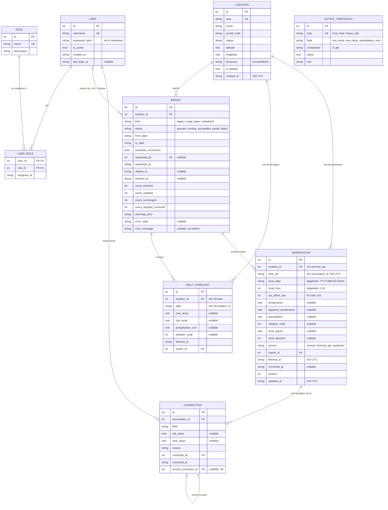
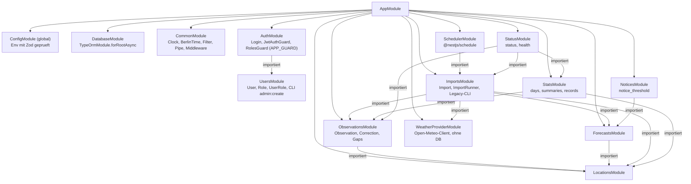
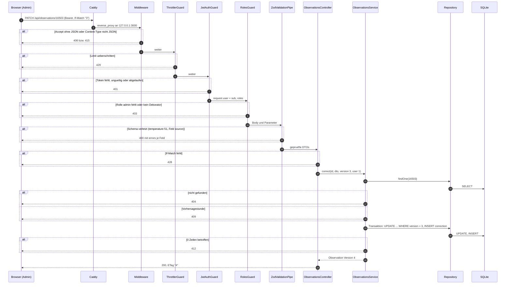
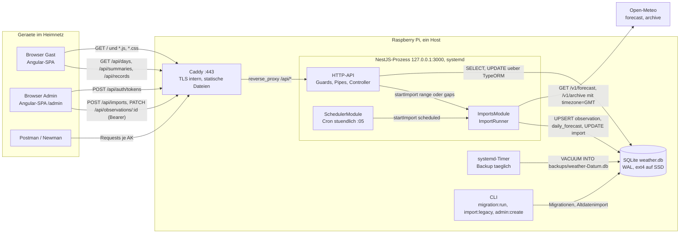

# 03 – Zielbild: Architektur, Sicherheit und Betrieb

Stand: 19.11.2026 · Grundlage: `docs/umbau/01-analyse.md` (verbindlich, Verweise auf F01–F34 und S1–S12), Entscheidungen des Auftraggebers (01-analyse.md Abschnitt 7) und Durchsicht von `backend/src/*.ts`, `frontend/src/app/**` sowie `backend/data/`.

**Kennzeichnung** wie in 01-analyse.md: **B** = Befund (steht im Code oder in den Daten) · **A** = Annahme (vermutet, muss noch geprüft werden) · **E** = Empfehlung (Vorschlag für das Zielbild)

**Begriffe** wie im Skript „Web-Programmierung 2026“ (Einheiten 1–17, Beispielprojekt Beer API): Ressource, Endpunkt, DTO, Pipe, Guard, Modul, Entity, Repository, Migration, Seed, Akzeptanzkriterium (AK).

---

## 0. Neue Befunde aus dem Code (Ergänzung zu 01-analyse.md)

Diese Befunde kommen in 01-analyse.md noch nicht vor. Sie bestimmen das Datenmodell und den Import. Sie heißen **Z1–Z4** (Zusatzbefund), damit sie nicht mit den Funktionen N01–N10 aus 02 verwechselt werden.

| Nr. | Befund | Beleg | Folge für das Zielbild |
|---|---|---|---|
| Z1 | **B:** Die Datei für den 29.03.2026 (Beginn der Sommerzeit) hat 24 Einträge, darunter `2026-03-29T02:00`. Diese Ortszeit gibt es in Europe/Berlin nicht. Auch der 26.10.2025 (Ende der Sommerzeit) hat 24 statt 25 Einträge | `backend/data/2026-03/2026-03-29.json`, `2025-10/2025-10-26.json` | **A:** Open-Meteo hat bei der langen Archivabfrage **einen festen Offset** für die ganze Antwort benutzt. Dann wären alle Sommerstunden im Altbestand um eine Stunde verschoben beschriftet. Vor der Migration wird das mit einer Stichprobe geprüft (B2.7, Schritt 2) |
| Z2 | **B:** Alle Tagesdateien bis 18.11.2026 haben den Zeitstempel 19.11.2026 14:36 (Backfill-Lauf), `2026-11-19.json` und `forecast.json` den Zeitstempel 15:01 (Scheduler). `RECENT_DAYS = 10` | `ls -l`, `backfill.ts:19,75-76` | Die Herkunft je Wert lässt sich rekonstruieren: 01.01.2025–08.11.2026 aus dem **Archiv** (677 Tage), 09.–18.11.2026 aus der **Forecast-API** (10 Tage), 19.11.2026 bis 15:00 aus der Forecast-API, ab 16:00 **Vorhersage** (1 Tag). Zusammen 688 Tage |
| Z3 | **B:** Der Scheduler holt nur „heute (UTC)“. Die Stunden zwischen dem letzten Abruf und Mitternacht bleiben dauerhaft Vorhersage | `scheduler.ts:15`, `weather-api.ts:57-59` | Der stündliche Abruf muss **gestern und heute** (Berlin) abdecken. Sonst bleibt die Stunde 23:00 jedes Tages eine Vorhersage |
| Z4 | **B:** Die Alt-Dateien enthalten nur die Felder `date`, `location`, `hourly[time, temperature, apparentTemperature, precipitation, weathercode, windspeed, winddirection]`. Durch `seed-data.ts` erzeugte Dateien haben weniger Felder (F16) | `weather-api.ts:7-21`, `seed-data.ts:6-17` | Ein striktes Zod-Schema für Altdateien erkennt Seed-Dateien und meldet sie, statt sie still zu übernehmen |

---

## B1 Stories und Akzeptanzkriterien

### B1.1 Rollen

| Rolle | Wer | Anmeldung | Darf | Darf nicht |
|---|---|---|---|---|
| **Gast** | jede Person im Heimnetz | keine | alle lesenden Endpunkte der Wetterdaten und des Status: Tage, Zusammenfassungen, Rekorde, Vorhersage, Hinweise, Status, Standort | schreiben, Importe sehen, Lücken sehen, Korrekturhistorie und Korrekturübersicht sehen. **Begründung:** Fehlertexte und interne Angaben sind nicht öffentlich (01 1.3, `lastError`). „Alles lesen“ in 01 Abschnitt 7 bezieht sich auf Wetterdaten und Status. **A:** vom Auftraggeber zu bestätigen |
| **Admin** | Betreiber (ein Konto, Rolle `admin`) | `POST /api/auth/tokens` → JWT | alles, was ein Gast darf, und zusätzlich: Import anstoßen, Lücken sehen und nachladen, Werte korrigieren und Korrekturen zurücknehmen, Import-Protokoll und Korrekturen sehen | sich selbst registrieren (es gibt keinen Registrierungsendpunkt) |
| **System** (technischer Akteur) | `SchedulerModule` im API-Prozess, CLI-Befehle auf dem Pi | keine HTTP-Anmeldung, läuft im Prozess bzw. mit Shellzugang | stündlicher Import, Altdatenimport, Anlegen des ersten Admins | – |

**E:** „Gast“ ist **keine Rolle in der Datenbank**, sondern ein anonymer Zugriff. In der Tabelle `role` steht nur `admin`. So bleibt das Muster user/role/user_role aus dem Kurs erhalten, ohne ein Konto für Gäste anzulegen (Entscheidung: keine Besucherkonten).

### B1.2 User Stories

Alle Zeitangaben in den Beispielen: **jetzt = 19.11.2026, 14:30 MEZ (13:30 UTC)**. Die Pfade haben das Präfix `/api`.

#### Bestehende Funktionen (aus 01-analyse.md 1.1)

**US01 – Heutigen Tag ansehen** (Gast)
Als Gast möchte ich den heutigen Tag in Heubach sehen (aktuelle Stunde mit gefühlter Temperatur und Wind, Tagesverlauf, Max, Min, Summe), damit ich weiß, wie das Wetter gerade ist. Behebt F06, F13, F15.

| AK | Anfrage | Erwartet |
|---|---|---|
| US01-1 | `GET /api/days/today` | **200**, `date = "2026-11-19"`, Header `Content-Location: /api/days/2026-11-19` |
| US01-2 | `GET /api/days/today` um 00:30 MEZ am 20.11. (Uhr im Test fest gesetzt) | **200**, `date = "2026-11-20"` und nicht der Vortag (F06) |
| US01-3 | `GET /api/days/today` | **200**. Stunden ab 15:00 haben `isPrediction = true`. `observed.precipitationSum` enthält nur Stunden bis 14:00. Die Vorhersage steht getrennt in `predicted` (F13) |
| US01-4 | `GET /api/days/today` mit Header `Accept: text/html` | **406**, Fehlerformat mit `code = "NOT_ACCEPTABLE"` |
| US01-5 | Tag mit einer Stunde `temperature: null` | **200**, `observed.temperature.min` ist das Minimum der vorhandenen Werte und nie 0 durch `null` (F15), `complete = false` |
| US01-6 | Browser, `/`, 1280 px. Vorbedingung: `FAKE_NOW=2026-11-19T13:30:00Z` (B4.8), Dev-DB mit Fixture `us16-ok` | Die Hero-Karte zeigt Temperatur, „Gefühlt …“ und Wind der Stunde 14:00. Die Werte sind gleich denen des Eintrags in `hours[]`, dessen `id` gleich `current.observationId` ist (`temperature`, `apparentTemperature`, `windSpeed`, `windDirection`) |

**US02 – Vergangenen Tag ansehen** (Gast)
Als Gast möchte ich einen vergangenen Tag über Pfeile, Datumsfeld oder Link aufrufen, damit ich frühere Tage vergleichen und Links teilen kann. Behebt F03, F09, F11, F19, F22.

| AK | Anfrage | Erwartet |
|---|---|---|
| US02-1 | `GET /api/days/2026-11-10` | **200**, 24 Stunden, `complete = true`, `isToday = false`, `current = null` |
| US02-2 | `GET /api/days/2026-02-30` | **400**, `errors[0] = { field: "date", code: "invalid_date" }` (F22) |
| US02-3 | `GET /api/days/2026-11-1` | **400**, `field: "date"` |
| US02-4 | `GET /api/days/2026-11-20` | **400**, `code = "DATE_IN_FUTURE"`, `field: "date"` |
| US02-5 | `GET /api/days/2024-12-31` | **404**, `code = "NO_DATA"`, Meldung nennt den ersten verfügbaren Tag „01.01.2025“ (Hinweis aus 1.4) |
| US02-6 | `GET /api/days/2026-03-29` | **200**, `hoursExpected = 23` (Sommerzeitbeginn) |
| US02-7 | `GET /api/days/2026-10-25` | **200**, `hoursExpected = 25`, zwei Stunden mit Ortszeit 02:00 (`+02:00` und `+01:00`) |
| US02-8 | Browser, `/tag/2026-11-10`, Klick auf ‹, dann auf › | Nach ‹ lautet die URL `/tag/2026-11-09` und das Datumsfeld zeigt den 09.11.2026. Nach › wieder `/tag/2026-11-10` |
| US02-9 | Browser, `/` (heute) | Der Button › ist `disabled` (Zukunftssperre in der Oberfläche, F19) |
| US02-10 | Browser, `/tag/2026-11-10`, Klick auf den Button „Heute“ | Die URL lautet `/`, das Datumsfeld zeigt das heutige Datum (Berlin) |
| US02-11 | Browser, `/tag/2026-11-10`, im Datumsfeld den 05.11.2026 wählen | Die URL lautet `/tag/2026-11-05`. Im Network-Tab steht genau 1 Request auf `/api/days/2026-11-05` |

**US03 – 7-Tage-Vorhersage ansehen** (Gast)
Als Gast möchte ich die Vorhersage für heute und die nächsten 6 Tage sehen. Behebt F18 (die Vorschau ist eine eigene Ressource und gehört nicht zu einem vergangenen Tag).

| AK | Anfrage | Erwartet |
|---|---|---|
| US03-1 | `GET /api/forecasts` | **200**, `items` mit 7 Einträgen, der erste hat `date = "2026-11-19"`, dazu `fetchedAt` |
| US03-2 | `GET /api/forecasts` bei leerer Tabelle | **200**, `items = []`, `fetchedAt = null` (leere Sammlung statt 404) |
| US03-3 | `GET /api/forecasts?days=14` | **400**, `code = "VALIDATION_FAILED"`, `errors[0] = { field: "days", code: "unrecognized_keys" }` (unbekannter Query-Parameter, `.strict()`) |

**US04 – Monatsübersicht ansehen** (Gast)
Als Gast möchte ich für einen Monat die Tageswerte (Mittel, Niederschlag) und die Kennzahlen sehen und erkennen, ob der Monat vollständig ist. Behebt F02, F12, F20, F21, F22, F28, S8.

| AK | Anfrage | Erwartet |
|---|---|---|
| US04-1 | `GET /api/summaries/months/2025-03` | **200**, `daysExpected = 31`, `daysComplete = 31`, `complete = true` |
| US04-2 | `GET /api/days?from=2025-03-01&to=2025-03-31` | **200**, 31 Einträge, aufsteigend nach Datum |
| US04-3 | `GET /api/summaries/months/2026-13` | **400**, `field: "yearMonth"` (F22) |
| US04-4 | `GET /api/summaries/months/2026-11` | **200**, `complete = false`, `daysComplete = 18`, `daysExpected = 30` |
| US04-5 | `GET /api/summaries/months/2024-12` | **404**, `code = "NO_DATA"` |
| US04-6 | `GET /api/summaries/months/2026-12` | **400**, `code = "DATE_IN_FUTURE"` |
| US04-7 | `GET /api/days?from=2025-01-01&to=2026-11-19` | **400**, `code = "VALIDATION_FAILED"`, `errors[0] = { field: "to", code: "range_too_long" }` (Zeitraum länger als 366 Tage) |
| US04-8 | `GET /api/summaries/years` | **200**, `items` mit den Jahren 2025 und 2026, für die Jahresauswahl (F20) |
| US04-9 | `GET /api/days?from=2026-11-01&to=2026-11-30` / `…&to=2026-11-19` | **400**, `code = "DATE_IN_FUTURE"`, `errors[0].field = "to"` / **200**, 19 Einträge. Das Frontend fragt für den laufenden Monat `to = min(Monatsende, heute)` ab (B5.1) |
| US04-10 | Browser, `/monat/2025/03`, 1280 px | Die Felder zeigen „2025“ und „März“. Wechsel auf „April“ → URL `/monat/2025/04`, im Network-Tab genau 2 Requests (`/api/summaries/months/2025-04` und `/api/days?from=2025-04-01&to=2025-04-30`). Die x-Achse des Diagramms zeigt den 1. bis 30. (V21) |

**US05 – Jahresübersicht ansehen** (Gast)
Als Gast möchte ich für ein Jahr die Monatswerte und die Kennzahlen sehen, mit Hinweis auf fehlende Monate. Behebt F28, S8.

| AK | Anfrage | Erwartet |
|---|---|---|
| US05-1 | `GET /api/summaries/years/2025` | **200**, `complete = true`, `temperature.mean` = Mittel der Tagesmittel (Regel R12) |
| US05-2 | `GET /api/summaries/months?year=2025` | **200**, 12 Einträge |
| US05-3 | `GET /api/summaries/years/2026` | **200**, `complete = false`, `daysComplete = 322`, `daysExpected = 365` |
| US05-4 | `GET /api/summaries/years/1939` | **400**, `field: "year"` (vor Beginn des Archivs) |
| US05-5 | `GET /api/summaries/years/2024` | **404**, `code = "NO_DATA"` |
| US05-6 | `GET /api/summaries/months?year=abc` | **400**, `field: "year"` |
| US05-7 | Browser, `/jahr/2025`, 1280 px | Das Diagramm zeigt 12 Monate auf der x-Achse (Jan–Dez), die Tabelle „Werte als Tabelle“ hat 12 Zeilen |

**US06 – Rekorde ansehen** (Gast)
Als Gast möchte ich den heißesten und kältesten Tag (Stundenwert), den regenreichsten Tag und die längste Trockenperiode sehen. Behebt F10, F13, F14, F27.

| AK | Anfrage | Erwartet |
|---|---|---|
| US06-1 | `GET /api/records` | **200**, `hottest`, `coldest`, `wettestDay`, `longestDryPeriod`, `daysCounted`. Antwortzeit auf dem Pi p95 < 200 ms (F10) |
| US06-2 | Testdaten: Stunde A 30,04 °C (früher), Stunde B 30,03 °C (später) | **200**, `hottest.value = 30.0` und das Datum von **A** (F14) |
| US06-3 | Testdaten: 3 Trockentage, 1 Tag fehlt, 4 Trockentage | **200**, `longestDryPeriod.days = 4` und nicht 7 (F27) |
| US06-4 | Vorhersagestunde heute 35 °C | **200**, `hottest` bleibt unverändert (F13) |
| US06-5 | leere Datenbank | **200**, alle Rekorde `null`, `daysCounted = 0` |
| US06-6 | `GET /api/records?year=2025` | **400**, `code = "VALIDATION_FAILED"`, `errors[0] = { field: "year", code: "unrecognized_keys" }` (ein Filter nach Jahr ist keine bestehende Funktion) |
| US06-7 | Nach US13-2 ist der Rekordwert `coldest` korrigiert (Fixture: korrigierte Stunde ist die kälteste) | **200**, `coldest.corrected = true` (`hottest.corrected = false`). Im Browser zeigt `/statistiken` an dieser Rekordkarte den Chip „KORRIGIERT“ (02 N03, Risiko „Hinweis auf der Rekordseite“) |

**US07 – Datenstand und Standort sehen** (Gast)
Als Gast möchte ich sehen, für welchen Ort und Zeitraum Daten vorliegen und wann zuletzt aktualisiert wurde. Grundlage ist der bestehende Endpunkt `/api/status`. Behebt F32, `lastError` öffentlich (1.3).

| AK | Anfrage | Erwartet |
|---|---|---|
| US07-1 | `GET /api/status` | **200**, `today`, `timezone`, `dataFrom`, `dataTo`, `lastSuccessfulUpdateAt`, `updateState`, **ohne** Fehlertext |
| US07-2 | `GET /api/status` direkt nach dem ersten Start ohne Import | **200**, `updateState = "never"`, `lastSuccessfulUpdateAt = null` (F32) |
| US07-3 | `GET /api/locations` | **200**, genau ein Eintrag `slug = "heubach"` |
| US07-4 | `GET /api/locations/99` | **404** |

**US08 – Stündlicher Abruf** (System)
Als System möchte ich jede Stunde die Werte für gestern und heute sowie die 7-Tage-Vorhersage holen, damit Daten aktuell sind, ohne dass Stunden dauerhaft Vorhersage bleiben. Behebt F01, F06, Z3.

| AK | Beobachtbar über | Erwartet |
|---|---|---|
| US08-1 | `GET /api/imports?kind=scheduled&limit=1` (Admin) | **200**, letzter Lauf `status = "succeeded"`, nicht älter als 65 min |
| US08-2 | Open-Meteo liefert für die Tagesvorhersage einen Fehler (gemockt) | Stundenwerte sind trotzdem gespeichert, Import `status = "partial"` mit Warnung. Kein gemeinsames Scheitern wie bei `Promise.all` (F01) |
| US08-3 | e2e mit `FixedClock` 20.11. 00:05 MEZ, Scheduler-Lauf mit gemocktem Provider, danach `GET /api/days/2026-11-19` | **200**, `hours[23]` (23:00 MEZ) hat `source = "forecast_api"` und `isPrediction = false`, nicht mehr `prediction` (Z3) |
| US08-4 | Admin-Import läuft, der Scheduler feuert | Der Scheduler-Lauf wird mit Warnung übersprungen (Regel R19), kein zweiter paralleler Import |

#### Admin-Funktionen (aus den Entscheidungen)

**US09 – Als Admin anmelden und abmelden** (Admin)
Als Admin möchte ich mich mit Benutzername und Passwort anmelden und wieder abmelden, damit nur ich schreibende Funktionen nutzen kann.

| AK | Anfrage | Erwartet |
|---|---|---|
| US09-1 | `POST /api/auth/tokens` `{ "username": "admin", "password": "<richtig>" }` | **200** (nicht 201), `accessToken`, `tokenType = "Bearer"`, `expiresIn = 3600`, **kein** `passwordHash` in der Antwort |
| US09-2 | falsches Passwort | **401**, `code = "INVALID_CREDENTIALS"` |
| US09-3 | unbekannter Benutzername, 10 Anfragen | **401**, gleiche Meldung wie US09-2. Der Median der Antwortzeit von 10 Anfragen unterscheidet sich um höchstens 50 ms vom Median von 10 Anfragen nach US09-2 (kein Hinweis auf vorhandene Konten) |
| US09-4 | Body ohne `password` | **400**, `field: "password"` |
| US09-5 | Body mit zusätzlichem Feld `"roles": ["admin"]` | **400**, `code = "VALIDATION_FAILED"`, `errors[0] = { field: "roles", code: "unrecognized_keys" }` (Mass Assignment) |
| US09-6 | `Content-Type: text/plain` | **415** |
| US09-7 | 6. Fehlversuch innerhalb von 60 s von derselben IP | **429** (Rate Limit, siehe B3.3) |
| US09-8 | `GET /api/auth/me` mit gültigem Token / ohne Token / mit abgelaufenem Token | **200** / **401** / **401** |
| US09-9 | Abmelden im Frontend | Token ist aus `sessionStorage` entfernt; der nächste Admin-Aufruf führt zum Login |

**US10 – Import für einen Zeitraum anstoßen** (Admin)
Als Admin möchte ich für einen Zeitraum Daten von Open-Meteo neu laden (Backfill), damit ich Altdaten nachziehen oder ersetzen kann. Ersetzt `backfill.ts` (S7).

| AK | Anfrage | Erwartet |
|---|---|---|
| US10-1 | `POST /api/imports` ohne Token | **401** |
| US10-2 | `POST /api/imports` mit gültigem Token ohne Rolle `admin` | **403** |
| US10-3 | `POST /api/imports` `{ "kind": "range", "from": "2026-10-01", "to": "2026-10-31" }` | **202**, Header `Location: /api/imports/42`, Body mit `status = "queued"` |
| US10-4 | `from = "2026-10-31"`, `to = "2026-10-01"` | **400**, `field: "to"` |
| US10-5 | `to = "2026-11-20"` | **400**, `code = "DATE_IN_FUTURE"`, `field: "to"` |
| US10-6 | `{ "kind": "range", "from": "2023-01-01", "to": "2026-01-01" }` (1097 Tage) | **400**, `code = "VALIDATION_FAILED"`, `errors[0] = { field: "to", code: "range_too_long" }` |
| US10-7 | zweiter `POST /api/imports`, während Import 42 läuft | **409**, `code = "IMPORT_RUNNING"`, `details.runningImportId = 42` (B3.3) |
| US10-8 | `{ "kind": "scheduled", … }` | **400**, `field: "kind"` (nur `range` und `gaps` sind über HTTP erlaubt) |

**US11 – Import-Protokoll und Import-Status ansehen** (Admin)
Als Admin möchte ich laufende und frühere Importe mit Zählern, Warnungen und Fehlern sehen.

| AK | Anfrage | Erwartet |
|---|---|---|
| US11-1 | `GET /api/imports/42` während des Laufs / danach | **200**, `status = "running"` / `"succeeded"` mit `counts` |
| US11-2 | `GET /api/imports?status=failed&page=1&limit=20` | **200**, nach `requestedAt` absteigend sortiert, `meta = { page, limit, total }` |
| US11-3 | `GET /api/imports/999` | **404** |
| US11-4 | `GET /api/imports?limit=500` | **400**, `field: "limit"` (höchstens 100) |
| US11-5 | `GET /api/imports` ohne Token | **401** |

**US12 – Lücken sehen und nachladen** (Admin)
Als Admin möchte ich fehlende Stunden, Stunden mit `null`-Werten und veraltete Vorhersagen sehen und gezielt nachladen.

| AK | Anfrage | Erwartet |
|---|---|---|
| US12-1 | `GET /api/gaps?from=2026-11-01&to=2026-11-19` | **200**, Liste von Lücken mit `reason` = `missing` / `null_values` / `stale_prediction` |
| US12-2 | `GET /api/gaps?from=2026-11-19&to=2026-11-01` | **400**, `code = "VALIDATION_FAILED"`, `errors[0] = { field: "to", code: "to_before_from" }` |
| US12-3 | e2e mit gemocktem Provider (liefert alle Stunden des Zeitraums): `POST /api/imports` `{ "kind": "gaps", "from": "2026-11-01", "to": "2026-11-19" }`, warten bis `succeeded` | **202**. Danach liefert `GET /api/gaps?from=2026-11-01&to=2026-11-19` **200** mit `items = []` |
| US12-4 | `GET /api/gaps` ohne Token | **401** |

**US13 – Einzelnen Wert korrigieren** (Admin)
Als Admin möchte ich einen einzelnen Stundenwert mit Begründung korrigieren, ohne versehentlich eine neuere Fassung zu überschreiben. Die Korrektur soll nachvollziehbar sein: Ich sehe alle Korrekturen eines Zeitraums in einer Übersicht und kann eine Korrektur mit Begründung zurücknehmen (N03 „mit Änderungsprotokoll“).

| AK | Anfrage | Erwartet |
|---|---|---|
| US13-1 | `GET /api/observations/16503` | **200**, Header `ETag: "3"` |
| US13-2 | `PATCH /api/observations/16503`, `If-Match: "3"`, Body `{ "temperature": 9.6, "reason": "Ausreißer, Nachbarstunden 9,4/9,8 °C" }` | **200**, `ETag: "4"`, `correctedAt` gesetzt |
| US13-3 | wie US13-2, aber ohne `If-Match` | **428**, `code = "PRECONDITION_REQUIRED"` |
| US13-4 | wie US13-2 mit `If-Match: "3"`, obwohl die Version inzwischen 4 ist | **412**, `code = "PRECONDITION_FAILED"` |
| US13-5 | `{ "temperature": 51, "reason": "…" }` | **400**, `field: "temperature"` |
| US13-6 | `{ "temperature": 9.6, "source": "archive", "reason": "…" }` | **400**, `code = "VALIDATION_FAILED"`, `errors[0] = { field: "source", code: "unrecognized_keys" }` |
| US13-7 | `{ "reason": "nur Begründung" }` | **400**, `code = "VALIDATION_FAILED"`, `errors[0] = { field: null, code: "missing_measurement" }` (kein Messwert angegeben) |
| US13-8 | Stunde 19.11. 18:00 (Vorhersage) | **409**, `code = "OBSERVATION_IS_PREDICTION"` |
| US13-9 | ohne Token / ohne Rolle | **401** / **403** |
| US13-10 | `Content-Type: text/plain` | **415** |
| US13-11 | `GET /api/observations/16503/corrections` (Admin) | **200**, Eintrag mit `field`, `oldValue`, `newValue`, `reason`, `correctedBy` |
| US13-13 | Nach US13-2 (ohne Neustart des Prozesses): `GET /api/records` und `GET /api/summaries/years/2026` | **200**, beide liefern den neuen Wert (Cache ist über die Datenrevision ungültig geworden, B2.4). Die Observation hat `version = 4` und ein neues `updated_at` |
| US13-14 | Nach US13-2: `GET /api/corrections?from=2026-11-19&to=2026-11-19&page=1&limit=20` (Admin) | **200**, `{ items, meta }`, `meta = { page, limit, total }`. `items[0]` ist der Eintrag aus US13-2 mit `observationId = 16503` und `observationTimeLocal`. Sortiert nach `correctedAt` absteigend |
| US13-15 | `GET /api/corrections` ohne Token / mit `from=2026-11-19&to=2026-11-01` / mit `limit=101` | **401** / **400** `errors[0] = { field: "to", code: "to_before_from" }` / **400** `field: "limit"` |
| US13-16 | Nach US13-2: `POST /api/observations/16503/corrections/3/reversal`, `If-Match: "4"`, Body `{ "reason": "Rücknahme: Wert war plausibel" }` (Admin) | **200**, `ETag: "5"`, `temperature = 19.6` (wieder der alte Wert), `correctedAt = null`. `GET /api/observations/16503/corrections` liefert 2 Einträge; der neue hat `revertsCorrectionId = 3`, `oldValue = 9.6`, `newValue = 19.6` (R33) |
| US13-17 | dieselbe Rücknahme ein zweites Mal (`If-Match: "5"`) / Rücknahme einer Korrektur, nach der dasselbe Feld noch einmal korrigiert wurde | **409**, `code = "CORRECTION_NOT_REVERSIBLE"` / **409**, `code = "CORRECTION_NOT_REVERSIBLE"` |
| US13-18 | Rücknahme ohne `If-Match` / mit veraltetem `If-Match` / Korrektur 999 / ohne Token / Body ohne `reason` | **428** / **412** / **404** / **401** / **400** `field: "reason"` |

US13-12 (Gastsicht „korrigiert“) steht unter „Neue Funktionen“. US13-13 bis US13-18 ergänzen N03 um den Cache nach Korrekturen, die Übersicht aller Korrekturen und die Rücknahme (Prüfung 05, P02, P06, P07).

**US14 – Betriebsstatus sehen** (Admin)
Als Admin möchte ich auf einen Blick sehen, ob der stündliche Abruf läuft, wann er zuletzt fehlschlug und wie viele Lücken es gibt.

| AK | Anfrage | Erwartet |
|---|---|---|
| US14-1 | Admin-Statusseite: `GET /api/status`, `GET /api/imports?limit=10`, `GET /api/gaps?from=<heute−30>&to=<heute>` | jeweils **200**. Der Fehlertext eines fehlgeschlagenen Imports (`error`) steht nur in den Admin-Endpunkten `GET /api/imports` (Liste) und `GET /api/imports/{id}`; das öffentliche `GET /api/status` enthält keinen Fehlertext (präzisiert in 14a) |
| US14-2 | dieselben Admin-Aufrufe ohne Token | **401** (die Admin-Seite zeigt den Login) |
| US14-3 | `GET /api/health` (Betrieb, kein Nutzer) | **200** `{ "status": "ok", "database": "ok" }`, bei nicht lesbarer DB **503** |

**US15 – Altbestand einmalig übernehmen** (System, ausgeführt vom Admin per CLI)
Als Admin möchte ich die 688 Tagesdateien und `forecast.json` einmal in die Datenbank übernehmen, mit Prüfung und Herkunft je Wert.

| AK | Aufruf | Erwartet |
|---|---|---|
| US15-1 | `npm run cli -- import:legacy --dir ./data --dry-run` | Exit-Code 0, Bericht „688 Dateien gültig, 0 Fehler“, **nichts** geschrieben |
| US15-2 | `npm run cli -- import:legacy --dir ./data` | 16 512 Stunden eingefügt. Danach liefert `GET /api/imports?kind=legacy` **200** mit `counts.inserted = 16512` |
| US15-3 | derselbe Befehl ein zweites Mal | `inserted = 0`, `updated = 0`, `unchanged = 16512` (idempotent) |
| US15-4 | Datei mit fehlendem Feld `windspeed` (Seed-Format, F16) | Datei wird abgelehnt und im Bericht genannt, Exit-Code ≠ 0, die übrigen Monate bleiben unberührt (Transaktion je Monat) |
| US15-5 | `GET /api/summaries/years/2025` nach der Migration | Werte stimmen mit den Charakterisierungswerten überein, bis auf die dokumentierten Abweichungen (B2.7, Schritt 9) |

#### Neue Funktionen (Entscheidung vom 19.11.2026, 02-verbesserungen-und-design.md E2.2)

Angenommen: N01–N04 (Must), N05, N06 (Should), N07 (Could). Abgelehnt: N08, N09, N10. Es gibt keinen WebSocket-Kanal und keinen Export.

**Was die vorhandenen Stories schon abdecken:**

| N | Funktion | schon abgedeckt durch | neu |
|---|---|---|---|
| N01 | Vorhersage und Rückblick kennzeichnen, Datenstand | API-Teil: US01-3 (`isPrediction`, `observed`/`predicted`), US07-1/-2 (`lastSuccessfulUpdateAt`, `updateState`), US08-3 | **US16**: Anzeige im Frontend und Regel „verzögert“ |
| N02 | Anmeldung, Import, Lücken nachladen | **vollständig:** US09, US10, US11, US12 | – |
| N03 | Korrektur mit Änderungsprotokoll | **für den Admin:** US13-1 bis US13-11 | **AK US13-12**: Gäste sehen „korrigiert“. **AK US13-13 bis US13-18**: Cache nach Korrektur, Übersicht aller Korrekturen, Rücknahme. **AK US06-7**: Hinweis an korrigierten Rekorden |
| N04 | Status- und Datenqualitätsseite | Admin-Teil: US14. Gast-Teil zum Teil: US07 | **US17**: öffentliche Seite `/status` mit Vollständigkeit |
| N05 | Klimakennzahlen | – | **US18** |
| N06 | Vergleich mit dem Vorjahr | – | **US19** |
| N07 | Hinweise auf Frost, Hitze und Starkregen | – | **US20** |

**Ergänzung zu US13 (N03, Gastsicht):**

| AK | Anfrage | Erwartet |
|---|---|---|
| US13-12 | Nach US13-2: `GET /api/days/2026-11-19` und `GET /api/days?from=2026-11-01&to=2026-11-19` | **200**. Bei der korrigierten Stunde ist `hours[].correctedAt` gesetzt, im Listeneintrag des 19.11. steht `hasCorrections = true`. Im Browser zeigt `/tag/2026-11-19` (1280 px) in der Tabelle „Werte als Tabelle“ den Chip „KORRIGIERT“ an dieser Stunde |

**US16 – Vorhersage und Rückblick erkennen, Datenstand sehen** (Gast) · N01
Als Gast möchte ich auf einen Blick sehen, welche Werte vergangen und welche vorhergesagt sind und wie aktuell die Daten sind. So verwechsle ich Prognose und Rückblick nicht und merke, wenn die Aktualisierung hängt. Behebt F13 (Anzeige), Ausfalltabelle 01 Abschnitt 4 („bemerken es kaum“).

| AK | Anfrage / Prüfschritt | Erwartet |
|---|---|---|
| US16-1 | `GET /api/status`, letzter erfolgreicher Abruf 14:05, jetzt 14:30 (Clock fest) | **200**, `updateState = "ok"`, `lastSuccessfulUpdateAt = "2026-11-19T13:05:…Z"`, `nextScheduledUpdateAt = "2026-11-19T14:05:00Z"` |
| US16-2 | wie US16-1, letzter Erfolg 11:05 | **200**, `updateState = "delayed"` |
| US16-3 | wie US16-1, `SCHEDULER_ENABLED=false` | **200**, `nextScheduledUpdateAt = null` |
| US16-4 | Browser, `/`, 1280 px. Vorbedingung: `FAKE_NOW=2026-11-19T13:30:00Z`, Dev-DB mit Fixture `us16-ok` (letzter Erfolg 14:05), Browser-Zeitzone Europe/Berlin (DevTools, Sensoren) | Im Seitenkopf steht „Stand: 14:05 Uhr“. Der Hero-Kicker lautet „JETZT · 14:00 UHR“. Im Diagramm beginnt das Vorhersageband bei 15:00, die Temperaturlinie ist dort gestrichelt und die Balken sind schraffiert. In „Werte als Tabelle“ steht in der Spalte ART für 15–23 Uhr der Text „Vorhersage“. Die Kennzahl „NIEDERSCHLAG BIS JETZT“ zeigt den Wert aus `observed`, darunter „+5,4 mm erwartet“ mit dem Chip „VORHERSAGE“ |
| US16-5 | Browser, `/`, 375 px. Vorbedingung: `FAKE_NOW=2026-11-19T13:30:00Z`, Fixture `us16-delayed` (letzter Erfolg 11:05, Status `delayed`) | Über dem Inhalt steht die Hinweisbox „Stand: 19.11.2026, 11:05 Uhr – seit 3 Stunden keine Aktualisierung“ (Linie links, nicht in Fehlerrot). Die Seite scrollt nicht horizontal |
| US16-6 | Browser, `/tag/2026-11-10`, 768 px | Es gibt keinen Vorhersage-Chip, kein Vorhersageband und keine „Jetzt“-Linie. Der Kicker lautet „RÜCKBLICK“ |

**US17 – Datenstand und Vollständigkeit als Gast sehen** (Gast) · N04
Als Gast möchte ich auf einer eigenen Seite sehen, für welchen Zeitraum Daten vorliegen, an wie vielen Tagen sie vollständig sind und ob es Lücken gibt. So kann ich die Zahlen einschätzen. Fehlertexte und das Importprotokoll bleiben beim Admin (US14).

| AK | Anfrage / Prüfschritt | Erwartet |
|---|---|---|
| US17-1 | `GET /api/status` nach der Migration und einem `gaps`-Import | **200**, zusätzlich `daysWithData = 688`, `daysComplete` (Ganzzahl), `gapCount = 0`. Kein Feld `error`, `message` oder `reason` |
| US17-2 | Fixture: am 12.11. fehlen 3 aufeinanderfolgende Stunden, am 14.11. hat eine Stunde `temperature = null` | **200**, `gapCount = 2`. Der Wert ist gleich der Länge von `items` aus `GET /api/gaps?from=<dataFrom>&to=<heute>` (Admin) |
| US17-3 | `GET /api/status` mit `Accept: text/html` | **406** |
| US17-4 | Browser als Gast, `/status`, 375 px | Die Seite hat die h1 „Datenstand“ und Kennzahl-Karten für „ZULETZT AKTUALISIERT“, „TAGE MIT DATEN“, „VOLLSTÄNDIGE TAGE“ und „LÜCKEN“. Es gibt keine Importtabelle und keinen Fehlertext. Der Footer-Link „Status“ führt hierher. Kein horizontales Scrollen |
| US17-5 | Browser als Admin, `/status`, 1280 px | Wie US17-4, zusätzlich der Link „Importprotokoll ansehen →“ auf `/admin/importe` (US11, US14) |

**US18 – Klimakennzahlen für Monat und Jahr** (Gast) · N05
Als Gast möchte ich für einen Monat oder ein Jahr die Zahl der Frost-, Eis-, Sommer-, heißen, Niederschlags- und Trockentage sehen. So kann ich den Zeitraum mit eigenen Erinnerungen vergleichen.

| AK | Anfrage / Prüfschritt | Erwartet |
|---|---|---|
| US18-1 | `GET /api/summaries/months/2025-01` | **200**, `indicators = { frostDays, iceDays, summerDays, hotDays, precipitationDays }`, alles Ganzzahlen ≥ 0. Es gilt `iceDays ≤ frostDays`, `hotDays ≤ summerDays` und `precipitationDays + dryDays = daysComplete` |
| US18-2 | Fixture mit 6 vollständigen Tagen: Min −0,1 / Min 0,0 / Max 25,0 / Max 24,9 / Max 30,0 / Max −0,1 und Min −3 | **200**, `frostDays = 2` (−0,1 und −3), `iceDays = 1`, `summerDays = 2` (25,0 und 30,0), `hotDays = 1` |
| US18-3 | Fixture: unvollständiger Tag mit Min −5 °C | **200**. Der Tag zählt nicht in `frostDays`, `complete = false` |
| US18-4 | `GET /api/summaries/years/2025` | **200**, `indicators` über alle vollständigen Tage des Jahres. `frostDays` ist gleich der Summe von `frostDays` aus `GET /api/summaries/months?year=2025` |
| US18-5 | Browser, `/monat/2025/01`, 375 px | Es gibt Kennzahl-Karten „FROSTTAGE“, „EISTAGE“ usw. ohne Überlauf. Bei `/monat/2026/11` steht daneben der Chip „UNVOLLSTÄNDIG“ und „18 VON 30 TAGEN“ |

**US19 – Mit dem Vorjahr vergleichen** (Gast) · N06
Als Gast möchte ich einen Monat oder ein Jahr mit demselben Zeitraum des Vorjahres vergleichen. Bei unvollständigen Zeiträumen vergleiche ich dieselben Kalendertage. So sehe ich, ob es wärmer oder nasser war.

| AK | Anfrage / Prüfschritt | Erwartet |
|---|---|---|
| US19-1 | `GET /api/summaries/periods?from=2025-01-01&to=2025-11-18` | **200**, `id = "2025-01-01..2025-11-18"`, `daysExpected = 322`, gleiche Felder wie die Jahreszusammenfassung inklusive `indicators` und `meanMethod` |
| US19-2 | `from=2025-11-18&to=2025-01-01` | **400**, `field: "to"` |
| US19-3 | `from=2025-01-01&to=2026-01-01` (366 Tage) / `to=2026-01-02` (367 Tage) | **200** / **400**, `field: "to"` |
| US19-4 | `from=2024-01-01&to=2024-11-18` | **404**, `code = "NO_DATA"` |
| US19-5 | `to=2026-11-20` | **400**, `code = "DATE_IN_FUTURE"`, `field: "to"` |
| US19-6 | `…&compare=previous` | **400**, `code = "VALIDATION_FAILED"`, `errors[0] = { field: "compare", code: "unrecognized_keys" }` |
| US19-7 | Browser, `/jahr/2026`, 1280 px, Klick auf den Schalter-Chip „VORJAHR VERGLEICHEN“ | `aria-pressed="true"`, die URL endet auf `?vergleich=vorjahr`. Im Network-Tab stehen zwei Requests auf `/api/summaries/periods` (2026-01-01..2026-11-18 und 2025-01-01..2025-11-18). Die Kennzahl zeigt z. B. „+0,4 °C wärmer als 01.01.–18.11.2025“, im Diagramm erscheint eine zweite, gestrichelte Linie. Nach F5 ist der Vergleich weiter aktiv |
| US19-8 | Browser, `/jahr/2025` | Der Chip ist deaktiviert (`aria-disabled`), daneben steht der Text „Kein Vorjahr mit Daten“ |
| US19-9 | Browser, `/monat/2026/11`, 1280 px, Klick auf „VORJAHR VERGLEICHEN“ (jetzt = 19.11.2026) | `aria-pressed="true"`, URL endet auf `?vergleich=vorjahr`. Im Network-Tab stehen zwei Requests auf `/api/summaries/periods` (2026-11-01..2026-11-18 und 2025-11-01..2025-11-18, R29). Die Kennzahl zeigt die Differenz zu „01.–18.11.2025“, im Diagramm erscheint die gestrichelte Vorjahreslinie |

**US20 – Hinweise auf Frost, Hitze und Starkregen** (Gast) · N07
Als Gast möchte ich bei der 7-Tage-Vorschau einen deutlichen Hinweis sehen, wenn Frost, Hitze oder viel Regen vorhergesagt ist. So denke ich an Pflanzen, Auto oder Schirm. Es ist kein amtlicher Warnhinweis.

| AK | Anfrage / Prüfschritt | Erwartet |
|---|---|---|
| US20-1 | `GET /api/notices`, Vorhersage 21.11.: `minTemp = -2.3` | **200**, `{ items: [ { id: "2026-11-21-frost", type: "frost", date: "2026-11-21", value: -2.3, threshold: 0, comparator: "lt", unit: "°C" } ], basedOnFetchedAt: "2026-11-19T13:05:12Z" }` |
| US20-2 | Grenzwerte in Fixtures: `minTemp` −0,1 / 0,0 · `maxTemp` 30,0 / 29,9 · `precipitationSum` 20,0 / 19,9 | **200**, Hinweis nur bei −0,1 (frost), 30,0 (heat) und 20,0 (heavy_rain) |
| US20-3 | Leere Tabelle `daily_forecast` | **200**, `items = []`, `basedOnFetchedAt = null` |
| US20-4 | Gespeicherte Vorhersage für gestern mit `minTemp = -4` | **200**, für gestern gibt es keinen Hinweis (nur `date ≥ heute`) |
| US20-5 | `GET /api/notices?days=3` | **400**, `code = "VALIDATION_FAILED"`, `errors[0] = { field: "days", code: "unrecognized_keys" }` |
| US20-6 | Browser, `/`, 375 px. Vorbedingung: `FAKE_NOW=2026-11-19T13:30:00Z`, Dev-DB mit Fixture `us20-frost` (Daten aus US20-1) | Über der 7-Tage-Vorschau steht eine Hinweisbox (Kicker „HINWEIS“, Linie links, **nicht** in Fehlerrot): „Frost möglich am Samstag, 21.11.: Tiefstwert −2,3 °C“ sowie „Kein amtlicher Warnhinweis – siehe Deutscher Wetterdienst“. An `/tag/2026-11-10` erscheint keine Box |

**Regeln für die neuen Stories (Ergänzung zur Tabelle B1.3):**

| Nr. | Regel | normale Fälle | Grenzen | Fehler | Ort |
|---|---|---|---|---|---|
| R25 | **Aktualisierungsstand** `updateState` | letzter erfolgreicher Import (`kind` ∈ scheduled/range/gaps, `status` ∈ succeeded/partial) ≤ 2 h → `ok` | genau 2 h → `ok`, 2 h 1 s → `delayed`. Nur ein `legacy`-Import → `never` | – (kein Fehlerfall, sondern Zustand) | **Service** (StatusService mit `Clock`). Die Schwelle ist eine Konstante, **A** aus N01 |
| R26 | **Lückenzähler** `gapCount` | Anzahl zusammenhängender Lücken (`missing`, `null_values`, `stale_prediction`) von `dataFrom` bis zur aktuellen vollen Stunde | Künftige Stunden von heute sind keine Lücke. Zwei Lücken mit einer vorhandenen Stunde dazwischen zählen als 2 | – | **Service** (derselbe GapsService wie bei `/gaps`, Ergebnis über die Datenrevision gecacht, B2.4) |
| R27 | **Kenntage** (nur vollständige Tage, R13) | Frost: Min < 0 · Eis: Max < 0 · Sommer: Max ≥ 25 · heiß: Max ≥ 30 · Niederschlag: Summe ≥ 0,1 mm | −0,1 / 0,0 · 24,9 / 25,0 · 29,9 / 30,0 · 0,09 / 0,1 mm. Ein heißer Tag ist auch ein Sommertag. Min und Max sind die Extremwerte der Stundenwerte | unvollständiger Tag → zählt in keiner Kennzahl | **Service** (Schwellen als Konstanten wie R09, Vergleich ungerundet, Unit-Test je Grenze). `dryDays` = Anzahl der Tage mit `isDryDay = true`, `precipitationDays` = Anzahl der vollständigen Tage mit `isDryDay = false`. Beide kommen aus derselben Tagesliste, deshalb gilt `precipitationDays + dryDays = daysComplete` (US18-1). **A:** DWD-nahe Definitionen, noch zu bestätigen (02, Frage 5) |
| R28 | **Freier Zeitraum** `summaries/periods` | `2025-01-01` bis `2025-11-18` | `from = to`, genau 366 Tage | `from > to`, über 366 Tage, Format falsch, unbekannter Parameter → **400** (Zod). `to > heute` → **400** `DATE_IN_FUTURE` (Service). Keine Daten → **404** `NO_DATA` | **Zod** (R01, R22, R23) **plus Service** |
| R29 | **Vorjahreszeitraum** | vollständiger Monat bzw. vollständiges Jahr → gleicher Monat bzw. gleiches Jahr minus 1 über `/summaries/months/{ym}` bzw. `/summaries/years/{y}` | unvollständiger Zeitraum → beide Seiten von Anfangstag bis **gestern**, über `/summaries/periods`. Der 29.02. im Vorjahr wird zum 28.02. | Vorjahr ohne Daten (404) → Chip deaktiviert, kein Fehlerzustand | **Frontend** (`utils/compare-period.ts` mit Unit-Test). Differenz = gerundeter Wert − gerundeter Vorjahreswert, damit die angezeigten Zahlen zusammenpassen |
| R30 | **Hinweisschwellen** | Frost: `minTemp < 0` · Hitze: `maxTemp ≥ 30` · Starkregen: `precipitationSum ≥ 20` | siehe US20-2. Werte `null` → kein Hinweis | Ungültiger Vergleichsoperator in der Stammdatentabelle → DB-`CHECK` lehnt ab | **DB** (Stammdaten `notice_threshold` mit `CHECK`) **plus Service** (NoticesService vergleicht ungerundet). **E:** Werte aus N07, vom User am 23.11.2026 bestätigt |
| R31 | **Hinweise nur für die Zukunft** | `date ≥ heute` (Berlin) | Heute zählt mit | – | **Service** (`Clock`, `BerlinTime`) |

**Ergänzung zu B2 (Datenmodell):**

| Ressource / Tabelle | Feld | gespeichert/berechnet | Bemerkung |
|---|---|---|---|
| `status` (Antwort) | `updateState` (`never` · `ok` · `delayed`), `nextScheduledUpdateAt` (nullable), `daysWithData`, `daysComplete`, `gapCount` | berechnet | R25, R26. Weiterhin ohne Fehlertext (US07-1) |
| `summaries/months/{ym}`, `summaries/years/{y}`, `summaries/periods` | `indicators: { frostDays, iceDays, summerDays, hotDays, precipitationDays }` | berechnet | `dryDays` bleibt wie bisher auf oberster Ebene und wird nicht doppelt geführt |
| `summaries/periods` | gleiche Form wie die Jahreszusammenfassung, `id = "{from}..{to}"`, dazu `from`, `to` | berechnet | R28 |
| `notices` | `id` (`{date}-{type}`), `type` (`frost` · `heat` · `heavy_rain`), `date`, `value`, `threshold`, `comparator`, `unit`. In der Sammlung zusätzlich `basedOnFetchedAt` | berechnet aus `daily_forecast` und `notice_threshold` | R30, R31 |
| **Tabelle `notice_threshold`** (neu) | `id` PK, `type` TEXT UNIQUE, `field` TEXT, `comparator` TEXT, `value` REAL, `unit` TEXT | gespeichert (Stammdaten) | `CHECK(type IN ('frost','heat','heavy_rain'))`, `CHECK(field IN ('min_temp','max_temp','precipitation_sum'))`, `CHECK(comparator IN ('lt','gte'))`. Die 3 Zeilen kommen per idempotenter Daten-Migration wie der Standort (B4.4). Es gibt keinen Endpunkt zum Ändern |

**Ergänzung zu B3.1 (Endpunkte) und B4.7 (Zugriff):**

| Story | Methode | Pfad | Erfolg | Fehler | Zugriff |
|---|---|---|---|---|---|
| US16, US17 | GET | `/api/status` (Felder ergänzt) | 200 | 406 | öffentlich |
| US18 | GET | `/api/summaries/months/{yearMonth}`, `/api/summaries/years/{year}` (Feld `indicators` ergänzt) | 200 | wie bisher | öffentlich |
| US19 | GET | `/api/summaries/periods?from={date}&to={date}` | 200 | 400 · 404 · 406 | öffentlich |
| US20 | GET | `/api/notices` | 200 `{ items, basedOnFetchedAt }` | 400 unbekannter Parameter · 406 | öffentlich |

**Module (Ergänzung zu B4.1, dort im Diagramm als Knoten `NoticesModule`):**
- **`NoticesModule`** (N07, neu). Es importiert `ForecastsModule` und besitzt die Entity `NoticeThreshold`. Die Richtung zeigt nach unten, deshalb entsteht kein Zyklus. Hinweise sind eine **eigene Ressource**, damit `ForecastsModule` das neue Modul nicht importieren muss.
- **N05 und N06 im `StatsModule`, ohne eigenes Modul.** Begründung:
  - `indicators` ist ein Feld der Zusammenfassungen, und `periods` nutzt denselben AggregationService.
  - Ein eigenes Modul müsste vom StatsModule importiert werden. Das wäre die verbotene Richtung (B4.1: „nicht umgekehrt“).
- **N01 und N04 im `StatusModule`, ohne eigenes Modul.** Es entsteht keine neue Ressource, nur Felder an `/status`. `StatusModule` importiert bereits `ImportsModule` und `ObservationsModule` (GapsService) und zusätzlich `StatsModule`, weil `daysComplete` (US17-1) das Tagesaggregat braucht.
- **N02 und N03** liegen in den vorhandenen Modulen `AuthModule`, `ImportsModule` und `ObservationsModule`. Die Übersicht `GET /corrections` und die Rücknahme liegen im `ObservationsModule` (eigener `CorrectionsController`, gleiche Entity `Correction`).

### B1.3 Regeln: Fälle vor dem Code

**Grundsatz für die Spalte „Ort“:**
- **Zod** prüft alles, was sich **allein aus der Anfrage** entscheiden lässt: Format, Bereich, Pflichtfelder, unbekannte Felder.
- Der **Service** prüft alles, was **die Uhr oder den Datenbestand** braucht. Die Uhr wird als `Clock` injiziert, damit Tests einen festen Zeitpunkt setzen können.
- Die **DB** sichert Invarianten zusätzlich ab (zweite Verteidigungslinie), auch gegen Fehler im eigenen Code und in der CLI.

| Nr. | Regel | normale Fälle | Grenzen | Fehler | Ort |
|---|---|---|---|---|---|
| R01 | **Datumsformat und gültiges Kalenderdatum** `YYYY-MM-DD` | `2026-11-10` | `2028-02-29` gültig (Schaltjahr), `2026-02-28`, `2025-12-31`, `2025-01-01` | `2026-02-29`, `2026-02-30`, `2026-11-1`, `2026-13-01`, `heute`, leer → **400** `invalid_date` | **Zod:** `z.iso.date()` plus `refine` mit Rückrechnung (Datum → Teile → gleich?). Unit-Test für jeden Grenzfall |
| R02 | **Zukunftssperre** (Tag, Monat, Import-Ende) | heute, gestern | heute 23:59 Berlin gültig. Um 00:30 MEZ gilt der neue Tag als heute (F06). Laufender Monat und laufendes Jahr sind gültig | morgen, nächster Monat, `to` > heute → **400** `DATE_IN_FUTURE` | **Service** mit `Clock` und `BerlinTime`. Zod kennt kein „jetzt“, das sich im Test festsetzen lässt |
| R03 | **Zeitraum vorhanden** | Tag mit Daten → 200 | erster Tag 01.01.2025; Tag mit nur 1 Stunde → 200 mit `complete = false` | Tag oder Monat ohne einzige Stunde → **404** `NO_DATA` mit `details.dataFrom` (B3.3). Leere Sammlung (`/days?from&to`, `/forecasts`) → **200** `[]` | **Service** (Repository-Abfrage) |
| R04 | **Monat 01–12** | `2025-03` | `2025-01`, `2025-12` | `2025-00`, `2025-13`, `2025-3` → **400** | **Zod:** `/^\d{4}-(0[1-9]\|1[0-2])$/` |
| R05 | **Jahr-Bereich** | `2025` | `1940` (Beginn des Open-Meteo-Archivs, **A**), laufendes Jahr | `1939`, `26`, `abc` → **400** (Zod). Jahr > laufendes Jahr → **400** `DATE_IN_FUTURE` (Service). Jahr ohne Daten → **404** | **Zod** (Format, ≥ 1940) **plus Service** (≤ laufendes Jahr, vorhanden) |
| R06 | **Zeitzone und Tagesgrenze**: Tag = Kalendertag in Europe/Berlin | `2026-11-19T13:00Z` gehört zu 19.11. | MEZ: `22:59Z` = 19.11., `23:00Z` = 20.11. · MESZ: `21:59Z` / `22:00Z` | Antwort für Stundenwerte nicht in UTC (`utc_offset_seconds ≠ 0`, also ohne `timezone=GMT`) → Import `failed` mit `code = "UPSTREAM_INVALID"` (R32). Kein eigener Code `AMBIGUOUS_TIME` (angeglichen in 14a): Open-Meteo liefert mit `timezone=GMT` nur UTC-Zeitstempel, eine mehrdeutige Ortszeit kann bei neuen Importen nicht entstehen; eine ungültige Antwort ist `UPSTREAM_INVALID` (R32) | **Service** (`BerlinTime`, einzige Stelle für Zeitrechnung) **plus DB** (`local_date` wird beim Schreiben berechnet und gespeichert) |
| R07 | **Sommer-/Winterzeit** (23/25-Stunden-Tage) | 24 Stunden | 29.03.2026: 23 Stunden, 02:00 fehlt · 25.10.2026: 25 Stunden, 02:00 doppelt (`utc_offset_min` 120 und 60) | dieselbe UTC-Stunde doppelt → Import scheitert an Unique-Index (Abbruch der Transaktion, Warnung). Altdatei mit 02:00 am 29.03. → Migrationsregel aus B2.7 (Schritte 2 und 5) | **Service** (`hoursInDay(date)`) **plus DB** (Unique `(location_id, time_utc)`, Check `utc_offset_min IN (60,120)`) |
| R08 | **Vorhersage gegenüber Vergangenheit** | Stunde ≤ jetzt mit `source ≠ prediction` zählt als vergangen | Stunde = aktuelle volle Stunde (14:00 bei 14:30) zählt als vergangen. Eine Vorhersage, deren Zeit vorbei ist, ist eine **veraltete Vorhersage**: zählt nicht und ist eine Lücke | Korrektur einer Vorhersagestunde → **409** `OBSERVATION_IS_PREDICTION` | **Service** (Clock). Abfragen bekommen `:now` als Parameter |
| R09 | **Trockentag** < 0,1 mm | 0,0 mm → trocken | 0,09 mm trocken, 0,1 mm nicht trocken. Summe über 23 bzw. 25 Stunden | Tag unvollständig (Stunde fehlt, Niederschlag `null`, Vorhersage) → `isDryDay = null` (unbekannt) und **nicht** trocken | **Service** (Summe per SQL, Schwelle als Konstante im Service, Unit-Test) |
| R10 | **Trockenperiode** über Kalendertage | 22.04.–03.05.2026 = 12 Tage (**B**, Ist-Ergebnis) | Periode aus 1 Tag. Periode endet gestern (heute ist nie vollständig). Gleich lange Perioden → die früheste gilt | Lücke oder unbekannter Tag beendet die Serie (F27). Abstand zweier Tage ≠ 1 Kalendertag → neue Serie | **Service** (Schleife über die Tagesliste in Datumsreihenfolge) |
| R11 | **Rekorde und Rundung** | Rekord = höchster bzw. niedrigster **Stundenwert**, regenreichster Tag = höchste Tagessumme vollständiger Tage | 30,04 gegenüber 30,03 → 30,04 bleibt (F14). Gleichstand → früheste Stunde. `−0,04` wird als `0.0` und nicht als `-0.0` ausgegeben. `x,x5` wird kaufmännisch vom Nullpunkt weg gerundet | `null` ignorieren, Vorhersagen ausschließen, keine Daten → `null` | **SQL/Service** vergleicht ungerundet. **Gerundet wird nur im Response-Mapper** (`round1()`, einzige Stelle) |
| R12 | **Mittelwerte** (Festlegung siehe unten) | Tagesmittel = Mittel der vorhandenen Stundenwerte. Monats- und Jahresmittel = Mittel der **Tagesmittel vollständiger Tage** | 23- und 25-Stunden-Tag zählen je 1 Tag. Monat mit 1 vollständigem Tag → Mittel dieses Tages, `complete = false` | Kein vollständiger Tag → `mean = null` | **Service** |
| R13 | **Unvollständiger Zeitraum** kennzeichnen (F28) | `daysComplete = daysExpected` → `complete = true` | laufender Monat und laufendes Jahr. Februar mit 28/29 Tagen. Heute ist immer unvollständig | kein Fehler, sondern `complete = false` plus `daysComplete`/`daysExpected` bzw. `hoursObserved`/`hoursExpected` | **Service** |
| R14 | **null-Werte** | alle Felder gefüllt | einzelnes Feld `null` (z. B. `windDirection`) → Tag bleibt vollständig, solange Temperatur und Niederschlag vorhanden sind | `null` ist nie 0: Min/Max nicht 0 °C (F15), Niederschlag `null` ist kein Trockentag | **DB** (Spalten nullable) **plus Service** (SQL-Aggregate ignorieren `NULL`) **plus Zod** (`.nullable()` im PATCH) |
| R15 | **WMO-Code-Bereich** (F26) | 0, 3, 61, 95 | 0 und 99; 56/57 = gefrierender Niesel, 66/67 = gefrierender Regen | 4, 100, −1, 2.5 → Korrektur **400**. Beim Import: Wert wird `null`, Warnung `UNKNOWN_WMO_CODE` im Protokoll | **Zod** (`z.enum` der 28 gültigen Codes) **plus DB** (`CHECK weather_code IN (…)`) |
| R16 | **Korrektur eines Werts** (Wertebereiche) | `temperature 9.6` | Temperatur −50 und +50 °C, gefühlte Temperatur −70 und +60 °C, Niederschlag 0 und 200 mm/h, Wind 0 und 300 km/h, Richtung 0 und 360°. Höchstens eine Nachkommastelle. `null` setzt den Wert auf „unbekannt“ | −50,1; 51; Niederschlag −0,1; Richtung 361; `"9,6"` als String; `4.25`; leeres Objekt; nur `reason`; Feld `source`/`timeUtc`/`id`/`version` → **400** | **Zod** (`.strict()`, Bereiche) **plus DB** (gleiche `CHECK`-Grenzen) |
| R17 | **Korrektur: veraltete Fassung** | `If-Match` = aktuelle Version | Admin in zwei Tabs | ohne `If-Match` → **428**, veraltet → **412** | **Controller** (Header vorhanden?) **plus Service** (`UPDATE … WHERE version = ?`, betroffene Zeilen = 0 → 412) |
| R18 | **Import-Zeitraum** | `2026-10-01` bis `2026-10-31` | `from = to`; `to` = heute; `from = 1940-01-01`; genau 1096 Tage | `from > to`, Format falsch → **400** (Zod). `to > heute` → **400** (Service). Über 1096 Tage → **400** (Zod) | **Zod** (Format, `from ≤ to`, Spanne) **plus Service** (heute) |
| R19 | **Überlappung laufender Importe** | kein Import aktiv → 202 | Scheduler feuert während eines Admin-Imports → Scheduler-Lauf übersprungen und protokolliert. Neustart während eines Laufs → alter Lauf wird beim Start `failed` mit `INTERRUPTED` | zweiter Admin-Import → **409** `IMPORT_RUNNING` | **Service** (Prüfung) **plus DB** (partieller Unique-Index: höchstens ein Import je Standort mit Status `queued`/`running`) |
| R20 | **Import gegenüber Korrektur** | korrigierte Stunden werden **nicht** überschrieben (`skippedCorrected`) | `overwriteCorrections = true` überschreibt und setzt `corrected_at = NULL`. Die Korrekturhistorie bleibt erhalten | – | **Service** (`ON CONFLICT … WHERE corrected_at IS NULL`) |
| R21 | **Login** | richtige Daten → 200 | Benutzername wird getrimmt und klein geschrieben. Passwort höchstens 72 Byte (bcrypt-Grenze) | falsch oder unbekannt → **401** mit gleicher Meldung. Feld fehlt oder zusätzlich → **400**. Über 5 Versuche pro Minute → **429**. Konto deaktiviert → **401** | **Zod** (Form) **plus Service** (bcrypt, Dummy-Vergleich bei unbekanntem Namen) **plus Throttler** |
| R22 | **Query-Parameter strikt** | bekannte Parameter | – | unbekannter Parameter → **400** `unrecognized_keys` | **Zod** `.strict()` auf jedem Query-Schema |
| R23 | **Listen-Zeitraum** `/days?from&to`, `/corrections?from&to` (bei `/corrections` ist der Berliner Kalendertag von `correctedAt` gemeint) | Monat | 1 Tag; 366 Tage; `to` = heute | `from > to` (`to_before_from`), über 366 Tage (`range_too_long`), `to` fehlt → **400** (Zod). `to` > heute → **400** `DATE_IN_FUTURE` (Service). Der laufende Monat wird deshalb mit `to = min(Monatsende, heute)` abgefragt (B5.1, US04-9) | **Zod** **plus Service** (heute) |
| R24 | **Pagination** `/imports`, `/corrections` | `page=1&limit=20` (Standard) | `limit=1`, `limit=100` | `limit=0`, `limit=101`, `page=0` → **400** | **Zod** (`z.coerce.number().int()`) |
| R32 | **Antwort des Wetterdienstes** (01 1.2: gültiges JSON ohne `hourly` → 500; 1.3: Antworten nicht validiert) | vollständige Antwort mit `hourly.time` und allen Variablen, `utc_offset_seconds = 0` (`timezone=GMT`) | einzelne Werte `null` → gespeichert als `null` (R14). `daily` fehlt → Stundenwerte gespeichert, Import `partial` (US08-2) | `hourly` fehlt, Arrays ungleich lang, `utc_offset_seconds ≠ 0`, kein JSON → Import `failed` mit `error.code = "UPSTREAM_INVALID"`, **nichts** geschrieben | **Zod** (`OpenMeteoResponseSchema` im `WeatherProviderModule`) **plus Service** (`ImportsService` setzt den Status) |
| R33 | **Rücknahme einer Korrektur** (N03) | Die jüngste, noch nicht zurückgenommene Korrektur eines Felds wird zurückgenommen: Feld = `oldValue` dieser Korrektur, neuer Eintrag in `correction` mit `revertsCorrectionId`, `version + 1`, `updated_at` neu, alles in einer Transaktion | Nach der Rücknahme hat die Stunde keine wirksame Korrektur mehr → `corrected_at = NULL` (ein Import darf sie danach wieder aktualisieren, R20). Sonst bleibt `corrected_at` gesetzt | schon zurückgenommen, nicht die jüngste Korrektur des Felds, oder selbst eine Rücknahme → **409** `CORRECTION_NOT_REVERSIBLE`. Ohne `If-Match` → **428**, veraltet → **412**. Korrektur gehört nicht zur Stunde → **404**. Body ohne `reason` oder mit Zusatzfeld → **400** | **Zod** (`{ reason }`, `.strict()`) **plus Controller** (`If-Match`) **plus Service** (Prüfung, Transaktion) **plus DB** (`UNIQUE(reverts_correction_id)`) |

**Festlegung Mittelwerte (R12) – E:**

| Variante | Rechnung | Vorteil | Nachteil |
|---|---|---|---|
| a) stundengewichtet (Ist im Backend, `data-store.ts:95`) | Mittel aller Stundenwerte des Zeitraums | einfach in SQL | 25-Stunden-Tag zählt mehr als 23-Stunden-Tag. Tage mit Lücken verzerren still |
| b) **Mittel der Tagesmittel** (gewählt) | Tagesmittel aus den Stundenwerten, dann Monat und Jahr aus den Tagesmitteln **vollständiger** Tage | jeder Tag zählt gleich, auch bei Sommer- und Winterzeit. Monat und Jahr nutzen dieselbe Regel (kein F28 mehr). Entspricht dem üblichen klimatologischen Vorgehen (Tag → Monat → Jahr) | unvollständige Tage fallen aus dem Mittel heraus. Das wird über `daysComplete` sichtbar gemacht |
| c) Mittel der Monatsmittel (Ist im Frontend, `yearly-page.ts:41`) | ungewichtet über Monate | – | Februar zählt so viel wie Juli. Das ist der Fehler F28 |

Das Jahresmittel wird **direkt aus den Tagesmitteln** berechnet und nicht aus den Monatsmitteln. **A:** Für 2026 liegt das Ergebnis nahe am stundengewichteten Wert von 11,65 °C aus 01-analyse.md und nicht bei 11,42 °C. Die genaue Zahl liefert der Charakterisierungstest.

**Festlegung „vollständiger Tag“ – E:** Alle erwarteten Stunden (23/24/25) sind als vergangene Werte vorhanden (keine Vorhersage), und `temperature` und `precipitation` sind nicht `null`. Monatssummen und Trockentage zählen nur vollständige Tage. Der laufende Tag erscheint deshalb nur in der Tagesansicht und nicht in Monat, Jahr und Tagesrekorden. Der Stundenrekord (`hottest`/`coldest`) nutzt **alle vergangenen** Stunden, auch die von heute.

---

## B2 Datenmodell

### B2.1 Ressourcen

| Ressource (Pfad) | Tabelle | gespeichert oder berechnet | Begründung |
|---|---|---|---|
| `locations` | `location` | gespeichert (Stammdatum, genau 1 Eintrag) | Entscheidung: Standort in der DB statt als Konstante an drei Stellen (1.2) |
| `observations` | `observation` | gespeichert | Stundenwert mit Herkunft. Einzige Quelle der Wahrheit für alle Auswertungen (S1, S5) |
| `days` | – | **berechnet** (SQL `GROUP BY local_date`) | siehe B2.4 |
| `summaries/months`, `summaries/years` | – | berechnet | aus `days` abgeleitet |
| `records` | – | berechnet | aus `observations` und `days` |
| `forecasts` | `daily_forecast` | gespeichert | 7-Tage-Vorhersage aus der Open-Meteo-Antwort `daily` |
| `imports` | `import` | gespeichert | Import-Protokoll. Ersetzt den flüchtigen Scheduler-Status im Arbeitsspeicher (F32) |
| `gaps` | – | berechnet | fehlende Stunden, `null`-Werte, veraltete Vorhersagen |
| `observations/{id}/corrections` | `correction` | gespeichert | Audit: wer hat wann welchen Wert warum geändert. Rücknahme als Unterressource `…/corrections/{correctionId}/reversal` (R33) |
| `corrections` | `correction` | gespeichert | Übersicht aller Korrekturen eines Zeitraums für den Admin (US13-14), dieselben Einträge wie oben |
| `summaries/periods` | – | berechnet | freier Zeitraum, gleiche Form wie die Jahreszusammenfassung (R28) |
| `notices` | `notice_threshold` (Schwellen) | berechnet aus `daily_forecast` und `notice_threshold` | Hinweise auf Frost, Hitze, Starkregen (R30, R31) |
| `status` | – | berechnet aus `import`, `observation` und dem Tagesaggregat | Datenstand und Vollständigkeit, ohne Fehlertext (US07, US16, US17) |
| `health` | – | berechnet (DB-Abfrage) | Betriebsprüfung, kein Nutzer (US14-3) |
| (intern) Admin-Konto | `user`, `role`, `user_role` | gespeichert | Kursmuster für Login und Rollen. Kein öffentlicher Endpunkt `/users` |

Die Ressource `days` hat kein `id`-Feld in der DB. Ihre natürliche Kennung ist das Datum (`id = "2026-11-19"`). Monat und Jahr haben entsprechend `id = "2026-11"` bzw. `"2026"`.

### B2.2 JSON-Beispiele je Ressource

Alle Werte sind **Beispielwerte**. Sie zeigen den Aufbau, nicht echte Messungen. Ausgenommen ist die Trockenperiode aus 01-analyse.md.

**location** (`GET /api/locations/1`)
```json
{
  "id": 1,
  "slug": "heubach",
  "name": "Heubach",
  "postalCode": "73540",
  "region": "Ostalbkreis",
  "latitude": 48.7936,
  "longitude": 9.9369,
  "timezone": "Europe/Berlin",
  "isDefault": true,
  "createdAt": "2026-11-19T09:00:00Z"
}
```

**observation** (`GET /api/observations/16503`, Header `ETag: "3"`, Stand **vor** der Korrektur aus US13-2)
```json
{
  "id": 16503,
  "locationId": 1,
  "timeUtc": "2026-11-19T13:00:00Z",
  "timeLocal": "2026-11-19T14:00:00+01:00",
  "localDate": "2026-11-19",
  "temperature": 19.6,
  "apparentTemperature": 5.1,
  "precipitation": 0.4,
  "weatherCode": 61,
  "windSpeed": 21.3,
  "windDirection": 232,
  "source": "forecast_api",
  "isPrediction": false,
  "importId": 7,
  "fetchedAt": "2026-11-19T13:05:12Z",
  "correctedAt": null,
  "version": 3
}
```
Werte für `source` (Herkunft je Wert): `archive` = Open-Meteo-Archiv (Reanalyse) · `forecast_api` = vergangene Stunde aus der Forecast-API · `prediction` = Vorhersage, Stunde lag beim Abruf in der Zukunft. Ob ein Wert aus dem Altbestand stammt, zeigt `importId` → Import mit `kind = "legacy"`. Ob er korrigiert wurde, zeigt `correctedAt`.

**day** (`GET /api/days/2026-11-19`, jetzt = 14:30 MEZ, Stand **nach** der Korrektur aus US13-2; `hours` hier gekürzt auf 3 von 24 Einträgen)
```json
{
  "id": "2026-11-19",
  "date": "2026-11-19",
  "locationId": 1,
  "timezone": "Europe/Berlin",
  "isToday": true,
  "hoursExpected": 24,
  "hoursObserved": 15,
  "hoursPredicted": 9,
  "complete": false,
  "current": { "observationId": 16503, "timeLocal": "2026-11-19T14:00:00+01:00" },
  "observed": {
    "temperature": { "mean": 9.1, "min": 8.4, "max": 9.8,
                     "minAt": "2026-11-19T06:00:00+01:00", "maxAt": "2026-11-19T13:00:00+01:00" },
    "precipitationSum": 0.4,
    "isDryDay": null
  },
  "predicted": {
    "temperature": { "min": 8.1, "max": 9.4 },
    "precipitationSum": 5.4
  },
  "hours": [
    { "id": 16489, "timeLocal": "2026-11-19T00:00:00+01:00", "temperature": 8.9, "apparentTemperature": 4.2,
      "precipitation": 0.0, "weatherCode": 3, "windSpeed": 22.8, "windDirection": 235,
      "source": "forecast_api", "isPrediction": false, "correctedAt": null },
    { "id": 16503, "timeLocal": "2026-11-19T14:00:00+01:00", "temperature": 9.6, "apparentTemperature": 5.1,
      "precipitation": 0.4, "weatherCode": 61, "windSpeed": 21.3, "windDirection": 232,
      "source": "forecast_api", "isPrediction": false, "correctedAt": "2026-11-19T13:20:00Z" },
    { "id": 16504, "timeLocal": "2026-11-19T15:00:00+01:00", "temperature": 9.4, "apparentTemperature": 4.9,
      "precipitation": 0.6, "weatherCode": 80, "windSpeed": 24.0, "windDirection": 240,
      "source": "prediction", "isPrediction": true, "correctedAt": null }
  ]
}
```

**day (Listeneintrag)** (`GET /api/days?from=2025-03-01&to=2025-03-31` → `{ "items": [ … ], "meta": { "from", "to", "count" } }`)
```json
{
  "id": "2025-03-30",
  "date": "2025-03-30",
  "locationId": 1,
  "hoursExpected": 23,
  "hoursObserved": 23,
  "complete": true,
  "temperature": { "mean": 7.8, "min": 2.1, "max": 13.4 },
  "precipitationSum": 0.0,
  "isDryDay": true,
  "hasCorrections": false
}
```

**month summary** (`GET /api/summaries/months/2026-11`)
```json
{
  "id": "2026-11",
  "year": 2026,
  "month": 11,
  "locationId": 1,
  "daysExpected": 30,
  "daysComplete": 18,
  "complete": false,
  "temperature": { "mean": 6.2, "min": -1.3, "max": 14.8,
                   "minAt": "2026-11-03T07:00:00+01:00", "maxAt": "2026-11-11T14:00:00+01:00" },
  "precipitationSum": 41.7,
  "dryDays": 6,
  "meanMethod": "mean_of_daily_means"
}
```

**year summary** (`GET /api/summaries/years/2026`)
```json
{
  "id": "2026",
  "year": 2026,
  "locationId": 1,
  "daysExpected": 365,
  "daysComplete": 322,
  "monthsWithData": 11,
  "complete": false,
  "temperature": { "mean": 11.6, "min": -13.9, "max": 33.9,
                   "minAt": "2026-01-14T07:00:00+01:00", "maxAt": "2026-07-02T16:00:00+02:00" },
  "precipitationSum": 702.3,
  "dryDays": 141,
  "meanMethod": "mean_of_daily_means"
}
```
Jahresminimum und Rekord `coldest` sind dieselbe Stunde (14.01.2026, 07:00) und haben deshalb denselben Wert.

**year list** (`GET /api/summaries/years`, für die Jahresauswahl)
```json
{
  "items": [
    { "id": "2025", "year": 2025, "complete": true,  "daysComplete": 365 },
    { "id": "2026", "year": 2026, "complete": false, "daysComplete": 322 }
  ]
}
```

**period summary** (`GET /api/summaries/periods?from=2025-01-01&to=2025-11-18`)
```json
{
  "id": "2025-01-01..2025-11-18",
  "from": "2025-01-01",
  "to": "2025-11-18",
  "locationId": 1,
  "daysExpected": 322,
  "daysComplete": 322,
  "complete": true,
  "temperature": { "mean": 11.2, "min": -9.8, "max": 34.6,
                   "minAt": "2025-02-18T07:00:00+01:00", "maxAt": "2025-07-02T16:00:00+02:00" },
  "precipitationSum": 655.0,
  "dryDays": 152,
  "indicators": { "frostDays": 61, "iceDays": 9, "summerDays": 48, "hotDays": 11, "precipitationDays": 170 },
  "meanMethod": "mean_of_daily_means"
}
```

**records** (`GET /api/records`)
```json
{
  "locationId": 1,
  "hottest":  { "value": 34.6, "timeLocal": "2025-07-02T16:00:00+02:00", "date": "2025-07-02", "observationId": 4463, "corrected": false },
  "coldest":  { "value": -13.9, "timeLocal": "2026-01-14T07:00:00+01:00", "date": "2026-01-14", "observationId": 9133, "corrected": false },
  "wettestDay": { "value": 38.2, "date": "2025-06-21" },
  "longestDryPeriod": { "days": 12, "from": "2026-04-22", "to": "2026-05-03" },
  "daysCounted": 687,
  "excludesPredictions": true
}
```
`corrected` ist `true`, wenn die Rekordstunde ein gesetztes `correctedAt` hat. Die Rekordkarte zeigt dann den Chip „KORRIGIERT“ (US06-7).

**forecast** (`GET /api/forecasts` → `{ "items": [ … ], "fetchedAt": "2026-11-19T13:05:12Z" }`)
```json
{
  "id": 113,
  "locationId": 1,
  "date": "2026-11-20",
  "maxTemp": 8.6,
  "minTemp": 7.2,
  "precipitationSum": 7.3,
  "weatherCode": 80,
  "fetchedAt": "2026-11-19T13:05:12Z",
  "importId": 7
}
```

**import** (`GET /api/imports/42`, nur Admin)
```json
{
  "id": 42,
  "locationId": 1,
  "kind": "range",
  "status": "succeeded",
  "from": "2026-10-01",
  "to": "2026-10-31",
  "overwriteCorrections": false,
  "requestedBy": 1,
  "requestedAt": "2026-11-19T13:10:00Z",
  "startedAt": "2026-11-19T13:10:00Z",
  "finishedAt": "2026-11-19T13:10:03Z",
  "counts": { "inserted": 0, "updated": 12, "unchanged": 731, "skippedCorrected": 1 },
  "warnings": [
    { "code": "UNKNOWN_WMO_CODE", "message": "Wettercode 4 unbekannt, als null gespeichert", "timeUtc": "2026-10-12T05:00:00Z" }
  ],
  "error": null,
  "links": { "self": "/api/imports/42" }
}
```
`kind`: `legacy` (CLI, Altbestand) · `range` (Admin, Zeitraum) · `gaps` (Admin, nur Lücken) · `scheduled` (stündlich). `status`: `queued` → `running` → `succeeded` | `partial` | `failed`. Bei `failed` ist `error = { "code": "UPSTREAM_TIMEOUT", "message": "Open-Meteo antwortete nicht innerhalb von 15 s" }`, ohne Stacktrace. Weitere Codes: `UPSTREAM_INVALID` (Antwort verletzt `OpenMeteoResponseSchema`, R32) und `INTERRUPTED` (Neustart während des Laufs, R19).

**gap** (`GET /api/gaps?from=2026-11-01&to=2026-11-19`, nur Admin → `{ "items": [ … ] }`)
```json
{
  "id": "2026-11-12T03:00:00Z",
  "from": "2026-11-12T04:00:00+01:00",
  "to": "2026-11-12T06:00:00+01:00",
  "hours": 3,
  "reason": "missing"
}
```

**correction** (`GET /api/observations/16503/corrections`, nur Admin)
```json
{
  "id": 3,
  "observationId": 16503,
  "field": "temperature",
  "oldValue": 19.6,
  "newValue": 9.6,
  "reason": "Ausreißer, Nachbarstunden 9,4/9,8 °C",
  "correctedBy": 1,
  "correctedAt": "2026-11-19T13:20:00Z",
  "revertsCorrectionId": null
}
```
`field` steht in der API in camelCase wie die Felder der Observation (`temperature`, `apparentTemperature`, `precipitation`, `weatherCode`, `windSpeed`, `windDirection`). Der Mapper setzt es beim Schreiben in die snake_case-Werte des DB-`CHECK` um (`apparent_temperature` usw.) und beim Lesen zurück. `revertsCorrectionId` ist bei einer Rücknahme (R33) die `id` der zurückgenommenen Korrektur, sonst `null`.

**corrections** (`GET /api/corrections?from=2026-11-19&to=2026-11-19&page=1&limit=20`, nur Admin)
```json
{
  "items": [
    { "id": 3, "observationId": 16503, "observationTimeLocal": "2026-11-19T14:00:00+01:00",
      "field": "temperature", "oldValue": 19.6, "newValue": 9.6,
      "reason": "Ausreißer, Nachbarstunden 9,4/9,8 °C", "correctedBy": 1,
      "correctedAt": "2026-11-19T13:20:00Z", "revertsCorrectionId": null }
  ],
  "meta": { "page": 1, "limit": 20, "total": 1 }
}
```
Filter `from`/`to` = Berliner Kalendertag von `correctedAt`, sortiert nach `correctedAt` absteigend (R23, R24).

**status** (`GET /api/status`, öffentlich, jetzt = 14:30 MEZ)
```json
{
  "locationId": 1,
  "today": "2026-11-19",
  "timezone": "Europe/Berlin",
  "dataFrom": "2025-01-01",
  "dataTo": "2026-11-19",
  "lastSuccessfulUpdateAt": "2026-11-19T13:05:12Z",
  "nextScheduledUpdateAt": "2026-11-19T14:05:00Z",
  "updateState": "ok",
  "daysWithData": 688,
  "daysComplete": 687,
  "gapCount": 0
}
```
Kein Feld `error`, `message` oder `reason` (US07-1, US17-1).

**token** (Antwort von `POST /api/auth/tokens`, B4.6)
```json
{
  "accessToken": "eyJhbGciOiJIUzI1NiIsInR5cCI6IkpXVCJ9.…",
  "tokenType": "Bearer",
  "expiresIn": 3600,
  "user": { "id": 1, "username": "admin", "roles": ["admin"] }
}
```

**user** (intern, Antwort von `GET /api/auth/me`; `passwordHash` kommt **nie** vor)
```json
{
  "id": 1,
  "username": "admin",
  "roles": ["admin"],
  "isActive": true,
  "createdAt": "2026-11-19T09:00:00Z",
  "lastLoginAt": "2026-11-19T13:08:00Z"
}
```

**role** und **user_role** (nur DB, kein Endpunkt)
```json
{ "id": 1, "name": "admin", "description": "Datenimport, Korrekturen, Protokolle" }
```
```json
{ "userId": 1, "roleId": 1, "assignedAt": "2026-11-19T09:00:00Z" }
```

### B2.3 ER-Modell



Die berechneten Ressourcen `days`, `summaries` (auch `periods`), `records`, `gaps`, `notices`, `status` und `health` sind keine Tabellen und stehen deshalb nicht im ER-Modell. `NOTICE_THRESHOLD` ist eine Stammdatentabelle ohne Fremdschlüssel; der NoticesService vergleicht ihre Schwellen mit `DAILY_FORECAST` (R30).

### B2.4 days: berechnet oder materialisiert?

| Variante | Vorteil | Nachteil | Bewertung |
|---|---|---|---|
| a) **berechnet** per SQL `GROUP BY local_date` mit Parameter `:now` | eine Quelle der Wahrheit, kann nicht veralten. Korrekturen wirken sofort. Die Uhr ist im Test steuerbar | Rechenzeit bei jeder Anfrage | **E: gewählt.** Rund 16 500 Zeilen, pro Jahr kommen 8 760 dazu. **A:** Mit Index `(location_id, local_date)` dauert das in SQLite auch auf dem Pi deutlich unter 100 ms. Wird gemessen (Abnahmekriterium US06-1) |
| b) materialisierte Tabelle `day_summary`, im selben Schreibvorgang aktualisiert | schnellste Lesezugriffe | zweite Wahrheit. Jeder Schreibweg (Import, Korrektur, CLI) muss sie pflegen. „Vorhersage“ hängt von der Uhrzeit ab und lässt sich schlecht speichern | erst, wenn a) die 200 ms reißt |
| c) SQL-View | Logik in der DB | `now` steht fest in der View, schwer testbar. TypeORM-ViewEntity kommt als weiterer Baustein dazu | nein |

Zusätzlich hält der StatsService einen **Cache im Arbeitsspeicher** für `records` und `summaries/years`. Der Cache-Schlüssel ist die **Datenrevision** `MAX(updated_at)` plus `COUNT(*)` aus `observation`. Jeder Schreibvorgang ändert die Revision, der Cache ist damit von selbst ungültig. Ein Event-Bus ist dafür nicht nötig (B6).

**Voraussetzung:** Upsert, PATCH und Rücknahme sind rohes SQL. TypeORM setzt `@UpdateDateColumn` dabei **nicht**, und ein Update ändert `COUNT(*)` nicht. Deshalb setzt **jeder Schreibweg** ausdrücklich `updated_at = :now` und `version = version + 1` (B2.7 Schritt 8, B3.4, R33). Ein e2e-Test prüft das: Nach einer Korrektur (US13-13) und nach einem `range`-Import, der Werte ändert, liefern `GET /api/records` und `GET /api/summaries/years/{y}` sofort die neuen Werte, ohne Neustart.

### B2.5 Felder: gespeichert oder berechnet, Pflicht oder optional, null

**Zeitstempel – Entscheidung (E):**

| Variante | Bewertung |
|---|---|
| Ortszeit ohne Offset (Ist) | ✘ mehrdeutig am 25.10. (02:00 doppelt), ungültige Zeiten am 29.03. (Z1). Ursache von F06 und S6 |
| Ortszeit mit Offset (`2026-10-25T02:00+02:00`) | eindeutig, aber Sortierung und Unique-Schlüssel als Text stimmen nicht, weil der Offset wechselt |
| **UTC als Schlüssel plus abgeleitete Ortsfelder** | ✔ **gewählt.** `time_utc` ist eindeutig und lässt sich als Text richtig sortieren. Unique-Index ohne Ausnahmen. `local_date`, `local_hour` und `utc_offset_min` werden **einmal beim Schreiben** von `BerlinTime` berechnet und gespeichert, weil SQLite keine Zeitzonenfunktionen kennt. Die API gibt beides aus: `timeUtc` und `timeLocal` mit Offset |

Speicherformat: `TEXT` im Format `YYYY-MM-DDTHH:MM:SSZ` mit eigenem Transformer. Der TypeORM-Typ `datetime` wird **nicht** verwendet, damit keine Umrechnung in die lokale Zeitzone des Rechners passiert. **E:** Neue Importe fragen Open-Meteo mit `timezone=GMT` ab. Die Umrechnung macht nur `BerlinTime`. Damit entfällt die DST-Unsicherheit aus Z1 für alle künftigen Daten.

**observation:**

| Feld | gespeichert/berechnet | Pflicht | `null` bedeutet |
|---|---|---|---|
| `id`, `locationId`, `timeUtc`, `source`, `importId`, `fetchedAt`, `version` | gespeichert | ja | – (nie `null`) |
| `localDate`, `localHour`, `utcOffsetMin` | gespeichert, aus `timeUtc` abgeleitet | ja | – |
| `timeLocal` | berechnet (Antwort) | ja | – |
| `temperature`, `apparentTemperature`, `precipitation`, `weatherCode`, `windSpeed`, `windDirection` | gespeichert | nein | Quelle hat keinen Wert geliefert, oder der Admin hat ihn auf „unbekannt“ gesetzt. **Fehlt die ganze Zeile, ist das eine Lücke** (`gap.reason = missing`) und kein `null` |
| `isPrediction` | berechnet: `source = prediction` oder `timeUtc > now` | ja | – |
| `correctedAt` | gespeichert | nein | nie korrigiert, oder durch einen Import mit `overwriteCorrections` ersetzt |

**Regel `null` gegenüber fehlendem Feld (E):**
- **Antworten:** Jedes Feld ist **immer vorhanden**. `null` heißt „unbekannt“. Felder werden nie weggelassen. Das Frontend braucht dann keine `undefined`-Prüfungen, und die Typen werden ehrlich (`number | null`, S5).
- **PATCH:** fehlendes Feld = unverändert, `null` = auf „unbekannt“ setzen. Das ist die Semantik von JSON Merge Patch (RFC 7396).
- **POST `/imports`:** `overwriteCorrections` fehlt → `false`.

**import:** `startedAt`, `finishedAt`, `requestedBy` (System), `errorCode` und `errorMessage` dürfen `null` sein. Alle Zähler sind Pflicht mit Standard 0. `warnings` ist immer ein Array.
**daily_forecast:** Die Werte dürfen `null` sein (Quelle liefert nichts). `date` und `fetchedAt` sind Pflicht.
**user:** `passwordHash` ist Pflicht, wird aber nur im Repository gelesen. Die Entity markiert die Spalte mit `select: false`, das Antwort-DTO hat das Feld gar nicht.

### B2.6 Was die Datenbank absichert

| Tabelle | Absicherung |
|---|---|
| alle | `PRAGMA foreign_keys = ON` (in SQLite standardmäßig **aus**). Im Test prüfen, dass der Treiber es setzt, sonst in `prepareDatabase` setzen |
| `location` | `UNIQUE(slug)`, `CHECK(latitude BETWEEN -90 AND 90)`, `CHECK(longitude BETWEEN -180 AND 180)` |
| `observation` | `FK location_id → location(id)`, `FK import_id → import(id)`, **`UNIQUE(location_id, time_utc)`**, `INDEX(location_id, local_date)`, `INDEX(updated_at)`, `CHECK(source IN ('archive','forecast_api','prediction'))`, `CHECK(local_hour BETWEEN 0 AND 23)`, `CHECK(utc_offset_min IN (60,120))`, `CHECK(temperature IS NULL OR temperature BETWEEN -50 AND 50)`, `CHECK(apparent_temperature IS NULL OR apparent_temperature BETWEEN -70 AND 60)`, `CHECK(precipitation IS NULL OR precipitation BETWEEN 0 AND 200)`, `CHECK(wind_speed IS NULL OR wind_speed BETWEEN 0 AND 300)`, `CHECK(wind_direction IS NULL OR wind_direction BETWEEN 0 AND 360)`, `CHECK(weather_code IS NULL OR weather_code IN (0,1,2,3,45,48,51,53,55,56,57,61,63,65,66,67,71,73,75,77,80,81,82,85,86,95,96,99))` |
| `daily_forecast` | `UNIQUE(location_id, date)`, `CHECK(min_temp IS NULL OR max_temp IS NULL OR min_temp <= max_temp)` |
| `import` | `CHECK(kind IN (…))`, `CHECK(status IN (…))`, `CHECK(from_date <= to_date)`, **partieller Unique-Index** `ON import(location_id) WHERE status IN ('queued','running')` (R19, schützt auch gegen zwei gleichzeitige Anfragen) |
| `correction` | `FK observation_id` mit `ON DELETE RESTRICT`, `FK corrected_by → user(id)`, `FK reverts_correction_id → correction(id)` (nullable), `UNIQUE(reverts_correction_id)` (eine Korrektur wird höchstens einmal zurückgenommen, R33), `INDEX(corrected_at)` (Übersicht), `CHECK(field IN ('temperature','apparent_temperature','precipitation','weather_code','wind_speed','wind_direction'))`, `CHECK(length(reason) BETWEEN 3 AND 500)` |
| `notice_threshold` | `UNIQUE(type)`, `CHECK(type IN ('frost','heat','heavy_rain'))`, `CHECK(field IN ('min_temp','max_temp','precipitation_sum'))`, `CHECK(comparator IN ('lt','gte'))` (R30) |
| `user` / `role` / `user_role` | `UNIQUE(username)`, `UNIQUE(name)`, `PRIMARY KEY(user_id, role_id)`, FKs mit `ON DELETE CASCADE` |

**Nicht** in der DB, sondern im Service: Zukunftssperre, Vollständigkeit, Trockentag und alles, was von „jetzt“ abhängt.

### B2.7 Datenmigration der 688 JSON-Dateien

Aufruf: `npm run cli -- import:legacy --dir <pfad> [--dry-run]`. Der Befehl läuft im selben Code wie der API-Import (ImportsModule, `kind = legacy`), aber als CLI mit `SCHEDULER_ENABLED=false`.

| Schritt | Inhalt | Prüfung |
|---|---|---|
| 1 | **Sichern:** Kopie von `backend/data/` als Quelle. Der Befehl liest nur, schreibt nie in die Quelle | Anzahl: 688 Dateien in 23 Monatsordnern plus `forecast.json` |
| 2 | **DST-Stichprobe (A aus Z1):** Für 15.07.2025, 30.03.2025, 26.10.2025 und 29.03.2026 werden Archivwerte mit `timezone=GMT` geholt und gegen die Altdatei verglichen. Ergebnis: Regel `legacyOffset = fixed+01:00` oder `europe-berlin` | Temperaturreihen stimmen mit einem Versatz von 0 h oder 1 h überein. Das Ergebnis kommt ins Import-Protokoll |
| 3 | **Charakterisierung vorher (S2):** Der alte Express-Server läuft einmal auf den Dateien. Die Antworten werden als Golden Files gespeichert: `/api/stats`, `/api/data/year/2025` und `2026`, alle 23 `/api/data/month/…`, 10 Tage, darunter die DST-Tage | Dateien liegen unter `api/test/characterization/golden/` (Skript `capture.sh`, 04 Schritt 0.1) |
| 4 | **Schema je Datei:** `LegacyDaySchema` (Zod, `.strict()`, Zahlen `.nullable()`) | Dateiname = `date`. Jede `time` beginnt mit `date`. 24 Einträge, keine doppelten Zeiten. Seed-Dateien (F16) fallen hier auf |
| 5 | **Umrechnung:** `time` → `time_utc` nach der Regel aus Schritt 2, dann `local_date`, `local_hour` und `utc_offset_min` über `BerlinTime` | Nach der Umrechnung haben DST-Tage 23 bzw. 25 Stunden (bei Regel `fixed`). Abweichungen kommen als Warnung ins Protokoll |
| 6 | **Herkunft (Z2):** `local_date ≤ 2026-11-08` → `archive`. 09.–18.11.2026 → `forecast_api`. 19.11.2026: `time_utc ≤ fetchedAt` (Datei-Zeitstempel 15:01) → `forecast_api`, sonst `prediction`. `fetched_at` = Datei-Zeitstempel | Zählung je Herkunft im Protokoll: 677 / 10 / 1 Tag(e) |
| 7 | **Wertebereiche:** gleiche Grenzen wie R16. Unbekannter WMO-Code → `null` plus Warnung | DB-`CHECK` als zweite Prüfung |
| 8 | **Schreiben, idempotent:** eine Transaktion je Monatsordner, Upsert `INSERT … ON CONFLICT(location_id, time_utc) DO UPDATE SET …, updated_at = :now, version = version + 1 WHERE (Werte unterscheiden sich) AND corrected_at IS NULL`. Neue Zeilen bekommen `updated_at = :now`, `version = 1`. Zählt `inserted`/`updated`/`unchanged`. `forecast.json` → `daily_forecast` | Zweiter Lauf: `inserted = 0`, `updated = 0` (US15-3) |
| 9 | **Nachprüfung:** `COUNT(*) = 16 512`, `COUNT(DISTINCT local_date) = 688`. Vergleich der neuen API mit den Golden Files aus Schritt 3 | **Erwartete Abweichungen**, jeweils dokumentiert: Rekorde ohne Rundungsfehler (F14), Monatsmittel als Mittel der Tagesmittel (R12), Tag 19.11.2026 nicht mehr in Monat, Jahr und Rekorden (F13, R13), Trockenperiode bei Lücken (F27, im Bestand keine), bei Regel `fixed` Verschiebung von Sommerstunden an den Tagesgrenzen |
| 10 | **Nachladen:** Liegt die Migration nach dem 19.11.2026, sind die Vorhersagestunden des 19.11. veraltet. Der Admin startet danach einen `gaps`-Import (US12) | `GET /api/gaps` ist leer |

**E:** Ob die 10 Tage aus der Forecast-API später durch Archivwerte ersetzt werden, ist offen (01-analyse.md, Frage 6). Technisch ist es ein `range`-Import. Die Herkunft wechselt dann auf `archive`, der Vorgang ist im Protokoll sichtbar.

---

## B3 API-Design

### B3.1 Endpunkte

Globales Präfix `/api`. Keine Versionierung im Pfad, weil genau ein Client mit dem Backend zusammen ausgeliefert wird (**A**). Kommt ein zweiter Client dazu, wird `/api/v1` eingeführt.

| Story | Methode | Pfad | Erfolg | Fehler |
|---|---|---|---|---|
| US01 | GET | `/api/days/today` | 200 (`Content-Location`) | 404 noch keine Daten, 406 |
| US02 | GET | `/api/days/{date}` | 200 | 400 Format, Kalender, Zukunft · 404 keine Daten · 406 |
| US04 | GET | `/api/days?from={date}&to={date}` | 200 `{ items, meta }` | 400 · 406 |
| US03 | GET | `/api/forecasts` | 200 `{ items, fetchedAt }` | 400 unbekannter Parameter · 406 |
| US04 | GET | `/api/summaries/months/{yearMonth}` | 200 | 400 · 404 · 406 |
| US05 | GET | `/api/summaries/months?year={yyyy}` | 200 `{ items }` | 400 · 404 · 406 |
| US04, US05 | GET | `/api/summaries/years` | 200 `{ items }` | 406 |
| US05 | GET | `/api/summaries/years/{year}` | 200 | 400 · 404 · 406 |
| US06 | GET | `/api/records` | 200 | 400 · 406 |
| US07 | GET | `/api/status` | 200 | 406 |
| US07 | GET | `/api/locations` | 200 `{ items }` | 406 |
| US07 | GET | `/api/locations/{id}` | 200 | 400 · 404 · 406 |
| US14 (Betrieb) | GET | `/api/health` | 200 | 406 · 503 |
| US09 | POST | `/api/auth/tokens` | **200** `{ accessToken, tokenType, expiresIn, user }` | 400 · 401 · 406 · 415 · 429 |
| US09 | GET | `/api/auth/me` | 200 | 401 · 403 · 406 |
| US10, US12 | POST | `/api/imports` | **202** + `Location` | 400 · 401 · 403 · 406 · 409 · 415 |
| US11, US14 | GET | `/api/imports?status=&kind=&page=&limit=` | 200 `{ items, meta }` | 400 · 401 · 403 · 406 |
| US10, US11 | GET | `/api/imports/{id}` | 200 | 400 · 401 · 403 · 404 · 406 |
| US12, US14 | GET | `/api/gaps?from=&to=` | 200 `{ items }` | 400 · 401 · 403 · 406 |
| US13 | GET | `/api/observations/{id}` | 200 + `ETag` | 400 · 404 · 406 |
| US13 | PATCH | `/api/observations/{id}` | 200 + neues `ETag` | 400 · 401 · 403 · 404 · 406 · 409 · 412 · 415 · 428 |
| US13 | GET | `/api/observations/{id}/corrections` | 200 `{ items }` | 401 · 403 · 404 · 406 |
| US13 | GET | `/api/corrections?from={date}&to={date}&page=&limit=` | 200 `{ items, meta }`, nach `correctedAt` absteigend | 400 · 401 · 403 · 406 |
| US13 | POST | `/api/observations/{id}/corrections/{correctionId}/reversal` (Body `{ reason }`, `If-Match`) | **200** + neues `ETag`, Body = geänderte Observation | 400 · 401 · 403 · 404 · 406 · 409 · 412 · 415 · 428 |
| – | GET | `/api/docs`, `/api/docs-json` | 200 | nur bei `SWAGGER_ENABLED=true` (Standard in Produktion: aus). Von der 406-Prüfung ausgenommen, weil die Swagger UI HTML ist |

406 steht in jeder Zeile, weil die `ContentNegotiationMiddleware` global vor den Guards läuft (B4.3). Bei Admin-Routen kommt sie deshalb auch ohne Token als 406 und nicht als 401.

**REST-Regeln, wie sie hier umgesetzt sind:**
- Im Pfad stehen nur Substantive: `imports` statt `/startImport`, `gaps` statt `/findGaps`, `auth/tokens` statt `/auth/login` (die Anmeldung erzeugt ein Token), `…/reversal` statt `/undoCorrection` (die Rücknahme ist ein eigener Vorgang in der Korrekturhistorie).
- Die Methode ist die Aktion.
- Filter, Zeitraum und Pagination gehen über Query-Parameter.
- `today` ist ein **Alias** auf eine Ressource und keine Aktion. Die kanonische Adresse steht in `Content-Location`.
- Sortierung: Listen sind fest sortiert (`days` aufsteigend, `imports` absteigend). Ein `sort`-Parameter wird erst ergänzt, wenn eine Story ihn braucht.

### B3.2 Statuscodes

| Code | Wo | Warum |
|---|---|---|
| 200 | alle GET, `PATCH`, `POST /auth/tokens`, `POST …/corrections/{correctionId}/reversal` | Das Token wird nicht gespeichert und hat keine abrufbare Adresse (keine `Location`). Die Rücknahme antwortet wie PATCH mit der geänderten Observation. In Nest braucht der Handler `@HttpCode(200)`, weil POST sonst 201 liefert |
| 201 | **bewusst nicht verwendet** | Kein Endpunkt legt synchron eine eigenständig abrufbare Ressource an. Der Korrektureintrag einer Rücknahme erscheint nur in der Historie. Admin-Konten entstehen per CLI |
| 202 | `POST /imports` | Auftrag angenommen, Verarbeitung läuft noch (B3.5) |
| 204 | **bewusst nicht verwendet** | Kein DELETE. Logout ist bei zustandslosem JWT nur clientseitig (B4.6) |
| 400 | Zod-Fehler und Fachregeln (Zukunft, Zeitraum) | Fehler liegt in der Anfrage |
| 401 | Token fehlt, ist ungültig oder abgelaufen; Login falsch | Wer fragt, ist nicht bekannt |
| 403 | Token gültig, Rolle fehlt; Endpunkt ohne `@Public`/`@Roles` | Bekannt, aber nicht berechtigt (Standard: verboten) |
| 404 | Ressource bzw. Zeitraum ohne Daten | – |
| 406 | `Accept` erlaubt kein `application/json` | Die API liefert nur JSON (Weg 1, B5.4) |
| 409 | Import läuft schon; Korrektur einer Vorhersage; Rücknahme nicht möglich (R33); Verletzung einer Unique-Regel der DB (`CONFLICT`) | Konflikt mit dem Zustand der Ressource |
| 413 | Body über 64 KB (`PAYLOAD_TOO_LARGE`) | Schutz vor großen Bodies (C1 A06) |
| 412 | `If-Match` passt nicht zur aktuellen Version | Lost Update verhindern |
| 415 | POST/PATCH ohne `application/json` bzw. `application/merge-patch+json` | Der Body könnte sonst still leer ankommen und erst als 400 auffallen |
| 428 | PATCH ohne `If-Match` | Erzwingt die Versionsprüfung (RFC 6585) |
| 429 | Login über dem Limit (5/min) oder globales Limit überschritten (`THROTTLE_GLOBAL_LIMIT`, B4.8) | **Über die Liste hinaus.** Begründung: Schutz gegen Durchprobieren von Passwörtern (C1, A07) |
| 500 / 503 | unerwarteter Fehler / DB nicht erreichbar (`/health`) | ohne Stacktrace |

### B3.3 Einheitliches Fehlerformat

Jede Fehlerantwort, ob von Middleware, Guard, Pipe, Service oder unerwarteter Exception, läuft durch **einen** globalen `ApiExceptionFilter` und hat diese Form:

```json
{
  "statusCode": 400,
  "error": "Bad Request",
  "code": "VALIDATION_FAILED",
  "message": "Die Anfrage enthält ungültige Werte.",
  "errors": [
    { "field": "temperature", "message": "Die Temperatur muss zwischen −50 und 50 °C liegen.", "code": "too_big" },
    { "field": "source", "message": "Das Feld „source“ ist nicht erlaubt.", "code": "unrecognized_keys" }
  ],
  "path": "/api/observations/16503",
  "timestamp": "2026-11-19T13:19:41Z",
  "requestId": "b6f1c0d2",
  "details": null
}
```

`details` ist ein optionales Objekt mit Zusatzangaben zum Fehler, sonst `null`. Beispiele: `{ "runningImportId": 42 }` bei `IMPORT_RUNNING` (US10-7), `{ "dataFrom": "2025-01-01" }` bei `NO_DATA` (R03).

- `errors` ist **immer** ein Array. Bei Fehlern ohne Feldbezug ist es leer. Das Frontend kann `errors[].field` direkt dem Formularfeld zuordnen (B5.2).
- `field` ist der Pfad im Body, in den Query-Parametern oder im Pfadparameter (`date`, `yearMonth`, `to`). `null` steht für einen Fehler am ganzen Objekt (z. B. „mindestens ein Messwert“).
- Bei Zod-Fehlern vom Typ `unrecognized_keys` entsteht **je Schlüssel ein Eintrag**.
- **Schreibweise in den AKs:** `code = "…"` meint den `code` oben im Fehler, `errors[0] = { field, code }` bzw. `errors[0].code` den Code am Feld. Feldcodes sind die Zod-Codes (`unrecognized_keys`, `too_big`, `too_small`, `invalid_type` …) und diese eigenen Codes: `invalid_date` (R01), `to_before_from` und `range_too_long` (R18, R23, R28), `missing_measurement` (US13-7).
- Feste `code`-Werte: `VALIDATION_FAILED`, `DATE_IN_FUTURE`, `NO_DATA`, `NOT_FOUND`, `UNAUTHENTICATED`, `INVALID_CREDENTIALS`, `FORBIDDEN`, `NOT_ACCEPTABLE`, `UNSUPPORTED_MEDIA_TYPE`, `PAYLOAD_TOO_LARGE`, `CONFLICT`, `IMPORT_RUNNING`, `OBSERVATION_IS_PREDICTION`, `CORRECTION_NOT_REVERSIBLE`, `PRECONDITION_FAILED`, `PRECONDITION_REQUIRED`, `TOO_MANY_REQUESTS`, `INTERNAL_ERROR`, `SERVICE_UNAVAILABLE`.
- Bei 500 steht in `message` nur „Interner Fehler“. Details gehen mit `requestId` ins Log.

### B3.4 PATCH mit ETag und If-Match

- **B:** Der Admin kann dieselbe Stunde in zwei Tabs oder nach längerer Pause bearbeiten, während ein Import sie inzwischen geändert hat. Ohne Versionsprüfung überschreibt die spätere Anfrage still die neuere Fassung (Lost Update).
- **E:** `observation.version` (TypeORM `@VersionColumn`). `GET` liefert `ETag: "<version>"`, und zwar als starkes ETag, weil es ein Byte-genauer Versionsstand ist. `PATCH` verlangt `If-Match`.
- Der Service schreibt atomar mit `UPDATE observation SET …, corrected_at = :now, updated_at = :now, version = version + 1 WHERE id = ? AND version = ?`. `updated_at` ist Pflicht, sonst bleibt der Cache veraltet (B2.4). Sind 0 Zeilen betroffen und die Zeile existiert, folgt **412**. So gibt es keine Lücke zwischen Prüfen und Schreiben.
- In **derselben Transaktion** entsteht je geändertem Feld ein Eintrag in `correction`.
- 412 und 428 gehen über die Liste der Statuscodes hinaus. Das ist begründet: nur mit ihnen wird die Versionsprüfung **erzwungen** und nicht bloß angeboten.
- Auch ein Import erhöht `version` (Upsert in B2.7 Schritt 8). Ein offenes Korrekturformular merkt also, wenn zwischendurch neue Daten kamen.
- Die **Rücknahme** (`POST /api/observations/{id}/corrections/{correctionId}/reversal`, R33) nutzt dasselbe Verfahren: `If-Match` Pflicht, `UPDATE … WHERE version = ?`, neuer Eintrag in `correction` in derselben Transaktion. Sie antwortet wie PATCH mit **200**, der geänderten Observation und dem neuen `ETag`. Ein `DELETE` gibt es nicht, weil die Historie vollständig bleiben soll.

### B3.5 Lang laufende Importe: asynchrones Muster

```
POST /api/imports  →  202 Accepted
                      Location: /api/imports/42
                      { "id": 42, "status": "queued", … }
GET  /api/imports/42  →  200 { "status": "running" … }   (Polling alle 2 s)
GET  /api/imports/42  →  200 { "status": "succeeded", "counts": … }
```

**Begründung:**
- Ein Backfill über 23 Monate hat mit `timeout: 60_000` gearbeitet (`backfill.ts:57`).
- Eine synchrone Antwort würde am Proxy-Timeout scheitern und den Admin ohne Rückmeldung lassen.
- Mit 202 ist der Auftrag sofort im Protokoll sichtbar, auch wenn der Browser geschlossen wird.

**Umsetzung im Monolithen:**
- Der Import-Datensatz wird in der Anfrage angelegt (`queued`).
- Danach startet der `ImportRunner` die Arbeit mit `setImmediate`, also **ohne** auf die HTTP-Antwort zu warten.
- Die Netzwerkabrufe laufen asynchron. Die DB-Schreibvorgänge laufen in Blöcken von 500 Zeilen, weil better-sqlite3 synchron ist und lange Transaktionen den Event-Loop blockieren würden.
- Beim Start setzt der Service hängengebliebene Läufe auf `failed` mit `INTERRUPTED` (R19).
- Eine Job-Queue mit Redis (BullMQ) ist nicht nötig, weil es höchstens einen Import gleichzeitig gibt.

### B3.6 Einordnung nach dem Richardson Maturity Model

| Stufe | erfüllt? | Beleg |
|---|---|---|
| 0 – ein Endpunkt, RPC | überschritten | – |
| 1 – Ressourcen | ✔ | `days`, `summaries`, `imports`, `observations` … |
| 2 – HTTP-Methoden und Statuscodes | ✔ | GET, POST, PATCH; 202, 404, 409, 412, 428 |
| 3 – Hypermedia (HATEOAS) | teilweise | nur `Location`, `Content-Location` und `links.self` beim Import |

**E: Stufe 2.** Volle Hypermedia lohnt sich bei einem einzigen, gemeinsam ausgelieferten Angular-Client nicht. Die Navigation steht im Frontend-Routing.

### B3.7 Dokumentation: OpenAPI und Postman

**OpenAPI/Swagger:**
- `@nestjs/swagger` mit `SwaggerModule.setup('api/docs', …)`. Die Swagger UI liegt unter `/api/docs`, das JSON unter `/api/docs-json`.
- `DocumentBuilder().addBearerAuth()` sorgt dafür, dass das Schloss-Symbol in der UI den Admin-Token setzt.
- Die Schemas kommen **aus den Zod-Schemas** über `z.toJSONSchema()` (Zod 4) und werden in `@ApiBody`/`@ApiResponse` eingesetzt. So gibt es eine Quelle der Wahrheit (S5).
- **E (Abweichung, optional):** Das Paket `nestjs-zod` (`createZodDto`), falls der Aufwand mit den Dekoratoren zu groß wird. Kosten: eine Abhängigkeit. Nutzen: weniger Doppelarbeit. Risiko: Drittpaket mit eigenem Release-Takt.
- In jedem Endpunkt sind die Fehlerantworten mit dem Fehlerschema dokumentiert.

**Postman-Collection** `docs/api/wetter-heubach.postman_collection.json`:

| Teil | Inhalt |
|---|---|
| Ordner | je Story einer: `US01 Heute` … `US20` (US15 nur Prüfabfragen nach der Migration), dazu `Auth` |
| Umgebungen | `local` (`baseUrl = http://localhost:3000/api`), `pi` (`baseUrl = https://wetter.home.arpa/api`) |
| Variablen | `baseUrl`, `adminUsername`, `adminPassword` (Typ *secret*, nur als „current value“, wird **nicht** exportiert), `token` (setzt das Testskript des Logins), `observationId`, `etag`, `importId` |
| Tests | **je AK ein Request**, Name z. B. `US02-2 ungültiges Datum → 400`. Prüfungen: `pm.response.to.have.status(400)`, `errors[0].field === "date"`, bei Erfolg Pflichtfelder und **kein** `passwordHash` |
| Abläufe | Login → `token` setzen. `GET /observations/{id}` → `etag` merken → PATCH mit `If-Match` → zweiter PATCH mit altem `etag` → 412 |
| Ausführung | `newman run … -e local.postman_environment.json` als Ergänzung zu den e2e-Tests (C6) |

---

## B4 Backend-Architektur

### B4.1 Module und Abhängigkeiten



Ein Pfeil A → B heißt: A importiert B und nutzt dessen exportierte Services.

**Begründung der Richtung (keine Zyklen):**
- **Unten** liegen Stammdaten und Daten: `Locations`, `Observations`, `Forecasts`. Sie kennen niemanden über sich.
- `Observations` speichert `import_id` nur als Spalte und importiert das `ImportsModule` **nicht**. Sonst entstünde der Zyklus Imports ↔ Observations.
- **Darüber** liegen die Abläufe: `Imports` verbindet den Provider mit dem Speichern. `Scheduler` ist nur ein Auslöser für `Imports`.
- **Daneben** liegen die Lesemodelle: `Stats` und `Status` lesen nur.
- `Auth` hängt nur von `Users` ab. Die Guards werden global per `APP_GUARD` registriert, deshalb importiert kein Fachmodul das `AuthModule`. Die Dekoratoren `@Public()` und `@Roles()` liegen in `CommonModule`.
- `WeatherProviderModule` hat keine DB-Abhängigkeit und ist deshalb mit Mocks leicht testbar. Es gibt nur **ein** Mapping der Open-Meteo-Variablen (S7).
- **StatsModule** bündelt drei berechnete Ressourcen (`days`, `summaries`, `records`), weil sie denselben Aggregations-Service und dieselbe Abfrage nutzen. Das ist eine bewusste Ausnahme von „ein Modul je Ressource“. Wird eine davon größer, lässt sie sich ohne Zyklus abspalten.
- **Neue Funktionen** (B1.2, US16–US20) kommen nur dort als eigenes Modul dazu, wo eine neue Ressource entsteht (`NoticesModule`). Sie dürfen nach unten importieren, aber nicht umgekehrt. `StatusModule` importiert `StatsModule` für `daysComplete` (US17-1); `StatsModule` kennt `StatusModule` nicht.

**Verzeichnisstruktur (E):**
```
api/src/
  main.ts                 app.module.ts            cli.ts
  config/                 env.schema.ts
  database/               data-source.ts  migrations/  seeds/dev.seed.ts
  common/                 clock.ts  berlin-time.ts  api-exception.filter.ts
                          zod-validation.pipe.ts  content-negotiation.middleware.ts
                          public.decorator.ts  roles.decorator.ts  round.ts
  locations/  observations/  forecasts/  weather-provider/  imports/
  scheduler/  stats/  status/  notices/  users/  auth/
     (je Modul: *.module.ts, *.controller.ts, *.service.ts, *.entity.ts, dto/*.schema.ts, *.spec.ts)
```
`server.ts`, `scheduler.ts`, `data-store.ts`, `weather-api.ts`, `backfill.ts` und `seed-data.ts` entfallen (S3, S4, S12). Die Logik von `backfill.ts` geht in `ImportsService` auf.

### B4.2 Aufbau je Modul

| Schicht | Aufgabe | darf nicht |
|---|---|---|
| **Controller** | nur HTTP: Pfad, Pipes, Header (`If-Match`, `ETag`, `Location`), Statuscode, Aufruf des Services, Mapping auf das Antwort-DTO | Fachregeln, SQL |
| **Service** | Fachlogik: Regeln R02, R03, R08–R13, R17–R21, R32, R33, Transaktionen, Uhr über `Clock` | `Request`/`Response` kennen |
| **Entity und Repository** | Tabelle, Spalten, Transformer für UTC-Text, parametrisierte Abfragen (`QueryBuilder` oder `query(sql, params)`) | Statuscodes |
| **DTO (Zod-Schema)** | Form der Ein- und Ausgabe, `.strict()`, Typ über `z.infer` | Datenbankzugriff |

**Pipe-Beispiel** (eigene Pipe nach dem Kursmuster, ohne Zusatzpaket):

```ts
// common/zod-validation.pipe.ts
@Injectable()
export class ZodValidationPipe<T extends z.ZodType> implements PipeTransform {
  constructor(private readonly schema: T) {}
  transform(value: unknown): z.infer<T> {
    const result = this.schema.safeParse(value);
    if (!result.success) throw ApiValidationException.fromZod(result.error); // → 400, errors[] je Feld
    return result.data;
  }
}

// observations/dto/observation-patch.schema.ts
const oneDecimal = (v: number) => Math.abs(v * 10 - Math.round(v * 10)) < 1e-9;
export const ObservationPatchSchema = z.object({
  temperature:         z.number().min(-50).max(50).refine(oneDecimal).nullable().optional(),
  apparentTemperature: z.number().min(-70).max(60).refine(oneDecimal).nullable().optional(),
  precipitation:       z.number().min(0).max(200).refine(oneDecimal).nullable().optional(),
  weatherCode:         WmoCodeSchema.nullable().optional(),            // R15
  windSpeed:           z.number().min(0).max(300).refine(oneDecimal).nullable().optional(),
  windDirection:       z.number().int().min(0).max(360).nullable().optional(),
  reason:              z.string().trim().min(3).max(500),
}).strict()                                                            // R16, Mass Assignment
  .refine(v => MEASUREMENT_FIELDS.some(f => f in v), { message: 'Mindestens ein Messwert ist nötig.' });
export type ObservationPatchDto = z.infer<typeof ObservationPatchSchema>;

// observations/observations.controller.ts
@Patch(':id') @Roles('admin')
async patch(
  @Param(new ZodValidationPipe(IdParamSchema)) { id }: IdParam,
  @Body(new ZodValidationPipe(ObservationPatchSchema)) dto: ObservationPatchDto,
  @Headers('if-match') ifMatch: string | undefined,
  @CurrentUser() user: JwtUser,
  @Res({ passthrough: true }) res: Response,
) {
  if (!ifMatch) throw new PreconditionRequiredException();             // 428
  const obs = await this.service.correct(id, dto, parseEtag(ifMatch), user.sub);
  res.setHeader('ETag', `"${obs.version}"`);
  return toObservationDto(obs);                                        // Mapping, Rundung nur hier
}
```

Query-Schemas sind ebenfalls `.strict()` (R22). Dabei ist `z.coerce.number()` für Zahlen aus dem Query-String nötig. **Achtung:** `z.coerce.boolean()` macht aus dem String `"false"` den Wert `true`. Für Wahrheitswerte deshalb `z.enum(['true','false']).transform(v => v === 'true')` verwenden.

### B4.3 Weg einer Anfrage

Reihenfolge in NestJS: **Middleware → Guards → Interceptors (vorher) → Pipes → Controller → Service → Repository**. Exceptions laufen von überall in den **ExceptionFilter**.



| Stelle | bricht ab mit | Grund |
|---|---|---|
| Caddy | 502 (API läuft nicht), 413 (Body zu groß, `request_body max_size 64KB`) | Proxy |
| Middleware (`ContentNegotiationMiddleware`) | 406, 415 | vor dem Parsen, damit kein leerer Body als 400 durchrutscht |
| Express-Body-Parser | 400 (kaputtes JSON), 413 `PAYLOAD_TOO_LARGE` (über `limit: '64kb'`) | |
| ThrottlerGuard | 429 | als erster Guard, damit Brute Force nicht erst bcrypt auslöst |
| JwtAuthGuard | 401 | `@Public()` überspringt ihn |
| RolesGuard | 403 | **Standard: verboten**, auch wenn ein Dekorator fehlt |
| ZodValidationPipe | 400 | Form der Anfrage |
| Controller | 428 | Header-Pflicht |
| Service | 400 (Fachregel), 404, 409, 412 | braucht Uhr oder Daten |
| Repository/DB | Verletzung einer Unique-Regel → vom Filter als **409** `CONFLICT`, einer Check-Regel → **500** `INTERNAL_ERROR` abgebildet | zweite Verteidigungslinie |
| ExceptionFilter | wandelt alles in das Fehlerformat (B3.3), 500 ohne Stacktrace | |

Die globalen Guards werden in **dieser Reihenfolge** als `APP_GUARD` registriert: Throttler, JWT, Roles. Nest führt sie in der Registrierungsreihenfolge aus.

### B4.4 Datenbank

- **`database/data-source.ts`:** eine `DataSource` für App und CLI (`type: 'better-sqlite3'`, `database: env.DB_PATH`, `entities`, `migrations`, **`synchronize: false`**, `migrationsRun: false`). `prepareDatabase` setzt `PRAGMA journal_mode = WAL`, `foreign_keys = ON`, `busy_timeout = 5000` und `synchronous = NORMAL`.
- **Migrationen** (Schema) liegen in `database/migrations/`, werden mit `migration:generate` erzeugt und von Hand geprüft. Zwei Sonderfälle:
  - Der Standort Heubach und die Rolle `admin` sind **Stammdaten** und keine Beispieldaten. Sie kommen deshalb als eigene, idempotente **Daten-Migration** (`INSERT … ON CONFLICT DO NOTHING`), weil sie auch in Produktion da sein müssen.
  - **Seeds** (`seeds/dev.seed.ts`) enthalten nur Entwicklungsdaten: einen Admin mit `DEV_ADMIN_PASSWORD` aus `.env` und kleine Testfälle (DST-Tag, Lücke, `null`). Benannte **Fixtures** für Browser-Prüfungen kommen mit `db:seed --fixture <name>` dazu (z. B. `us16-ok`, `us16-delayed`, `us20-frost`, zusammen mit `FAKE_NOW`, B4.8).
  - **Schutz der gesammelten Daten (F16, V34):** Seeds und `db:reset` brechen ab, (1) wenn `NODE_ENV === 'production'` und (2) wenn in der Tabelle `import` ein Eintrag mit `kind IN ('legacy','scheduled')` steht. Das heißt: Die DB enthält echte, gesammelte Daten. Nur mit `--force-delete-collected-data` geht es weiter. (3) Vor dem Löschen legt `db:reset` immer eine Sicherung `VACUUM INTO '<DB_PATH>-before-reset.db'` an.
  - **Zwei Dateien in der Entwicklung:** Die Sammel-DB heißt `weather.db` (ab Schritt 9 schreibt der Scheduler hinein, 04 A5). Seeds, Fixtures und `db:reset` laufen gegen eine eigene Datei `weather.dev.db` (`DB_PATH` in `.env.development`). e2e-Tests nutzen `:memory:`.
- **Befehle** (`api/package.json`):

| Skript | Wirkung |
|---|---|
| `migration:generate`, `migration:run`, `migration:revert` | TypeORM-CLI mit `-d src/database/data-source.ts` |
| `db:seed [--fixture <name>]` | Dev-Seed bzw. Fixture. Verweigert in Produktion und bei gesammelten Daten (siehe oben) |
| **`db:reset`** | **ein** Befehl: verweigert in Produktion und bei gesammelten Daten (außer `--force-delete-collected-data`), sichert per `VACUUM INTO …-before-reset.db`, löscht `DB_PATH` sowie `-wal` und `-shm`, führt `migration:run` und `db:seed` aus. Exit-Code ≠ 0 bei Abbruch, die DB bleibt dann unverändert |
| `cli -- import:legacy`, `cli -- admin:create`, `cli -- admin:set-password` | CLI über `NestFactory.createApplicationContext` (kein Zusatzpaket) |

- **`.gitignore` ergänzen:** `*.db`, `*.db-wal`, `*.db-shm`, `.env`, `.env.*` mit Ausnahme `!.env.example`, `api/backups/`.
- **Risiko FAT32/USB-Platte (B: D: ist FAT32 per USB, 0.2):**
  - FAT32 hat kein Journal. Wird die Platte abgezogen oder fällt der Strom aus, ist die Datei eher beschädigt als auf NTFS oder ext4.
  - Die WAL-Datei und die `-shm`-Datei liegen neben der DB. Sie funktionieren auf lokalen Laufwerken, aber **nicht** auf Netzlaufwerken.
  - Die Platte ist langsam.
  - Die 4-GB-Grenze von FAT32 ist bei geschätzt unter 10 MB DB-Größe kein Thema.
  - **E:** `DB_PATH` konfigurierbar machen. In der Entwicklung die DB auf `C:` legen (Sammel-DB `%LOCALAPPDATA%\wetter-heubach\weather.db`, Dev-DB für Seeds `%LOCALAPPDATA%\wetter-heubach\weather.dev.db`). Auf dem Pi ext4 auf einer USB-SSD nutzen, nie ein SMB/NFS-Share. Nie zwei Prozesse mit Schreibzugriff, außer der CLI mit `busy_timeout`.

### B4.5 Performance (F10)

| Maßnahme | Wirkung |
|---|---|
| Aggregation per SQL (`GROUP BY local_date`, `MIN`/`MAX`/`AVG`/`SUM`, `COUNT(temperature)`) statt Lesen aller Dateien | kein synchrones `fs` mehr, kein Parsen von 688 Dateien |
| Index `(location_id, local_date)` und Unique-Index `(location_id, time_utc)` | Bereichsabfragen ohne Full Scan |
| Trockenperiode und Rekorde in **einer** Abfrage über die Tagesliste (rund 700 Zeilen), dann eine Schleife im Service | O(n) über Tage |
| Cache im Arbeitsspeicher für `records` und `summaries/years`, Schlüssel = Datenrevision (B2.4) | wiederholte Aufrufe ohne DB-Arbeit |
| HTTP: `Cache-Control: no-cache` plus `ETag` (Express setzt schwache ETags von selbst) → **304** beim erneuten Laden. `/forecasts` und `/status` mit `max-age=60`. Statische Angular-Dateien mit Hash im Namen bekommen von Caddy `max-age=31536000, immutable` | weniger Übertragung, keine veralteten Daten nach Korrekturen |
| Abnahme: p95 < 200 ms für `/records` und `/summaries/years/{y}` auf dem Pi, gemessen mit `autocannon` oder Postman | erst wenn das reißt: materialisierte Tageswerte (B2.4 b) |

### B4.6 Authentifizierung (nur Admin)

- **Login:** `POST /api/auth/tokens` (erzeugt ein Token, REST-Regel B3.1), Body `LoginSchema = z.object({ username: z.string().trim().toLowerCase().min(3).max(50), password: z.string().min(1).refine(byteLength ≤ 72) }).strict()`.
- **Passwort:**
  - Gespeichert wird nur der **bcrypt-Hash** (`bcryptjs`, Kosten 12; **A:** etwa 0,3–1 s auf dem Pi, wird gemessen, sonst 11).
  - Bei unbekanntem Benutzernamen läuft trotzdem ein `compare` gegen einen Dummy-Hash. Das verhindert, dass die Laufzeit verrät, ob ein Konto existiert.
  - Neue Passwörter brauchen mindestens 12 Zeichen und höchstens 72 Byte.
- **JWT** (`@nestjs/jwt`, HS256):
  - Payload `{ sub: 1, username: "admin", roles: ["admin"], iss: "wetter-heubach", aud: "wetter-heubach-admin" }`.
  - `expiresIn: '1h'`, Secret aus `JWT_SECRET`, mindestens 32 Zeichen, erzeugt mit `openssl rand -base64 48`.
  - Kein Refresh-Token: Es gibt einen Admin, eine Stunde reicht, danach meldet er sich neu an. Das bleibt bewusst als Schuld (C7).
  - Antwort **200**: `{ accessToken, tokenType: "Bearer", expiresIn: 3600, user: { id, username, roles } }` (Beispiel in B2.2). Fehler: 400 · 401 · 415 · 429.
- **`passwordHash` in keiner Antwort:**
  - Die Spalte hat `select: false`.
  - Antworten entstehen nur über explizite Mapper. Es gibt kein `return entity`.
  - Ein e2e-Test durchsucht **jede** Antwort nach `password`.
- **Erster Admin:**
  - **Produktion:** `npm run cli -- admin:create --username admin`. Das Passwort wird verdeckt eingegeben oder einmalig aus `ADMIN_INITIAL_PASSWORD` gelesen. Gibt es schon einen Admin, bricht der Befehl ab.
  - **Entwicklung:** `db:seed` gegen `weather.dev.db`, nur wenn `NODE_ENV ≠ production` (B4.4). In der Sammel-DB entsteht der Admin per `admin:create` wie in Produktion.
  - **E:** `admin:set-password` als CLI für den Fall eines vergessenen Passworts. Es ist bewusst **kein** HTTP-Endpunkt, weil es keine E-Mail gibt (C3).
- **Registrierung:** **kein** öffentlicher Endpunkt. Begründung: Die Entscheidung sieht nur Gast (anonym) und einen Admin vor, es gibt keine Besucherkonten. Ein Registrierungsendpunkt wäre nur Angriffsfläche ohne Nutzen (A01, A07).
- **Logout:** clientseitig, das Token wird verworfen. Ein serverseitiges Sperren ist bei 1 h Laufzeit nicht nötig. **E für später:** `token_version` am User, falls ein Token vorzeitig ungültig werden muss.

### B4.7 Autorisierung je Endpunkt

**Grundsatz: Was nicht öffentlich ist, ist verboten.**
- `JwtAuthGuard` und `RolesGuard` sind **global**.
- `@Public()` öffnet einen Endpunkt.
- `@Roles('admin')` verlangt die Rolle.
- Hat ein Handler **keinen** der beiden Dekoratoren, antwortet der RolesGuard mit **403**. Ein vergessener Dekorator macht also zu und nicht auf. Ein e2e-Test prüft alle registrierten Routen auf genau einen der beiden Dekoratoren.

| Endpunkt | Zugriff |
|---|---|
| `GET /days/today`, `GET /days/{date}`, `GET /days` | öffentlich |
| `GET /forecasts` | öffentlich |
| `GET /summaries/months/{ym}`, `GET /summaries/months`, `GET /summaries/years`, `GET /summaries/years/{y}` | öffentlich |
| `GET /records` | öffentlich |
| `GET /status`, `GET /health` | öffentlich (ohne Fehlertexte) |
| `GET /summaries/periods`, `GET /notices` | öffentlich |
| `GET /locations`, `GET /locations/{id}` | öffentlich |
| `GET /observations/{id}` | öffentlich (Gast darf alles lesen; nötig für das ETag) |
| `POST /auth/tokens` | öffentlich, mit Rate Limit |
| `GET /auth/me` | Rolle `admin` (`@Roles('admin')`; es gibt nur Admin-Konten). So hat auch diese Route genau einen der beiden Dekoratoren, und US09-8 ist erfüllbar |
| `POST /imports`, `GET /imports`, `GET /imports/{id}` | Rolle `admin` |
| `GET /gaps` | Rolle `admin` |
| `PATCH /observations/{id}`, `GET /observations/{id}/corrections`, `POST /observations/{id}/corrections/{correctionId}/reversal` | Rolle `admin` |
| `GET /corrections` | Rolle `admin` (nur lesend) |
| `GET /docs` | nur bei `SWAGGER_ENABLED=true`; dann öffentlich im Heimnetz (**A**) |

### B4.8 Konfiguration

- `ConfigModule.forRoot({ isGlobal: true, validate: (env) => EnvSchema.parse(env) })`. Bei fehlerhafter Konfiguration startet der Prozess **nicht** (fail fast).
- Das Schema ist **nicht** `.strict()`, weil `process.env` viele fremde Variablen enthält.

```ts
export const EnvSchema = z.object({
  NODE_ENV: z.enum(['development', 'test', 'production']),
  HOST: z.string().default('127.0.0.1'),                 // S9: nicht 0.0.0.0
  PORT: z.coerce.number().int().min(1).max(65535).default(3000),
  DB_PATH: z.string().min(1),
  JWT_SECRET: z.string().min(32),
  JWT_EXPIRES_IN: z.string().default('1h'),
  TRUST_PROXY: z.string().default('loopback'),           // echte Client-IP für Throttler/Logs
  CORS_ORIGINS: z.string().optional(),                   // leer = CORS aus (gleiche Origin)
  SWAGGER_ENABLED: z.enum(['true', 'false']).default('false').transform(v => v === 'true'),
  SCHEDULER_ENABLED: z.enum(['true', 'false']).default('true').transform(v => v === 'true'),
  OPEN_METEO_FORECAST_URL: z.url().default('https://api.open-meteo.com/v1/forecast'),
  OPEN_METEO_ARCHIVE_URL: z.url().default('https://archive-api.open-meteo.com/v1/archive'),
  OPEN_METEO_TIMEOUT_MS: z.coerce.number().int().min(1000).max(60000).default(15000),
  DEV_ADMIN_PASSWORD: z.string().min(12).optional(),
  THROTTLE_GLOBAL_LIMIT: z.coerce.number().int().min(1).default(120), // Anfragen je 60 s und IP (C1 A06)
  FAKE_NOW: z.iso.datetime().optional(),                 // nur development/test, siehe unten
}).refine(e => !e.FAKE_NOW || (e.NODE_ENV !== 'production' && !e.SCHEDULER_ENABLED),
  { path: ['FAKE_NOW'], message: 'FAKE_NOW nur in development/test und nur mit SCHEDULER_ENABLED=false' });
```

- **`THROTTLE_GLOBAL_LIMIT`:** globales Limit des Throttlers, Standard **120 Anfragen pro 60 s und IP**. Eine Seite braucht höchstens 3 Requests, das Limit stört Gäste also nicht. Das Login hat sein eigenes, strengeres Limit (5 pro Minute). Für Lastmessungen (`autocannon`) wird es in der Testumgebung vorübergehend erhöht.
- **`FAKE_NOW`** (E, für Browser-Prüfungen): Ist der Wert gesetzt, stellt der `Clock`-Provider eine `FixedClock(FAKE_NOW)` statt der `SystemClock` bereit. So lassen sich AKs mit fester Uhrzeit (US01-6, US16-4/-5, US20-6) in der laufenden App prüfen, zusammen mit einer Fixture aus `db:seed --fixture <name>` in der Dev-DB (B4.4). In Produktion startet der Prozess mit gesetztem `FAKE_NOW` **nicht** (fail fast), und der Scheduler muss aus sein, damit nichts unter einer falschen Zeit gespeichert wird. Das Frontend nimmt „heute“ und „jetzt“ für die Anzeige aus den API-Antworten (`status.today`, `isPrediction`, `current`); `berlinToday()` ist nur der Startwert, bis `/api/status` geantwortet hat. Die Zeitzone des Browsers wird in den DevTools (Sensoren) auf Europe/Berlin gestellt.

- `.env.example` enthält alle Schlüssel mit Platzhaltern (`JWT_SECRET=bitte-mit-openssl-rand-base64-48-erzeugen`), **ohne echte Werte**, und ist eingecheckt.
- Die echte `.env` steht in `.gitignore`. In Produktion kommen die Werte nicht aus `.env`, sondern aus der systemd-`EnvironmentFile` (C5).
- Die Koordinaten stehen **nicht** in der Konfiguration, sondern im Stammdatum `location` (Entscheidung).

**Abweichungen vom Kurs-Stack (Kosten, Nutzen, Risiko):**

| Abweichung | Kosten | Nutzen | Risiko | Entscheidung |
|---|---|---|---|---|
| **`@nestjs/schedule`** für den stündlichen Abruf | 1 offizielles Nest-Paket (nutzt intern `cron`) | `@Cron('0 5 * * * *', { timeZone: 'Europe/Berlin' })`, in den Lebenszyklus der App eingebunden, über `SchedulerRegistry` testbar und abschaltbar (`SCHEDULER_ENABLED=false` für CLI und Tests) | Läuft im Prozess: Ist der Prozess aus, fehlen Läufe. Ausgleich: `gaps`-Import, die Forecast-API liefert bis zu 92 Tage rückwirkend (**A**) | **E: ja.** Alternativen: node-cron 3 (veraltet, uuid-Schwachstelle, S10), `setInterval` (driftet, kennt keine Zeitzone), systemd-Timer plus CLI (zweiter Prozess, gegen „ein Prozess“), BullMQ (braucht Redis) |
| **`@nestjs/throttler`** | 1 offizielles Paket | Rate Limit für Login (5/min, 429), ein globales Limit gegen teure Abfragen (`THROTTLE_GLOBAL_LIMIT`, Standard 120 pro 60 s und IP) | falsche IP hinter dem Proxy → `trust proxy` setzen | **E: ja** (OWASP A07) |
| natives `fetch` (Node 24) statt axios | keine Abhängigkeit | Timeout über `AbortSignal.timeout`, axios-Schwachstellen fallen weg (S10) | eigene Retry-Logik (2 Versuche mit Backoff) | **E: ja** |
| eigener Helfer `BerlinTime` mit `Intl.DateTimeFormat` statt luxon/date-fns-tz | ca. 60 Zeilen plus Tests | keine Abhängigkeit, eine einzige Stelle für Zeitrechnung (S6) | Fehler bei DST-Grenzen → Unit-Tests für alle vier Umstellungstage. `Temporal` ist in Node 24 **A:** nicht ohne Flag verfügbar | **E: ja**, Wechsel auf luxon, falls der Helfer wächst |
| `helmet` | bereits im Ist (**B**) | Sicherheitsheader | – | beibehalten |

---

## B5 Frontend-Umbau (Weg 1: bestehendes Angular 21 anbinden)

### B5.1 Änderungen je Datei

| Datei | Änderung | behebt |
|---|---|---|
| `app.config.ts` | `provideHttpClient(withInterceptors([authInterceptor, apiErrorInterceptor]))`, `provideRouter(routes, withComponentInputBinding())`, `{ provide: LOCALE_ID, useValue: 'de' }` mit `registerLocaleData(localeDe)`, eigene `TitleStrategy` | F29, F30 |
| `app.routes.ts` | öffentlich: `''` (heute), `tag/:date`, `monat/:year/:month`, `jahr/:year`, `statistiken`, `status` (N04, US17), `admin/anmeldung` (Login-Seite; deutscher Routenname wie die übrigen Seiten, die REST-Regel gilt nur für API-Pfade). `admin` mit `canMatch: [adminGuard]` und Kindern `''` (Status), `importe`, `importe/:id`, `luecken`, `korrektur` (Übersicht aller Korrekturen, US13-14), `korrektur/:date`. `title` je Route | F11, F30 |
| `models/weather.ts` → `models/api.ts` | Typen passend zu den DTOs, **`number \| null`** wo nötig, `ApiError` für das Fehlerformat. **E (optional, Abweichung):** Typen mit `openapi-typescript` aus `/api/docs-json` erzeugen (dev-Abhängigkeit, eine Quelle der Wahrheit) | S5, F15 |
| `services/weather.service.ts` | neue Pfade (`/days/…`, `/summaries/…`, `/records`, `/forecasts`, `/status`). `getStatus()` wird jetzt genutzt | S12 |
| `services/auth.service.ts` (neu) | `login()`, `logout()`, Token als Signal plus `sessionStorage`, Timer bis `exp` | US09 |
| `services/admin-api.service.ts` (neu) | Importe, Lücken, `getObservation()` (liest `ETag`), `patchObservation(id, dto, etag)` mit `If-Match`, `getCorrections(from, to, page)`, `reverseCorrection(id, correctionId, reason, etag)` mit `If-Match` | US10–US14 |
| `interceptors/auth.interceptor.ts` (neu) | `Authorization: Bearer <token>` **nur** für URLs, die mit `/api/` beginnen | US09 |
| `interceptors/api-error.interceptor.ts` (neu) | `HttpErrorResponse` → `ApiError`. Bei 401 auf Admin-Routen: Logout und Weiterleitung zu `/admin/anmeldung?returnUrl=…` | B5.2 |
| `guards/admin.guard.ts` (neu) | `CanMatchFn`: Token vorhanden und nicht abgelaufen. Das ist nur Komfort, die Sicherheit liegt im Backend | US09 |
| `pages/today-page/*` | Datum aus Route oder `today` vom Server statt `toISOString()` (F06). Min, Max und Summe aus `observed` statt `Math.min/max` (F15, S8). Vorhersagestunden getrennt und gekennzeichnet (F13). Alte Werte bei Fehler löschen (F03). `switchMap` bzw. `httpResource` gegen Race Conditions (F04). Leeres Feld abfangen (F09). `min`/`max` am Datumsfeld (F19). Vorschau nur bei heute (F18) | F03, F04, F06, F09, F13, F15, F18, F19 |
| `pages/monthly-page/*` | Route-Parameter, zwei parallele Requests (`/summaries/months/{ym}`, `/days?from&to` mit `to = min(Monatsende, heute)`, R23, US04-9; die x-Achse füllt das Frontend bis zum Monatsende auf, V21), keine eigene Mittelwertberechnung (S8). Auswahl an Signal gebunden (F02). Button „Laden“ entfällt (F21). Jahre aus `/summaries/years` (F20). Hinweis bei `complete = false` | F02, F04, F12, F20, F21, F28 |
| `pages/yearly-page/*` | wie Monat mit `/summaries/years/{y}` und `/summaries/months?year=` | F04, F12, F20, F28 |
| `pages/stats-page/*` | Werte aus `/records`. Skelett statt „aus 0 gespeicherten Tagen“. Chip „KORRIGIERT“ bei `corrected = true` (US06-7) | F10 |
| `pages/status-page/*` (neu, öffentlich) | Datenstand aus `/status` für Gäste (US17). Der Admin sieht zusätzlich den Link „Importprotokoll ansehen →“ auf `/admin/importe` | N04 |
| `utils/weather-icon.ts` | 56/57 „Gefrierender Niesel“, 66/67 „Gefrierender Regen“, `null` und unbekannte Codes „Unbekannt“ statt „Gewitter“ oder „Nebel“ | F26 |
| `components/state/*` (neu) | `app-loading`, `app-empty`, `app-error` (zeigt `message` und Feldfehler) | B5.2 |
| `pages/admin/*` (neu) | `login-page`, `status-page`, `imports-page` (Liste mit Filter und Pagination), `import-detail-page` (Polling alle 2 s, solange `queued`/`running`), `gaps-page` (mit „Nachladen“), `correction-page` (Stunden eines Tags, Formular je Stunde, Historie je Stunde mit Button „Zurücknehmen“ und Pflichtfeld „Grund“), `corrections-page` (Übersicht aller Korrekturen mit Filter Zeitraum und Blättern über `?seite=`, Link je Zeile auf `/admin/korrektur/:date`) | US09–US14 |
| `angular.json` | `cli.analytics` entfernen (1.3). Unit-Test-Ziel einrichten (F33). Bei CSP: `security.autoCsp` | F33, C1 |
| `proxy.conf.json` | bleibt für `ng serve`. `/api` → `localhost:3000`, dadurch gleiche Origin auch in der Entwicklung | S9 |

Fokus, Kontraste, Diagramm-Textalternative, Responsiveness und Design (F05, F07, F08, F17, F31, S11) gehören zur Design-Phase und sind hier nicht beschrieben.

### B5.2 Lade-, Leer- und Fehlerzustände

| Zustand | Anzeige | Auslöser |
|---|---|---|
| Erstes Laden | Skelett in der Endgröße der Karten, Text für Screenreader per `aria-live` („Daten werden geladen“), keine Zahl „0“ (02 E3.7.8) | erster Request einer Seite läuft |
| Wechsel der Auswahl | alter Inhalt bleibt **unverändert** stehen (kein Flackern, 1.4; kein Abdunkeln, weil das den Kontrast senkt), `aria-busy="true"`, 2-px-Ladebalken oben in der Karte, Chip „LÄDT …“ im Seitenkopf (02 E3.7.8) | Request nach einem Wechsel läuft |
| Leer | „Für März 2024 liegen keine Daten vor. Daten gibt es ab 01.01.2025.“ mit Link zum ersten Monat | 404 `NO_DATA` oder `items = []` |
| Unvollständig | Hinweis mit Linie links: „Monat unvollständig: 18 von 30 Tagen“ | `complete = false` |
| Fehler am Feld | Text unter dem Feld aus `errors[].message`, Feld bekommt `aria-invalid="true"` und `aria-describedby` | 400 mit `field` |
| Fehler allgemein | Meldung aus `message`, **alte Werte werden entfernt** (F03, F12), Button „Erneut versuchen“ | 5xx, Netzwerk |
| Konflikt | „Der Wert wurde inzwischen geändert. Neu laden?“ | 412 |
| Nicht angemeldet | Weiterleitung zum Login mit `returnUrl` | 401 |

**Zuordnung im Formular:** `apiError.errors.forEach(e => form.get(e.field)?.setErrors({ server: e.message }))`. Fehler ohne passendes Feld erscheinen oben im Formular.

### B5.3 Token im Client, CORS und HTTPS

| Speicherort | übersteht F5 | XSS kann lesen | CSRF-Risiko | Aufwand | Bewertung |
|---|---|---|---|---|---|
| Arbeitsspeicher (Signal) | ✘, nach jedem Neuladen neu anmelden | schwer, aber XSS kann im Namen des Nutzers handeln | keins | gering | sicher, aber unbequem |
| **sessionStorage** | ✔ | ✔ | keins (Header statt Cookie) | gering | **E: gewählt** |
| localStorage | ✔, auch nach Neustart des Browsers | ✔ | keins | gering | länger angreifbar als nötig |
| httpOnly-Cookie | ✔ | ✘ | ✔, braucht CSRF-Schutz und `SameSite` | höher; weicht vom Kursmuster Bearer ab | erst bei öffentlichem Betrieb |

**Begründung:**
- `sessionStorage` gilt nur für den Tab, ist nach dem Schließen weg und übersteht F5.
- Das Restrisiko XSS wird klein gehalten: Angular escaped alle Ausgaben, es gibt kein `innerHTML` (**B**, 1.3), eine CSP ist gesetzt, und das Token gilt nur 1 h.
- Header: `Authorization: Bearer <token>` über den Interceptor.
- **Ablauf:** `exp` aus dem Payload lesen, nur zur Anzeige, ohne Prüfung der Signatur. Zum Ablauf automatisch abmelden. Ein 401 vom Server meldet ebenfalls ab.
- **Logout:** `sessionStorage.removeItem`, Signal leeren, Weiterleitung auf `/`.

**CORS:**
- Frontend und API kommen über **eine Origin** (Caddy in Produktion, `proxy.conf.json` in der Entwicklung). Deshalb ist **CORS aus**, statt wie im Ist `*` zu erlauben (S9, 1.3).
- Nur wenn `CORS_ORIGINS` gesetzt ist, wird eine Freigabeliste aktiv.

**HTTPS im Heimnetz:**
- Ohne TLS ginge das Admin-Passwort im Klartext durchs WLAN.
- **E:** Caddy mit `tls internal` (eigene lokale CA) unter `wetter.home.arpa` (RFC 8375) über den Router-DNS oder die hosts-Datei. Das Root-Zertifikat von Caddy einmal auf den eigenen Geräten installieren.
- Die API selbst bindet nur an `127.0.0.1` und ist im LAN nicht direkt erreichbar (1.3: 0.0.0.0).

### B5.4 Drei Wege im Vergleich

| Kriterium | **Weg 1: bestehendes Angular anbinden** | Weg 2: Handlebars (hbs), JSON oder HTML je nach `Accept` | Weg 3: neues Angular-Frontend |
|---|---|---|---|
| Aufwand | mittel: Services, Routen, Admin-Seiten | hoch: alle Seiten und Diagramme neu als Templates | sehr hoch |
| Wiederverwendung | Diagramm-Komponente, Seitenstruktur, Signals | kaum | kaum |
| Interaktivität (Pfeile, Diagramm, Polling) | ✔ | eingeschränkt, braucht zusätzliches JS | ✔ |
| Kursbezug | Angular-Anbindung an REST | hbs und Content Negotiation (406 wird hier sinnvoll) | – |
| Risiko | Altlasten (F02–F04) müssen behoben werden | zwei Darstellungswege im Backend, mehr XSS-Fläche (`{{{ }}}`) | Zeit, Rückfall auf Neuschreiben |
| Entscheidung | **✔ entschieden** | ✘ | ✘ |

**Begründung:**
- Die Entscheidung des Auftraggebers legt Weg 1 fest. Sachlich spricht dafür: Die Fehler des Frontends liegen in Zustand und Datumslogik (F02–F06, F11), nicht in der Technik. Sie werden durch die Anbindung an die neue API und das Routing ohnehin behoben.
- Weg 2 würde die Diagramme (Chart.js) und die Signals-Logik aufgeben.
- Weg 3 kostet am meisten und bringt fachlich nichts dazu.
- Die API liefert deshalb nur JSON. 406 sichert das ab.

### B5.5 XSS vermeiden

- Kein `innerHTML`, kein `bypassSecurityTrust*`, keine `{{{ }}}` (Handlebars entfällt). Ausgaben nur über Interpolation `{{ }}`.
- Texte vom Server, die vom Nutzer oder von außen kommen (`reason`, Warnungen und Fehlermeldungen von Open-Meteo), sind auf 500 Zeichen begrenzt. Sie werden serverseitig von Steuerzeichen bereinigt und im Client nur interpoliert.
- **CSP über Caddy:** `default-src 'self'; script-src 'self'; style-src 'self' 'unsafe-inline'; img-src 'self' data:; connect-src 'self'; frame-ancestors 'none'; base-uri 'self'; form-action 'self'`.
  - **A:** `'unsafe-inline'` für Styles ist nötig, solange das Angular-Build kritisches CSS inline einbettet. Alternative: `inlineCritical: false` bzw. `autoCsp`.
- Chart.js zeichnet auf Canvas und braucht kein `eval`.

---

## B6 Optionale Erweiterungen

| Erweiterung | verlangt eine Story? | Rechnung | Entscheidung |
|---|---|---|---|
| **WebSocket/socket.io** statt Polling | nein. Die Daten ändern sich höchstens stündlich. Nur der Import-Status (US11) ändert sich schneller | **A:** 10 Gäste im Heimnetz laden die Heute-Seite alle 5 min neu: 10 × 12/h = **120 Requests/h**. Admin pollt einen Import von 30 s alle 2 s = **15 Requests** je Import. Zusammen unter 0,05 Requests/s | **nicht nötig.** socket.io kostet eine Abhängigkeit, eine Proxy-Konfiguration für Upgrade und einen Zustand je Verbindung. Wieder prüfen bei mehr als 100 gleichzeitigen Clients oder bei einer Story mit Live-Werten unter 1 min |
| **EventEmitter2** für Folgen von Importen | nein. Die einzige Folge ist ein ungültiger Cache, und das löst die Datenrevision (B2.4) ohne Event | – | **nicht nötig.** Wenn eine angenommene Funktion (B1.2) auf „Import fertig“ reagieren muss (z. B. Benachrichtigung), dann `@nestjs/event-emitter` mit Ereignis `import.finished`. So bleibt die Richtung Imports → neues Modul ohne Zyklus |

---

## B7 Soll-Systemskizze

Die Pfeile zeigen vom Absender weg und nennen die Nachricht. Antworten sind nicht eingezeichnet.



**Ausfalltabelle Soll-Zustand**

| Teil fällt aus | Was läuft weiter? | Was steht still? | Bemerken es die Nutzer? |
|---|---|---|---|
| **Client** (Browser oder Tab abgestürzt, offline) | Caddy, API, Scheduler, Datensammlung, andere Clients | nur die Anzeige bei diesem Nutzer. Ein laufender Import läuft weiter (202-Muster) | nur der betroffene Nutzer. Die Auswahl steht in der URL (F11) und ist nach dem Neuladen wieder da. Der Admin bleibt angemeldet, solange der Tab offen war |
| **Reverse Proxy** (Caddy) | API-Prozess, **Scheduler und Importe**, DB, Backups. Es gehen keine Stunden verloren | alle Requests der Browser: statische Dateien **und** `/api` | Ja, sofort: Seite lädt nicht (Verbindungsfehler). Datenbestand bleibt vollständig |
| **⚠ API-Prozess** (NestJS abgestürzt oder hängt) | Caddy liefert die Angular-Hülle aus. DB-Datei und Backup-Timer laufen | **alle `/api`-Requests (502), Scheduler, Importe, Korrekturen, Login.** systemd startet den Prozess neu (`Restart=on-failure`). Die Stunden der Ausfallzeit lädt der nächste `gaps`-Import nach, statt dass sie wie im Ist dauerhaft fehlen | Ja: Die Seite erscheint, zeigt aber den Fehlerzustand „Server nicht erreichbar“ |
| **Datenbank** (Datei beschädigt, Platte voll, gesperrt) | Caddy, API-Prozess, `/api/health` (meldet 503), Open-Meteo-Abrufe | alle Daten-Endpunkte (503/500 im Fehlerformat, ohne Stacktrace), Speichern der Importe (`failed`) | Ja: Fehlerzustand auf allen Seiten. Der Admin sieht in den Logs `SQLITE_FULL` bzw. `SQLITE_CORRUPT`. Wiederherstellung aus dem Backup (C5) |
| **Open-Meteo** (nicht erreichbar, Ratenlimit) | alle Anzeigen und Auswertungen aus der DB, Korrekturen, Login | neue Stunden und neue Vorhersage. Timeout 15 s und 2 Wiederholungen, dann Import `failed`. Kein Hängen wie im Ist (1.3) | Gäste: `/api/status` meldet `updateState = "delayed"`, die Oberfläche zeigt „Stand: 13:05“. Admin: fehlgeschlagene Importe im Protokoll. Nach der Rückkehr gleicht ein `gaps`-Import die Lücke aus |

**⚠ Der API-Prozess** ist der Teil, dessen Ausfall die meisten Nachrichten scheitern lässt. Es scheitern alle `/api`-Requests von Gast, Admin und Postman, die Nachrichten des Schedulers und der Importe an Open-Meteo sowie alle Schreibvorgänge in die DB. Nur die statischen Dateien und der Backup-Timer laufen weiter. Übergeordnet ist der **Pi selbst** (Strom, SD/SSD) der gemeinsame Single Point of Failure für alle Teile außer Open-Meteo und den Clients (C4).

---

## C – Sicherheit, Betrieb, Kosten

### C1 OWASP Top 10 (2025)

| Kategorie | Risiko hier (Bezug Ist) | Gegenmaßnahme im Zielbild |
|---|---|---|
| **A01 Broken Access Control** (inkl. SSRF) | Bisher gibt es keine schreibenden Endpunkte. Künftig Import und Korrektur. Risiko: ein vergessener Guard. **Mass Assignment:** `repository.save(body)` würde `source`, `version` oder `roles` übernehmen | Globale Guards, **Standard: verboten**, `@Public()` nur bei GET und Login. Test „jede Route hat genau einen Dekorator“. e2e-Tests 401/403 für jeden Admin-Endpunkt. **Zod `.strict()`** und explizites Mapping DTO → Entity (US09-5, US13-6). SSRF: Die Open-Meteo-URLs kommen nur aus der Konfiguration, die Koordinaten aus der DB, es gibt keine URL aus Anfragen |
| **A02 Security Misconfiguration** | CORS `*`, Bindung an 0.0.0.0, Stacktraces als HTML ohne `NODE_ENV=production`, `express.json()` ohne Bedarf (1.3) | CORS aus (gleiche Origin), `HOST=127.0.0.1`, `NODE_ENV=production`, globaler ExceptionFilter, `helmet`, `x-powered-by` aus, `trust proxy` = loopback, Swagger in Produktion aus, Body-Limit 64 KB, Sicherheitsheader und CSP über Caddy |
| **A03 Software Supply Chain Failures** | 8 Schwachstellen laut `npm audit` (1 critical, 4 high), u. a. axios, Express 4, node-cron/uuid. `npx -y @angular/cli mcp` ohne Version. Analytics-ID der Angular CLI (1.3) | Express 4, axios und node-cron fallen weg (S10). Lockfile, `npm ci`, `npm audit --omit=dev` vor jedem Deployment, Dependabot im (öffentlichen) Repo. Feste Version in `.vscode/mcp.json`. `cli.analytics` aus |
| **A04 Cryptographic Failures** | künftig Passwort und Token, Klartext-HTTP im WLAN | bcrypt Kosten 12, JWT-Secret ≥ 32 Zeichen zufällig, TLS über Caddy `tls internal`, Secrets nicht im Repo |
| **A05 Injection** | SQL bei Aggregationen, Pfade beim Legacy-Import, XSS in Admin-Texten. Path Traversal im Ist ausgeschlossen (**B**) | nur parametrisierte Abfragen (`QueryBuilder`, `query(sql, [params])`), kein String-Zusammenbau. Zod für alle Eingaben. Das Legacy-Verzeichnis kommt nur über die CLI. Angular-Escaping. Zeilenumbrüche in Log-Ausgaben werden entfernt (Log Injection) |
| **A06 Insecure Design** | Fachregeln waren unklar (F13, F14, F27). Unbegrenzte Zeiträume als DoS (`/api/stats` 3,3 s blockiert den Event-Loop, F10) | Regeln vor dem Code (B1.3) mit Tests. Obergrenzen (366 Tage, 1096 Tage, `limit ≤ 100`). Höchstens ein Import gleichzeitig. Globales Rate Limit `THROTTLE_GLOBAL_LIMIT` (120 Anfragen pro 60 s und IP, B4.8). ETag/If-Match. Kein synchrones `fs` mehr |
| **A07 Authentication Failures** | kein Rate Limit (1.3), künftig ein Login | Throttler 5 Versuche/min/IP am Login (429), einheitliche Fehlermeldung, Dummy-`compare`, Token 1 h, keine Registrierung, kein Standardpasswort in Produktion (Admin nur per CLI) |
| **A08 Software or Data Integrity Failures** | nicht-atomares Schreiben, still übersprungene kaputte Dateien, `seed-data.ts` überschreibt echte Daten (F16), ungeprüfte Open-Meteo-Antworten | Transaktionen, Zod-Prüfung jeder Open-Meteo-Antwort (R32, `UPSTREAM_INVALID`), versionierte Migrationen, Audit-Tabelle `correction`, tägliches Backup mit Wiederherstellungstest, `seed-data.ts` gelöscht, Seeds und `db:reset` verweigern bei gesammelten Daten und sichern vorher (B4.4) |
| **A09 Security Logging and Alerting Failures** | `lastError` öffentlich, Status nur im Arbeitsspeicher (F32), keine Protokolle | Status und Fehler in `import` (nur Admin). Log-Ereignisse: Login erfolgreich/fehlgeschlagen (ohne Passwort), Import gestartet/fehlgeschlagen, Korrektur. Ausgabe über journald. Admin-Statusseite zeigt fehlgeschlagene Läufe |
| **A10 Mishandling of Exceptional Conditions** | `Promise.all` lässt bei einem Fehler alles scheitern (F01). Kein Timeout. Gültiges JSON ohne `hourly` → 500 für ein ganzes Jahr (1.2) | Tagesvorhersage und Stundenwerte getrennt behandelt (`partial`). Timeout plus Retry. Ein Filter für alle Fehler. `unhandledRejection` wird geloggt. Abgebrochene Importe werden beim Start bereinigt |

### C2 DSGVO

| Thema | Bewertung |
|---|---|
| **Personenbezogene Daten** | (1) Admin-Konto: Benutzername, bcrypt-Hash, `last_login_at`. (2) IP-Adressen in den Caddy-Access-Logs und im Throttler (nur im Arbeitsspeicher). (3) `correctedBy` und `requestedBy` verweisen auf das Admin-Konto. (4) Commit-Metadaten mit der E-Mail-Adresse des Autors im **öffentlichen** Repo (**B**, 1.3). Wetterdaten sind nicht personenbezogen |
| **Verantwortlicher** | der Betreiber, also der Auftraggeber als Privatperson |
| **Anwendbarkeit** | **A:** Rein privater Betrieb im Heimnetz für Haushalt und Familie fällt unter die Haushaltsausnahme (Art. 2 Abs. 2 lit. c DSGVO). Trotzdem gilt Datensparsamkeit: Caddy-Logs ohne Query-Strings, Aufbewahrung 7 Tage, keine IPs im Anwendungslog |
| **Schriften** | Inter und Space Grotesk aus der Designvorgabe **lokal als woff2** ausliefern, nicht von Google Fonts laden. Fremdeinbindung überträgt IP-Adressen (LG München I, Urteil zu Google Fonts 2022) |
| **Fremde Dienste** | Open-Meteo wird nur **serverseitig** aufgerufen. Es geht nur die IP des Pi raus, keine Daten von Besuchern. Kein CDN, keine Analytics (**B**, 1.3) |
| **Commit-Metadaten** | **E:** künftig die GitHub-noreply-Adresse verwenden. Ob das Repo öffentlich bleibt, ist offen (Frage 8). Die History umzuschreiben ist möglich, aber aufwendig |
| **Impressum und Datenschutzerklärung** | **A:** Im Heimnetz ohne öffentliche Domain nicht nötig, weil es kein öffentlich angebotener digitaler Dienst ist (§ 5 DDG). **Wird die Seite öffentlich erreichbar**, Impressum und Datenschutzerklärung (Server-Logs, Open-Meteo-Hinweis, lokale Schriften) neu prüfen |

### C3 Make or Buy

| Teil | bauen oder kaufen | Begründung (Kosten, Nutzen, Risiko, Anbieterbindung) |
|---|---|---|
| **Hosting** | **selbst betreiben** (Raspberry Pi) | Kosten: einmalig ca. 140 € plus Strom (C7). Nutzen: Lernziel Betrieb, Daten bleiben zu Hause. Risiko: ein Host, eigene Wartung. Keine Anbieterbindung. Ein VPS (ca. 4–6 €/Monat) wäre nur für öffentlichen Betrieb sinnvoll |
| **Datenbank** | **eingebettet nutzen** (SQLite, kein eigener DB-Server) | kostenlos, kein Dienst zu betreiben, eine Datei zu sichern. Grenze: ein Schreiber gleichzeitig, das reicht bei einem Admin und einem Scheduler. Managed PostgreSQL bringt Kosten und Bindung ohne Nutzen |
| **Anmeldung** | **selbst bauen** (bcrypt, JWT, Guards nach Kurs) | Lernziel des Kurses, ein Konto, kein Passwort-Reset. Keycloak, Auth0 o. Ä. wären zu groß, brauchen Internet bzw. einen eigenen Dienst und binden an den Anbieter |
| **E-Mail** | **nicht nötig** | kein Passwort-Reset per Mail (CLI stattdessen), keine Benachrichtigungen in den Stories. Falls später nötig: SMTP über ein vorhandenes Postfach kaufen statt selbst einen Mailserver betreiben |
| **CDN** | **nicht nötig** | Heimnetz, wenige Clients, Caddy liefert gehashte Dateien mit langem Cache. Ein CDN würde Besucher-IPs an Dritte geben (C2) |
| **Monitoring** | **selbst, einfach**: systemd-Restart, journald, `/api/health`, Admin-Statusseite. Optional ein Dead-Man-Switch per Ping an healthchecks.io (Gratis-Stufe) | Nutzen: Man merkt, wenn der Scheduler stillsteht. Das Risiko beim fremden Dienst ist gering, weil nur ausgehende Pings ohne Inhalt gesendet werden. Uptime Kuma auf dem Pi wäre eine weitere Alternative, ein Prometheus/Grafana-Stack wäre Overkill |
| **Wetterdaten** | **nutzen** (Open-Meteo, kostenlos) | **A:** nur für nicht-kommerzielle Nutzung frei. Eine eigene Station wäre eine neue Anforderung. Die Bindung ist gering: ein Modul `WeatherProviderModule` kapselt den Anbieter |
| **TLS-Zertifikate** | **selbst** (Caddy `tls internal`) | Let's Encrypt braucht eine öffentliche Domain bzw. DNS-Challenge. Die gibt es laut Entscheidung nicht |

### C4 Verfügbarkeit

**Festlegung (E):** Ziel ist **99 %** Verfügbarkeit für das Lesen. Das sind höchstens 5 256 Minuten (rund 87,6 h) Ausfall pro Jahr. Begründung: Hobby- und Lernprojekt im Heimnetz, niemand ist auf die Seite angewiesen, und ausgefallene Stunden werden nachgeladen.

**Angenommene Einzelverfügbarkeiten (A):**

| Glied | Verfügbarkeit | Begründung |
|---|---|---|
| Pi-Hardware, Strom, Netz im Haus | 99,5 % | Stromausfälle, Updates mit Neustart, SD/SSD |
| Reverse Proxy (Caddy) | 99,95 % | einfach und stabil, Neustart in Sekunden |
| API-Prozess (NestJS, systemd-Restart, Deployments) | 99,8 % | Abstürze, Deployments (ca. 1 min je Deployment) |
| Datenbank (SQLite-Datei, selber Host) | 99,95 % | kein eigener Dienst, Risiko liegt bei Platte und Sperren |
| Open-Meteo (nur für Aktualität) | 99,5 % | kostenloser Dienst ohne zugesicherte Verfügbarkeit |

**Rechnung, Kette hintereinander geschaltet (alle müssen laufen):**

```
Lesen (Gast sieht Daten):
  0,995 × 0,9995 × 0,998 × 0,9995
= 0,9945025 × 0,998 × 0,9995
= 0,9925135 × 0,9995
= 0,9920172   →  99,20 %

Ausfall: (1 − 0,9920172) × 525 600 min = 0,0079828 × 525 600 ≈ 4 196 min ≈ 69,9 h pro Jahr
→ Ziel 99 % (5 256 min) erfüllt.

Aktuelle Daten (zusätzlich Open-Meteo):
  0,9920172 × 0,995 = 0,9870572   →  98,71 %
Ausfall: 0,0129428 × 525 600 ≈ 6 803 min ≈ 113,4 h pro Jahr
```

**Bewertung:**
- Die Aktualität fällt öfter aus als das Lesen. Das ist hinnehmbar, weil Lücken bis zu 92 Tage rückwirkend nachgeladen werden (**A**).
- Der größte Hebel ist das schwächste Glied, der Pi selbst (Strom). Eine kleine USV wäre möglich, lohnt sich für 99 % aber nicht.
- Zur Erinnerung: Die Glieder liegen auf **einem** Host. Sie fallen deshalb eher gemeinsam aus, als die Multiplikation annimmt. Die Rechnung ist eine Abschätzung.

### C5 Deployment auf dem Raspberry Pi

| Schritt | Inhalt |
|---|---|
| Plattform | **A:** Raspberry Pi 4 oder 5 (4 GB), Raspberry Pi OS 64 Bit, USB-SSD mit ext4. Node.js 24 LTS über das NodeSource-Paket |
| Build | Frontend auf dem Entwicklungsrechner bauen: `ng build` (Produktionskonfiguration), Ergebnis `dist/frontend/browser`. Backend `npm ci && npm run build`. Übertragen per `rsync`/`scp` nach `/opt/wetter-heubach/{api,web}` |
| Abhängigkeiten | auf dem Pi `npm ci --omit=dev`. **Risiko:** `better-sqlite3` ist ein natives Modul. **A:** Für linux-arm64 gibt es fertige Builds, sonst braucht es `build-essential` und `python3` |
| Umgebung | `NODE_ENV=production`. Secrets in `/etc/wetter-heubach/env` (Rechte `600`, Eigentümer root, gelesen über `EnvironmentFile=`). Keine `.env` auf dem Pi |
| Migrationen | **eigener Schritt** vor dem Neustart: `npm run migration:run` (vorher Backup). Kein `migrationsRun` beim Start, damit eine fehlerhafte Migration nicht in eine Neustart-Schleife führt |
| Prozessmanager | **systemd** statt PM2. Gründe: auf dem Pi schon vorhanden, keine globale npm-Abhängigkeit, Logs in journald mit Rotation, `Restart=on-failure` mit `RestartSec=2`, eigener Nutzer `wetter` ohne Login, Härtung (`NoNewPrivileges`, `ProtectSystem=strict`, `ReadWritePaths=/var/lib/wetter-heubach`). PM2 bringt Clustering und ein Dashboard mit, beides ist hier unnötig. Nebenbei: Der PM2-Link in der README hat einen Tippfehler (F34) |
| Reverse Proxy | **Caddy** statt Nginx: automatisches TLS (`tls internal`), kurze Konfiguration. Kern der Caddyfile: `wetter.home.arpa { tls internal; encode gzip; handle /api/* { reverse_proxy 127.0.0.1:3000 }; handle { root * /opt/wetter-heubach/web; try_files {path} /index.html; file_server }; header { … CSP, HSTS … } }`. `try_files` macht F5 auf `/monat/2025/03` möglich |
| Backup | systemd-Timer täglich 03:30: `sqlite3 /var/lib/wetter-heubach/weather.db "VACUUM INTO '/var/backups/wetter/weather-$(date +%F).db'"`. Das ist konsistent trotz WAL; `.backup` geht ebenso. 14 Tageskopien behalten, wöchentlich auf einen anderen Datenträger (NAS oder USB-Stick). **Einmal im Monat eine Wiederherstellung testen** (`db:restore` auf eine Testkopie, `PRAGMA integrity_check`) |
| Logging | Nest-Logger nach stdout → journald (`journalctl -u wetter-api`). Caddy-Access-Log mit `roll_keep_for 168h`. Keine Passwörter, Tokens oder Bodies im Log |
| Aktualisieren | `apt upgrade` und `npm audit` monatlich. Deployment = Backup → Dateien übertragen → `npm ci --omit=dev` → `migration:run` → `systemctl restart wetter-api` → `/api/health` prüfen |

### C6 Tests

| Ebene | Was | Werkzeug |
|---|---|---|
| **Charakterisierung (zuerst, S2)** | Golden Files der Alt-API (B2.7, Schritt 3). Nach der Migration vergleicht ein Test die neue API. Jede Abweichung steht in einer Liste „erwartet anders“ mit F-Nummer (F13, F14, F27, F28, R12) | Jest, JSON-Vergleich mit Toleranz 0,05 |
| **Unit mit Mocks** | `BerlinTime`: vier DST-Tage, Mitternacht MEZ/MESZ, `hoursInDay`. Zod-Schemas: R01, R04, R05, R16, R18, R21–R24 mit allen Grenzen aus B1.3. `AggregationService`: R09–R14 (Trockentag 0,09/0,1, Periode mit Lücke, Rekord 30,04/30,03, Gleichstand, `−0,0`, Mittel bei 23/25 Stunden, `null`, Vollständigkeit). `ImportsService`: Mapping der Open-Meteo-Antwort, unbekannter WMO-Code, `partial` bei Fehler der Tagesvorhersage (F01), R19, R20. `ObservationsService`: 409, 412. `AuthService`: bcrypt gemockt, Payload ohne Hash, Dummy-Vergleich. **Mocks:** `Clock`, `OpenMeteoClient`, Repositories | Jest (Nest-Standard), `Test.createTestingModule` |
| **e2e** | **jedes AK aus B1.2** als Test gegen die echte App mit SQLite `:memory:`, Migrationen und kleinen Fixtures. Dazu: jede Admin-Route ohne Token → 401, mit Token ohne Rolle → 403, keine Antwort enthält `password`, jede Route hat `@Public` oder `@Roles` | supertest |
| **API manuell/regressiv** | Postman-Collection (B3.7) | Newman |
| **Frontend Unit** | Interceptors (Bearer nur für `/api`, 401 → Logout), `weather-icon.ts` (F26), Zuordnung der Feldfehler, Pages mit gemocktem `HttpTestingController` (F02, F03, F04, F12) | Vitest (Angular 21), behebt F33 |
| **Browser** | Barrierefreiheit (axe/Lighthouse je Route inkl. Admin-Seiten, Tastaturbedienung, Fokus, NVDA-Stichprobe), Responsiveness 320/375/768/1280/1920 px (F05), Zeitzonen-Emulation 00:30 MEZ (F06), Zurück und F5 (F11) | Edge/Chrome DevTools, Lighthouse, axe |
| **Last** | p95 < 200 ms für `/records`, `/summaries/years/{y}` auf dem Pi (F10) | autocannon |

**Reihenfolge (E):** Charakterisierung und `BerlinTime`-Tests **vor** dem ersten Modul, danach die Tests je Modul zusammen mit dem Code.

### C7 Total Cost of Ownership (grob)

| Posten | Annahme | Kosten |
|---|---|---|
| Hardware einmalig | Pi 5 4 GB ca. 65 €, Netzteil 15 €, Gehäuse mit Kühlung 15 €, USB-SSD 128 GB 30 €, microSD 10 € | **ca. 135 €** |
| Strom | ca. 4 W im Mittel × 8 760 h = 35 kWh × 0,35 €/kWh | **ca. 12 € pro Jahr** |
| Domain, Zertifikat, Dienste | keine öffentliche Domain, Caddy intern, Open-Meteo kostenlos | 0 € |
| Umbau (einmalig, Lernzeit) | Charakterisierung 6 h, Backend-Module und Migration 45–60 h, Auth 8 h, Tests 20 h, Frontend-Anbindung und Admin-Seiten 30–40 h, Deployment 8 h | **ca. 120–140 h** |
| Betrieb pro Jahr | Updates, `npm audit`, Backup-Test: ca. 1 h pro Monat | **ca. 12 h pro Jahr** |
| **Summe 3 Jahre** | 135 € + 3 × 12 € = **ca. 171 €** plus ca. 160–180 h (Lernzeit, nicht in Euro bewertet) | |

**Bewusst bleibende technische Schulden:**
1. **Ein Host:** Der Pi ist ein Single Point of Failure, es gibt keine Redundanz (C4).
2. **SQLite mit einem Schreiber:** reicht für einen Admin und einen Scheduler. Mehrere Standorte oder Nutzer mit Schreibrechten würden PostgreSQL nahelegen.
3. **Kein Refresh-Token und kein Sperren von Tokens:** Abmeldung nur clientseitig, ein Token bleibt bis zu 1 h gültig.
4. **Ein Standort:** Pfade ohne `locationId`. Erweiterbar über einen Query-Parameter, ohne Bruch der API.
5. **Modelldaten statt Messdaten:** Die Wortwahl ist offen (Frage 5). Die Herkunft steht aber in `source`.
6. **Eigener Zeit-Helfer** statt einer Bibliothek, abgesichert nur durch Tests.
7. **Swagger-Schemas aus Zod** mit etwas Handarbeit in den Dekoratoren. Die Frontend-Typen sind nur dann generiert, wenn `openapi-typescript` gewählt wird.
8. **Keine CI-Pipeline** im ersten Schritt. Tests laufen lokal. GitHub Actions ist für öffentliche Repos kostenlos und eine spätere Option.
9. **Off-site-Backup** nur von Hand bzw. wöchentlich.
10. **Altbestand mit unsicherer Stundenbeschriftung** (Z1), bis ein `range`-Import ihn ersetzt.

---

## Annahmen und offene Fragen

**Annahmen:**
- **A1 (Z1):** Open-Meteo hat beim Backfill einen festen Offset für die ganze Archivantwort verwendet. Prüfung durch die DST-Stichprobe vor der Migration (B2.7, Schritt 2). Davon hängt die Umrechnungsregel für 16 512 Stunden ab.
- **A2:** Die Forecast-API liefert mit `past_days` bis zu 92 Tage rückwirkend, das Archiv reicht bis 1940 zurück. Das ist die Grundlage für die Jahresgrenze R05 und das Nachladen von Lücken.
- **A3:** SQL-Aggregation über rund 16 500 Zeilen (in 10 Jahren rund 100 000) bleibt auf dem Pi unter 200 ms. Wird gemessen, sonst materialisierte Tageswerte (B2.4).
- **A4:** Grenzwerte, die nicht vom Auftraggeber stammen, sind Vorschläge: Import höchstens 1096 Tage, Liste höchstens 366 Tage, `limit ≤ 100`, Login 5/min, globales Limit 120 Anfragen pro 60 s und IP, Token 1 h, bcrypt-Kosten 12, Wertebereiche aus R16, Pflicht-Begründung bei Korrekturen (3–500 Zeichen).
- **A5:** Hardware Pi 4/5 mit USB-SSD. Preise und Strompreis 0,35 €/kWh sind Schätzwerte.
- **A6:** Betrieb nur im Heimnetz. Haushaltsausnahme der DSGVO, kein Impressum nötig.
- **A7:** Zod 4 ist im Kurs-Stack (wegen `z.iso.date()` und `z.toJSONSchema()`). Bei Zod 3 ersetzen `z.string().date()` und `zod-to-json-schema` diese Aufrufe.
- **A8:** In Angular 21 ist `httpResource` nutzbar. Sonst wird `switchMap` verwendet, das Ziel (keine Race Condition, F04) bleibt gleich.
- **A9:** Der Login-Pfad heißt `POST /api/auth/tokens`, weil im Pfad nur Substantive stehen (B3.1). Falls der Kurs `/auth/login` vorgibt, wird der Pfad mit begründeter Ausnahme (Kursmuster) umbenannt; Statuscodes und Body bleiben gleich.

**Offene Fragen an den Auftraggeber:**
1. Sollen Werte aus der Forecast-API (09.–18.11.2026 und künftig die letzten Tage) automatisch durch Archivwerte ersetzt werden, sobald das Archiv sie hat? (01-analyse.md, Frage 6. Technisch ist das ein geplanter `range`-Import.)
2. Darf ein Import korrigierte Werte überschreiben, wenn der Admin es ausdrücklich wählt (`overwriteCorrections`)? Oder sollen Korrekturen immer Vorrang haben?
3. *(gestrichen am 19.11.2026: Die Rücknahme einer Korrektur gehört zu N03 und ist eingeplant, R33, US13-16 bis US13-18. Die Nummerierung der übrigen Fragen bleibt, weil 04 auf sie verweist.)*
4. Wie lange sollen die stündlichen Import-Protokolle (8 760 pro Jahr) aufbewahrt werden? Vorschlag: 90 Tage für `scheduled`, `range`/`gaps`/`legacy` dauerhaft.
5. Ist die Regel „Monats- und Jahresmittel nur aus vollständigen Tagen“ fachlich gewünscht, oder sollen Tage mit einzelnen fehlenden Stunden ab einer Schwelle (z. B. 20 von 24) mitzählen?
6. Ist HTTPS mit interner CA in Ordnung? Dafür muss das Caddy-Root-Zertifikat auf jedem Gerät installiert werden, das die Admin-Seite nutzt.
7. Soll Swagger UI auf dem Pi erreichbar sein oder nur in der Entwicklung?
8. Bleibt das GitHub-Repo öffentlich (01-analyse.md, Frage 8)?
9. Wortwahl „Messdaten“ oder „Modelldaten“ (01-analyse.md, Frage 5): Das betrifft nur Texte im Frontend, nicht das Datenmodell.

---

## Anhang: Kritische Dateien für die Umsetzung

Bestehende Dateien, die ersetzt oder umgebaut werden:
- `D:\Projekte\wetter-Dashboard\backend\src\data-store.ts` – Aggregationsregeln (Vorlage für den StatsService und die Charakterisierung)
- `D:\Projekte\wetter-Dashboard\backend\src\backfill.ts` und `D:\Projekte\wetter-Dashboard\backend\src\weather-api.ts` – Open-Meteo-Mapping (zusammenführen in WeatherProviderModule und ImportsModule, S7)
- `D:\Projekte\wetter-Dashboard\frontend\src\app\services\weather.service.ts` und `D:\Projekte\wetter-Dashboard\frontend\src\app\models\weather.ts` – Anbindung an die neue API
- `D:\Projekte\wetter-Dashboard\frontend\src\app\app.routes.ts` und `D:\Projekte\wetter-Dashboard\frontend\src\app\app.config.ts` – Routen mit Parametern, Interceptors, Locale
- `D:\Projekte\wetter-Dashboard\frontend\src\app\pages\today-page\today-page.ts` – UTC-Logik und lokale Berechnungen (F06, F13, F15)
- `D:\Projekte\wetter-Dashboard\backend\data\2026-03\2026-03-29.json` – Beleg für Z1 (DST-Stichprobe vor der Migration)
- `D:\Projekte\wetter-Dashboard\.gitignore` – `*.db`, `*.db-wal`, `*.db-shm`, `.env` ergänzen

Neu anzulegen (Kern):
- `api/src/common/berlin-time.ts` (einzige Stelle für Zeitrechnung)
- `api/src/database/data-source.ts` und `api/src/database/migrations/`
- `api/src/observations/dto/observation-patch.schema.ts`
- `api/src/imports/imports.service.ts`
- `api/src/auth/`
