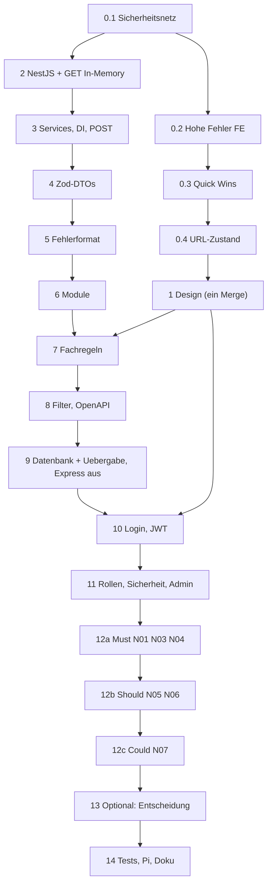
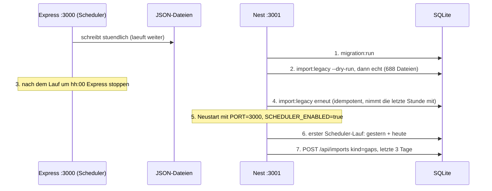

# 04 – Roadmap

Stand: 19.11.2026 · Grundlage: `01-analyse.md` (F01–F34, S1–S12, Abschnitt 7), `02-verbesserungen-und-design.md` (V01–V35, N01–N10, E2.2, E3.10), `03-zielbild.md` (US01–US20, R01–R33, B2–B7, C). Korrigiert nach der Prüfung `05-pruefung.md` (P01–P37). Arbeitsstand: Branch `umbau/analyse`, Commit `226e214` („Backfill, Fix Vorhersage-Abruf, Ist-Analyse“). `02-…md` und `03-…md` sind noch nicht committet.

**Kennzeichnung:** **B** = Befund · **A** = Annahme · **E** = Empfehlung
**Aufwand** wie in 02: **S** = bis ½ Tag · **M** = 1–3 Tage · **L** = mehr als 3 Tage (Einzelarbeit, Lernprojekt)

**Grundsätze:**
1. Nach jedem Schritt startet die Anwendung (`npm start` im Frontend, Backend läuft) und die Prüfungen unter „Fertig, wenn …“ sind erfüllt. Jeder Schritt ist ein eigener Branch `umbau/<nr>-<thema>` und wird erst gemergt, wenn er fertig ist. **Ausnahme Schritt 1:** Das Design wird in **einem** Merge übernommen (E3.10).
2. **Parallelbetrieb (Strangler-Muster):**
   - Das NestJS-Backend entsteht im neuen Ordner **`api/`** neben `backend/`. In der Entwicklung läuft es auf `127.0.0.1:3001`, Express bleibt auf `:3000`.
   - Die Pfade der neuen API (B3.1) unterscheiden sich vollständig von den alten (`/api/data/*`, `/api/forecast`, `/api/stats`). Deshalb verteilt `frontend/proxy.conf.json` die Anfragen **je Ressource**: neue Ressourcen gehen an `:3001`, der Rest fällt auf `:3000` zurück.
   - Jede Seite wird umgestellt, sobald ihre Ressource fachlich fertig ist.
3. **Express bleibt bis Schritt 9 der einzige Schreiber** (Scheduler → JSON-Dateien). Nest liest bis dahin nur bzw. hält Daten im Speicher. Express wird in Schritt 9 nach der Übergabe des Schedulers abgeschaltet (Ablauf in Schritt 9).
4. Die Nest-API kommt **nicht vor Schritt 11** auf den Raspberry Pi, weil schreibende Endpunkte erst dann geschützt sind.
5. Tests entstehen in jedem Schritt mit dem Code. Schritt 14 schließt nur die Lücken und nimmt ab.

---

## Übersicht

| Schritt | Ziel | Aufwand | Abhängigkeit | Status |
|---|---|---|---|---|
| 0.1 | Sicherheitsnetz: F01 prüfen, Frontend-Tests, Golden Files der Alt-API | M | – | ✅ erledigt (`a4ec0b6`) |
| 0.2 | Kritische und hohe Fehler im Frontend (F02–F07) | M | 0.1 | ✅ erledigt (`76986a3`) |
| 0.3 | Quick Wins aus E1 | M | 0.2 | ✅ erledigt (`9e783e8`) |
| 0.4 | URL-Zustand und Datumsfeld (F11, F09, F19) | M | 0.3 | ✅ erledigt (`f912292`) |
| 1 | Design-Grundlage und Umstellung aller Seiten (E3.10) | L | 0.4 | ✅ erledigt (`79cc815`…`2fcccd5`) |
| 2 | NestJS-Projekt `api/`, erste GET-Endpunkte (In-Memory), Frontend liest Status | M | 0.1 | ✅ erledigt (`8cca517`) |
| 3 | Services, Dependency Injection, `POST /imports` | M | 2 | ✅ erledigt (`0a2c7b9`) |
| 4 | Zod-DTOs und Validierung, Feldfehler im Frontend | M | 3 | offen |
| 5 | Einheitliche Fehlerbehandlung und Statuscodes | S | 4 | offen |
| 6 | Module je Ressource, Regeln zwischen Modulen | M | 5 | offen |
| 7 | Fachregeln und berechnete Felder; Heute und Rekorde auf die neue API | L | 6, 1 | offen |
| 8 | Filter, Sortierung, OpenAPI; Monat und Jahr auf die neue API | M | 7 | offen |
| 9 | Datenbank, Migrationen, Altdatenimport, Übergabe des Schedulers, Express aus | L | 8 | offen |
| 10 | Login, JWT, AuthGuard, Login-Seite (keine Registrierung) | M | 9, 1 | offen |
| 11 | Rollen, RolesGuard, `.env`, sichere Grundeinstellungen, Admin-Bereich | L | 10 | offen |
| 12a | Must: N01, N03, N04 | M | 11 | offen |
| 12b | Should: N05, N06 | M | 12a | offen |
| 12c | Could: N07 | S | 12b | offen |
| 13 | Optional: WebSockets, Templates, Events (Entscheidung) | S | 12c | offen |
| 14 | Tests, Barrierefreiheit, Deployment auf den Pi, Dokumentation | L | 13 | offen |



Der Strang über 0.2 bis 1 (Frontend) und der Strang über 2 bis 6 (Backend) können parallel laufen. Sie treffen sich in Schritt 7, weil die umgestellten Seiten die Komponenten aus Schritt 1 brauchen. **Berührungspunkt Footer:** Schritt 2 liefert im Frontend nur Typen und Service-Methoden. Die Anzeige von Ort und Datenzeitraum aus Nest im Footer baut der Schritt ein, der von 1 und 2 **als zweiter** gemergt wird (Details in Schritt 1, Aufgabe 3, und Schritt 2).

---

## Schritt 0.1 – Sicherheitsnetz

> **Status:** ✅ Erledigt am 19.11.2026, Commit `a4ec0b6`. Golden Files mit README unter `api/test/characterization/`. Vitest läuft mit `maxWorkers: 2` (`frontend/vitest.config.mjs`), weil auf der USB-Platte sonst die Worker in ein Timeout laufen.

**Ziel:** Bevor sich etwas ändert, wird das heutige Verhalten festgehalten. F01 ist geprüft.
**Bezug:** F01, F33 · V24 · S2 · C6 (Charakterisierung zuerst) · C2 (Commit-Adresse, 01 1.3)

**Aufgaben:**
- **F01 prüfen.** `git show --stat 226e214` muss `backend/src/weather-api.ts` enthalten (Fix bereits committet). Außerdem `docs/umbau/02-…md` bis `05-…md` committen.
- **Commit-Adresse (03 C2):** nur lokal im Repo `git config user.email "<id>+<name>@users.noreply.github.com"` setzen, damit neue Commits im öffentlichen Repo keine private E-Mail-Adresse mehr enthalten.
- **Frontend-Tests einrichten.** `ng test` mit Vitest einrichten (**A:** Standard in Angular 21). Pakete: `vitest` und `jsdom` in der Version, die `ng add`/der Schaltplan vorschlägt. Erste Specs:
  - `utils/weather-icon.spec.ts` (Ist-Verhalten, später umgedreht)
  - Zustandsmodell
  - `null`-Behandlung
- **Golden Files nach B2.7 Schritt 3.** Ein Skript `api/test/characterization/capture.sh` holt mit `curl` gegen das laufende Express folgende Antworten:
  - `/api/stats`, `/api/data/year/2025` und `2026`
  - alle 23 Monate
  - 10 Tage, darunter 30.03.2025, 26.10.2025 und 29.03.2026

  Ablage als JSON unter `api/test/characterization/golden/`. Der Ordner `api/` entsteht hier nur mit diesem Unterordner.

**Frontend und Design:** keine sichtbare Änderung.

**Fertig, wenn …**

| Prüfung | Erwartet |
|---|---|
| Express starten, nach dem ersten Abruf `curl -i http://localhost:3000/api/status` | **200**, `lastFetch` gesetzt, `lastStatus = "ok"`. Der Zeitstempel von `backend/data/forecast.json` ist neu |
| `cd frontend && npm test` | Exit-Code 0, mindestens 3 Spec-Dateien |
| `ls api/test/characterization/golden` | 36 JSON-Dateien (1 + 2 + 23 + 10) |
| `git config --local user.email` | endet auf `@users.noreply.github.com` (03 C2) |

**Aufwand:** M · **Risiko:** `npm install` dauert auf der USB-Platte über 20 Minuten (01, 0.2). Abhängigkeiten nur einmal je Schritt installieren.

## Schritt 0.2 – Kritische und hohe Fehler im Frontend

> **Status:** ✅ Erledigt am 19.11.2026, Commit `76986a3`. Der Übergangs-Fokusring wurde in Schritt 1 durch `--color-focus` ersetzt.

**Ziel:** Die sichtbar falschen Anzeigen verschwinden, noch mit der Express-API. Dieser Teil läuft auf einem eigenen kleinen Branch vor dem Design (E3.10).
**Bezug:** F02, F03, F04, F05, F06 (Frontend-Teil), F07 (Übergangsring, endgültig in Schritt 1), F12, F31 · V01, V02, V03, V04 (Minimalfassung), V05, V09 · Sicherheit 1.3 (Express: 0.0.0.0, CORS `*`)

**Aufgaben:**
- `monthly-page.html/.ts`, `yearly-page.html/.ts`: `[selected]` an jeder Option (V01). Zustandsmodell `idle/loading/success/empty/error` (V02). `switchMap` über `toObservable()` (V03).
- `today-page.ts/.html`: dasselbe Zustandsmodell. Neuer Helfer `utils/berlin-date.ts` mit `berlinToday()` und `berlinHour()` über `Intl.DateTimeFormat` (V09). Er ersetzt alle `toISOString().slice(0,10)`.
- `app.css`: Media-Query unter 48 em, Navigation als Raster mit 4 Spalten, `min-height: 2.75rem` (V04, Minimalfassung).
- `styles.css`, `today-page.css`, `monthly-page.css`, `yearly-page.css`: alle `outline: none` entfernen, globaler `:focus-visible` (V05). **Übergangsring zweifarbig**, weil das spätere `--color-focus` `#C2571A` auf dem alten blauen Header-Verlauf (`#0369a1` → `#0ea5e9` → `#38bdf8`) und dem Footer `#0369a1` nur 1,32 / 1,62 / 2,10:1 erreicht:
  ```css
  :focus-visible {
    outline: 3px solid #1B1F24;      /* innen, direkt am Element */
    outline-offset: 0;
    box-shadow: 0 0 0 5px #FFFFFF;   /* 2 px weißer Saum außerhalb des Rings */
  }
  ```
  Die beiden Ringfarben haben untereinander **16,56:1** (≥ 9:1, WCAG-Technik C40). Damit erreicht an jeder Stelle mindestens eine der beiden ≥ 3:1 gegen die angrenzende Fläche: dunkel gegen `#0369a1` / `#0ea5e9` / `#38bdf8` = 2,79 / 5,98 / 7,73, weiß = 5,93 / 2,77 / 2,14; auf weißen und hellen Flächen dunkel 14,81–16,56. Schritt 1 ersetzt den Übergangsring durch `--color-focus` (02 E3.3 #25, #31), weil der blaue Header dann entfällt. **A:** `box-shadow` wird in Containern mit `overflow: hidden` abgeschnitten; dort bleibt der dunkle Ring sichtbar.
- **E (Express, klein):** In `backend/src/weather-api.ts` und `server.ts` wird „heute“ in Europe/Berlin berechnet, wie in `backfill.ts:22-24`. Sonst schreibt der Scheduler bis zur Abschaltung in Schritt 9 weiter falsche Tagesdateien (F06, Backend-Teil). Außerdem `app.listen(PORT, '127.0.0.1')` statt `0.0.0.0` und `cors()` entfernen: Der Dev-Proxy (`proxy.conf.json`) liefert dieselbe Origin, und Express mit den 8 `npm audit`-Funden (body-parser, qs) ist bis Schritt 9 nicht mehr aus dem LAN erreichbar.

**Fertig, wenn …**

| Prüfung | Erwartet |
|---|---|
| Browser `/monat`, 1280 px | Die Auswahl zeigt „Nov“. Wählt man das Jahr 2025, geht ein Request auf `/api/data/month/2025/11` (200), und die Auswahl zeigt weiter „Nov“ |
| Browser `/`: 10.11.2026 wählen, dann 31.12.2024 | Nur die Fehlerbox ist sichtbar, keine Werte vom 10.11. (F03) |
| Browser `/`: ab dem 17.11. fünfmal schnell auf ‹ klicken | Datumsfeld und angezeigte Daten zeigen beide den 12.11. Im Network-Tab sind die überholten Requests „canceled“ (F04) |
| Browser, alle 4 Routen bei 320 und 375 px, Konsole: `document.documentElement.scrollWidth === document.documentElement.clientWidth` | `true` (F05) |
| Browser: mit Tab durch Navigation, Logo, Datumsfeld und Footer-Link gehen; Farben mit dem DevTools-Farbwähler messen | An jeder dieser Stellen hat mindestens einer der beiden Ringe (`#1B1F24` bzw. weißer Saum) **≥ 3:1** gegen die angrenzende Fläche. Kein Element hat `outline: none` (F07) |
| Unit-Test `berlinToday()` mit fester Uhr `2026-11-19T23:30:00Z` | `"2026-11-20"` (F06) |
| `curl -i http://localhost:3000/api/data/month/2026/11` (Gegenprobe F12) | **200** |
| Browser `/`: einen Tag laden, Express stoppen, dann auf ‹ klicken | Nur die Fehlerbox ist sichtbar, keine Werte des vorigen Tags. Der Proxy antwortet mit einem 5xx (je nach Dev-Server 500, 502 oder 504) (F12) |
| `curl http://<LAN-IP>:3000/api/status` von einem anderen Gerät | Verbindung abgelehnt (Express nur auf `127.0.0.1`) |
| `curl -I http://localhost:3000/api/status` | **kein** `Access-Control-Allow-Origin` |

**Aufwand:** M · **Risiko:** Der Express-Fix für die Berliner Zeit ändert, in welche Datei die Stunden zwischen 0 und 2 Uhr geschrieben werden. Im Altbestand bleiben falsche Dateien möglich; sie fallen bei der Migration (Schritt 9) auf.

## Schritt 0.3 – Quick Wins aus E1

> **Status:** ✅ Erledigt am 19.11.2026, Commit `9e783e8`. Das Chart-Locale ist `de-DE`. **Offen:** Monat und Jahr haben bei Serverfehlern noch keinen Button „Erneut versuchen“, nur die Heute-Seite.

**Ziel:** Kleine Verbesserungen mit hohem Nutzen, alle im Frontend bzw. im Repo.
**Bezug:** F15, F16 (README), F18, F20, F21, F26, F29, F30, F34 · V10, V11, V13, V15, V17, V18, V19, V20, V22, V25 · Sicherheit 1.3 (Analytics-ID, MCP-Version)

**Aufgaben:**
- `app.routes.ts`: `title` an jeder Route und eigene `TitleStrategy`.
- `app.html`: `ariaCurrentWhenActive="page"` (V10).
- `app.config.ts`: `LOCALE_ID 'de-DE'` und `registerLocaleData(localeDe)`. Neue Pipe `pipes/unit.pipe.ts` (V11).
- `today-page.ts`: `null` vor `Math.min/max` herausfiltern (V13).
- Button „Laden“ entfernen (V15).
- Vorschau nur an „heute“ anzeigen (V17).
- Konstante `DATA_START = '2025-01-01'` (V18).
- Vollständige WMO-Tabelle in `weather-icon.ts`, Spec umdrehen (V19).
- Fehlermeldung je nach Ursache (V20).
- Sichtbare `<label>`, `font: inherit` (V22).
- `FormsModule` entfernen (Teil von V23).
- README: PM2-Link korrigieren und Seed-Empfehlung streichen (V25).
- `angular.json`: `cli.analytics` entfernen. `.vscode/mcp.json`: feste Version statt `npx -y`.

**Fertig, wenn …**

| Prüfung | Erwartet |
|---|---|
| Browser `/monat` | Der Tab-Titel lautet „November 2026 – Monat – Wetter Heubach“. Der aktive Navigationspunkt hat `aria-current="page"` (F30) |
| Browser `/` | Zahlen erscheinen als „9,7 °C“ mit schmalem Leerzeichen (F29) |
| Unit-Test Tag mit `temperature: null` | Das Minimum ist der kleinste echte Wert, nicht 0 (F15) |
| Unit-Test `describeWeather(66)` / `(57)` / `(100)` / `(null)` | „Gefrierender Regen“ / „Gefrierender Niesel“ / „Unbekannt“ / „Keine Angabe“ (F26) |
| Browser `/monat`: Monat wechseln | Es gibt keinen Button „Laden“ und genau 1 Request je Wechsel (F21) |
| Browser `/` mit einem vergangenen Tag | Keine Vorschautabelle, stattdessen der Link „Aktuelle 7-Tage-Vorschau“ (F18) |
| Browser `/jahr` | Die Auswahl bietet nur 2025 und 2026 an (F20) |
| Browser `/` mit dem 31.12.2024 | „Für den 31.12.2024 liegen keine Daten vor. Daten gibt es ab dem 01.01.2025.“ (V20) |
| `grep -n keymetrics README.md` | Treffer, und `keymaster` kommt nicht mehr vor (F34). Die Seed-Empfehlung fehlt (F16) |
| `grep -c analytics frontend/angular.json` | `0` (Analytics-ID entfernt, 1.3) |
| `.vscode/mcp.json` ansehen | enthält `@angular/cli@<feste Version>` und kein `-y` (1.3, C1 A03) |
| `npm test` | grün |

**Aufwand:** M · **Risiko:** Die neue `LOCALE_ID` verändert Formate in Chart.js-Tooltips. Im Browser gegenprüfen.

## Schritt 0.4 – URL-Zustand und Datumsfeld

> **Status:** ✅ Erledigt am 19.11.2026, Commit `f912292`. Tastatureingaben im Datumsfeld werden erst nach Enter, Verlassen des Felds oder 800 ms Pause übernommen. **Offen:** Beim Wechsel `/` ↔ `/tag/…` wird die Vorschau neu geladen (Cache in Schritt 7). Bleibt die Seite über Mitternacht offen, werden „heute“ und `max` nicht neu berechnet.

**Ziel:** Die Auswahl steht in der URL, und das Datumsfeld lässt keine Fehlbedienung zu.
**Bezug:** F09, F11, F19 · V08, V12 · US02-8 bis -11 (Bedienung, hier noch gegen Express; endgültig in Schritt 7)

**Aufgaben:**
- `app.routes.ts`: `''`, `tag/:date`, `monat/:year/:month`, `jahr/:year`, `statistiken`.
- `app.config.ts`: `withComponentInputBinding()`.
- Pfeile, Button „Heute“ und Auswahlfelder navigieren über `Router.navigate`. › ist an „heute“ deaktiviert.
- Datumsfeld mit Label, `min` = `DATA_START` und `max` = `berlinToday()`. Ein leerer Wert führt zu einer Fehlermeldung am Feld (`aria-invalid`, `aria-describedby`).
- Bei Zukunftsdaten: Vorhersage-Box und „Zurück zu heute“.

**Fertig, wenn …**

| Prüfung | Erwartet |
|---|---|
| Browser: `http://localhost:4200/monat/2025/03` direkt öffnen, dann F5 | März 2025 wird angezeigt, keine Umleitung auf `/` (F11) |
| Browser: `/tag/2026-11-10` → ‹ → Zurück-Button | Erst 09.11., nach dem Zurück-Button wieder 10.11. |
| Browser `/tag/2026-02-30` | Hinweis „Ungültiges Datum“ mit Link auf heute, keine Umleitung |
| Browser `/`: Datumsfeld leeren | Meldung unter dem Feld, Feld mit `aria-invalid="true"`, ‹ › deaktiviert, **kein** Request im Network-Tab (F09) |
| Browser: Datumsfeld | Das Feld hat die Attribute `min="2025-01-01"` und `max` = heute (F19) |
| Browser `/tag/2026-11-10`: Klick auf „Heute“ | URL `/`, das Datumsfeld zeigt das heutige Datum (US02-10) |
| Browser `/` | › ist `disabled` (US02-9) |
| Browser `/tag/2026-11-10`: im Datumsfeld den 05.11.2026 wählen | URL `/tag/2026-11-05`, genau 1 Request im Network-Tab (US02-11) |

**Aufwand:** M · **Risiko:** Doppelte Requests durch Router und Signal. Mit `distinctUntilChanged` absichern.

---

## Schritt 1 – Design-Grundlage und Umstellung der Seiten

> **Status:** ✅ Erledigt am 19.11.2026, Teilcommits 1a `79cc815`, 1b `ee8bb2f`, 1c `4020359`, 1d `f8e9a7b`, Feinschliff `2fcccd5`. Die Endprüfung ist bestanden: axe ohne Verstöße, Breiten 320–1920 px und Zoom 400 % funktionieren. Screenshots liegen unter `docs/umbau/screenshots/nachher/`. **Offen:** Die Footer-Links sind nur 29 px hoch. Die Rekordkarten haben noch keine Stunde und keinen Link „Tag ansehen“. Der Chip „11 von 12 Monaten“ fehlt. Auf der Monatsseite fehlen die Pfeile für Vor- und Folgemonat. Der Footer-Block „Datenstand“ kommt mit Schritt 2. Auf Heute fehlen „bis jetzt“-Werte (Schritt 7). Über die Wortwahl V26 ist noch nicht entschieden.

**Ziel:** Die Designvorgabe aus E3 ist vollständig umgesetzt, auf Branch `umbau/design`. Gemergt wird erst nach der Endprüfung, in **einem** Schritt, damit es nie halb altes und halb neues Design gibt.
**Bezug:** F05 (endgültig), F07 (endgültiger Fokusring `--color-focus`), F08, F10 (Frontend-Teil), F17, F23, F24, F25, F31 · V04, V06, V07, V14, V16, V21, V22, V23 (Diagramm), V26 (falls entschieden) · S11

**Aufgaben** (Reihenfolge E3.10, jeder Commit baut fehlerfrei):
1. `frontend/src/styles/tokens.css` nach E3.2, in `angular.json` **vor** `styles.css` eingetragen. Schriften als woff2 unter `frontend/public/assets/fonts/` mit `OFL.txt`. Quelle: `@fontsource-variable/inter` und `@fontsource-variable/space-grotesk` (Version 5, nur zum Kopieren der Dateien als devDependency oder einmalig entpackt). Preload von Inter in `index.html`. Die Basis in `styles.css` kommt aus E3.2, dazu die Alias-Variablen aus E3.10.
2. Die 38 Hex- und 18 rgb-Werte durch Tokens ersetzen. `stylelint` 16 mit `stylelint-config-standard` und der Regel `color-no-hex` (Ausnahme `tokens.css`), Skript `npm run lint:css`.
3. `app.html/.css`: Header, Navigation, Footer (`.surface-dark`), Skip-Link (E3.7.1, E3.7.9). Der übergangsweise zweifarbige Fokusring aus Schritt 0.2 wird durch `--color-focus` ersetzt. Footer-Block „Datenstand“: Ist Schritt 2 schon gemergt, liest er Ort und `dataFrom`/`dataTo` aus dem Nest-`/api/status` (über `weather.service.getStatus()`/`getLocation()` aus Schritt 2). Sonst zeigt er nur statischen Text („Wetterdaten für Heubach“), und Schritt 2 baut die Anzeige ein. Das Express-Feld `lastFetch` wird nicht mehr gelesen.
4. Gemeinsame Komponenten unter `frontend/src/app/components/`: `card`, `kpi-card`, `chip`, `notice`, `form-field`, `data-table`, `skeleton` und `state/` (`app-loading`, `app-empty`, `app-error`, B5.1). Buttons als globale Klassen.
5. `climate-chart.ts/.html`: Farben aus den Tokens (E3.8), `<figure>` mit `figcaption`, `role="img"` und `aria-label`, Datentabelle in `<details>`, HTML-Legende (V07). Nur die benötigten Chart.js-Teile registrieren, `chart.update()` (V23). Ganze Monatsachse mit Lücken (V21). Das Vorhersageband entsteht übergangsweise aus `Stunde > berlinHour()`, ab Schritt 7 aus `isPrediction`.
6. Seiten in der Reihenfolge Heute → Monat → Jahr → Rekorde (E3.9): Kicker statt doppelter Werte (V16), Skelett statt „aus 0 Tagen“ (V14), 7-Tage-Vorschau als Tabelle mit Wettertext. Wortwahl nach V26 **nur, wenn sie entschieden ist**, sonst bleiben die alten Begriffe.
7. Aliase löschen, Endprüfung, Nachher-Screenshots unter `docs/umbau/screenshots/nachher/`.

**Fertig, wenn …**

| Prüfung | Erwartet |
|---|---|
| `npm run lint:css` | Exit-Code 0. `grep -rEn --include=*.css --include=*.ts "#[0-9a-fA-F]{3,8}\b\|rgba?\(" frontend/src/app` findet nichts (S11). Die Suche ist auf CSS und TS beschränkt, weil HTML-Entitäten wie `&#8249;` (‹) sonst Treffer liefern |
| Browser `/monat/2026/11`, 1280 px (Daten bis 19.11.) | Die x-Achse des Diagramms zeigt den 1. bis 30. Nach dem letzten Tag mit Daten (19.11.) bleibt die Linie leer, die Achse läuft bis zum 30. weiter (V21) |
| Browser: mit Tab durch Header, Seitenkopf, Karten und Footer gehen | Der Fokusring ist `--color-focus` und erreicht laut 02 E3.3 #25 bzw. #31 mindestens 3,69:1 (hell) bzw. 4,83:1 (dunkel) gegen die angrenzende Fläche (F07) |
| Browser, Network-Tab auf allen Routen | Nur Requests an `localhost:4200`. `/assets/fonts/inter-latin-wght-normal.woff2` liefert 200, keine fremden Hosts (C2) |
| axe DevTools auf `/`, `/monat/2025/03`, `/jahr/2025`, `/statistiken` | 0 Verstöße der Stufen „serious“ und „critical“, keine Kontrastfehler (F08) |
| Browser bei 320, 375, 768, 1280 und 1920 px auf allen 4 Routen | `scrollWidth === clientWidth`. Labels wie „GESAMTNIEDERSCHLAG“ bleiben in der Karte (F05) |
| DevTools, Element-Prüfung von Navigation, Buttons und Feldern | Jede Klickfläche ist mindestens 44 × 44 px groß (F31) |
| Browser `/`, Screenreader-Baum in DevTools (Accessibility) | Das Canvas hat einen Namen, die Tabelle „Werte als Tabelle“ ist vorhanden, die Vorschau hat Wettertext (F17) |
| Browser `/tag/2026-11-10` | Der große Wert trägt den Kicker „HÖCHSTWERT“. Jeder Wert erscheint nur einmal (F23, F24). Alle Karten haben dieselbe orange Kante (F25) |
| DevTools-Emulation `prefers-reduced-motion: reduce` | Keine Einblendanimation, Diagramm ohne Animation |
| Zoom 200 % und 400 % bei 1280 px | Kein Inhalt abgeschnitten, kein horizontales Scrollen bei 400 % |

**Aufwand:** L · **Risiko:** Mischzustand aus altem und neuem Design. Gegenmittel: Feature-Branch, Aliase, ein einziger Merge. Zweites Risiko: Die Seiten werden in Schritt 7 und 8 noch einmal angefasst (neue Felder). Deshalb liegt die Logik in Komponenten und nicht in den Seiten.

---

## Schritt 2 – NestJS-Projekt und erste GET-Endpunkte (In-Memory)

> **Status:** ✅ Erledigt am 20.11.2026, Commit `8cca517`. Das Gerüst ist von Hand nach der Nest-11-Vorlage gebaut (nicht `nest new`), damit `api/test/characterization/` erhalten bleibt. 43 Unit- und 12 e2e-Tests in `api/`, 218 Frontend-Tests. **Offen:** Felder, die erst spätere Schritte berechnen (u. a. `isPrediction`, `complete`, `nextScheduledUpdateAt`), fehlen noch. `timeLocal` hat kein Offset, weil die Altdaten an Umstellungstagen 24 naive Einträge haben (Z1; `/api/days/2026-03-29` zeigt `hoursExpected: 23` bei 24 Stunden). Ungültige Daten bei `/api/days/:date` liefern 404 statt 400 (Schritt 4). `X-Powered-By` ist noch gesetzt (Schritt 11). Ältere Tagesdateien liest Nest nur beim Start.

**Ziel:** Ein lauffähiges NestJS-Projekt in `api/`. Die ersten lesenden Endpunkte aus B3.1 liefern Daten aus dem Arbeitsspeicher, und das Frontend liest erstmals von der neuen API.
**Bezug:** US01 (Grundform), US02-1, US03-1/-2, US07-1/-2 (`updateState = "never"`), US07-3/-4 · F32 (ehrlicher Anfangszustand) · S4

**Aufgaben:**
- `npx @nestjs/cli@11 new api --skip-git --package-manager npm` mit TypeScript strict. Pakete:
  - `@nestjs/core`, `@nestjs/common` und `@nestjs/platform-express` in Version 11 (Express 5 darunter)
  - `reflect-metadata`, `rxjs` 7
  - dev: `@nestjs/testing` 11, `jest`, `ts-jest`, `supertest` 7
- **Vor dem ersten Modul (C6):** `api/src/common/clock.ts` (`Clock`, `SystemClock`, `FixedClock`) und `api/src/common/berlin-time.ts` (`localDate`, `localHour`, `hoursInDay`). Unit-Tests für 30.03.2025, 26.10.2025, 29.03.2026 und 25.10.2026 sowie für Mitternacht MEZ und MESZ.
- `main.ts`: `setGlobalPrefix('api')`, `listen(3001, '127.0.0.1')`. Port und Datenordner kommen **übergangsweise** aus `process.env.PORT` und `process.env.LEGACY_DATA_DIR` (Standard `../backend/data`). Das wird in Schritt 11 durch `ConfigModule` ersetzt; `LEGACY_DATA_DIR` entfällt in Schritt 9.
- `legacy/legacy-file-source.ts`: liest beim Start **asynchron und nur lesend** alle Tagesdateien in eine `Map<date, hours[]>`. Die Datei für heute und `forecast.json` liest es bei jeder Anfrage neu.
- Controller (vorerst ohne Service, Kursmuster „erste Endpunkte“):
  - `GET /api/locations` und `/api/locations/:id` (Heubach als Konstante)
  - `GET /api/days/today` mit `Content-Location`, `GET /api/days/:date`
  - `GET /api/forecasts`
  - `GET /api/status` mit `today`, `timezone`, `dataFrom`, `dataTo`, `updateState: "never"` und `lastSuccessfulUpdateAt: null`, weil Nest noch keinen Import kennt
- **Frontend** (nur Datenzugriff, keine Anzeige):
  - `proxy.conf.json` verteilt die Anfragen. `/api/locations` und `/api/status` gehen an `http://localhost:3001`, `/api` als letzter Eintrag an `:3000`.
  - `models/api.ts` (neu) mit `number | null`.
  - `weather.service.ts`: `getStatus()` und `getLocation()` gegen die neue API.
  - **Nur wenn Schritt 1 schon gemergt ist:** Der Footer zeigt Ort und Datenzeitraum aus Nest, mit den Komponenten aus Schritt 1. Ist Schritt 1 noch nicht gemergt, übernimmt Schritt 1 diese Anzeige (Schritt 1, Aufgabe 3).

**Fertig, wenn …**

| Anfrage / Prüfung | Erwartet |
|---|---|
| `curl -i http://127.0.0.1:3001/api/locations` | **200**, `items` mit genau einem Eintrag `slug = "heubach"` |
| `curl -i http://127.0.0.1:3001/api/locations/99` | **404** (noch Standardformat von Nest, wird in Schritt 5 einheitlich) |
| `curl -i http://127.0.0.1:3001/api/days/2026-11-10` | **200**, 24 Stunden |
| `curl -i http://127.0.0.1:3001/api/days/today` | **200**, `date` = Berliner Datum, Header `Content-Location: /api/days/2026-11-19` |
| `curl -i http://127.0.0.1:3001/api/forecasts` | **200**, `items` mit 7 Einträgen und `fetchedAt` |
| `curl -i http://127.0.0.1:3001/api/status` | **200**, `updateState = "never"` (F32) |
| `curl http://<LAN-IP>:3001/api/status` von einem anderen Gerät | Verbindung abgelehnt (S9) |
| `cd api && npm test` | BerlinTime-Tests grün |
| Browser `localhost:4200`, Network-Tab | `/api/status` liefert 200 (über den Proxy an 3001). `/api/data/...` liefert weiter 200 von Express |
| Browser: Footer (Prüfung gehört zu dem von Schritt 1 und 2, der als zweiter gemergt wird) | Der Footer zeigt „Heubach“ und den Datenzeitraum aus `/api/status` (`dataFrom`–`dataTo`) |

**Aufwand:** M · **Größtes Risiko:** Die Reihenfolge der Proxy-Einträge. **A:** Der Dev-Server nimmt den ersten passenden Schlüssel. Der Fallback `/api` muss deshalb zuletzt stehen, und `/api/forecasts` darf nicht von `/api/forecast` überdeckt werden; dafür werden nur neue Ressourcen ausdrücklich gelistet.
**Design:** keine Änderung. Die Footer-Anzeige nutzt die Komponenten aus Schritt 1 und entsteht deshalb erst, wenn beide Schritte gemergt sind (siehe Übersicht).

## Schritt 3 – Services, Dependency Injection, POST

> **Status:** ✅ Erledigt am 20.11.2026, Commit `0a2c7b9`. 118 Unit- und 17 e2e-Tests. Entscheidungen: Die Tagesvorhersage wird mit `timezone=Europe/Berlin` abgerufen (Offset 3600/7200 geprüft), weil „Tag“ der Berliner Kalendertag ist; R32 `utc_offset_seconds = 0` gilt für die Stunden. Für „heute“ gewinnt die neuere Quelle (Express-Datei oder Import). Zusätzliche Codes `UPSTREAM_ERROR`, `INTERNAL_ERROR`, Warnung `FORECAST_FAILED`. R25 (`updateState`) ist schon im `StatusService`. **Befund für Schritt 9:** Der Live-Import bestätigt Z1: Die Altdateien sind im Sommer um 1 h versetzt (fester Offset +01:00). **Offen:** Validierung (US10-4…-8) in Schritt 4, Fehlerformat in Schritt 5. Scheitert im Runner auch das Setzen von `failed`, bliebe ein Import `running`; die Startbereinigung `INTERRUPTED` kommt mit Schritt 9.

**Ziel:** Controller rufen Services auf. Der Datenzugriff liegt hinter einer austauschbaren Schnittstelle. Der erste schreibende Endpunkt nimmt Importaufträge an.
**Bezug:** US08-2 (Unit), US10-3, US11-1 (In-Memory) · F01 (Muster gegen `Promise.all`) · V27 (Grundlage) · N02 (Anfang) · S3, S7 · R32 (01 1.2/1.3: Open-Meteo-Antworten prüfen)

**Aufgaben:**
- Schnittstelle `ObservationStore` mit dem Token `OBSERVATION_STORE` und der Implementierung `InMemoryObservationStore` (befüllt aus `LegacyFileSource`). Dazu `ForecastStore` und `ImportStore` genauso. In Schritt 9 tritt TypeORM an diese Stelle.
- `DaysService`, `ForecastsService`, `LocationsService`, `StatusService`, alle mit `Clock` per DI.
- `weather-provider/open-meteo.client.ts`: natives `fetch`, `AbortSignal.timeout(15000)`, 2 Wiederholungen mit Backoff, `timezone=GMT`. Ein einziges Variablen-Mapping (S7). Jede Antwort wird mit `OpenMeteoResponseSchema` (Zod) geprüft (03 R32): `hourly` fehlt, Arrays ungleich lang oder `utc_offset_seconds ≠ 0` → Import `failed` mit `error.code = "UPSTREAM_INVALID"`, nichts geschrieben. Das Paket `zod` kommt dafür schon hier dazu (sonst Schritt 4).
- `imports/imports.service.ts` und `import-runner.ts`:
  - `POST /api/imports` legt den Auftrag mit `queued` an und antwortet **202** mit `Location`.
  - Danach startet `setImmediate`.
  - Stundenwerte und Tagesvorhersage werden **getrennt** behandelt (`partial`).
  - Geschrieben wird **nur in den Arbeitsspeicher**, nie in die JSON-Dateien, denn Express bleibt der Schreiber.
- `GET /api/imports/:id`.
- **DELETE entfällt (begründet):** Kein Endpunkt aus B3.1 löscht etwas (B3.2: 204 bewusst nicht verwendet). Auch die Rücknahme einer Korrektur löscht nichts, sondern ist ein eigener Eintrag in der Historie (`POST …/corrections/{correctionId}/reversal`, 03 R33, Schritt 12a).
- Unit-Tests mit gemocktem `OpenMeteoClient` und `FixedClock`.

**Fertig, wenn …**

| Anfrage / Prüfung | Erwartet |
|---|---|
| `curl -i -X POST -H "Content-Type: application/json" -d '{"kind":"range","from":"2026-10-01","to":"2026-10-03"}' http://127.0.0.1:3001/api/imports` | **202**, `Location: /api/imports/1`, Body `status = "queued"` |
| `curl -s http://127.0.0.1:3001/api/imports/1` alle 2 s abfragen, bis `status` weder `queued` noch `running` ist, höchstens 30 s | **200**, `status = "succeeded"`, `counts.updated + counts.unchanged = 72` |
| Unit-Test: Mock wirft bei `daily` einen Fehler | Status `partial`, die Stundenwerte sind gespeichert (US08-2, F01) |
| Unit-Test: Mock liefert `{}` (gültiges JSON ohne `hourly`) | Import `failed`, `error.code = "UPSTREAM_INVALID"`, nichts geschrieben (03 R32) |
| `curl -i http://127.0.0.1:3001/api/imports/999` | **404** |
| Unit-Test `DaysService` mit Fake-Store | Der Controller-Test braucht keine Dateien mehr (DI) |

**Aufwand:** M · **Größtes Risiko:** Ein offener schreibender Endpunkt ohne Anmeldung. Gegenmittel: Bindung nur an `127.0.0.1`, kein Deployment vor Schritt 11, Schreiben nur in den Arbeitsspeicher.
**Frontend/Design:** keine Änderung.

## Schritt 4 – DTOs und Validierung mit Zod

**Ziel:** Jede Eingabe wird durch ein Zod-Schema geprüft. Fehler kommen je Feld zurück, und das Frontend kann sie dem Formularfeld zuordnen.
**Bezug:** US02-2/-3, US03-3, US10-4/-6/-8, US09-5 (Muster) · F22 · V33 (Zod-Teil) · R01, R04, R05, R18, R22

**Aufgaben:**
- Paket `zod` 4 (**A7** in 03), installiert schon in Schritt 3 für R32.
- `common/zod-validation.pipe.ts` und `ApiValidationException.fromZod()` mit einem Eintrag `errors[]` je Feld. Bei `unrecognized_keys` entsteht je Schlüssel ein Eintrag.
- Schemas unter `*/dto/*.schema.ts`:
  - `DateParamSchema` (R01, `z.iso.date()` + Rückrechnung), `YearMonthSchema` (R04), `YearSchema` (R05, ≥ 1940)
  - `ForecastsQuerySchema` (`.strict()`, R22)
  - `ImportCreateSchema` (`kind` ∈ `range`/`gaps`, `from ≤ to`, höchstens 1096 Tage, `overwriteCorrections` optional, `.strict()`, R18)
- Unit-Test für jeden Grenzfall aus B1.3.
- **Frontend:**
  - `utils/apply-server-errors.ts` setzt `errors[].field` auf das passende Form-Control (B5.2), mit Spec.
  - `form-field` aus Schritt 1 zeigt `server`-Fehler mit `aria-invalid` und `aria-describedby`.
  - Sichtbar wird das ab Schritt 7 (Datumsfeld Heute) und Schritt 11 (Importformular).

**Fertig, wenn …**

| Anfrage | Erwartet |
|---|---|
| `curl -i http://127.0.0.1:3001/api/days/2026-02-30` | **400**, `errors[0] = { field: "date", code: "invalid_date" }` (F22) |
| `curl -i http://127.0.0.1:3001/api/days/2026-11-1` | **400**, `field: "date"` |
| `curl -i "http://127.0.0.1:3001/api/forecasts?days=14"` | **400**, `field: "days"`, `unrecognized_keys` |
| `POST /api/imports` mit `from` nach `to` / `kind: "scheduled"` / Spanne 1097 Tage / Zusatzfeld `"x":1` | jeweils **400**, `field` = `to` / `kind` / `to` / `x` |
| `npm test` (Zod-Specs) | `2028-02-29` gültig, `2026-02-29` ungültig, `2025-00` und `2025-13` ungültig |
| Frontend-Spec `apply-server-errors` | Ein 400 mit `field: "to"` setzt den Fehler am Control `to` |

**Aufwand:** M · **Größtes Risiko:** `z.coerce.boolean()` bei Query-Strings (B4.2) und doppelt gepflegte Typen. Deshalb Typen nur über `z.infer`.
**Design:** Fehlerzustand des Formularfelds nach E3.7.3.

## Schritt 5 – Fehlerbehandlung und einheitliche Statuscodes

**Ziel:** Jede Fehlerantwort hat das Format aus B3.3, ohne Stacktrace. Die Statuscodes aus B3.2 sind umgesetzt, soweit sie ohne Anmeldung möglich sind.
**Bezug:** US01-4, US02-4/-5, US10-5/-7 · F22, Stacktraces 1.3 · V33 (Filter), V20 (Servermeldung) · R02, R03, R19 (409)

**Aufgaben:**
- `common/api-exception.filter.ts` als `APP_FILTER` mit `requestId`. Bei 500 nur „Interner Fehler“.
- `common/content-negotiation.middleware.ts` für 406 und 415.
- Body-Limit `64kb`.
- Fachfehler im Service: `DATE_IN_FUTURE` (Clock), `NO_DATA` mit `details.dataFrom`, `IMPORT_RUNNING` mit `details.runningImportId` (03 B3.3). DB-Konflikt → 409 `CONFLICT`, Body zu groß → 413 `PAYLOAD_TOO_LARGE`.
- Unbekannte Routen liefern ein JSON-404.
- e2e-Tests mit `supertest`.
- **Frontend:** `interceptors/api-error.interceptor.ts` wandelt die Antwort in `ApiError` um. `app-error` zeigt `message`, „Erneut versuchen“ und bei `NO_DATA` den Link zum Datenbeginn.

**Fertig, wenn …**

| Anfrage | Erwartet |
|---|---|
| `curl -i http://127.0.0.1:3001/api/days/2024-12-31` | **404**, `code = "NO_DATA"`, `message` nennt „01.01.2025“ |
| `curl -i http://127.0.0.1:3001/api/days/2026-11-20` | **400**, `code = "DATE_IN_FUTURE"` |
| `curl -i -H "Accept: text/html" http://127.0.0.1:3001/api/days/today` | **406**, `code = "NOT_ACCEPTABLE"` |
| `curl -i -X POST -H "Content-Type: text/plain" -d x http://127.0.0.1:3001/api/imports` | **415** |
| `POST /api/imports` mit einem JSON-Body über 64 KB | **413**, `code = "PAYLOAD_TOO_LARGE"` |
| Zweites `POST /api/imports`, während Import 1 läuft | **409**, `code = "IMPORT_RUNNING"`, `details.runningImportId = 1` |
| `curl -i http://127.0.0.1:3001/api/gibtsnicht` | **404** als JSON im Fehlerformat, kein HTML |
| e2e-Test mit einem Service, der einen Fehler wirft | **500**, `message = "Interner Fehler"`, kein `stack` im Body |

**Aufwand:** S · **Größtes Risiko:** Nest-eigene Exceptions (z. B. `NotFoundException` des Routers) laufen am Filter vorbei. Der Filter fängt deshalb **alles** ab (`@Catch()`).

## Schritt 6 – Module je Ressource und Regeln zwischen Modulen

**Ziel:** Die Modulstruktur aus B4.1 steht, ohne Zyklen. Regeln, die mehrere Module betreffen, sind an einer Stelle umgesetzt.
**Bezug:** US08-4 · R19 · S4 · B4.1, B4.2

**Aufgaben:**
- Folgende Module anlegen und die Controller und Services aus den Schritten 2–5 hineinziehen:
  - `CommonModule`, `LocationsModule`, `ObservationsModule`, `ForecastsModule`
  - `WeatherProviderModule`, `ImportsModule`, `SchedulerModule`, `StatsModule`, `StatusModule`
- Exporte nur über `exports`.
- `SchedulerModule` mit `@nestjs/schedule` (**A:** Major-Version kompatibel zu Nest 11 bei der Installation prüfen): `@Cron('0 5 * * * *', { timeZone: 'Europe/Berlin' })`. Der Schalter `SCHEDULER_ENABLED` hat im Parallelbetrieb den **Standard `false`**, weil Express schreibt.
- R19: Ein Scheduler-Lauf wird übersprungen und protokolliert, solange ein Import läuft.
- Optionale Prüfung auf Zyklen: `madge --circular` (dev) oder ein Boot-Test.

**Fertig, wenn …**

| Prüfung | Erwartet |
|---|---|
| `npm run start:dev` | startet ohne „circular dependency“. Alle Endpunkte aus den Schritten 2–5 antworten unverändert (e2e grün) |
| Unit-Test `SchedulerService.tick()` während ein Import `running` ist | Kein zweiter Import, Warnung „übersprungen“ im Protokoll (US08-4) |
| `npx madge --circular --extensions ts src` | „No circular dependency found“ |
| `curl -i http://127.0.0.1:3001/api/status` | **200** wie zuvor (Regressionsprüfung) |

**Aufwand:** M · **Größtes Risiko:** Der Zyklus Imports ↔ Observations. `Observations` speichert `import_id` nur als Spalte (B4.1).
**Frontend/Design:** keine Änderung.

## Schritt 7 – Fachliche Regeln und berechnete Felder; Heute und Rekorde umstellen

**Ziel:** Alle Regeln aus B1.3, die Tage und Rekorde betreffen, sind im Service umgesetzt und getestet. Die Seiten Heute und Rekorde lesen von der neuen API.
**Bezug:** US01-1 bis -6, US02-1 bis -11, US03, US06-2 bis -5, US05-1 (Mittelregel) · F06 (Backend), F13, F14, F15, F27, F28 (Regel) · V28, V29, V30, V32 (Regel) · N01 (API-Teil) · R02, R03, R06–R14

**Aufgaben:**
- `stats/aggregation.service.ts`:
  - Tagesaggregat aus den Stundenwerten: `observed`/`predicted`, `complete`, `hoursExpected` über `hoursInDay`, `current`, `isDryDay`
  - R12: Mittel der Tagesmittel
  - R13: Vollständigkeit
  - Rekorde ungerundet (R11), Trockenperiode über Kalendertage (R10)

  Der Service arbeitet über Zeilenlisten aus dem Store, damit Schritt 9 nur die Abfrage tauscht.
- `isPrediction` nach R08 mit `:now` aus `Clock`.
- `FAKE_NOW` (03 B4.8): Ist `process.env.FAKE_NOW` gesetzt, liefert der `Clock`-Provider eine `FixedClock`. Bis Schritt 11 übergangsweise direkt aus `process.env` (A4), nur bei `SCHEDULER_ENABLED=false`. Fixtures `us16-ok`, `us16-delayed` und `us20-frost` liegen bis Schritt 9 als JSON im `InMemoryObservationStore`, ab Schritt 9 in `db:seed --fixture`.
- `common/round.ts` (`round1`, ohne `-0.0`) nur in den Response-Mappern.
- `GET /api/records`, `GET /api/summaries/months/:yearMonth`, `GET /api/summaries/years/:year`.
- Charakterisierungstest vergleicht die neue API mit den Golden Files (Toleranz 0,05) und führt eine Liste „erwartet anders“ mit F-Nummer (B2.7 Schritt 9).
- **Frontend:**
  - Proxy: `/api/days`, `/api/forecasts`, `/api/records` und `/api/summaries` gehen an 3001.
  - `today-page`: Min, Max und Summe aus `observed`, Vorhersage aus `predicted`. Das Vorhersageband im Diagramm kommt jetzt aus `isPrediction`. Das Datumsfeld zeigt Serverfehler am Feld (Schritt 4).
  - `stats-page`: Werte aus `/records`, Datum **und** Stunde, Link „Tag ansehen →“ auf `/tag/:date`.

**Fertig, wenn …**

| Anfrage / Prüfung | Erwartet |
|---|---|
| `GET /api/days/today` (Clock 14:30) | **200**, Stunden ab 15:00 mit `isPrediction = true`, `observed.precipitationSum` nur bis 14:00 (US01-3) |
| e2e mit `FixedClock` 20.11. 00:30 MEZ: `GET /api/days/today` | **200**, `date = "2026-11-20"` (US01-2, F06) |
| `GET /api/days/2026-03-29` / `2026-10-25` (Fixtures) | `hoursExpected = 23` / `25` (US02-6/-7) |
| `GET /api/records` mit den Fixtures 30,04/30,03, Lücke und 35 °C-Vorhersage | `hottest.value = 30.0` mit dem Datum von A, `longestDryPeriod.days = 4`, Vorhersage ignoriert (US06-2/-3/-4) |
| `GET /api/summaries/years/2025` | **200**, `complete = true`, `meanMethod = "mean_of_daily_means"` (US05-1) |
| `npm test` (Charakterisierung) | grün. Abweichungen nur aus der Liste (F13, F14, F27, F28, R12) |
| Browser `/`, 1280 px. Vorbedingung: Nest mit `FAKE_NOW=2026-11-19T13:30:00Z`, Fixture `us16-ok`, Browser-Zeitzone Europe/Berlin (DevTools, Sensoren) | Hero „JETZT · 14:00 UHR“ mit Temperatur, „Gefühlt …“ und Wind der Stunde 14:00 (US01-6). Kennzahl „NIEDERSCHLAG BIS JETZT“ mit „+… mm erwartet“ und Chip „VORHERSAGE“ (F13) |
| Browser `/tag/2026-11-10`: ‹, ›, „Heute“, Datumsfeld | wie US02-8 bis US02-11, jetzt gegen die neue API |
| Browser `/statistiken`, 375 px | 4 Rekordkarten mit Datum und Stunde. Der Link „Tag ansehen →“ öffnet `/tag/…`. Network: `/api/records` liefert 200 von 3001 |

**Aufwand:** L · **Größtes Risiko:** Die Regeln entstehen jetzt in JavaScript über In-Memory-Daten und in Schritt 9 noch einmal teilweise in SQL. Gegenmittel: dieselben Tests laufen gegen beide Stores, und SQL liefert nur Tagesaggregate, die Regeln bleiben im Service.

## Schritt 8 – Filter, Sortierung, OpenAPI; Monat und Jahr umstellen

**Ziel:** Listen mit Zeitraum, Jahr, Status und Pagination. Die Doku ist erzeugt. Das Frontend nutzt keinen Express-Endpunkt mehr.
**Bezug:** US04-1 bis -10 (US04-6 hierher verschoben, siehe Schritt 5), US05-2 bis -7, US11-2/-4 (ohne Auth) · F20, F28 · V32, V35 · R22, R23, R24

**Aufgaben:**
- Neue bzw. erweiterte Endpunkte:
  - `GET /api/days?from&to` (R23, aufsteigend, `{ items, meta }`; `to` > heute → 400 `DATE_IN_FUTURE`)
  - `GET /api/summaries/months?year=`, `GET /api/summaries/years`
  - `GET /api/imports?status&kind&page&limit` (R24, nach `requestedAt` absteigend)
  - `GET /api/status` mit echtem `dataFrom`/`dataTo` (V35)
- **Sortierung** ist fest je Liste. Einen `sort`-Parameter gibt es bewusst nicht (B3.1).
- `@nestjs/swagger` 11: `SwaggerModule.setup('api/docs')`, Schemas aus `z.toJSONSchema()`, `addBearerAuth()`. Übergangsweise eingeschaltet über `process.env.SWAGGER_ENABLED`.
- Postman-Collection `docs/api/wetter-heubach.postman_collection.json` mit den Ordnern US01–US08.
- **Frontend:**
  - `monthly-page` und `yearly-page` laden parallel (`/summaries/months/{ym}` + `/days?from&to` bzw. `/summaries/years/{y}` + `/summaries/months?year=`). Sie rechnen nichts mehr selbst (S8). Für den laufenden Monat gilt `to = min(Monatsende, heute)`; die x-Achse füllt das Frontend bis zum Monatsende auf (03 B5.1, V21).
  - Jahresliste aus `/summaries/years` (F20).
  - Chips „18 VON 30 TAGEN“ (`daysComplete`/`daysExpected`) und „UNVOLLSTÄNDIG“.
  - Alte Methoden und `models/weather.ts` löschen.
  - Zum Abschluss Screenshots aller 4 Routen bei 1280 px unter `docs/umbau/screenshots/nachher/schritt-8/` ablegen (Vergleichsstand für Schritt 9).

**Fertig, wenn …**

| Anfrage / Prüfung | Erwartet |
|---|---|
| `GET /api/summaries/months/2025-03` / `2026-11` / `2026-13` / `2024-12` | **200** `complete = true` / **200** `daysComplete = 18` / **400** `field: "yearMonth"` / **404** (US04) |
| `GET /api/days?from=2025-01-01&to=2026-11-19` | **400**, über 366 Tage (US04-7) |
| `GET /api/summaries/years` | **200**, `items` mit 2025 und 2026 (US04-8) |
| `GET /api/summaries/months/2026-12` | **400**, `code = "DATE_IN_FUTURE"` (US04-6) |
| `GET /api/days?from=2026-11-01&to=2026-11-30` / `…&to=2026-11-19` | **400** `DATE_IN_FUTURE` / **200**, 19 Einträge (US04-9) |
| Browser `/monat/2025/03` → Monat „April“ wählen | URL `/monat/2025/04`, genau 2 Requests, x-Achse 1.–30. (US04-10) |
| Browser `/jahr/2025` | Diagramm mit 12 Monaten (US05-7) |
| Browser `/monat/2026/11` | Chips „UNVOLLSTÄNDIG“ und „18 VON 30 TAGEN“ |
| `GET /api/summaries/months?year=abc` | **400**, `field: "year"` (US05-6) |
| `GET /api/imports?limit=500` | **400**, `field: "limit"` (US11-4) |
| `curl -i http://127.0.0.1:3001/api/docs-json` | **200**, OpenAPI 3 mit allen Pfaden aus B3.1, die es bis hier gibt |
| Browser `/jahr/2026`, 1280 px | Ø Temperatur nahe 11,6 °C, nicht 11,4 (F28). Chip „UNVOLLSTÄNDIG“. In der Auswahl nur 2025 und 2026 |
| Browser, Network-Tab auf allen 4 Routen | **Kein** Request auf `/api/data/*`, `/api/stats` oder `/api/forecast` |

**Aufwand:** M · **Größtes Risiko:** Doppelte Pflege von Zod-Schema und Swagger-Dekorator. Wenn es zu aufwendig wird, ist `nestjs-zod` die Ausweichlösung (B3.7).

## Schritt 9 – Datenbank, Altdatenimport, Übergabe des Schedulers

**Ziel:** SQLite mit Migrationen und Fremdschlüsseln ersetzt den Arbeitsspeicher. Die 688 Dateien sind geprüft übernommen. Nest übernimmt den stündlichen Abruf ohne Datenlücke. Express wird abgeschaltet.
**Bezug:** US07 (echter Status), US08-1/-3, US12-1/-2 (ohne Auth), US14-3, US15-1 bis -5, US06-1 (p95 lokal) · F01, F10, F16, F32 · V27, V31, V34 · S1, S10, S12 · R06, R07, R15, R16 (DB-`CHECK`), R19 (Index), R20

**Aufgaben:**
- Pakete: `@nestjs/typeorm` 11, `typeorm` 0.3, `better-sqlite3` 12 (natives Modul).
- `database/data-source.ts` mit `synchronize: false`. `prepareDatabase` setzt WAL, `foreign_keys = ON` und `busy_timeout`. **`DB_PATH` auf C:** (B4.4): Die **Sammel-DB** `%LOCALAPPDATA%\wetter-heubach\weather.db` nimmt den Altbestand und ab der Übergabe die stündlichen Daten auf. Seeds und Fixtures laufen nur gegen die **Dev-DB** `%LOCALAPPDATA%\wetter-heubach\weather.dev.db`.
- Entities `Location`, `Observation` (`@VersionColumn`, UTC-Transformer), `DailyForecast`, `Import`, `Correction`. Die Tabelle wird jetzt angelegt, genutzt wird sie ab 12a.
- Migrationen:
  - `InitialSchema` mit allen `CHECK`s, Unique-Indizes und dem partiellen Index aus B2.6 (von Hand geprüft)
  - Daten-Migration `Stammdaten` (Heubach)
- `seeds/dev.seed.ts` mit DST-Tag, Lücke und `null`, dazu `db:seed --fixture <name>` (`us16-ok`, `us16-delayed`, `us20-frost`). Skripte `migration:*`, `db:seed`, `db:reset`. **Schutz nach 03 B4.4:** Seeds und `db:reset` brechen ab bei `NODE_ENV=production` **und** wenn `import` einen Eintrag mit `kind IN ('legacy','scheduled')` enthält (außer mit `--force-delete-collected-data`). `db:reset` legt vorher `VACUUM INTO '<DB_PATH>-before-reset.db'` an.
- TypeORM-Stores unter **demselben Token** wie die In-Memory-Stores (Schritt 3). SQL-Tagesaggregat `GROUP BY local_date`. Cache nach Datenrevision (B2.4). `Cache-Control` nach B4.5.
- `ImportsService`:
  - Upsert `ON CONFLICT … DO UPDATE SET …, updated_at = :now, version = version + 1 WHERE (Werte unterscheiden sich) AND corrected_at IS NULL` (R20, B2.4: ohne `updated_at` bleibt der Cache veraltet)
  - Blöcke zu 500 Zeilen
  - Beim Start werden hängengebliebene Läufe auf `INTERRUPTED` gesetzt
  - Scheduler holt gestern und heute (Z3)
- `observations/gaps.service.ts` und `GET /api/gaps` (bis Schritt 11 nur auf `127.0.0.1`).
- `GET /api/health`.
- `cli.ts` mit `import:legacy --dir --dry-run`. Vorher die **DST-Stichprobe** (B2.7 Schritt 2): 4 Tage mit `timezone=GMT` holen und vergleichen, Regel `fixed+01:00` oder `europe-berlin` festlegen und protokollieren.
- `backend/src/seed-data.ts` löschen (V34, F16).

**Übergabe Express → Nest ohne Datenlücke:**



Die Forecast-API liefert vergangene Stunden rückwirkend (**A2** in 03). Deshalb deckt Schritt 6 bzw. 7 jede Stunde zwischen dem Stopp von Express und dem ersten Lauf von Nest ab.

Danach:
- `proxy.conf.json` leitet nur noch `/api` an `:3000` (Nest).
- `backend/src/*.ts` wird gelöscht. `backend/data/` wird vorher als Archiv außerhalb des Repos gesichert.
- `LEGACY_DATA_DIR` entfällt; der CLI-Parameter `--dir` ersetzt ihn.

**Fertig, wenn …**

| Anfrage / Prüfung | Erwartet |
|---|---|
| `npm run migration:run` | Exit-Code 0. Der Test „PRAGMA foreign_keys“ in der App ergibt 1 |
| e2e: Observation mit `location_id = 99` einfügen / `temperature = 51` | FK-Fehler / CHECK-Fehler |
| `npm run cli -- import:legacy --dir <archiv> --dry-run` | Exit-Code 0, „688 Dateien gültig, 0 Fehler“, nichts geschrieben (US15-1) |
| Echter Lauf, dann `GET /api/imports?kind=legacy` | **200**, `counts.inserted = 16512` (US15-2). Zweiter Lauf: `unchanged = 16512` (US15-3) |
| Datei im Seed-Format | wird abgelehnt, Exit-Code ≠ 0, die übrigen Monate bleiben unberührt (US15-4) |
| `GET /api/summaries/years/2025` | gleich den Golden Files bis auf die Abweichungsliste (US15-5) |
| Prozess neu starten, `GET /api/imports/1` | **200**, der Status bleibt erhalten (F32) |
| 65 min nach der Übergabe `GET /api/imports?kind=scheduled&limit=1` | **200**, `status = "succeeded"` (US08-1) |
| `GET /api/gaps?from=<Übergabe−2 Tage>&to=<heute>` | **200**, `items = []` |
| `curl http://localhost:3000/api/data/today` | **404** im JSON-Format (Express ist aus, Nest kennt den Pfad nicht) |
| `GET /api/health` / mit unlesbarem `DB_PATH` | **200** `database: "ok"` / **503** (US14-3) |
| `npx autocannon -d 10 http://127.0.0.1:3000/api/records` | p95 < 200 ms (lokal; Abnahme auf dem Pi in Schritt 14) |
| `npm run db:reset` mit `DB_PATH` = Sammel-DB (nach dem Altdatenimport) | Abbruch mit Exit-Code ≠ 0 und Hinweis auf gesammelte Daten. Die DB ist unverändert (`COUNT(*)` aus `observation` wie vorher) (03 B4.4, F16) |
| e2e: `range`-Import, der Werte einer Stunde ändert, dann sofort `GET /api/records` | Der neue Wert erscheint ohne Neustart. `version` der Stunde ist um 1 gestiegen, `updated_at` ist neu (03 B2.4) |
| Browser: Screenshots aller 4 Routen bei 1280 px | stimmen mit `docs/umbau/screenshots/nachher/schritt-8/` (Aufnahme am Ende von Schritt 8) überein. Die Kennzahlen sind identisch bis auf die Abweichungsliste (B2.7 Schritt 9). `/statistiken` lädt in unter 1 s (F10) |

**Aufwand:** L · **Größtes Risiko:** Die DST-Regel des Altbestands (Z1) und das native `better-sqlite3`. Zweites Risiko: Nest-Scheduler und offene Admin-Endpunkte laufen bis Schritt 11 ohne Anmeldung, aber nur auf `127.0.0.1`.
**Frontend/Design:** nur der Proxy ändert sich.

---

## Schritt 10 – Login, JWT, AuthGuard; Login-Seite

**Ziel:** Der Admin kann sich anmelden. Alle Endpunkte ohne `@Public()` verlangen ein gültiges Token. **Registrierung entfällt:** Es gibt nur Gast (anonym) und einen Admin, und jeder Registrierungsendpunkt wäre nur Angriffsfläche (B4.6, 01 Abschnitt 7). Der erste Admin entsteht per CLI.
**Bezug:** US09-1 bis -9, US10-1, US11-5, US12-4 · N02 · R21 · C1 A07

**Aufgaben:**
- Pakete: `@nestjs/jwt` 11, `bcryptjs` 3, `@nestjs/throttler` (**A:** Version passend zu Nest 11).
- `UsersModule`: Entities `User` (`passwordHash` mit `select: false`), `Role`, `UserRole`. Migration dazu und Daten-Migration Rolle `admin`.
- CLI `admin:create` und `admin:set-password`. Dev-Seed-Admin mit `DEV_ADMIN_PASSWORD` nur in der Dev-DB `weather.dev.db`; in der Sammel-DB entsteht der Admin per `admin:create` (03 B4.4, B4.6).
- `AuthModule`:
  - `POST /api/auth/tokens` mit `@HttpCode(200)` und `@Public()`, `LoginSchema` aus B4.6. Erfolg **200** `{ accessToken, tokenType, expiresIn, user }`, Fehler 400 · 401 · 415 · 429 (03 B3.1)
  - Dummy-`compare` bei unbekanntem Benutzernamen
  - `GET /api/auth/me` mit `@Roles('admin')` (03 B4.7; der Dekorator wirkt ab Schritt 11 mit dem RolesGuard, bis dahin prüft nur der JwtAuthGuard)
  - `JwtAuthGuard` als `APP_GUARD` nach `ThrottlerGuard` (Login 5 Versuche pro Minute)
- Alle **Gast**-Endpunkte laut 03 B4.7 (Zeilen „öffentlich“) mit `@Public()` versehen. `GET /imports`, `/imports/{id}`, `/gaps` und `/observations/{id}/corrections` bleiben ohne `@Public()`.
- **Frontend:**
  - `services/auth.service.ts` (`sessionStorage`, Timer bis `exp`), `interceptors/auth.interceptor.ts` (Bearer nur für `/api/`), `guards/admin.guard.ts`
  - Seite `/admin/anmeldung` im neuen Design (E3.7.3). Feldfehler aus `errors[].field`, allgemeiner Fehler oben im Formular
  - Header: „Admin“ und „Abmelden“ nur nach der Anmeldung
  - `/admin` zeigt vorerst nur „Angemeldet als admin“

**Fertig, wenn …**

| Anfrage / Prüfung | Erwartet |
|---|---|
| `curl -i -X POST -H "Content-Type: application/json" -d '{"username":"admin","password":"<richtig>"}' http://localhost:3000/api/auth/tokens` | **200**, `accessToken`, `expiresIn = 3600`, kein `passwordHash` (US09-1) |
| falsches Passwort / unbekannter Name | **401** mit derselben Meldung `INVALID_CREDENTIALS`. Median von je 10 Anfragen unterscheidet sich um höchstens 50 ms (US09-2/-3) |
| Body mit `"roles":["admin"]` | **400**, `errors[0] = { field: "roles", code: "unrecognized_keys" }` (US09-5) |
| `curl -i -X POST -H "Content-Type: text/plain" -d x http://localhost:3000/api/auth/tokens` | **415** (US09-6) |
| 6 Fehlversuche in 60 s | **429** (US09-7) |
| `GET /api/auth/me` ohne Token / mit Token | **401** / **200** (US09-8) |
| `POST /api/imports` und `GET /api/gaps` ohne Token | **401** (US10-1, US12-4) |
| `GET /api/imports` ohne Token | **401** (US11-5; Gegenprobe, dass nur Gast-Endpunkte `@Public()` haben) |
| e2e: Durchsuchen aller Antworten | Keine Antwort enthält `password` |
| Browser `/admin/anmeldung`, 375 px | Sichtbare Labels. Ein leeres Passwort zeigt die Meldung am Feld mit `aria-invalid`. Nach der Anmeldung geht es weiter auf `/admin`, und F5 behält die Anmeldung. „Abmelden“ leert `sessionStorage` (US09-9) |

**Aufwand:** M · **Größtes Risiko:** Ein vergessenes `@Public()` sperrt eine Gastseite. Der e2e-Test aus Schritt 11 prüft jede Route; bis dahin laufen die Gast-e2e-Tests aus den Schritten 7 und 8 als Netz.

## Schritt 11 – Rollen, RolesGuard, `.env`, sichere Grundeinstellungen; Admin-Bereich

**Ziel:** Standard ist „verboten“. Die Konfiguration wird beim Start geprüft. Die sicheren Voreinstellungen aus C1 sind gesetzt. Der Admin-Bereich bedient Importe, Lücken und Status. Damit ist N02 vollständig.
**Bezug:** US09-8 (403 ohne Rolle), US10-1 bis -8, US11-1 bis -5, US12-1 bis -4, US14-1 bis -3 · N02, N04 (Admin-Teil) · S9 · C1 A01, A02, A03, A06 (globales Limit), A09

**Aufgaben:**
- `RolesGuard` als drittes `APP_GUARD`. Ohne Dekorator gibt es **403**. `@Roles('admin')` an `auth/me`, `imports`, `gaps` und den kommenden `PATCH`/`corrections`/`reversal`.
- e2e-Test: Jede registrierte Route hat genau einen der Dekoratoren `@Public` oder `@Roles`.
- `@nestjs/config` (**A:** 4.x): `ConfigModule.forRoot({ validate: EnvSchema.parse })` nach B4.8. Er ersetzt alle `process.env`-Übergänge aus den Schritten 2 bis 10 (Liste in A4).
- `.env.example` einchecken. `.gitignore` um `*.db*`, `.env*` und `!.env.example` ergänzen.
- `main.ts`:
  - `helmet`, CORS aus (nur bei gesetztem `CORS_ORIGINS` eine Freigabeliste)
  - `HOST=127.0.0.1`, `trust proxy` = loopback, `x-powered-by` aus
  - Swagger nur bei `SWAGGER_ENABLED`
  - globales Throttle-Limit `THROTTLE_GLOBAL_LIMIT` (Standard 120 Anfragen pro 60 s und IP, 03 B4.8)
- Log-Ereignisse nach A09.
- `npm audit --omit=dev`.
- **Frontend** (`pages/admin/*`, Design E3.7.5/E3.7.7):
  - `status-page` (US14)
  - `imports-page`: Formular Zeitraum + Art, Tabelle mit Status-Chips, Blättern über `?seite=`
  - `import-detail-page`: Polling alle 2 s
  - `gaps-page` mit „Nachladen“
  - `api-error.interceptor`: 401 → Abmelden und `returnUrl`

**Fertig, wenn …**

| Anfrage / Prüfung | Erwartet |
|---|---|
| e2e: `POST /api/imports` mit einem Token **ohne** Rolle `admin`. Das Test-Token entsteht im e2e-Test mit `JwtService.sign({ sub: 99, username: "test", roles: [] })` und demselben `JWT_SECRET` | **403** (US10-2) |
| `GET /api/auth/me` mit diesem Test-Token / mit Admin-Token | **403** / **200** (US09-8, 03 B4.7) |
| 121 Anfragen in 60 s von derselben IP auf `GET /api/records` | Die 121. liefert **429** `TOO_MANY_REQUESTS` (globales Limit) |
| `POST /api/imports` als Admin `{ "kind":"range","from":"2026-10-01","to":"2026-10-31" }` | **202** mit `Location` (US10-3). Ein zweiter Auftrag → **409** (US10-7) |
| `GET /api/imports?status=failed&page=1&limit=20` als Admin | **200**, `meta = { page, limit, total }` (US11-2) |
| `GET /api/gaps?from=2026-11-19&to=2026-11-01` als Admin | **400** (US12-2) |
| Start mit `JWT_SECRET` kürzer als 32 Zeichen | Der Prozess endet mit Exit-Code ≠ 0 und nennt das Feld (fail fast) |
| `curl -I http://localhost:3000/api/status` | `X-Content-Type-Options: nosniff`, **kein** `X-Powered-By`, **kein** `Access-Control-Allow-Origin` |
| `GET /api/docs` bei `SWAGGER_ENABLED=false` | **404** |
| `cd api && npm audit --omit=dev` | 0 Funde der Stufen high und critical |
| Browser `/admin/importe`, 1280 px | Ein Import mit `to` nach `from` zeigt den Fehler am Feld „Bis“. Ein gültiger Import zeigt die Box „ERFOLG – Import #… gestartet“, die Detailseite wechselt von „LÄUFT“ auf „OK“ |
| Browser `/admin/luecken`, 375 px | Tabelle ohne horizontales Scrollen der Seite. „Nachladen“ startet einen `gaps`-Import (US12-3) |
| Browser: abgelaufenes Token, Klick auf „Importe“ | Weiterleitung auf `/admin/anmeldung?returnUrl=/admin/importe` |

**Aufwand:** L · **Größtes Risiko:** Die Reihenfolge der Guards (Throttler, JWT, Roles). Eine falsche Reihenfolge lässt Brute Force bis zu bcrypt durch oder liefert 403 statt 401.
**E:** Ab hier ist eine **Probeinstallation auf dem Pi** möglich (Schritt 14, C5). Damit hängt die Datensammlung nicht mehr am Entwicklungsrechner.

---

## Schritt 12 – Angenommene neue Funktionen

### 12a – Must: N01, N03, N04 (N02 ist mit Schritt 11 fertig)

**Ziel:** Gäste erkennen Vorhersage und Datenstand. Der Admin korrigiert Werte nachvollziehbar, sieht alle Korrekturen in einer Übersicht und kann eine Korrektur zurücknehmen. Gäste sehen eine Statusseite.
**Bezug:** US06-7, US13-1 bis -18, US16-1 bis -6, US17-1 bis -5 · F13 (Anzeige) · R08, R14, R16, R17, R20, R23, R24, R25, R26, R33

**Aufgaben:**
- **N03:**
  - `GET /api/observations/:id` mit `ETag` (öffentlich)
  - `PATCH /api/observations/:id`: `If-Match` Pflicht (428), `UPDATE … SET …, corrected_at = :now, updated_at = :now, version = version + 1 WHERE version = ?` (412; `updated_at` für den Cache, 03 B2.4), Korrektur einer Vorhersage → 409, ein Eintrag in `correction` je Feld in derselben Transaktion, `Content-Type` `application/merge-patch+json` oder `application/json`
  - `GET /api/observations/:id/corrections`
  - **Übersicht:** `GET /api/corrections?from&to&page&limit` (`@Roles('admin')`, nur lesend, nach `correctedAt` absteigend, `{ items, meta }`, R23/R24). Migration: `INDEX(corrected_at)`
  - **Rücknahme:** `POST /api/observations/:id/corrections/:correctionId/reversal` mit `If-Match` und Body `{ reason }` (R33): Wert = `oldValue`, neuer Eintrag mit `revertsCorrectionId`, `version + 1`, `updated_at` neu, bei nicht rücknehmbarer Korrektur 409 `CORRECTION_NOT_REVERSIBLE`. Migration: Spalte `reverts_correction_id` mit FK und `UNIQUE`
  - `records`: Feld `corrected` an `hottest`/`coldest` (US06-7)
  - Frontend `/admin/korrektur/:date`: Stunden des Tags, Formular je Stunde, Pflichtfeld „Grund“, bei 412 „Der Wert wurde inzwischen geändert. Neu laden?“. Historie je Stunde mit Button „Zurücknehmen“ (Pflichtfeld „Grund“)
  - Frontend `/admin/korrektur`: Tabelle aller Korrekturen (E3.7.5) mit Filter „Von“/„Bis“, Blättern über `?seite=`, Link je Zeile auf `/admin/korrektur/:date`
  - Chip „KORRIGIERT“ in der Tagestabelle (US13-12) und an Rekordkarten (US06-7)
- **N01:** `StatusService` mit `updateState` (`never`/`ok`/`delayed`, R25) und `nextScheduledUpdateAt` über `SchedulerRegistry`. Frontend: „Stand: …“ im Seitenkopf, Hinweisbox bei `delayed`, Footer-Datenstand.
- **N04:** `/api/status` um `daysWithData`, `daysComplete` und `gapCount` erweitern (R26, GapsService). Frontend-Seite `/status` mit Kennzahlen; der Admin sieht zusätzlich den Link zum Protokoll.

**Fertig, wenn …**

| Anfrage / Prüfung | Erwartet |
|---|---|
| `GET /api/observations/16503` | **200**, `ETag: "3"` (US13-1) |
| `PATCH` mit `If-Match: "3"` und `{ "temperature": 9.6, "reason": "Ausreißer …" }` | **200**, `ETag: "4"` (US13-2). Ohne `If-Match` → **428**, mit altem ETag → **412**, `temperature: 51` → **400**, Vorhersagestunde → **409** (US13-3 bis -8) |
| `range`-Import über die korrigierte Stunde | `counts.skippedCorrected = 1`, der Wert bleibt 9,6 (R20) |
| Nach dem PATCH ohne Neustart: `GET /api/records` und `GET /api/summaries/years/2026` | neue Werte sofort sichtbar, `version = 4` (US13-13, 03 B2.4) |
| `GET /api/corrections?from=2026-11-19&to=2026-11-19` als Admin / ohne Token / `limit=101` | **200** mit dem Eintrag aus US13-2 / **401** / **400** (US13-14, US13-15) |
| `POST /api/observations/16503/corrections/3/reversal`, `If-Match: "4"`, `{ "reason": "Rücknahme: Wert war plausibel" }` | **200**, `ETag: "5"`, `temperature = 19.6`, `correctedAt = null`, Historie mit 2 Einträgen (US13-16). Zweite Rücknahme → **409** `CORRECTION_NOT_REVERSIBLE` (US13-17). Ohne `If-Match` → **428** (US13-18) |
| Fixture: korrigierte Stunde ist die kälteste, `GET /api/records` | `coldest.corrected = true` (US06-7) |
| `GET /api/status` mit dem letzten Erfolg 11:05 bei Clock 14:30 | **200**, `updateState = "delayed"` (US16-2) |
| `GET /api/status` | **200**, `daysWithData`, `gapCount` gesetzt, kein Fehlertext (US17-1) |
| Browser US16-4 bis -6, US17-4/-5, US13-12, US06-7. Vorbedingung: Nest mit `FAKE_NOW=2026-11-19T13:30:00Z` und der Fixture aus dem jeweiligen AK (`us16-ok`, `us16-delayed`) in der Dev-DB, Browser-Zeitzone Europe/Berlin | wie in 03-zielbild.md beschrieben |
| Browser `/admin/korrektur`, 1280 px | Tabelle mit dem Eintrag aus US13-2, Filter „Von“/„Bis“ ändert die URL, Link führt auf `/admin/korrektur/2026-11-19` |

**Aufwand:** M · **Größtes Risiko:** Lost Update zwischen Import und Korrektur. Abgesichert durch die Version und die Regel R20 im Upsert.

### 12b – Should: N05, N06

**Bezug:** US18-1 bis -5, US19-1 bis -9 · R27, R28, R29

**Aufgaben:**
- `AggregationService`: `indicators` über vollständige Tage (R27) in allen Zusammenfassungen.
- `GET /api/summaries/periods?from&to` im `StatsModule` (R28).
- Frontend:
  - Kenntag-Karten auf Monat und Jahr
  - Schalter-Chip „VORJAHR VERGLEICHEN“ (`aria-pressed`, `?vergleich=vorjahr`)
  - `utils/compare-period.ts` (R29) mit Spec
  - zweite, gestrichelte Diagrammlinie `--chart-compare` und Differenztext

**Fertig, wenn …**

| Anfrage / Prüfung | Erwartet |
|---|---|
| Fixture US18-2, `GET /api/summaries/months/<fixture>` | **200**, `frostDays = 2`, `iceDays = 1`, `summerDays = 2`, `hotDays = 1` |
| `GET /api/summaries/periods?from=2025-01-01&to=2025-11-18` | **200**, `daysExpected = 322` (US19-1) |
| `…&to=2026-01-02` bei `from=2025-01-01` / `…&compare=previous` | **400** `field: "to"` / **400** `field: "compare"` |
| Browser US19-7 und US19-8 | wie beschrieben. Nach F5 ist der Vergleich weiter aktiv |
| Browser `/monat/2026/11`, Klick „VORJAHR VERGLEICHEN“ (US19-9) | 2 Requests `/api/summaries/periods` (2026-11-01..2026-11-18 und 2025-11-01..2025-11-18), gestrichelte Vorjahreslinie |
| Frontend-Spec `previousYearRange('2028-01-01','2028-02-29')` | `2027-01-01` bis `2027-02-28` |

**Aufwand:** M · **Größtes Risiko:** Ein Vergleich unvollständiger mit vollständigen Zeiträumen. R29 vergleicht deshalb immer gleiche Kalendertage bis gestern.

### 12c – Could: N07

**Bezug:** US20-1 bis -6 · R30, R31

**Aufgaben:**
- `NoticesModule` (importiert `ForecastsModule`).
- Entity `NoticeThreshold`, Migration mit `CHECK`s und Daten-Migration mit 3 Schwellen.
- `GET /api/notices` (`@Public`, Query `.strict()`).
- Frontend: Hinweisbox über der Vorschau auf `/` mit dem festen Text „Kein amtlicher Warnhinweis – siehe Deutscher Wetterdienst“.

**Fertig, wenn …**

| Anfrage / Prüfung | Erwartet |
|---|---|
| `GET /api/notices` mit Fixture `minTemp = -2.3` | **200**, Eintrag `type = "frost"` (US20-1). Grenzwerte nach US20-2 |
| Leere Vorhersage | **200**, `items = []`, `basedOnFetchedAt = null` |
| `GET /api/notices?days=3` | **400** |
| SQL `UPDATE notice_threshold SET comparator='xx'` in der Dev-DB | CHECK-Fehler |
| Browser US20-6. Vorbedingung: `FAKE_NOW=2026-11-19T13:30:00Z`, Fixture `us20-frost` in der Dev-DB | Hinweisbox im Hinweisstil, nicht in Fehlerrot |

**Aufwand:** S · **Größtes Risiko:** Verwechslung mit amtlichen Warnungen. Deshalb gibt es den festen Hinweistext und keine Fehlerfarbe.

---

## Schritt 13 – Optional: WebSockets, Templates, Events

**Ziel:** Die optionalen Kursthemen sind begründet entschieden.

| Thema | Entscheidung | Begründung |
|---|---|---|
| WebSockets / SSE | **entfällt** | N09 ist abgelehnt (02 E2.2). Rechnung in B6: unter 0,05 Requests/s. Polling (Import-Status alle 2 s) und „Stand: …“ (N01) decken den Bedarf |
| Templates (Handlebars) | **entfällt** | Weg 1 ist entschieden (B5.4). Die API liefert nur JSON, 406 sichert das ab |
| Events (`@nestjs/event-emitter`) | **nicht nötig**, optional als Lernübung | Die Folgen eines Imports brauchen kein Event: Der Cache ist über die Datenrevision ungültig (B2.4), Status, Lücken und Hinweise werden beim Lesen berechnet. **Falls doch geübt wird:** Ereignis `import.finished` aus `ImportsModule`, ein Listener schreibt ein strukturiertes Log bzw. pingt optional einen Dead-Man-Switch (C3). So bleibt die Richtung Imports → Listener ohne Zyklus |

**Fertig, wenn …**
- Die Entscheidung steht in der README (Abschnitt Architektur).
- Falls die Übung umgesetzt wird: Ein Unit-Test zeigt, dass der Listener nach einem `succeeded`-Import genau einmal aufgerufen wird, und `POST /api/imports` liefert weiter **202**.

**Aufwand:** S · **Risiko:** Ein Event-Bus ohne fachlichen Bedarf macht den Ablauf schwerer nachvollziehbar.

## Schritt 14 – Tests, Barrierefreiheit, Deployment, Dokumentation

**Ziel:** Abnahme aller AK, Betrieb auf dem Raspberry Pi, Dokumentation auf dem Stand des Codes.
**Bezug:** alle US (Abnahme), US06-1 (p95 auf dem Pi) · F33 (abgeschlossen) · C4, C5, C6

**Aufgaben:**
- **Tests:**
  - e2e für jedes AK aus B1.2 (SQLite `:memory:`, Migrationen, Fixtures)
  - Postman-Ordner US01–US20, `newman` 6
  - Frontend-Specs für Interceptors, Seiten mit `HttpTestingController` (F02, F03, F04, F12)
  - `autocannon` 8 auf dem Pi
- **Browser:**
  - axe/Lighthouse je Route inklusive `/status` und `/admin/*`
  - Tastaturbedienung, NVDA-Stichprobe
  - Breiten 320/375/768/1280/1920, Zoom 200/400 %
  - Zeitzonen-Emulation 00:30 MEZ, Zurück und F5
- **Deployment (C5):**
  - Node 24 auf dem Pi, `/opt/wetter-heubach/{api,web}`
  - systemd-Unit mit `EnvironmentFile=/etc/wetter-heubach/env`
  - Caddy `tls internal` für `wetter.home.arpa`
  - `migration:run`, `admin:create`
  - Backup-Timer mit Wiederherstellungstest
- **Übergabe des Schedulers vom Entwicklungsrechner auf den Pi:**
  1. Scheduler auf dem PC stoppen (`SCHEDULER_ENABLED=false`).
  2. DB mit `VACUUM INTO` kopieren und auf den Pi übertragen.
  3. Pi starten.
  4. `gaps`-Import ausführen.
- **Dokumentation:**
  - README neu: Start, `.env`, CLI, Deployment, Architektur, Entscheidung aus Schritt 13
  - 01–05 nachführen (die Pfade in 03 nennen schon `api/src`)
  - Nachher-Screenshots

**Fertig, wenn …**

| Anfrage / Prüfung | Erwartet |
|---|---|
| `cd api && npm test && npm run test:e2e` / `cd frontend && npm test` | alles grün (F33) |
| `newman run docs/api/wetter-heubach.postman_collection.json -e pi.postman_environment.json` | 0 Fehler |
| `curl -i https://wetter.home.arpa/api/health` | **200** `{ "status": "ok", "database": "ok" }` |
| `curl http://<pi-ip>:3000/api/status` aus dem LAN | Verbindung abgelehnt |
| Browser `https://wetter.home.arpa/monat/2025/03`, F5 | Die Seite lädt (Caddy `try_files`) |
| `sudo systemctl kill -s SIGKILL wetter-api` (SIGKILL gilt für `Restart=on-failure` als Fehler; das Standardsignal SIGTERM nicht) | Der Dienst läuft nach höchstens 10 s wieder (`RestartSec=2`, 03 C5). `/api/health` liefert 200 |
| `npx autocannon -d 20 https://wetter.home.arpa/api/records` und `/api/summaries/years/2026`, während der Messung `THROTTLE_GLOBAL_LIMIT=100000` (danach Standardwert und Neustart) | p95 < 200 ms (US06-1, F10) |
| Wiederherstellungstest des Backups, `PRAGMA integrity_check` | `ok` |
| axe auf allen Routen inklusive Admin | 0 Verstöße der Stufen „serious“ und „critical“ |
| 24 h nach dem Umzug: `GET /api/gaps?from=<Umzug−1>&to=<heute>` | **200**, `items = []` |

**Aufwand:** L · **Größtes Risiko:** `better-sqlite3` auf linux-arm64 (Build-Werkzeuge nötig) und das Caddy-Root-Zertifikat auf allen Admin-Geräten.

---

## Abdeckungsmatrix

**Fehler F01–F34:**

| F | Schritt | F | Schritt | F | Schritt |
|---|---|---|---|---|---|
| F01 | 0.1 (Commit prüfen), 3 + 9 (`partial`) | F13 | 7 (API), 12a (Anzeige US16) | F25 | 1 |
| F02 | 0.2 | F14 | 7 | F26 | 0.3 |
| F03 | 0.2 | F15 | 0.3 (FE), 7 (API) | F27 | 7 |
| F04 | 0.2 | F16 | 0.3 (README), 9 (Skript gelöscht) | F28 | 7 (Regel), 8 (Anzeige) |
| F05 | 0.2 (minimal), 1 (endgültig) | F17 | 1 | F29 | 0.3 |
| F06 | 0.2 (FE + Express), 7 (Nest) | F18 | 0.3 | F30 | 0.3 |
| F07 | 0.2 (Übergangsring), 1 (endgültig) | F19 | 0.4 | F31 | 0.2, 1 |
| F08 | 1 | F20 | 0.3 (Konstante), 8 (`/summaries/years`) | F32 | 2 (`never`), 9 (persistiert) |
| F09 | 0.4 | F21 | 0.3 | F33 | 0.1, 14 |
| F10 | 1 (Skelett), 9 (DB), 14 (p95 Pi) | F22 | 4 | F34 | 0.3 |
| F11 | 0.4 | F23 | 1 | | |
| F12 | 0.2 | F24 | 1 | | |

**User Stories:**

| US | Schritt | US | Schritt |
|---|---|---|---|
| US01 | 2 (Grundform), 5 (406), 7 (inkl. Browser US01-6) | US11 | 3 (Einzelabruf), 8 (Liste), 11 (Schutz, UI) |
| US02 | 0.4 (Bedienung US02-8 bis -11), 2, 4, 5, 7 | US12 | 9 (API), 10 (401), 11 (UI) |
| US03 | 2, 4, 7 | US13 | 12a (inkl. Übersicht und Rücknahme, US13-13 bis -18) |
| US04 | 5 (Muster `DATE_IN_FUTURE`), 8 | US14 | 9 (`/health`), 11 |
| US05 | 7 (Mittel), 8 | US15 | 9 |
| US06 | 7, 9 und 14 (Leistung), 12a (US06-7) | US16 | 12a |
| US07 | 2, 9 | US17 | 12a |
| US08 | 3 (`partial`), 6 (Überspringen), 9 (Betrieb) | US18 | 12b |
| US09 | 10, 11 (US09-8: 403 ohne Rolle) | US19 | 12b |
| US10 | 3, 4, 5, 9, 11 | US20 | 12c |

**Neue Funktionen:** N01 → 7 (API) und 12a · N02 → 3, 9, 10, 11 · N03 → 12a (Tabelle `correction` ab 9; Korrektur, Übersicht und Rücknahme) · N04 → 11 (Admin) und 12a (Gast) · N05 → 12b · N06 → 12b · N07 → 12c · N08, N09, N10: abgelehnt, **nicht eingeplant** (02 E2.2).

**Verbesserungen V01–V35:**

| V | Schritt | V | Schritt | V | Schritt |
|---|---|---|---|---|---|
| V01 | 0.2 | V13 | 0.3 | V25 | 0.3 |
| V02 | 0.2 | V14 | 1 | V26 | 1, **nur nach Entscheidung** der Wortwahl (offene Frage 1); sonst nicht eingeplant |
| V03 | 0.2 | V15 | 0.3 | V27 | 3 (Grundlage), 9 |
| V04 | 0.2, 1 | V16 | 1 | V28 | 7 (Regel), 9 (Speicherung) |
| V05 | 0.2 | V17 | 0.3 | V29 | 7 |
| V06 | 1 | V18 | 0.3 | V30 | 7 |
| V07 | 1 | V19 | 0.3 | V31 | 9; **abweichend von V31** ohne materialisierte Tabelle `daily_summary`, Grund: 03 B2.4 wählt Berechnung plus Cache. Die Tabelle kommt erst, wenn p95 > 200 ms |
| V08 | 0.4 | V20 | 0.3 (FE), 5 (Servermeldung) | V32 | 7, 8 |
| V09 | 0.2 | V21 | 1 | V33 | 4, 5 |
| V10 | 0.3 | V22 | 0.3, 1 | V34 | 9 |
| V11 | 0.3 | V23 | 0.3 (`FormsModule`), 1 (Chart.js) | V35 | 8 |
| V12 | 0.4 | V24 | 0.1 | | |

**Nicht eingeplant:**
- **Archivabgleich** der Werte aus der Forecast-API. Grund: offene Frage 6 (01) bzw. Frage 1 (03); technisch wäre es ein `range`-Import ohne Code-Änderung.
- **CI-Pipeline.** Grund: bewusste Schuld C7 Nr. 8.

---

## Annahmen und offene Fragen

**Annahmen:**
- **A1:** Das neue Backend heißt dauerhaft `api/` und nicht `backend/`. Das passt zu C5 (`/opt/wetter-heubach/api`) und spart ein Umbenennen auf der langsamen USB-Platte. 03 nennt die Pfade bereits als `api/src/…` und `api/test/characterization/golden/`.
- **A2:** Im Parallelbetrieb (Schritte 2–8) läuft Nest auf Port 3001, ab der Übergabe in Schritt 9 auf 3000. Der Dev-Proxy wertet die Schlüssel in der eingetragenen Reihenfolge aus. Das wird in Schritt 2 geprüft.
- **A3:** Versionshinweise bei der Installation prüfen:
  - NestJS-Kernpakete, `@nestjs/typeorm`, `@nestjs/jwt` und `@nestjs/swagger` in Version 11
  - `@nestjs/config` 4, `@nestjs/schedule` und `@nestjs/throttler` in der zu Nest 11 passenden Major-Version
  - `zod` 4, `typeorm` 0.3, `better-sqlite3` 12, `bcryptjs` 3, Fontsource 5, `stylelint` 16, `newman` 6, `autocannon` 8
- **A4:** Bis Schritt 11 gibt es übergangsweise `process.env`-Werte: `PORT` und `LEGACY_DATA_DIR` (ab 2, `LEGACY_DATA_DIR` entfällt in 9), `SCHEDULER_ENABLED` (ab 6), `FAKE_NOW` (ab 7), `SWAGGER_ENABLED` (ab 8), `DB_PATH` (ab 9), `JWT_SECRET` und `DEV_ADMIN_PASSWORD` (ab 10). `ConfigModule` ersetzt sie in Schritt 11, das Kursthema „.env“ bleibt dort.
- **A5:** Bis zur Installation auf dem Pi sammelt der Entwicklungsrechner die Daten (erst Express, ab Schritt 9 Nest) in der Sammel-DB `weather.db`. Seeds, Fixtures und `db:reset` laufen nur gegen `weather.dev.db` und verweigern bei gesammelten Daten (03 B4.4). Ausfallzeiten schließt ein `gaps`-Import, solange die Forecast-API die Stunden rückwirkend liefert (03, A2).
- **A6:** Kenntage (R27) und Hinweisschwellen (R30) sind DWD-nahe Vorschläge aus N05/N07 und noch nicht bestätigt.
- **A7:** Die Schwelle „verzögert“ von 2 h (R25) stammt aus dem Vorschlag N01.
- **A8:** Der Express-Fix für die Berliner Zeit in Schritt 0.2 ist eine kleine Ergänzung, damit bis Schritt 9 keine weiteren falsch zugeordneten Tagesdateien entstehen.

**Offene Fragen an den Auftraggeber:**
1. Wortwahl „Messdaten“ oder „Modelldaten“ (V26). Davon hängen die Texte in Schritt 1 ab.
2. Sollen Werte aus der Forecast-API später automatisch durch Archivwerte ersetzt werden (Archivabgleich)?
3. Darf ein Import korrigierte Werte überschreiben (`overwriteCorrections`)? (Die Rücknahme von Korrekturen ist entschieden und in 12a eingeplant, 03 R33.)
4. Sind die Kenntage (R27) und die Hinweisschwellen (R30) so richtig?
5. Soll die Nest-API schon nach Schritt 11 auf den Pi (Probebetrieb), damit die Datensammlung nicht am Entwicklungsrechner hängt?
6. Route `/statistiken` in `/rekorde` umbenennen (02, Frage 7)?
7. Niederschlagsfarbe Stahlblau oder Neutralton (02, Frage 4)?
8. Swagger auf dem Pi erreichbar oder nur in der Entwicklung (03, Frage 7)?
9. Aufbewahrungsdauer der stündlichen Import-Protokolle (03, Frage 4)?
10. Bleibt das GitHub-Repo öffentlich (01, Frage 8)?
11. Verlangt der Kurs Events oder WebSockets ausdrücklich als Übung? Dann wird die optionale Übung aus Schritt 13 umgesetzt.

## Kritische Dateien für die Umsetzung
- `D:\Projekte\wetter-Dashboard\frontend\proxy.conf.json` – Verteilung je Ressource im Parallelbetrieb (Schritte 2, 7, 8, 9)
- `D:\Projekte\wetter-Dashboard\frontend\src\app\pages\today-page\today-page.ts` – F03, F04, F06, F09, F13, F15 (Schritte 0.2–0.4, 7)
- `D:\Projekte\wetter-Dashboard\frontend\src\styles\tokens.css` (neu) und `D:\Projekte\wetter-Dashboard\frontend\src\styles.css` – Design-Grundlage (Schritt 1)
- `D:\Projekte\wetter-Dashboard\api\src\common\berlin-time.ts` (neu) und `D:\Projekte\wetter-Dashboard\api\src\stats\aggregation.service.ts` (neu) – Zeit- und Fachregeln (Schritte 2, 7)
- `D:\Projekte\wetter-Dashboard\api\src\imports\imports.service.ts` (neu) und `D:\Projekte\wetter-Dashboard\backend\src\scheduler.ts` – Import, Übergabe des Schedulers (Schritte 3, 9)
